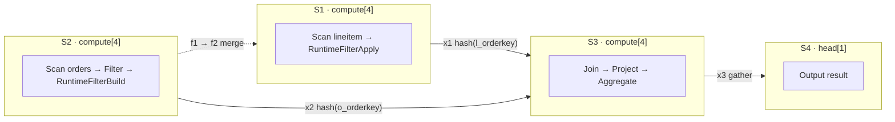

# Conventions

## Code comes in pairs

Choose the C++ or Rust tab to follow an example. Later snippets in a chapter usually continue
with the variables already in scope. C++ examples use the book's `SIRIUS_TRY` macro to return
an error from the enclosing function. Rust uses `?`.

The examples illustrate the proposed API. For the subset available on upstream
`main`, see [What exists upstream](introduction.md#what-exists-upstream).

### Getting Sirius

The public C++ configuration and context headers live under `<sirius/context/>`. Use C++23
and link the CMake target `sirius::sirius`, or `sirius::sirius_static` for a static build.
The safe Rust crate is `sirius`. Its `ContextConfigBuilder::new()` returns a
`Result`. The umbrella header `<sirius/sirius.hpp>` and `sirius::prelude::*` in the
walkthroughs are proposed conveniences. [Public C++ API](https://github.com/sirius-db/sirius/blob/ef7eb2951a370f4293784549bc05fc46c7cc64f6/docs/api/index.md) · [Rust configuration example](https://github.com/sirius-db/sirius/blob/ef7eb2951a370f4293784549bc05fc46c7cc64f6/rust/crates/sirius/examples/config.rs)

Integrations that share an engine in one process need to link the same shared library. Two
independently linked static copies can each have their own process-wide state.

### Results and errors

The proposed C++ API uses `std::expected<T, Error>`. Match on the error code. The message is
for the reader, and an error may also identify the node, stage or worker involved.

Rust examples that stay in one layer return that layer's error type, for example
`Result<Relation, PlanError>`. Code that crosses layers uses `sirius::Result<T>`.
[API at a glance](reference/api-at-a-glance.md#errors) maps the error codes to Rust variants.

### Shared API conventions

In the proposed API, schemas, expressions, relations and plans are immutable. A transformation
returns a new value. An operation that transfers ownership consumes its handle. For example,
`std::move(prepared).start()` in C++ and `prepared.start()` in Rust each consume one prepared
plan. A builder that produces more than one object names the results.
`build_runtime_filter`, for instance, returns both a relation and a filter.

### Where Rust names differ

In prose, method names use the C++ spelling. These are the corresponding Rust names used in
the examples.

| C++ | Rust | Rule |
|---|---|---|
| `X::create(...)`, `Plan::create_instance(...)` | `X::try_new(...)`, `Plan::try_new_instance(...)` | The proposed plan and context constructors use `try_new`. |
| `ContextConfigBuilder{}` | `ContextConfigBuilder::new()?` | Creating the builder allocates, and Rust returns a failed allocation as an error. |
| `JoinScope::create(...)` | `JoinScope::new(...)` | It cannot fail. |
| `X::defaults()` | `X::default()` | The `Default` trait. |
| `WorkerSet::unsized(...)` | `WorkerSet::try_new_unsized(...)` | `unsized` is a reserved word in Rust. |
| `type()` | `data_type()` | `type` is a keyword in Rust. |
| `and_`, `or_`, `not_`, `auto_`, `volatile_`, `union_` | `and`, `or`, `not`, `Auto`, `Volatile`, `Union` | The plain names are reserved in C++. |
| `size()` on a list | `len()` and `is_empty()` | The Rust names for the length of a list. |
| `truncated()` | `is_truncated()` | A predicate starts with `is_`. |
| `reader.next()` returns an optional batch | `BatchReader` is an `Iterator` | A `for` loop reads it. |
| `Result<T>` with the one `Error` | `Result<T, PlanError>` and so on; `sirius::Result<T>` across layers | One error enum per layer; see [Results and errors](#results-and-errors). |
| `ErrorCode::invalid_plan` | `PlanError::Invalid { .. }` | The variant is the code. |
| `error.location`, `error.worker` | `error.location()`, `error.worker()` | A field in C++, a method in Rust. |
| `ReadPoll` with an `Error` alternative | `Result<ReadPoll, ExecutionError>` | A failure is the `Err` of a `Result`. |
| `WriteFailure`, `TryWriteResult` | `WriteError`, `Result<(), TryWriteError>` | A failure is the `Err` of a `Result`. |
| A `std::vector<std::string>` of column names | `&[&str]` | Names are borrowed: `&["l_orderkey"]`. |
| Any other `std::vector<T>` argument | Any `IntoIterator<Item = T>`; a slice where the call only reads the items (`Expression::call`, `Relation::choose`) | The snippets pass a `Vec` or an array. |
| A default argument | The argument, written out | Rust has no default arguments. |
| `std::move(x).start()` | `x.start()` | A consuming method takes `self`. |

## The `SIRIUS_TRY` helper

The book defines this helper for C++ examples. It evaluates a fallible expression once,
returns the error on failure, and gives the unwrapped value a local name on success.

```cpp
#define SIRIUS_TRY(name, expr)                                                     \
  auto name##_result_ = (expr);                                                    \
  if (!name##_result_) return std::unexpected(std::move(name##_result_).error()); \
  auto name = std::move(name##_result_).value()
```

Use the macro as a statement in a function returning `std::expected`. It declares the named
variable in the surrounding scope, so an `if` or loop around it needs braces.

## Drawing plans

Plan trees show operations and their inputs. Stage diagrams show which workers exchange rows or
values. For the full notation, see [Plan notation](reference/plan-notation.md).

### Text trees

A text tree starts with a [header](reference/plan-notation.md#header) that names the plan and
its form, then lists the worker sets. The book gives each example plan a descriptive title. The
body puts the root first and draws children below it. Here is Q1 (shipped line revenue) from
Part III:

```text
Plan "q1_shipped_revenue" (joined)
worker sets: head[1], compute[4]
Output "result" on head[1]
└─ Exchange x1 gather -> head[1]
   └─ Project [l_orderkey, l_linenumber, revenue = l_extendedprice * (1 - l_discount)]
      └─ Filter l_shipdate <= 1998-09-02
         └─ Scan lineitem [l_orderkey, l_linenumber, l_extendedprice, l_discount, l_shipdate]
                          on compute[4]  shards=files_round_robin
```

Read it from the bottom up, the way rows flow: each worker of `compute[4]` scans, filters and
projects its share of the `lineitem` files, and `x1` gathers the rows onto the one worker of
`head[1]`, where the output is read.

These marks carry most of the meaning:

| Mark | Meaning | Example |
|---|---|---|
| `├─`, `│`, `└─` | Tree rails, three columns per level. Join children: left, then right. | `└─ Filter ...` |
| `name[n]` | A worker set of size n. | `compute[4]` |
| `name[?]` | An unsized worker set, the hosting set of an instance plan. | `frag1[?]` |
| `name#i` | One worker of a set. | `compute#2` |
| `on <set>` | Where a leaf or an `Output` runs. Other nodes run where their input runs. | `on compute[4]` |
| `x<k>` | An exchange id. | `Exchange x1 gather -> head[1]` |
| `~> f1` | This node produces the runtime value `f1`. | `RuntimeFilterBuild ... ~> f1` |
| `<~ f2` | This node consumes the runtime value `f2`. | `RuntimeFilterApply [l_orderkey] <~ f2` |
| `values:` | A header block listing derived runtime values. | `f2 = ValueExchange merge f1 -> compute[4]` |
| `S<k>` | A stage, used in split form. | `Stage S1 on compute[4]` |
| `-> (...)` | A schema, shown only when it matters. | `-> (l_returnflag string, ...)` |
| `type?` | A nullable field in a schema line. A required field has no mark. | `total_revenue sum_state<decimal(38,4)>?` |

Value ids carry a letter for their kind: `f` for filters, `s` for statistics, `b` for
boundaries, `d` for decisions and `a` for assignments. Expressions are infix with bare literals,
such as `l_shipdate <= 1998-09-02` or `c_mktsegment == "BUILDING"`.

A tree shows a plan in one of four forms: *joined* (with `Exchange` nodes, as above), *split*
(one block per stage), *instance* (one worker's view) and *resolved* (runtime decisions filled
in). All four print the same IR at different levels of detail; Part II explains each.

### Mermaid diagrams

A Mermaid diagram draws one box per stage, labelled with its id and worker set. Solid arrows
are data edges, labelled with the exchange. Dotted arrows are value edges, labelled with the
values they carry. A stage is numbered after the exchange that ends it: `S1` sends into `x1`,
`S3` into `x3`, and the output stage takes the next number, `S4`. This is the stage graph of Q4
(urgent March revenue), where a runtime filter built from `orders` travels back to the
`lineitem` scan:



## Naming

`Exchange` names a plan node, `Relation::exchange` the public builder method, and
`EXCHANGE_SINK` an engine operator. A worker such as `compute#2` is a logical execution slot
bound to one GPU. A partition is a subset of rows routed by an exchange. A shard is the part
of a scan assigned to a worker. [Glossary](reference/glossary.md)

## Keys are names, values are expressions

The builder API takes two kinds of arguments and never mixes them:

- **Keys are names.** Group keys, window keys, hash keys, join key pairs, runtime-filter keys and
  sort keys name plain columns of the input, as strings.
- **Values are expressions.** Predicates, projections, measure arguments and join residuals are
  scoped `Expression`s, built from `relation.column(...)` and literals.

To group, hash, join or sort on something computed, **project it first**, name it, and use the
name. This example sorts line items by discounted revenue, where `scan` is a scan of `lineitem`:

```cpp
SIRIUS_TRY(price, scan.column("l_extendedprice"));
SIRIUS_TRY(discount, scan.column("l_discount"));
SIRIUS_TRY(one, Value::decimal("1", 15, 2));
SIRIUS_TRY(one_minus, Expression::literal(one).sub(discount));
SIRIUS_TRY(revenue, price.mul(one_minus));
SIRIUS_TRY(columns, scan.pass_through({"l_orderkey", "l_linenumber"}));
columns.push_back(revenue.named("revenue"));
SIRIUS_TRY(projected, scan.project(std::move(columns)));
SIRIUS_TRY(sorted, projected.sort({SortKey::desc("revenue")}));
```

```rust
let price = scan.column("l_extendedprice")?;
let discount = scan.column("l_discount")?;
let one = Value::decimal("1", 15, 2)?;
let one_minus = Expression::literal(one).sub(&discount)?;
let revenue = price.mul(&one_minus)?;
let mut columns = scan.pass_through(&["l_orderkey", "l_linenumber"])?;
columns.push(revenue.named("revenue"));
let projected = scan.project(columns)?;
let sorted = projected.sort(vec![SortKey::desc("revenue")])?;
```

The plan computes `revenue` once, in the `Project`, and the sort refers to it by name:

```text
Sort [revenue desc]
└─ Project [l_orderkey, l_linenumber, revenue = l_extendedprice * (1 - l_discount)]
   └─ Scan lineitem ...  on local[1]  shards=files_round_robin
```

A downstream join can still use a hash distribution after a projection that passes its key
through unchanged. If the projection computes a different key, the validator needs a new
reason to believe the rows are partitioned on it.

## The C ABI underneath

Given a scan node and its Boolean predicate, the public C builder returns a new filter node
through an output parameter.

```c
#include <sirius-c/plan/plan.h>

#include <stdio.h>

void inspect_filter(const sirius_plan_node* scan, const sirius_expression* predicate) {
    sirius_plan_node* filtered = NULL;
    sirius_error* error = NULL;
    sirius_status status = sirius_plan_filter(scan, predicate, &filtered, &error);
    if (status == SIRIUS_SUCCESS) {
        printf("node kind %u\n", (unsigned)sirius_plan_node_get_kind(filtered));
    } else {
        fprintf(stderr, "filter failed (%u): %s\n", (unsigned)status,
                sirius_error_message(error));
    }
    sirius_error_destroy(error);
    sirius_plan_node_release(filtered);
}
```

Zero means success. A nonzero status is authoritative even if allocating a diagnostic failed.
The node retains the inputs it needs. The caller owns the returned reference and releases it
after use. The same retain/release pattern applies to expressions and plans.
[C plan header](https://github.com/sirius-db/sirius/blob/ef7eb2951a370f4293784549bc05fc46c7cc64f6/include/sirius-c/plan/plan.h)

The engine context has a separate lifetime contract. Releasing the last engine owner and
reporting `runtime_unavailable` after a fatal device failure are part of the proposed
lifecycle. The published context header permits process termination on unrecoverable teardown.
[Current context contract](https://github.com/sirius-db/sirius/blob/ef7eb2951a370f4293784549bc05fc46c7cc64f6/include/sirius-c/context/context.h) · [Proposed contract](https://github.com/sirius-db/sirius/issues/2460)
