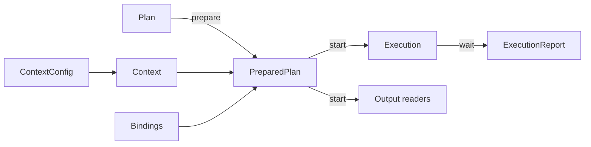

<div class="sirius-wordmark" role="img" aria-label="Sirius"></div>

# Introduction

Suppose four GPUs are working on the same query. To compute total revenue, each GPU sums the
rows it has read. One GPU then needs the partial sum from each of the four. A plan for the
query ought to answer three questions. What crosses between GPUs? Which GPU receives it? What
does the receiver do with it?

Here is how the proposed **Sirius Plan IR** (intermediate representation) answers them. Read
the tree from the leaves up.

```text
Aggregate final
└─ Exchange x1 gather -> head[1]
   └─ Aggregate partial measures=[total_revenue = sum(revenue)]
```

The partial aggregate produces a typed sum state on each worker. The exchange gathers those
states onto a single worker, and the final aggregate merges them. This works whether the
workers share a machine or communicate over a network. The plan specifies which states reach
the receiver. The engine chooses how to transfer them.

## What exists upstream

Sirius already runs GPU queries through DuckDB. Loading the extension lets it intercept
ordinary SQL, and DuckDB can run eligible queries on the CPU when Sirius cannot run them.
Distributed execution also exists. Each rank runs the same SQL in its own DuckDB process, the
planner inserts exchanges, and rank 0 returns the result. [DuckDB integration](https://github.com/sirius-db/sirius/blob/ef7eb2951a370f4293784549bc05fc46c7cc64f6/docs/gpu_execution.md) · [Distributed execution](https://github.com/sirius-db/sirius/blob/ef7eb2951a370f4293784549bc05fc46c7cc64f6/docs/super-sirius/distributed-sirius.md)

The public C API can build and inspect a small physical plan without a GPU. It supports
Boolean and 64-bit integer fields, a local Parquet scan with a supplied schema, column
references, literals, comparisons and filters. The public C++ API exposes configuration and
context creation. The safe Rust crate exposes configuration. There is also an older execution
bridge used by the experimental integrations. These are the interfaces on upstream
`main` at `ef7eb295` (20 November 2026). [C plan builder](https://github.com/sirius-db/sirius/pull/2500) · [C++ headers](https://github.com/sirius-db/sirius/tree/ef7eb2951a370f4293784549bc05fc46c7cc64f6/include/sirius) · [Rust bindings](https://github.com/sirius-db/sirius/tree/ef7eb2951a370f4293784549bc05fc46c7cc64f6/rust/crates)

**This book is a design proposal.** The C++ and Rust walkthroughs show what a caller could write
with a fuller plan API. Upstream proposes delivering execution with completed inputs and
materialized outputs first, then adding live streaming. The distributed plan vocabulary,
validation rules and failure protocols in these chapters are design material for discussion.
[Plan construction](https://github.com/sirius-db/sirius/issues/1750) · [Execution API](https://github.com/sirius-db/sirius/issues/2461)

## From plan to result

You can build a plan without a context. A **worker** is a logical slot for work on one GPU.
An **exchange** says how to divide or replicate rows among workers. For a hash join, for
example, the senders on both inputs must agree on how a key maps to a receiving worker. The
plan records the hash scheme and partition assignment so that agreement can be checked.



Preparing a plan binds workers to endpoints and named inputs to sources. A caller that wants
a different join or exchange builds or rewrites the plan before preparing it. Starting it
returns an execution handle and readers for the outputs hosted in this process. A reader
delivers batches. Waiting on the execution gives its terminal outcome.

## Where to start

- To follow one query from a scan to returned batches, start with [Your first plan](part-1/01-hello-plan.md).
  The examples have C++ and Rust tabs. [Conventions](conventions.md) explains the notation.
- To discuss where planning ends and execution begins, read [Everything in the plan](part-2/01-everything-in-the-plan.md).
  [Partitioned join and runtime filters](part-3/04-partitioned-join-and-runtime-filters.md)
  follows both the rows and the filter through a four-worker join.
- To see what changes when another system schedules the work, compare
  [DuckDB, StarRocks and Distributed Sirius](part-4/04-one-ir-three-integrations.md).
- For the engine changes, start with [From plan to pipelines](part-5/01-from-plan-to-pipelines.md).
  [Open questions](reference/open-questions.md) records the choices the proposal still leaves
  to implementers and hosts.
