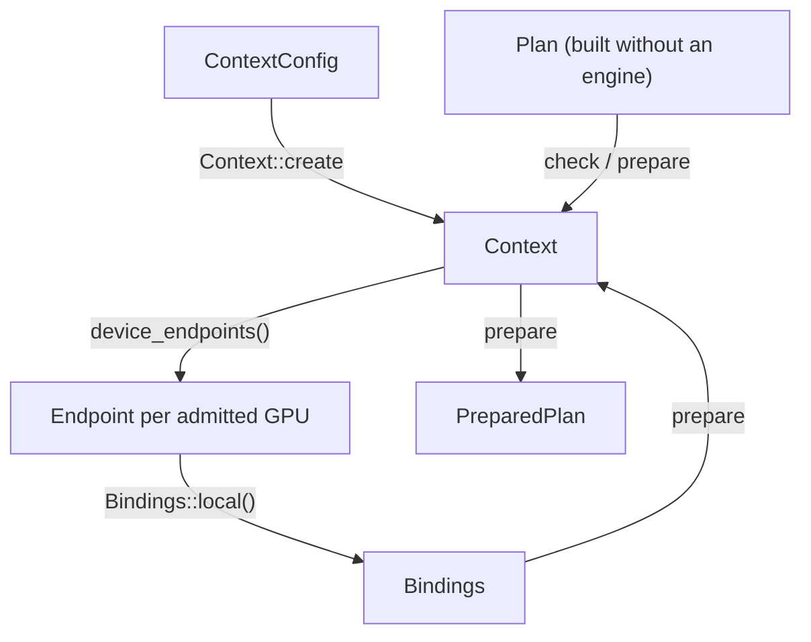
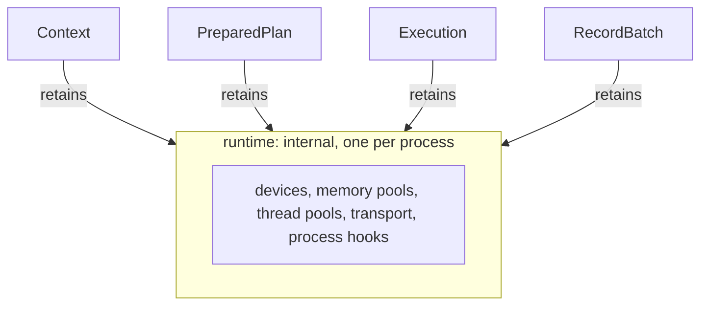

# The context

The current C++ API starts an engine with `Context::create` and returns a
`std::unique_ptr<Context>` on success. It supports one active context per process. The caller
must ensure their lifetimes do not overlap. An unrecoverable rollback or teardown error can
terminate the process, and some process settings survive teardown.
[Public C++ context contract](https://github.com/sirius-db/sirius/blob/ef7eb2951a370f4293784549bc05fc46c7cc64f6/include/sirius/context/context.hpp)

The rest of this chapter describes the proposed execution API. It would enforce the lifetime
limit, let engine-backed objects retain the runtime, and report permanent GPU failures to the
host. [Runtime lifecycle design](https://github.com/sirius-db/sirius/issues/2448) ·
[Context contract proposal](https://github.com/sirius-db/sirius/issues/2460)



You build a plan without a context, as in [Your first plan](01-hello-plan.md), and bring it to
the context to check or prepare it.

## The context: your handle to the engine

Sirius separates the handle you hold from the thing that runs:

- The **runtime** is internal. A process has one, and it owns every GPU-bound resource: devices,
  memory pools, thread pools, the transport and process-wide hooks. It is reference-counted and
  has no public type.
- A **`Context`** is a public handle to the runtime. It retains the runtime. Prepared plans,
  executions, readers and batches are handles to the same runtime.



This book calls the internal runtime *the engine*.

`Context::create` turns a configuration into a running engine:

```cpp
#include <sirius/sirius.hpp>
using namespace sirius;

Result<Context> start_engine() {
  SIRIUS_TRY(config, ContextConfigBuilder{}.build());
  SIRIUS_TRY(context, Context::create(config));
  std::cout << "admitted " << context.devices().size() << " GPUs\n";
  return context;
}
```

```rust
use sirius::prelude::*;

fn start_engine() -> sirius::Result<Context> {
    let config = ContextConfigBuilder::new()?.build()?;
    let context = Context::try_new(&config)?;
    println!("admitted {} GPUs", context.devices().len());
    Ok(context)
}
```

This is the first call in a Sirius program that touches hardware. It does four things:

- **It resolves the configuration.** It discovers the GPUs, applies the device selection, and
  turns every fraction into bytes. It derives operator defaults that depend on capacity; settings
  you gave explicitly keep their values.
- **It starts the engine's services.** It initializes CUDA and telemetry, sets up the memory
  tiers (GPU, pinned host and disk) and starts the thread pools for scans, pipelines and
  spilling.
- **It sets up the transport.** The configuration names it; it carries data between this process
  and others.
- **It admits GPUs.** An *admitted* GPU is one the configuration selected and the context
  brought up. `devices()` lists them.

If any step fails, for example because the configuration asks for a GPU this machine does not
have, `Context::create` returns `context_initialization` and nothing is left running.

A `Context` is **move-only**: you can move it or return it, as `start_engine` does, but not copy
it.

## Endpoints: where workers can run

Every admitted GPU gets one **endpoint**, an opaque value that names "this GPU in this process".
`device_endpoints()` returns them in the same order as `devices()`:

```cpp
for (const Endpoint& endpoint : context.device_endpoints()) {
  std::vector<std::byte> bytes = endpoint.to_bytes();   // what you would send to a launcher
  SIRIUS_TRY(copy, Endpoint::from_bytes(bytes));
  std::cout << "endpoint of " << bytes.size() << " bytes, round trip "
            << (copy == endpoint ? "ok" : "broken") << '\n';
}
```

```rust
for endpoint in context.device_endpoints() {
    let bytes = endpoint.to_bytes(); // what you would send to a launcher
    let copy = Endpoint::from_bytes(&bytes)?;
    println!("endpoint of {} bytes, round trip {}", bytes.len(),
             if copy == *endpoint { "ok" } else { "broken" });
}
```

You can compare endpoints and convert them to and from bytes. You cannot look inside one.

A plan names *logical* workers, such as `local#0` or `compute#2`. An endpoint is a *physical*
place. At prepare, the bindings map each logical worker to an endpoint:

- In a single process, `Bindings::local()` assigns the workers of every set round-robin over this
  context's `device_endpoints()`. With four GPUs and a set `compute[4]`, each worker gets its own
  GPU.
- Across processes, each process sends its endpoints, as bytes, to whatever launches the job.
  Every process then builds the same bindings from the same list; see
  [Stages and bindings](../part-2/04-stages-and-bindings.md).

A worker is bound to one endpoint, so it runs on exactly one GPU
([Workers and worker sets](../part-2/02-workers-and-distribution.md#workers-and-worker-sets)).
Moving rows between two GPUs, even in the same process, is therefore always written in the plan.

## How long a context lives

Three rules govern the engine's lifetime.

**One engine per process.** Create one context early, keep it for the life of the program, and
check and prepare every plan with it. While an engine is alive, a second `Context::create` fails
with `context_initialization` and touches no GPU and no process hook. An engine is alive as long
as any handle holds it: a prepared plan, an execution or a batch is enough. An engine that is
still shutting down also counts.

There is no public get-or-create. Integrations that must share one engine do so internally: every
Sirius-enabled DuckDB database in a process shares one engine, and closing a database drops only
its handle. The limit covers only integrations that link the same shared Sirius library; see
[Getting Sirius](../conventions.md#getting-sirius). Whether a second create with a matching
configuration should share instead of fail is
[open question 15](../reference/open-questions.md#15-one-context-per-process).

**Engine-backed objects retain the runtime.** Several objects can keep the engine alive: the
`Context`, prepared plans, executions, their readers, and every `RecordBatch` the engine hands
you. So does every task in flight. Handles never borrow from each other, so there is no required
drop order, and Rust handles carry no lifetime parameters.

Dropping a handle never throws or terminates the process. Dropping your `Context` does not stop
work in flight: an execution keeps running until it finishes, fails or is cancelled, and its
readers keep working. Dropping an `Execution` may wait; see
[Cancelling](06-prepare-and-execute.md#cancelling).

When the last owner lets go, the engine stops its threads, frees memory only after the GPU work
that used it has completed, and restores the process hooks it installed. Only then can the process
create a new engine.

**A failed engine stays failed.** Two things make the engine unavailable for the whole process: a
fatal device error, such as a sticky CUDA error, and GPU work whose completion the engine cannot
confirm. Nothing recovers the device in place. The execution that hit the fault fails with
`runtime_unavailable`, and subsequent operations that need a working engine return the same code. Building plans needs no
context, so it keeps working.

Drops stay valid. If a drop cannot confirm that the GPU is done with some memory, it still
returns; the engine keeps that memory and becomes unavailable.

An unavailable engine that a handle still holds is alive, so `Context::create` fails with
`context_initialization`, like any second create. When the last owner lets go, the engine is
*abandoned*: it stops its threads, logs once, and keeps its GPU resources until the process
exits. From then on every `Context::create` fails with `runtime_unavailable`.

The two failure codes differ. `execution` means this query failed and the engine is fine, for
example after an I/O error, a recoverable device error, or running out of memory after retry.
`runtime_unavailable` means the engine is down for this process.

Sirius never replays failed work on the CPU. A host with its own CPU engine can rerun the query
from its own plan, and treats `runtime_unavailable` like `unsupported` for every later query; see
[When the device itself fails](../part-5/07-failure-cancellation-and-recovery.md#when-the-device-itself-fails).

## Checking a plan

`context.check()` asks whether this engine build supports every node, type, function and kind
of runtime value in the plan, including every type that crosses between workers. It needs no
bindings, inputs or endpoints:

```cpp
auto support = context.check(plan);
if (!support) {
  const Error& error = support.error();
  if (error.code != ErrorCode::unsupported) return std::unexpected(error);
  std::cerr << "this engine cannot run the plan: " << error.message << '\n';
  return {};
}
std::cout << "supported\n";
```

```rust
match context.check(&plan) {
    Ok(_support) => println!("supported"),
    Err(PrepareError::Unsupported { message, .. }) => {
        eprintln!("this engine cannot run the plan: {message}");
    }
    Err(error) => return Err(error.into()),
}
```

On success you get a `SupportReport`. For a missing feature the error is `unsupported`, with the
node location when available. An `unsupported` plan is still valid; this
engine build cannot execute it, for example because it calls a function the engine does not
implement.

`check()` is one of three places where Sirius checks a plan:

| Where | Question | Typical error |
|---|---|---|
| `Plan::create` / `Plan::from_root` | Is this a well-formed plan? Do scopes, types and distributions line up? | `invalid_plan` |
| `Context::check` | Can this engine build run it? | `unsupported` |
| `Context::prepare` and `start` | Can the bound devices run it? Do the bindings fit the plan? At `start`: do all peers agree? | `unsupported`, `binding_mismatch` |

`prepare()` runs the same support check, so `check()` is optional. `prepare()` also checks the
devices the bindings name, which `check()` cannot see. Either way, a plan the engine cannot run
fails with `unsupported`; Sirius never replans it and never falls back.

Call `check()` when you want the answer before you have bindings, for example in a host that
translates its own plans into the Sirius Plan IR
([Part IV](../part-4/04-one-ir-three-integrations.md)).
[Validation](../part-2/07-validation.md#three-gates) lists every check in all three places.

## Why one object?

The Sirius API has no public session: no planning object sits between the context and your
plans. The engine's internal sessions are not part of the API and appear only in Part V. A public
session would have nothing to hold:

- **Preparation does no planning.** `prepare` checks support, resolves the few properties you
  left as `auto`, and binds. It never rewrites your plan; see
  [Preparing a plan](06-prepare-and-execute.md#preparing-a-plan).
- **Rewrites are calls you make.** A rewrite such as `push_filters_into_scans` is a function from
  one plan to another. You apply it before you prepare, and you can print the result; see
  [Plan-to-plan rewrites](../part-5/05-plan-to-plan-rewrites.md).
- **There is no catalog.** Sirius never looks up a table by name. Every table source carries its
  own [schema](04-schemas-and-expressions.md#fields-and-schemas) and files, so the same plan
  means the same thing in every process.

Here is the plan from [Your first plan](01-hello-plan.md), with its filters pushed into its scans
before it is prepared:

```cpp
SIRIUS_TRY(pushed, rewrite::push_filters_into_scans(plan));
SIRIUS_TRY(prepared, context.prepare(pushed, Bindings::local()));
std::cout << prepared.plan().explain();
```

```rust
let pushed = rewrite::push_filters_into_scans(&plan)?;
let prepared = context.prepare(&pushed, Bindings::local())?;
println!("{}", prepared.plan().explain(&ExplainOptions::default()));
```

The `Filter` line is unchanged and the `Scan` gains a pruning hint;
[Scan, filter and project](../part-3/01-scan-filter-project.md) shows both trees side by side. In
a distributed plan, every process must apply the same rewrites, because the fingerprint covers
the plan you prepare.

Prepared plans do not all run at once: the engine queues work beyond its admission limit, which
defaults to one execution at a time; see
[Admission across processes](../part-5/08-running-at-scale.md#admission-across-processes).

A `Session` may arrive later as a *planning environment*, with a catalog and settings, for
preparing plans that name catalog tables or start from SQL.
