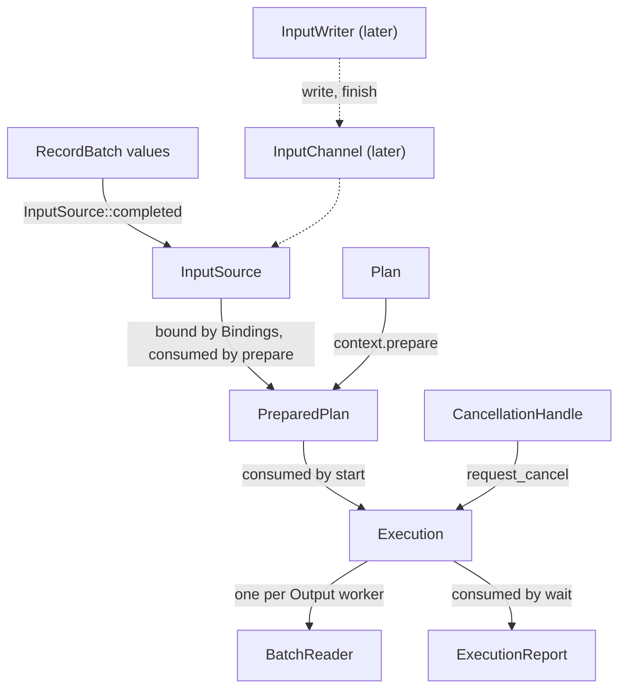

# Prepare and execute

The proposed API separates a reusable plan from one attempt to run it. `prepare` checks support
and binds resources. `start` gives the host an execution handle and output readers. `wait`
returns the outcome.

The first proposed delivery accepts completed inputs and provides blocking reads. Live writers,
polling and bounded input channels come later. [Public execution API proposal](https://github.com/sirius-db/sirius/issues/2461)

## The path from plan to report

Boxes are Sirius objects. An edge label names the call that leads to the next one. Dotted edges
belong to the later, live-streaming delivery.



The plan is unchanged throughout, and batches and the report are plain immutable data. Every other
object except the `CancellationHandle` is a *capability*: a move-only object that stands for the
right to do one thing, consumed when you use it.

## Preparing a plan

`context.prepare(plan, bindings)` takes the plan by reference and the bindings by value, and
returns a `PreparedPlan` or an error. If it fails, everything it acquired is released.

For a plan that runs on `local[1]` and reads only files, `Bindings::local()` is enough. It binds
every worker set round-robin over this context's device endpoints, so `local#0` runs on your first
GPU.

Preparation does four things, in order:

1. **Checks support.** It runs the checks of
   [`context.check(plan)`](03-context-and-session.md#checking-a-plan), then checks the GPUs that
   the bindings name, which `check` cannot see. A valid plan that this build or these devices
   cannot run fails with `unsupported`.
2. **Resolves `auto` properties.** A few worker-local properties may be left `auto` in the plan,
   such as the [build side](07-aggregates-joins-and-ordering.md#the-build-side) of a join.
   Preparation picks each value deterministically from the plan, the engine build and the bound
   devices, without a cost search, and the report records it. An explicit value that the engine
   cannot honor fails with `unsupported`.
3. **Binds.** Workers are mapped to endpoints, named inputs to their sources, and the workers of
   each `Output` to readers. A relative scan path is resolved against the working directory.
   Missing or inconsistent bindings fail with `binding_mismatch`.
4. **Snapshots resources.** The prepared plan holds what it needs to start. Admission and the
   handshake with peers happen at `start`.

Preparation changes no node, routing or partitioning: it never replans, falls back or rewrites.
Bindings say *where*, never *what*
([Bindings: where, never what](../part-2/04-stages-and-bindings.md#bindings-where-never-what)). To
apply a rewrite such as `rewrite::push_filters_into_scans`, call it on the plan before you prepare
it; see [Plan-to-plan rewrites](../part-5/05-plan-to-plan-rewrites.md).

`prepared.plan()` is the plan you built with every `auto` resolved: its `explain()` prints
`build=auto->right` where you left the build side open. `prepared.local_workers()` lists the
workers this process hosts.

`context.prepare_with(plan, bindings, options)` also takes `PrepareOptions`. They tune this one
execution, never what it computes, so they are not part of the plan or its fingerprint. One of
them, `with_first_contact_deadline`, bounds how long each peer of an exchange may take to answer
after `start`; it matters only when a plan spans processes.

### Checking sources early

By default preparation opens no file: each file is checked against the plan when a worker opens it,
during execution ([The source check](05-relations-and-plans.md#the-source-check)). To catch a stale
schema before anything starts, ask for the check at prepare as well:

```cpp
auto options = PrepareOptions::defaults().with_source_check(SourceCheck::at_prepare);
SIRIUS_TRY(prepared, context.prepare_with(plan, Bindings::local(), std::move(options)));
```
```rust
let options = PrepareOptions::default().with_source_check(SourceCheck::AtPrepare);
let prepared = context.prepare_with(&plan, Bindings::local(), options)?;
```

With `SourceCheck::at_prepare`, preparation reads the metadata of every Parquet file in the splits
of the workers this process hosts. It compares the names and types of the scanned columns, and each
declared size, with the plan. A file that does not match, or cannot be read, fails preparation with
`source_mismatch`, located at the scan.

The early check covers the following cases.

- **It covers this process's workers only.** In a plan that spans processes, each process opts in
  for itself, and peers may differ.
- **It skips what it cannot know.** A scan whose splits are claimed at run time
  ([`Shards::dynamic()`](../part-2/02-workers-and-distribution.md#shard-kinds)) has none to read
  yet, and the source of a scan kind registered by the host belongs to the host.
- **It cannot see data.** A null in a `required` column is found only when the column is read.
- **It does not replace the check at open.** A file can change after prepare.

It costs one metadata read per file, so it is off by default (`SourceCheck::at_open`).

## The quickest path: `collect`

`collect()` starts the execution, drains every output and waits for completion, as in the
[first chapter](01-hello-plan.md). `consume` stands for your own code.

```cpp
#include <sirius/sirius.hpp>
using namespace sirius;

Result<void> run_collected(const Context& context, const Plan& plan) {
  SIRIUS_TRY(prepared, context.prepare(plan, Bindings::local()));
  std::cout << prepared.plan().explain();          // as built, auto resolved
  SIRIUS_TRY(collected, std::move(prepared).collect());
  for (const RecordBatch& batch : collected.batches) consume(batch);
  std::cout << collected.report.stages().size() << " stage instances\n";
  return {};
}
```
```rust
use sirius::prelude::*;

fn run_collected(context: &Context, plan: &Plan) -> sirius::Result<()> {
    let prepared = context.prepare(plan, Bindings::local())?;
    println!("{}", prepared.plan().explain(&ExplainOptions::default()));    // auto resolved
    let collected = prepared.collect()?;
    for batch in &collected.batches { consume(batch); }
    println!("{} stage instances", collected.report.stages().len());
    Ok(())
}
```

`collect()` returns a `Collected{batches, report}`, and succeeds only if the whole execution
succeeded. It holds every batch in memory at once, so it suits small results and tests. Read
anything larger as a stream.

## Consuming transitions

`collect()` and `start()` *consume* the prepared plan:

```cpp
SIRIUS_TRY(started, std::move(prepared).start());   // prepared is now moved-from
```
```rust
let started = prepared.start()?;                    // prepared is moved; using it again won't compile
```

A prepared plan is single-use. It is consumed when `start()` succeeds, and also when starting fails
for an operational reason: its resources now belong to the execution or have been released. To run
the plan again, prepare it again with fresh bindings; a plan can be prepared any number of times.

`wait()` consumes the `Execution` in the same way
([Shared API conventions](../conventions.md#shared-api-conventions)).

## Streaming the output

`start()` returns a `StartedExecution` with two fields:

- `execution`: the `Execution`, your handle for progress, cancellation and the final outcome;
- `outputs`: one `OutputReader` per worker of every `Output` node that this process hosts.
  Each has the output's name, the worker it reads from, and a `BatchReader`.

A plan on `local[1]` with one `Output "result"` gives one reader, for `local#0`.

```cpp
SIRIUS_TRY(started, std::move(prepared).start());
BatchReader& reader = started.outputs.front().reader;   // Output "result", worker local#0
while (true) {
  SIRIUS_TRY(batch, reader.next());
  if (!batch) break;                // clean end of stream (not yet success)
  consume(*batch);
}
SIRIUS_TRY(report, std::move(started.execution).wait());
```
```rust
let StartedExecution { execution, mut outputs } = prepared.start()?;
let reader = &mut outputs[0].reader;   // Output "result", worker local#0
for batch in reader {                  // ends at a clean end of stream (not yet success)
    consume(&batch?);
}
let report = execution.wait()?;
```

`next()` blocks until it has a batch, reaches the end of the stream, or sees a failure:

| `next()` returns | Meaning | Later calls |
|---|---|---|
| a batch | One more batch of the output. You own it. | Continue reading. |
| `nullopt` / `None` | Clean end of this stream. | Keep returning end of stream. |
| an `Error` / `Some(Err(error))` | This stream failed; the error carries the cause. | C++ keeps returning the failure. Rust returns `None`. |

Both terminal states are sticky: once a reader has ended or failed, `next()` never returns
another batch. In Rust, `BatchReader` is an `Iterator` over `Result<RecordBatch, ExecutionError>`,
so it yields the failure once and then ends. `wait()` returns the same failure.

### End of stream is not success

**Reaching the end of a reader does not mean the execution succeeded.** A reader reports the end
of *its* stream. The execution may still fail afterwards, for example while another output is
produced or during cleanup. The outcome is what `wait()` returns, so always call it.

If another output fails after this reader has ended, its end stays final. The failure is reported
by `wait()` and by readers that still have work.

### Polling without blocking

`poll()` arrives with the later delivery; until then, read with `next()` or `collect()`.

Use `poll()` to drive several readers from one thread or from an event loop. It never waits, and
returns a batch, `Pending`, `End` or an `Error`. `Pending` means "nothing yet", so an empty queue
is never mistaken for the end of the stream. In Rust the failure is the `Err` of `poll()`, and
`ReadPoll` has the other three.

```cpp
ReadPoll polled = reader.poll();
if (auto* batch = std::get_if<RecordBatch>(&polled)) consume(*batch);
else if (std::holds_alternative<Pending>(polled)) { /* do other work, poll again later */ }
else if (std::holds_alternative<End>(polled)) { /* this stream is done */ }
else return std::unexpected(std::get<Error>(std::move(polled)));
```
```rust
match reader.poll()? {
    ReadPoll::Batch(batch) => consume(&batch),
    ReadPoll::Pending => { /* do other work, poll again later */ }
    ReadPoll::End => { /* this stream is done */ }
    _ => {}   // ReadPoll is non-exhaustive
}
```

`next()` and `poll()` follow the same terminal contract, so you can mix them on one reader.

## Waiting and the report

`std::move(execution).wait()` blocks until the execution reaches its terminal state, then returns
an `ExecutionReport` or the execution's error. The report is an immutable record of what happened:

| Accessor | Contents |
|---|---|
| `stages()` | Per stage instance: rows, bytes and time. |
| `exchanges()` | Per sender and receiver of every exchange. |
| `values()` | For every runtime value: its outcome, the kind used, bytes and rows pruned. |
| `decisions()` | Every runtime decision: its label and inputs. |
| `spills()` | What was spilled and where. |
| `resolved_plan()` | The plan with every runtime decision substituted. |

On `local[1]` most of these are short: one stage instance, no exchanges, no decisions. Part II
uses `decisions()` and `resolved_plan()` to show which alternative an adaptive plan took.

## Feeding completed inputs

Suppose `plan` keeps the urgent orders from the [`Input`](05-relations-and-plans.md#input)
`recent_orders` of the previous chapter:

```text
Output "result" on local[1]
└─ Filter o_orderpriority == "1-URGENT"
   └─ Input "recent_orders" on local[1]
```

A *completed* input supplies every batch before the execution starts; nothing can be added later.
`InputSource::completed(schema, batches)` builds one. It needs no context.

To bind the source, use `Bindings::builder()` instead of `Bindings::local()`. `all_workers_local()`
binds the worker sets as before; `input(name, worker, source)` attaches the source to the `Input`
node's instance on that worker and consumes it.

```cpp
// batches: the std::vector<RecordBatch> to send, each with the orders schema
SIRIUS_TRY(source, InputSource::completed(schema, std::move(batches)));
SIRIUS_TRY(bindings, Bindings::builder()
                         .all_workers_local()
                         .input("recent_orders", WorkerSet::local().at(0), std::move(source))
                         .build());
SIRIUS_TRY(prepared, context.prepare(plan, std::move(bindings)));
SIRIUS_TRY(collected, std::move(prepared).collect());
```
```rust
// batches: the Vec<RecordBatch> to send, each with the orders schema
let source = InputSource::completed(&schema, batches)?;
let bindings = Bindings::builder()
    .all_workers_local()
    .input("recent_orders", WorkerSet::local().at(0), source)
    .build()?;
let prepared = context.prepare(&plan, bindings)?;
let collected = prepared.collect()?;
```

Preparation fails with `binding_mismatch` if the plan has an `Input` that you did not bind, if you
bind a name the plan does not have, or if a source's schema differs from the `Input`'s.

Rows already in Arrow form come in through `RecordBatch::from_arrow(schema, array)`, which adopts
them through the Arrow C Data Interface without a context and without a copy into the engine's
memory pools. `to_arrow` exports a batch. A `RecordBatch` is cheap to copy (`clone()` in Rust) and
a copy shares the same columns, so one set of batches can feed several inputs. The signatures and
the rules for release callbacks, synchronization and lifetimes are in the
[API at a glance](../reference/api-at-a-glance.md#record-batches-and-arrow).

To chain two executions in one process, run the first to completion, then bind its batches as a
completed input of the second. Never feed an input from another live Sirius execution in the same
process: a consumer waiting for admission can leave its producer holding the last slot while it waits for
buffer space. A higher concurrency limit can still fill up.

## Feeding live inputs

Everything in this section arrives with the later delivery; until then, use
[completed inputs](#feeding-completed-inputs).

When rows arrive while the query runs, the same plan reads them through an `InputChannel`, which
has two ends:

- one `InputSource`, the consumer end, which you bind into a prepared plan;
- one or more `InputWriter`s, the producer ends, one per producer.

`InputChannel::create(schema, producers, limits)` creates both ends and needs no context. The
`ProducerCount` is fixed at creation (`ProducerCount::from_size(n)` rejects zero), so the channel
knows how many producers must finish before its stream is complete. `BufferLimits` bounds how much
the channel queues. How you construct one is
[open question 21](../reference/open-questions.md#21-input-buffer-limits), so the snippet takes
`limits` as given.

You bind the channel's source like a completed one, with `input(name, worker, source)`.

```cpp
// limits: a BufferLimits (construction is an open question, see Open questions)
SIRIUS_TRY(producers, ProducerCount::from_size(1));
SIRIUS_TRY(channel, InputChannel::create(schema, producers, limits));
SIRIUS_TRY(bindings, Bindings::builder()
                         .all_workers_local()
                         .input("recent_orders", WorkerSet::local().at(0), std::move(channel.source))
                         .build());
SIRIUS_TRY(prepared, context.prepare(plan, std::move(bindings)));
SIRIUS_TRY(started, std::move(prepared).start());   // start before any blocking write
InputWriter writer = std::move(channel.writers.front());
```
```rust
// limits: a BufferLimits (construction is an open question, see Open questions)
let producers = ProducerCount::from_size(1)?;
let InputChannel { source, mut writers } = InputChannel::try_new(&schema, producers, limits)?;
let bindings = Bindings::builder()
    .all_workers_local()
    .input("recent_orders", WorkerSet::local().at(0), source)
    .build()?;
let prepared = context.prepare(&plan, bindings)?;
let StartedExecution { execution, mut outputs } = prepared.start()?;   // start before any blocking write
let mut writer = writers.remove(0);
```

### Writing and finishing

Each writer knows its channel and its producer slot, so a write takes only a batch. Hand the
writer to a producer thread, write, and finish:

```cpp
// batches: the std::vector<RecordBatch> to send
std::jthread producer([&writer, batches = std::move(batches)]() mutable {
  for (RecordBatch& batch : batches) {
    if (!writer.write(std::move(batch))) break;   // not accepted: closed or failed
  }
  (void)std::move(writer).finish();               // consumes the writer
});
while (true) {
  SIRIUS_TRY(batch, started.outputs.front().reader.next());
  if (!batch) break;
  consume(*batch);
}
producer.join();
SIRIUS_TRY(report, std::move(started.execution).wait());
```
```rust
// batches: the Vec<RecordBatch> to send
let producer = std::thread::spawn(move || {
    for batch in batches {
        if writer.write(batch).is_err() { break; }   // not accepted: closed or failed
    }
    writer.finish()                                  // consumes the writer
});
for batch in &mut outputs[0].reader {
    consume(&batch?);
}
let _ = producer.join();
let report = execution.wait()?;
```

The writer contract:

- **A write accepts the whole batch or returns it.** `write()` blocks until the channel accepts the
  batch. A failure hands the batch back. Acceptance means the channel owns the batch, not that it
  has been processed.
- **`try_write()` never blocks.** It returns `Accepted`, `WouldBlock` (with your batch) or a
  `WriteFailure` (with the error and your batch). Use it from event loops. The Rust spellings are
  in the [API at a glance](../reference/api-at-a-glance.md#live-inputs).
- **`finish()` consumes the writer.** It marks that producer complete. The writer is consumed even
  when the receiver has already closed.
- **Clean end of input needs every producer.** The `Input` node reaches end of stream only when
  every declared producer has finished and every queued batch has been consumed.
- **A dropped, unfinished writer aborts the input.** It never counts as a clean end of stream.
- **Start before blocking.** A channel buffers batches before the execution starts, up to its
  limits. Once it is full, a blocking write stalls because nothing consumes. Start the execution
  first, as the snippet does.
- **Receiver closure is not failure.** If the plan no longer needs the input (for example, a
  `Limit` above it is satisfied), writes fail because the receiver closed. The execution can
  still succeed; `wait()` is the authority.

The snippet shows only the successful path. If reading fails or the producer cannot launch, request
cancellation before you join blocked producer threads, so that nothing waits forever on a channel
nobody serves. Sirius prescribes no thread pool or async runtime; this coordination belongs to your
application.

## Cancelling

`execution.cancellation()` returns a `CancellationHandle`, a small, copyable value with one
method, `request_cancel()`. Use it for a deadline, a Ctrl-C or a host aborting a query.

```cpp
CancellationHandle cancel = started.execution.cancellation();
std::thread([cancel] {
  std::this_thread::sleep_for(std::chrono::seconds(30));
  cancel.request_cancel();     // idempotent; harmless after the execution has finished
}).detach();
auto report = std::move(started.execution).wait();
if (!report && report.error().code == ErrorCode::cancelled) std::cout << "timed out\n";
```
```rust
let cancel = execution.cancellation();
std::thread::spawn(move || {
    std::thread::sleep(std::time::Duration::from_secs(30));
    cancel.request_cancel();   // idempotent; harmless after the execution has finished
});
match execution.wait() {
    Err(ExecutionError::Cancelled) => println!("timed out"),
    other => { other?; }
}
```

A cancellation request:

- is **concurrent and idempotent**: any number of threads can request it, any number of times;
- **wakes blocked readers and writers**: a blocked `next()` or `write()` returns a `cancelled`
  error (this arrives with the later delivery);
- **does not terminate immediately**: workers stop at safe points, and `wait()` returns once they
  have;
- **stays safe after completion**: the handle outlives the execution, so the detached timer above
  is fine.

Dropping the `Execution` also requests cancellation, then waits for workers to stop safely, so the
destructor may block. It never throws or terminates the process, and you need not drain readers
first. If the engine cannot confirm that the GPU work finished, the drop still returns, and the
engine keeps that memory and becomes unavailable; see
[How long a context lives](03-context-and-session.md#how-long-a-context-lives).

Stopping early is not cancelling. Dropping a `BatchReader` before its end closes that output. An
execution whose outputs were all closed ends `closed`, not `cancelled`, and `wait()` still returns
the report. How an execution ends, and how a cancellation reaches workers on other machines, is in
[Failure, cancellation and recovery](../part-5/07-failure-cancellation-and-recovery.md#how-an-execution-ends).

## Who owns what

The consumer
end of an input moves `InputSource -> PreparedPlan -> Execution`. The writers of a live input stay
with your producer tasks.

| Event | What happens |
|---|---|
| An unbound `InputSource` is dropped | A completed source releases its batches. A live channel closes; writers see the receiver closed. |
| Preparation fails after taking a source | The source is released and blocked writers wake. |
| A `PreparedPlan` is dropped without starting | Its bound inputs close. |
| Starting fails | Acquired resources are released and affected channels close. |
| The execution finishes early (for a limit) | Unused inputs close; writers see the closure. |
| The `Execution` is cancelled or dropped | Blocked readers and writers wake and workers stop safely. |

Engine-backed handles and result batches keep the engine alive, and handles never
borrow from each other. You can drop them in any order, and a drop never throws; see
[How long a context lives](03-context-and-session.md#how-long-a-context-lives).

The thread-safety contracts below are targets, pending an audit:

| Types | Contract |
|---|---|
| `Plan`, `Schema`, `ExecutionReport` | Immutable and shareable (`Send + Sync`) |
| `Context` | Shared between threads; executions may still run one at a time |
| `PreparedPlan`, `Execution` | Movable to another thread (`Send`), one caller at a time |
| Each `InputWriter` or `BatchReader` | One caller per reader or writer; different ones run concurrently |
| `CancellationHandle` | Concurrent requests |
| `RecordBatch` | Immutable once built; cheap to copy (`Clone`), movable and shareable (`Send + Sync`) |

## Where did output routing go?

Some execution APIs route outputs at prepare time. Routing decides what each worker ends up with,
so Sirius keeps it in the plan: a single destination, a broadcast or a hash-partitioned result is
an `Exchange` with mode `gather`, `broadcast` or `hash` before the `Output`. Preparation only
binds, and on `local[1]` there is nothing to route. The full mapping is in
[Routing moves into the plan](../part-2/01-everything-in-the-plan.md#routing-moves-into-the-plan),
and the exchanges are in [Exchanges](../part-2/03-exchanges.md).

## Errors, by phase

The phase tells you how far you got, and in Rust it also decides the error enum
([Results and errors](../conventions.md#results-and-errors)):

| Phase | Typical codes | Rust enum | What it means |
|---|---|---|---|
| Building relations and plans | `invalid_plan` | `PlanError` | Structure, scope, type or distribution is wrong, or the registry does not know a function. Fix the builder code. |
| `context.check`, `prepare` | `unsupported` | `PrepareError` | The plan is valid, but this engine build (or, at `prepare`, the bound devices) cannot run it or cannot honor an explicit property. |
| `prepare`, `start` | `binding_mismatch` | `PrepareError` from `prepare`, `ExecutionError` from `start` | Bindings are incomplete or inconsistent, or the `ExecutionId` ([Stages and bindings](../part-2/04-stages-and-bindings.md)) was already used by a worker this process hosts. |
| `start` | `transport` | `ExecutionError` | A peer did not answer before the first-contact deadline (`PrepareOptions::with_first_contact_deadline`). |
| `prepare` with `SourceCheck::at_prepare`, readers, `wait()` | `source_mismatch` | `PrepareError` from `prepare`, `ExecutionError` from readers and `wait()` | A scanned file does not match what the plan declares for it. Rebuild the plan from the current files, or fix the files. |
| Readers, `wait()` | `execution`, `transport`, `cancelled` | `ExecutionError` | Something failed or was cancelled while running. |
| Operation requiring a healthy engine | `runtime_unavailable` | `ContextError`, `PrepareError` or `ExecutionError`, by the call | The engine is down for this process. Restart the process to use the GPU again. |

When one worker fails, its diagnostic includes its origin and plan location where available; see
[How an execution ends](../part-5/07-failure-cancellation-and-recovery.md#how-an-execution-ends).

`execution` fails this query only; `runtime_unavailable` means the engine is down for the process.
See [How long a context lives](03-context-and-session.md#how-long-a-context-lives) and
[When the device itself fails](../part-5/07-failure-cancellation-and-recovery.md#when-the-device-itself-fails).

An error that refers to a node carries its `NodeId` as the location, so you can find the node in
`explain()` output: `error.location` in C++, `error.location()` in Rust.
