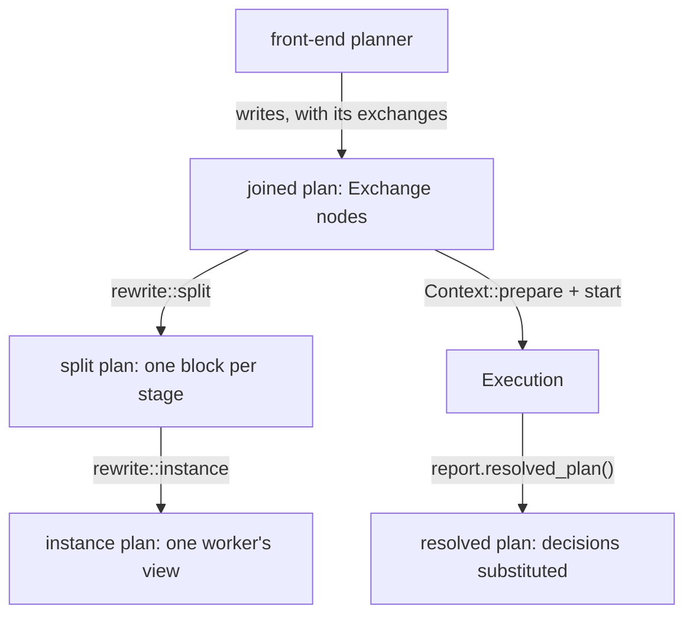

# Everything in the plan

On one GPU a join can read both of its inputs directly. On four GPUs, matching rows can be in
different places. The proposed plan records how to bring them together and which properties the
next operator may rely on.

## The ownership rule

> The plan owns every fact two workers must agree on, and every distribution or ordering property
> later nodes rely on. The engine owns how each edge is carried out, and any choice the plan leaves
> open.

The plan's side covers every value computed, the types at every boundary, every exchange and every
runtime value that crosses workers. What the plan fixes about one edge is its **logical edge**. How
the engine carries it out is its **physical shape**. [The logical edge and its physical
shape](#the-logical-edge-and-its-physical-shape) lists both.

For a hash exchange the plan fixes which worker owns a key. The engine chooses the route
the bytes take. The plan may deliberately leave row placement open. A round-robin exchange, for instance,
promises to distribute its input but gives a downstream join no guarantee about matching keys.

The following rules apply to plans built with the proposed API.

1. **Everything that moves is a node.** Every movement of rows between workers is an `Exchange`.
   A [worker](02-workers-and-distribution.md#workers-and-worker-sets) is bound to exactly one GPU,
   so that includes a move between two GPUs in one process. Every runtime value that crosses
   workers travels through a `ValueExchange`. The front-end places these nodes, by hand or through
   helpers and rewrites it calls. Sirius adds none and checks them all. The transport (same
   device, peer copy or network) follows from the bindings and belongs to the physical shape.
2. **If two workers must agree on it, it is in the plan.** Examples: the hash scheme, the partition
   count, filter kinds and geometry, range boundaries, broadcast versus partitioned, sender sets
   and aggregate state types.
3. **Runtime choices are plan values.** An adaptive choice is a `Decide` node with a pure
   policy and enumerated, labeled alternatives: exchange modes, partition counts, or whole
   subtrees under a `Choose`. The `ExecutionReport` records the chosen label.
4. **Bindings say where, never what.** Preparation binds logical workers to endpoints and named
   inputs to sources. It never changes nodes, routing, partitioning or a scan's shard rule.
5. **Builders may help; plans may not hide.** Convenience helpers expand into ordinary nodes, and
   `explain()` shows the expansion.
6. **Rewrites are plan-to-plan.** Every rewrite produces another plan in the same IR that you can
   print, diff and execute. Preparation applies no rewrites: a host that wants one calls it
   before it prepares.

## The questions a single-worker plan leaves open

Take the urgent-March-revenue query from the running example: total discounted revenue per order,
for orders placed in March 1995 with priority "1-URGENT". On one worker the plan looks like this.

```text
Plan "q4_urgent_march_revenue" (joined)
worker sets: local[1]
Output "result" on local[1]
└─ Aggregate keys=[o_orderkey, o_orderdate] measures=[revenue = sum(rev)]
   └─ Project [o_orderkey, o_orderdate, rev = l_extendedprice * (1 - l_discount)]
      └─ Join inner keys=[l_orderkey == o_orderkey] build=right  mode=single
         ├─ Scan lineitem [l_orderkey, l_extendedprice, l_discount]  on local[1]  shards=files_round_robin
         └─ Filter o_orderdate >= 1995-03-01 and o_orderdate < 1995-04-01 and o_orderpriority == "1-URGENT"
            └─ Scan orders [o_orderkey, o_orderdate, o_orderpriority]  on local[1]  shards=files_round_robin
```

With four workers, the two scans can read matching rows on different GPUs. This version hashes
both inputs on order key. The orders workers also merge a Bloom filter and send it back to the
lineitem workers so they can discard some rows before the shuffle.

```text
Plan "q4_urgent_march_revenue" (joined)
worker sets: head[1], compute[4]
values:
  f2 = ValueExchange merge f1 -> compute[4]
Output "result" on head[1]
└─ Exchange x3 gather -> head[1]
   └─ Aggregate keys=[o_orderkey, o_orderdate] measures=[revenue = sum(rev)]
      └─ Project [o_orderkey, o_orderdate, rev = l_extendedprice * (1 - l_discount)]
         └─ Join inner keys=[l_orderkey == o_orderkey] build=right  mode=co_partitioned(x1, x2)
            ├─ Exchange x1 hash(l_orderkey) -> compute[4]
            │  └─ RuntimeFilterApply [l_orderkey] <~ f2  wait=never
            │     └─ Scan lineitem [l_orderkey, l_extendedprice, l_discount]  on compute[4]  shards=files_round_robin
            └─ Exchange x2 hash(o_orderkey) -> compute[4]
               └─ RuntimeFilterBuild keys=[o_orderkey] spec=bloom(fixed 8MiB)  scope=partial ~> f1
                  └─ Filter o_orderdate >= 1995-03-01 and o_orderdate < 1995-04-01 and o_orderpriority == "1-URGENT"
                     └─ Scan orders [o_orderkey, o_orderdate, o_orderpriority]  on compute[4]  shards=files_round_robin
```

The aggregate needs no second exchange: the inner join's output is already hashed on `o_orderkey`,
one of its group keys. [The Distribution
property](02-workers-and-distribution.md#the-distribution-property) follows the distributions up
this tree.

## Three examples that motivated the design

### Exchanging filter information between workers

The orders workers each see only some build keys. A lineitem worker that relied on a single
worker's Bloom filter could discard a row that matches on another worker. Merging the four
filters gives every lineitem worker the information it needs to rule out a match.

```text
values:
  f2 = ValueExchange merge f1 -> compute[4]
RuntimeFilterApply [l_orderkey] <~ f2  wait=never
RuntimeFilterBuild keys=[o_orderkey] spec=bloom(fixed 8MiB)  scope=partial ~> f1
```

`wait=never` lets early rows through while the merge is in flight. The join checks all
candidates, including Bloom false positives. [Runtime filters](05-runtime-filters.md)

### A broadcast exchange

In Q3 the nation table has only 25 rows. Broadcasting it lets each worker join the customers
it scanned against a complete copy.

```text
Join inner keys=[c_nationkey == n_nationkey] build=right  mode=broadcast_build
├─ Filter c_mktsegment == "BUILDING"
└─ Exchange x1 broadcast -> compute[4]
```

A right outer join cannot use the same plan: a worker with no matching customer for a nation
cannot tell whether another worker found one. [Broadcast join](../part-3/03-broadcast-join.md)

### Partial and final aggregation across workers

For a pricing summary, every row with the same return flag and line status belongs to one group.
A worker can aggregate its own rows before it sends anything. The hash exchange then brings the
states for each group to the worker that will finish it.

```text
Aggregate final keys=[l_returnflag, l_linestatus]
└─ Exchange x1 hash(l_returnflag, l_linestatus) -> compute[4]
   └─ Aggregate partial keys=[l_returnflag, l_linestatus] ...
```

The exchange carries typed state columns. An average, for example, needs the sum and count
from each worker so the final can recover the global average. [Aggregation](../part-3/02-aggregation.md)

## Routing moves into the plan

Some execution APIs route outputs at prepare time: you tell `prepare` whether the output goes to
a single place, is broadcast, or is hash partitioned across destinations. Where result rows go
decides what each receiving worker ends up with, so Sirius keeps routing in the plan. Preparation
only binds readers to the `Output` workers the plan names.

| Routing at prepare time | Sirius (routing in the plan) | Readers |
|---|---|---|
| `OutputRouting::single()` | `Exchange::gather(head)`, then `Output` on `head[1]` | One, in the process hosting `head#0` |
| `OutputRouting::broadcast(destinations)` | `Exchange::broadcast(consumers)`, then `Output` on `consumers[n]` | One per worker of `consumers`; each sees every row |
| `OutputRouting::hash_partitioned(destinations, keys)` | `Exchange::hash(keys, consumers)`, then `Output` on `consumers[n]` | One per worker; each sees its partition |
| (no counterpart) | No exchange; `Output` on `compute[4]` | Four; each sees what its worker produced |
| `Destinations` | A `WorkerSet` in the plan, plus a `WorkerBinding` in the bindings | n/a |
| `InputBindings` | `BindingsBuilder::input(name, worker, source)` | n/a |

`Output` gives one `OutputReader` per worker of its set, delivered to the process hosting that
worker ([Readers go where the Output
lives](04-stages-and-bindings.md#readers-go-where-the-output-lives)). The exchange in front of
`Output` sets the shape of the result.

```cpp
SIRIUS_TRY(gathered, revenue_rows.exchange(Exchange::gather(head)));
SIRIUS_TRY(plan, Plan::from_root(gathered));          // adds Output "result" on head[1]
SIRIUS_TRY(prepared, context.prepare(plan, Bindings::local()));
SIRIUS_TRY(started, std::move(prepared).start());
for (auto& out : started.outputs) {
  // out.output == "result", out.worker is head#0: exactly one reader
}
```
```rust
let gathered = revenue_rows.exchange(&Exchange::gather(&head, GatherOrder::any()))?;
let plan = Plan::from_root(&gathered, "result")?;     // adds Output "result" on head[1]
let prepared = context.prepare(&plan, Bindings::local())?;
let started = prepared.start()?;
for out in &started.outputs {
    // out.output == "result", out.worker is head#0: exactly one reader
}
```

Producer counts stay out of the plan. How many writers feed a channel is a property of the channel,
so `ProducerCount` belongs to `InputChannel`, the live input that comes later.

## What stays implicit

### The logical edge and its physical shape

| The plan owns the logical edge | The engine owns its physical shape |
|---|---|
| Mode, keys, hash scheme, partition count, null routing and durability | Transport, chunking and compression |
| Target set, sender set and ordered destinations | Flow control, credits and connection pooling; where a spool lives |
| For a value edge: kind, merge rule and wait policy | Direct delivery or forwarding through an intermediate worker, and the shape of a merge or a shuffle |

In Q4, the Bloom merge and the hash exchange each allow several physical implementations.

- `f2 = ValueExchange merge f1 -> compute[4]` says that every compute worker ends up with the OR of
  all four partial filters. On two hosts, the engine may OR the two shares on each host and send
  one filter per host over the network, or reduce the shares in a tree or a ring. Bitwise OR
  is associative and commutative, so every worker ends up with the same `f2`.
- `Exchange x1 hash(l_orderkey) -> compute[4]` says that partition p lands on `compute#(p mod 4)`.
  The engine may run it as a two-level shuffle: between the GPUs of one host over NVLink, then
  across the network. `compute#2` still ends up with exactly partition 2.

Combining partial aggregate states on each host before they cross the network looks similar but
belongs to the plan. It changes which rows cross a worker boundary, so it is a plan rewrite that
inserts an explicit combine phase (`aggregate_combine`).

### Inside one worker

The engine owns everything that happens to the rows a worker holds.

- **Kernels and algorithm variants.** Which hash table, which sort, whether a join builds once and
  probes in place or splits itself into pieces inside the worker. The plan can fix a worker-local
  property such as a join's build side, or leave it `auto` for preparation to resolve
  ([Preparing a plan](../part-1/06-prepare-and-execute.md#preparing-a-plan)).
- **Batch sizes.** How many rows flow through an operator at a time.
- **Task scheduling.** Which pipeline runs next and on which stream.
- **Pipeline fusion.** Which nodes run back to back without materializing in between.
- **Memory tiers and spilling.** Moving data between GPU memory, pinned host memory and disk.
- **Local sub-partitioning inside one worker.** Splitting a worker's rows into smaller pieces to fit
  memory, for example to run a join or a sort out of core
  ([The seed rule](../part-5/02-exchanges-in-the-engine.md#the-seed-rule)).
- **The choice among a filter's allowed kinds, while the filter never leaves one worker.** Once a
  filter crosses workers the plan fixes its allowed kinds and merge rule so receivers can interpret it.

### Where the plan says `arbitrary`

Where a distribution is `arbitrary`, the plan states only that each worker ends up with some share
of the rows. The engine or the host picks which. Batch boundaries, which rows a `round_robin`
exchange sends to which worker, and which *n* rows a per-worker `Limit` keeps are such choices. No
later node can rely on them.

Results are therefore deterministic only up to the nondeterminism SQL already allows: row order
without `ORDER BY`, which rows a `LIMIT` returns without `ORDER BY`, which of two rows with equal
order keys a window numbers first, and floating-point summation order. Within those limits, engine
choices change only speed and memory use, so the engine can improve them without touching a plan
([Inside the engine](../part-5/01-from-plan-to-pipelines.md)).

## One plan, many forms

A plan passes through several *forms* on its way to execution. Every form is the same IR (rule 6),
so you can print and diff any two.



- The **joined plan** is what the front-end writes, with every exchange in it. Validation rejects
  a missing or misplaced exchange with an error that says what to insert
  ([Validation](07-validation.md)).
- The **single-worker plan** of Part I is a joined plan whose only set is `local[1]`. It runs as
  is. Whether a helper should spread one over the GPUs of one machine is [open question
  36](../reference/open-questions.md#36-a-distribution-helper-for-one-machine).
- `rewrite::split` cuts the joined plan at every exchange into **stages**. Each exchange becomes an
  `ExchangeSink` at the root of the sending stage and an `ExchangeSource` in the receiving stage
  ([Stages and bindings](04-stages-and-bindings.md)).
- `rewrite::instance` shows one worker's view, with concrete files and partitions.
  `Plan::create_instance` builds the same form directly, for a host that plans one worker at a
  time.
- After execution, `resolved_plan()` gives the **resolved plan**, where every adaptive decision is
  replaced by the chosen alternative ([Adaptive plans](06-adaptive-plans.md)).

## Three hosts, one plan

Part IV applies the same proposed preparation API to three hosts.

- The DuckDB extension would translate its optimized plan into builder calls. [DuckDB integration](../part-4/01-duckdb-extension.md)
- StarRocks would supply one plan for each fragment instance it schedules. [StarRocks integration](../part-4/02-starrocks.md)
- The Distributed Sirius processes would each supply the same joined plan. [Distributed integration](../part-4/03-distributed-sirius.md)
