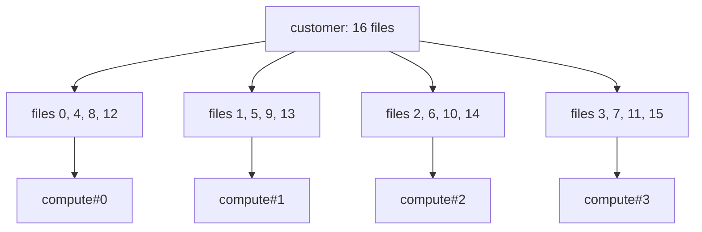

# Workers and distribution

On four GPUs, the fact that each worker has *some* orders is enough for a filter. To finish a
grouped sum, it matters whether each worker has *all* the orders for its groups. A worker set
names the participants. A distribution records what each operator can assume about their rows.

## Workers and worker sets

A **worker** is a logical execution slot bound to exactly one GPU. A **worker set** is a named
group of workers, created with `WorkerSet::create` from a name and a size.

```cpp
#include <sirius/sirius.hpp>
using namespace sirius;

Result<void> declare_sets() {
  SIRIUS_TRY(head, WorkerSet::create("head", 1));
  SIRIUS_TRY(compute, WorkerSet::create("compute", 4));
  WorkerRef third = compute.at(2);         // printed compute#2
  WorkerSet local = WorkerSet::local();    // "local", size 1: the default for every leaf
  return {};
}
```
```rust
use sirius::prelude::*;

fn declare_sets() -> Result<(), PlanError> {
    let head = WorkerSet::try_new("head", 1)?;
    let compute = WorkerSet::try_new("compute", 4)?;
    let third = compute.at(2);         // printed compute#2
    let local = WorkerSet::local();    // "local", size 1: the default for every leaf
    Ok(())
}
```

A set prints as `compute[4]` and its workers as `compute#0` through `compute#3`. The plan header
lists the sets in declaration order:

```text
Plan "q1_shipped_revenue" (joined)
worker sets: head[1], compute[4]
```

Worker sets have three properties.

- **Workers are logical.** `compute#2` is a name. At prepare time, bindings map each worker to an
  `Endpoint`, a (process, GPU) pair, so the same plan runs on four GPUs in one machine or on two
  hosts with two GPUs each. See [Stages and bindings](04-stages-and-bindings.md).
- **Sizes are part of the plan.** The partition count of a hash exchange, the number of range
  boundaries and the shard assignment of a scan all depend on the set size, and every worker has
  to agree on them.
- **`local[1]` is the default.** Every plan in Part I ran on `local[1]`, the set
  `WorkerSet::local()` returns. On a size-1 set every relation is on one worker, so those plans
  needed no exchanges.

A plan may use several sets. The running example uses `head[1]` for the final steps and
`compute[4]` for the rest. Workers of different sets may share a GPU: in the cluster deployment
`head#0` and `compute#0` are bound to the same device. Bindings decide that, and the plan does not
change.

### Sized and unsized sets

Every set so far is **sized**: the plan states its size. A set can also be **unsized**, printed
`scan[?]`. You still name its workers by index, but the plan does not say how many there are.

```cpp
SIRIUS_TRY(scan, WorkerSet::unsized("scan"));   // printed scan[?]
WorkerRef me = scan.at(2);                      // printed scan#2
```
```rust
let scan = WorkerSet::try_new_unsized("scan")?;   // printed scan[?]
let me = scan.at(2);                              // printed scan#2
```

Workers agree on edges, not on which siblings run beside them. A worker that scans and sends its
rows to another set never needs to know how many siblings it has, so its plan can leave that
number out.

Only the hosting set of an **instance plan**, a plan built for one worker (see [Instance
plans](04-stages-and-bindings.md#instance-plans)), may be unsized, and only while nothing in the
plan depends on its size. These sets are always sized: the sender set of every edge the plan
receives, the target set of every edge it sends on, a set whose scans use a shard rule, and a set
a `Decide` controls. [Validation](07-validation.md) gives the full list as V24.

A plan that one program builds for all its workers uses sized sets only, as do the plans in this
chapter.

## Putting a scan on a set

A leaf says which set does the work. A scan says it with `ScanOptions`.

```cpp
SIRIUS_TRY(lineitem_rows, Relation::scan(lineitem,
    ScanOptions::on(compute)
        .with_columns({"l_orderkey", "l_linenumber", "l_extendedprice", "l_discount",
                       "l_shipdate"})
        .with_shards(Shards::files_round_robin())));
```
```rust
let lineitem_rows = Relation::scan(&lineitem,
    ScanOptions::on(&compute)
        .with_columns(&["l_orderkey", "l_linenumber", "l_extendedprice", "l_discount",
                        "l_shipdate"])
        .with_shards(Shards::files_round_robin()))?;
```

`ScanOptions::on(set)` moves the scan to `set` and keeps the other defaults of
`ScanOptions::defaults()` (`files_round_robin`, all columns). The scan line in `explain()` names
the set and the shard rule:

```text
Scan lineitem [l_orderkey, l_linenumber, l_extendedprice, l_discount, l_shipdate]
              on compute[4]  shards=files_round_robin
```

For a static shard rule, the builder assigns the splits when it builds the scan. `Relation::scan` takes the file list of the
`TableSource` and the size of the set, and stores in the plan the exact splits each worker reads.
Two processes that build the same plan therefore agree on who reads what without talking to each
other, and no coordinator hands out files at run time. The fingerprint covers those lists, so the
handshake at `start` checks the agreement ([Every process prepares the same
plan](04-stages-and-bindings.md#every-process-prepares-the-same-plan)).

In instance form, the scan prints one worker's list. `lineitem` has 256 files, so `compute#2`
reads 64 of them:

```text
Scan lineitem [l_orderkey, l_linenumber, l_extendedprice, l_discount, l_shipdate]
              files=[2, 6, 10, ..., 254] (64 of 256)
```

The one exception to build-time resolution is `Shards::dynamic()`, which lets the workers of the
set claim splits at run time. See
[Dynamic splits](../part-5/08-running-at-scale.md#dynamic-splits) and
[open question 22](../reference/open-questions.md#22-dynamic-split-assignment).

## Shard kinds

A **shard** is the part of a source that one worker reads. A **split** is the unit of scan work: a
file, or a byte range of a file. `Shards` says how splits are assigned to workers. There are six
kinds.

| Kind | Rule | Resulting distribution | Use when |
|---|---|---|---|
| `files_round_robin()` | File `i` goes to worker `i mod n` | `arbitrary(W)` | The default: files are many and similar in size |
| `byte_ranges(target_bytes)` | Files are laid end to end in list order and cut at every multiple of `target_bytes`; range j goes to worker j mod n; a row group belongs to the range holding its start | `arbitrary(W)` | Files are uneven in size; the cost is reading partial files |
| `replicated()` | Every worker reads every split | `replicated(W)` | The table is small: reading `nation` on every worker can replace a broadcast exchange ([Broadcast join](../part-3/03-broadcast-join.md) compares the two) |
| `explicit_splits(per_worker)` | Worker `k` reads exactly `per_worker[k]` | `arbitrary(W)` | You supply each worker's list |
| `splits(list)` | The one worker an instance plan runs as reads exactly `list` | `arbitrary(W)` | The host's scheduler hands out scan work one instance at a time |
| `dynamic()` | The set's workers claim the splits at run time, each exactly once; the claims are recorded in the report | `arbitrary(W)` | Some workers are slower than others: a worker that finishes early claims more splits |

For a partitioned scan the assignments should cover each split once. In an instance plan the
host must establish coverage across instances. A replicated scan deliberately reads each split on
every worker.

`files_round_robin` and `byte_ranges` are builder conveniences
([rule 5](01-everything-in-the-plan.md#the-ownership-rule)): they compute the lists from the
`TableSource`'s file list, and the joined and split forms print the rule as a label for those
lists. Neither opens a file. `byte_ranges` cuts by sizes that you declare
([Sized files](#sized-files)).

`files_round_robin`, `byte_ranges`, `explicit_splits` and `dynamic` need a sized set, because the
lists, or the claims, depend on its size.

`splits` is legal only in an instance plan, and it works on an unsized set. The host writes into
each instance plan the splits its scheduler assigned to that plan's worker. Covering the whole
source exactly once is then the host's job.

Whoever computes them, the splits are in the plan, never in the bindings
([rule 4](01-everything-in-the-plan.md#the-ownership-rule)).

At a million files, inline split lists make every plan large. A `TableSource` built from a
[split manifest](../part-5/08-running-at-scale.md#split-manifests) lets the scan store its rule
and the manifest's digest instead, and the fingerprint covers the digest.

Each kind has a factory on `Shards`.

```cpp
Shards by_file = Shards::files_round_robin();
Shards by_bytes = Shards::byte_ranges(256 << 20);   // about 256 MiB per range
Shards everywhere = Shards::replicated();
SIRIUS_TRY(by_hand, Shards::explicit_splits({{{"data/nation.parquet", std::nullopt}}}));
SIRIUS_TRY(given, Shards::splits({{"lineitem/07.parquet", std::nullopt}}));   // instance plans
Shards claimed = Shards::dynamic();   // claimed at run time
```
```rust
let by_file = Shards::files_round_robin();
let by_bytes = Shards::byte_ranges(256 << 20);   // about 256 MiB per range
let everywhere = Shards::replicated();
let by_hand = Shards::explicit_splits(vec![vec![Split { uri: "data/nation.parquet".into(),
                                                        byte_range: None }]])?;
let given = Shards::splits(vec![Split { uri: "lineitem/07.parquet".into(),
                                        byte_range: None }])?;   // instance plans
let claimed = Shards::dynamic();   // claimed at run time
```

The outer list of `explicit_splits` has one entry per worker of the scan's set, so the one above
suits a set of size 1. The factory does not know the set, so `Relation::scan` checks the count.
The factory itself fails on a malformed split list.

In instance form, a scan with `splits` prints its list, abbreviated when it is long:

```text
Scan lineitem [l_orderkey, l_extendedprice, l_discount]
              splits=[lineitem/07.parquet[0, 256MiB), lineitem/07.parquet[256MiB, 512MiB), lineitem/19.parquet] (3 splits)
```

Here `files_round_robin` deals the 16 `customer` files to `compute[4]`.



### Sized files

`byte_ranges` is the one shard kind that needs each file's size. Building a plan does no I/O, so
you declare the sizes. A file of a table source is a `DataFile`, a URI with an optional size in
bytes. A plain string is a file without a size, and `DataFile::sized(uri, bytes)` is a **sized
file**.

```cpp
// listing: (uri, size in bytes) pairs from your catalog; lineitem_fields: the lineitem schema
std::vector<DataFile> files;
for (const auto& [uri, bytes] : listing) files.push_back(DataFile::sized(uri, bytes));
SIRIUS_TRY(sized, TableSource::parquet("lineitem", std::move(files), lineitem_fields));
SIRIUS_TRY(by_range, Relation::scan(sized,
    ScanOptions::on(compute).with_shards(Shards::byte_ranges(256 << 20))));
```
```rust
// listing: (uri, size in bytes) pairs from your catalog; lineitem_fields: the lineitem schema
let mut files = Vec::new();
for (uri, bytes) in &listing { files.push(DataFile::sized(uri, *bytes)); }
let sized = TableSource::parquet("lineitem", files, &lineitem_fields)?;
let by_range = Relation::scan(&sized,
    ScanOptions::on(&compute).with_shards(Shards::byte_ranges(256 << 20)))?;
```

`Relation::scan` cuts the ranges by arithmetic on the declared sizes: it lays the files end to end
in list order, cuts the total at every multiple of `target_bytes`, and gives range j to worker
j mod n. A range that crosses a file boundary gives its worker one split per file. Three rules
follow:

- **Every file must be sized.** `byte_ranges` over a source with an unsized file fails at
  `Relation::scan` with `invalid_plan`. The other shard kinds do not use sizes to assign splits.
- **Sizes are plan facts.** The fingerprint covers every declared size, under every shard kind.
  Two processes that declare different sizes for one file hold different plans, and `start` fails
  with `binding_mismatch` (V25) when the peers check the closed plan. The check precedes row
  transfer on that edge. Take the sizes from one place that every
  process shares, such as a catalog.
- **A wrong size is caught.** When a worker opens a sized file whose size differs from the declared
  one, the execution fails with `source_mismatch`
  ([The source check](../part-1/05-relations-and-plans.md#the-source-check)). `TableSource::parquet`
  rejects a declared size of 0, because no Parquet file is empty.

## The Distribution property

A relation's **distribution** says how its rows are spread over its worker set. It is fixed at
construction and returned by `relation.distribution()`. There are six kinds, over a set W.

| Distribution | Meaning |
|---|---|
| `single(W)` | All rows are on the one worker of W; requires \|W\| = 1 |
| `arbitrary(W)` | Rows are spread over W with no promise about which row is where. Each input row has one owner |
| `hashed(keys, sig)` | Each row is on the worker its keys hash to, under partitioning signature `sig` |
| `replicated(W)` | Every worker holds every row |
| `ranged(keys, b)` | Worker i holds the rows whose keys fall in interval i of boundaries `b` |
| `decided(d, [..])` | One of several distributions, chosen at run time by decision `d`; downstream checks use the **meet**, the strongest guarantee all alternatives share |

The signature `sig` in `hashed` records everything two workers must agree on for two hashings to
count as the same; see
[Exchanges](03-exchanges.md#the-partitioning-signature-and-co-partitioning).

A relation may also carry an ordering fact, `sorted(keys)`: each worker's rows are sorted. It says
nothing about global order.

`arbitrary` leaves row placement to the engine or the host; see
[Where the plan says `arbitrary`](01-everything-in-the-plan.md#where-the-plan-says-arbitrary).

Each node derives its output distribution from its inputs by a fixed rule. On a size-1 set,
distribution checks treat any non-replicated distribution as `single(W)`, because every row is on
the one worker.

| Node | Output distribution |
|---|---|
| `Scan` | `arbitrary(W)`, or `replicated(W)` with `shards=replicated` |
| `Values` | `single(W)`, or `replicated(W)` |
| `Input` | `arbitrary(W)` |
| `Filter` | Retained rows stay on their workers. A filter preserves identical replicas only if each copy gets the same predicate result. |
| `Project` | Preserves hash or range placement when it passes the keys through unchanged. Preserving identical replicas also requires the same expression results on each worker. |
| `Aggregate partial` / `combine` | Keeps hash or range partitioning only if every partition key survives as a grouping column. For grouping sets each partition key must occur in every set. Otherwise those partitioning facts are lost |
| `Aggregate` / `Aggregate final` | Same as its (required) input |
| `Join` | Co-partitioned: `hashed` on the keys that are never null-padded (either list for `inner`, the left keys for `left`, `left_semi`, `left_anti` and `mark`, the right keys for `right`, `right_semi` and `right_anti`), `arbitrary` for `full`. Broadcast build: the probe's distribution. Single inputs: `single`. Decided inputs: the meet |
| `Sort`, `TopN`, `Limit` | Keep the placement of retained rows. `Sort` adds local ordering. Multiplicity after a per-worker `TopN` or `Limit` on replicas is unresolved |
| `Window` | Same as its (required) input; never `sorted` |
| `Union` | The common `hashed` if all signatures match and the hash keys occupy the same output positions in the same order; `replicated` if all inputs are; otherwise `arbitrary` |
| `Repeat` | Same as its input, unless its count column is one of the hash or range keys; then `arbitrary` |
| `Exchange` | Set by its mode: `single`, `hashed`, `replicated`, `ranged`, `arbitrary` or `decided`; a `forward` keeps its input's |

**An unresolved case is the multiplicity of replicas.** Broadcast one row to four workers, run
`Limit 1` on each, then gather. The gather receives four copies. Calling the intermediate data
`arbitrary` would allow a later `count(*)` to return four for one input row. The same issue occurs
when a hash exchange takes every replica as an independent input or the arms of a `Choose` differ
in multiplicity. The proposal still needs a rule for consuming a single copy or rejecting such
plans. [Open question 27](../reference/open-questions.md#27-requirements-as-data-and-equivalence-properties)

Applied to the orders side of the urgent-March-revenue plan from the previous chapter, the rules
give:

1. The scan gives `arbitrary(compute[4])`; the filter and the runtime filter build keep it.
2. Exchange `x2` turns it into `hashed([o_orderkey], sig)`.
3. The inner join with the lineitem side, hashed the same way by `x1`, gives every output row equal
   `l_orderkey` and `o_orderkey`, so its output is hashed on either one.
4. The projection keeps `o_orderkey` as a plain column, so the result is still hashed and the
   single-phase aggregate runs without another exchange (V6).
5. The gather `x3` makes it `single(head[1])`, so one worker produces this result.

A left join would be hashed on `l_orderkey` only, because an unmatched line item has a null
`o_orderkey` but stays on the worker its own key hashed to. The projection drops `l_orderkey`, so
that plan would need an exchange before the aggregate.

The builder reports only properties it can derive. A filter may happen to leave all rows on one
worker even though its declared distribution is still `arbitrary`.

Apache DataFusion has a similar split between what a node provides and what it requires of its
inputs; see
[Related designs](../appendix/related-designs.md#requirements-and-the-passes-that-enforce-them).

## Errors the distribution catches

The builder checks distributions at every call, so it rejects a wrong plan as you write it. Two
mistakes are common when you move a plan off `local[1]`.

### A grouped aggregate over scattered rows

Move the scan of Part I's pricing summary to `compute[4]` and call the filtered and projected rows
`priced`. The rows of one group are now spread over four workers, so a single-phase aggregate
could produce up to four answers per group. The builder rejects it.

```cpp
auto attempt = priced.aggregate({"l_returnflag", "l_linestatus"}, measures);
if (!attempt) {
  // attempt.error().code == ErrorCode::invalid_plan
  std::cerr << attempt.error().message << '\n';
}
```
```rust
let attempt = priced.aggregate(&["l_returnflag", "l_linestatus"], measures.clone());
if let Err(err) = attempt {
    // err is PlanError::Invalid { .. }
    eprintln!("{err}");
}
```

```text
invalid_plan: V6: Aggregate keys=[l_returnflag, l_linestatus] reads arbitrary(compute[4]);
a group's rows may be on several workers. Use aggregate_partial and aggregate_final with an
exchange, or hash on the keys first.
```

Under V6, a grouped single-phase or final aggregate needs its input `single`, or `hashed` on a
subset of the group keys. An ungrouped single-phase or final aggregate needs `single`. `relation.aggregate(...)` checks this
when you call it, and `Plan::create` checks it again over the whole graph.

There are two fixes. The first moves the rows so each group lands on one worker, and keeps the
single-phase aggregate:

```cpp
SIRIUS_TRY(by_group, priced.exchange(Exchange::hash({"l_returnflag", "l_linestatus"}, compute)));
SIRIUS_TRY(totals, by_group.aggregate({"l_returnflag", "l_linestatus"}, measures));
```
```rust
let by_group = priced.exchange(&Exchange::hash(&["l_returnflag", "l_linestatus"], &compute,
                                               Partitions::one_per_worker(), HashScheme::v1()))?;
let totals = by_group.aggregate(&["l_returnflag", "l_linestatus"], measures)?;
```

The second aggregates in two phases, which moves partial states instead of rows; see
[Two-phase aggregation, end to end](03-exchanges.md#two-phase-aggregation-end-to-end).

V7 guards replicated inputs: a partial or single-phase aggregate never consumes `replicated` rows
on a set larger than one. If you scan `lineitem` with `shards=replicated` on `compute[4]`, every
worker sees every row, so per-worker sums would count everything four times.

### A join across two sets

In the BUILDING-customers query, `customer` is scanned on `compute[4]` and `nation` on `head[1]`.
A direct join would not say which workers run it or how the nation rows get there.

```cpp
SIRIUS_TRY(on, JoinOn::keys({{"c_nationkey", "n_nationkey"}}));
auto cross_set = building.join(nations, JoinType::inner, std::move(on), JoinOptions::defaults());
// cross_set.error().code == ErrorCode::invalid_plan
```
```rust
let on = JoinOn::keys(&[("c_nationkey", "n_nationkey")])?;
let cross_set = building.join(&nations, JoinType::Inner, on, JoinOptions::default());
// cross_set is Err(PlanError::Invalid { .. })
```

```text
invalid_plan: Join inputs are on different worker sets (compute[4] and head[1]); insert an exchange
```

The fix is the broadcast exchange from the previous chapter,
`nations.exchange(Exchange::broadcast(compute))`. Both inputs are then on `compute[4]`, the build
side is `replicated`, and the join derives `mode=broadcast_build`.

Hashing both inputs on the corresponding join keys would also bring matching rows together.
[Co-partitioning](03-exchanges.md#the-partitioning-signature-and-co-partitioning)
