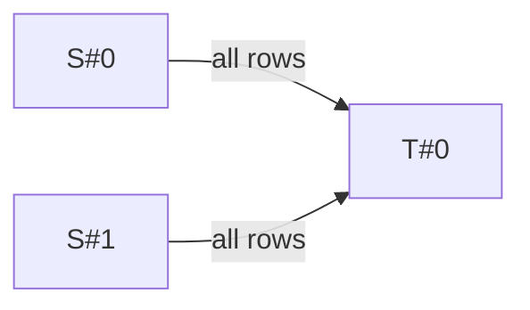
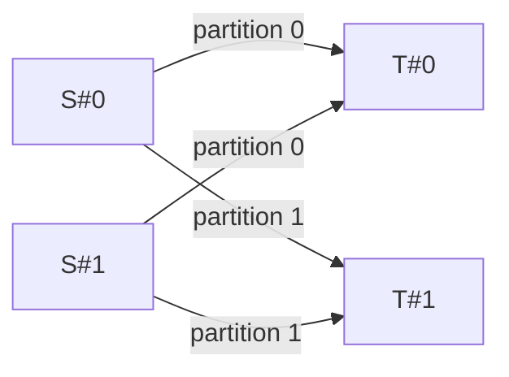
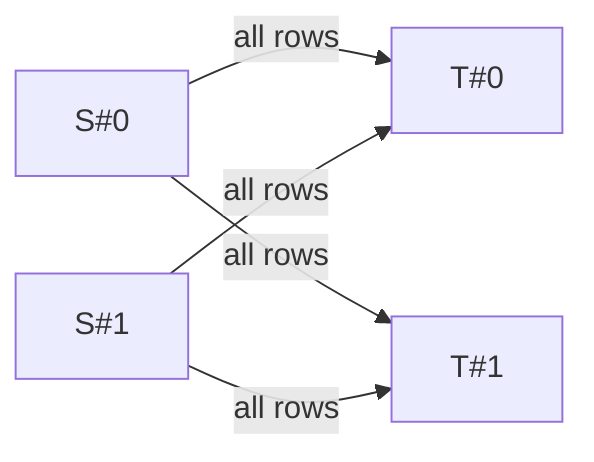
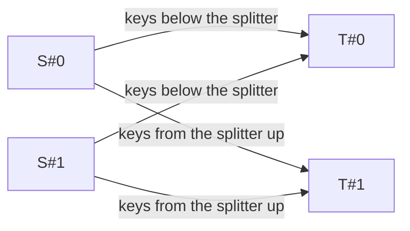
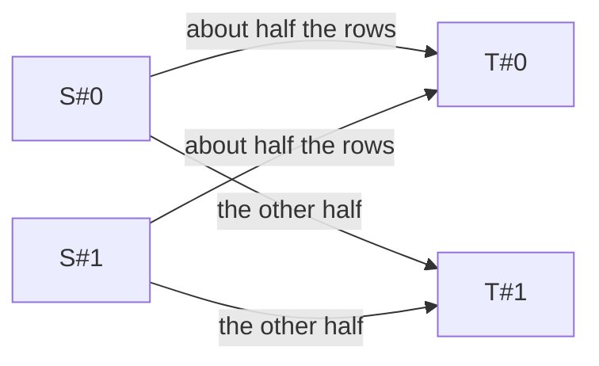
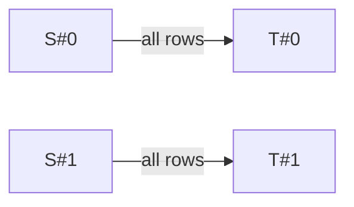
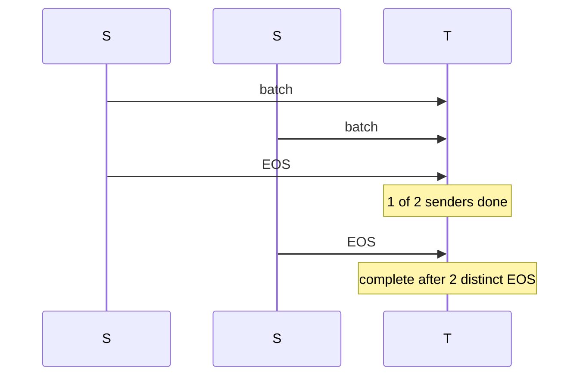
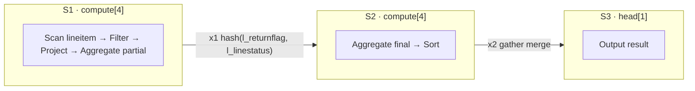

# Exchanges

An exchange routes rows between workers. A hash exchange brings equal join keys together. A
broadcast gives every worker a copy of the build table. A gather collects the results on one
worker. Choosing among them changes both the cost and what the next operator can assume.

## What an exchange is

An `Exchange` moves rows from its input's worker set S to a target set T. Every worker of S is a
**sender**, and the **mode** decides which receiver gets each row. Add one with
`relation.exchange(...)`, passing a value from an `Exchange` factory.

```cpp
#include <sirius/sirius.hpp>
using namespace sirius;

Result<Relation> to_head(const Relation& rows, const WorkerSet& head) {
  return rows.exchange(Exchange::gather(head));   // GatherOrder::any() by default
}
```
```rust
use sirius::prelude::*;

fn to_head(rows: &Relation, head: &WorkerSet) -> Result<Relation, PlanError> {
    rows.exchange(&Exchange::gather(head, GatherOrder::any()))
}
```

Each exchange key must name a plain column of the input, so project computed keys first
([Keys are names, values are expressions](../conventions.md#keys-are-names-values-are-expressions)).
In `explain()` an exchange prints its id, mode and target:

```text
Exchange x1 hash(l_orderkey) -> compute[4]
```

`Plan::create` assigns ids such as `x1` deterministically
([Fingerprints](../part-1/05-relations-and-plans.md#fingerprints)).

## Exchange modes

Each of the seven modes is a factory on `Exchange`. All but `round_robin` fix which receivers get
each row. The pictures use two senders, `S#0` and `S#1`, and two receivers, `T#0` and `T#1`.

### Gather

A **gather** sends every row to T, which must have exactly one worker (V19). The result is
`single(T)`. A gather has an order:

- `GatherOrder::any()`: rows arrive in the order senders produce them.
- `GatherOrder::by_worker()`: all of sender 0's rows, then all of sender 1's, and so on.
- `GatherOrder::merge(keys)`: a k-way merge. The input must be sorted on `keys` within each worker
  (V14), and the output is sorted.

```cpp
std::vector<SortKey> order{SortKey::asc("l_returnflag"), SortKey::asc("l_linestatus")};
Exchange anything = Exchange::gather(head);
Exchange in_turn = Exchange::gather(head, GatherOrder::by_worker());
Exchange merged = Exchange::gather(head, GatherOrder::merge(order));
```
```rust
let order = vec![SortKey::asc("l_returnflag"), SortKey::asc("l_linestatus")];
let anything = Exchange::gather(&head, GatherOrder::any());
let in_turn = Exchange::gather(&head, GatherOrder::by_worker());
let merged = Exchange::gather(&head, GatherOrder::merge(order.clone()));
```



`by_worker` makes a range-partitioned sort globally ordered, and `merge` combines per-worker sorted
runs. [Sort, top-N and limit](../part-3/06-sort-top-n-and-limit.md) compares them.

### Hash

A **hash** exchange sends each row to the worker its keys hash to. Joins and grouped aggregation
use it. All senders must agree on its parameters.

```cpp
SIRIUS_TRY(sixty_four, Partitions::fixed(64));
Exchange by_order = Exchange::hash({"l_orderkey"}, compute);   // one_per_worker, HashScheme::v1()
Exchange finer = Exchange::hash({"l_orderkey"}, compute, sixty_four);
Exchange marked = Exchange::hash({"o_custkey"}, compute, Partitions::one_per_worker(),
                                 HashScheme::v1().with_nulls(NullRouting::to_all));
```
```rust
let sixty_four = Partitions::fixed(64)?;
let by_order = Exchange::hash(&["l_orderkey"], &compute, Partitions::one_per_worker(),
                              HashScheme::v1());
let finer = Exchange::hash(&["l_orderkey"], &compute, sixty_four, HashScheme::v1());
let marked = Exchange::hash(&["o_custkey"], &compute, Partitions::one_per_worker(),
                            HashScheme::v1().with_nulls(NullRouting::ToAll));
```

Keys are first canonicalized: signed integers become int64, and decimals become their
scale-preserving 128-bit form. A row goes to partition `h_v1(canon(keys)) mod P`, and partition `p`
goes to worker `p mod |T|`.

- **`Partitions`** sets P. `one_per_worker()` makes P equal to \|T\|. `fixed(count)` sets it
  directly: with `fixed(64)` on `compute[4]`, worker `compute#2` receives partitions 2, 6, 10 and
  so on, 16 of the 64. `decided_by(decision)` lets a runtime `Decision` choose P
  ([Adaptive plans](06-adaptive-plans.md)). `assigned_by(assignment)` takes P from an observed
  histogram and replaces `p mod |T|` with a partition-to-worker map computed at run time, which
  balances skewed partitions
  ([Skew](../part-5/08-running-at-scale.md#skew-more-partitions-than-workers)). Non-default
  partitions print as `partitions=64`, `partitions=<~d2` or `partitions=16 assign=<~a1`.
- **`HashScheme`** fixes the hash function, its seed and the key canonicalization.
  `HashScheme::v1()` is the only scheme the proposed API defines. It is Sirius-defined, so every
  worker in a hash exchange must be a Sirius worker.
- **`NullRouting`** says where rows with a null key go. The default, `hashed`, treats null as a
  value like any other. `to_all` sends null-key rows to every worker. A co-partitioned mark join
  requires it on its build exchange (V10,
  [Mark joins need the whole build](#mark-joins-need-the-whole-build)). Any other node would see
  those rows once per worker, so nothing else may read a `to_all` exchange (V28).



### The partitioning signature and co-partitioning

A hash exchange produces `hashed(keys, sig)`. The **partitioning signature** `sig` is the tuple of
everything that decides where a row lands:

- the `HashScheme`, including its `NullRouting`;
- the key types;
- the partition count, or the decision that sets it;
- the assignment that maps partitions to workers, if there is one;
- the target set W.

Two edges are **co-partitioned** when their signatures are equal and their keys match position by
position. A hash join over co-partitioned inputs needs no further movement: a lineitem row and an
orders row with order key 42 land on the same worker.

Both keys of a join pair have the same type (V4), so exchanges whose keys differ in type are never
co-partitioned. To join an int32 key with an int64 key, cast one side in a `Project` below its
exchange.
[Hash canonicalization in v1](../reference/extension-points.md#hash-canonicalization-in-v1)
lists how `v1` hashes every key type.

The join from the urgent-March-revenue query has co-partitioned inputs. `probed_lineitem` is the
lineitem scan after its runtime filter, and `filtered_orders` is the filtered orders scan.

```cpp
SIRIUS_TRY(left, probed_lineitem.exchange(Exchange::hash({"l_orderkey"}, compute)));
SIRIUS_TRY(right, filtered_orders.exchange(Exchange::hash({"o_orderkey"}, compute)));
SIRIUS_TRY(on, JoinOn::keys({{"l_orderkey", "o_orderkey"}}));
SIRIUS_TRY(joined, left.join(right, JoinType::inner, std::move(on), JoinOptions::defaults()));
```
```rust
let left = probed_lineitem.exchange(&Exchange::hash(&["l_orderkey"], &compute,
                                                    Partitions::one_per_worker(), HashScheme::v1()))?;
let right = filtered_orders.exchange(&Exchange::hash(&["o_orderkey"], &compute,
                                                     Partitions::one_per_worker(), HashScheme::v1()))?;
let on = JoinOn::keys(&[("l_orderkey", "o_orderkey")])?;
let joined = left.join(&right, JoinType::Inner, on, JoinOptions::default())?;
```

```text
Join inner keys=[l_orderkey == o_orderkey] build=right  mode=co_partitioned(x1, x2)
├─ Exchange x1 hash(l_orderkey) -> compute[4]
│  └─ ...
└─ Exchange x2 hash(o_orderkey) -> compute[4]
   └─ ...
```

The join derives `co_partitioned` from its inputs. Without the exchange on one side, there is
nothing to derive:

```text
invalid_plan: V8: Join inner keys=[l_orderkey == o_orderkey] has no legal mode: its build input is
  arbitrary(compute[4]); insert an exchange
```

The check is exact. The join rejects exchanges whose signatures differ, even when the rows would
line up.

There is one exception. A build exchange with `NullRouting::to_all` matches a probe exchange with
`NullRouting::hashed` when the rest of the signature is equal, because rows with a non-null key go
to the same worker under both. Only a `mark` join may use it
([Mark joins need the whole build](#mark-joins-need-the-whole-build)).

A null-safe key pair
([Null-safe keys](../part-1/07-aggregates-joins-and-ordering.md#null-safe-keys)) needs no
exception. Under `NullRouting::hashed` a null key hashes as one fixed marker, so null keys meet on
one worker. The signature is the same whether the pairs are plain or null-safe.

Set operations are compositions
([Set operations](../part-1/07-aggregates-joins-and-ordering.md#set-operations)), and they need no
new rule. A distinct `INTERSECT` or `EXCEPT` across workers is a null-safe join hashed on every
column. Its output is hashed on the left keys, so the aggregate above it needs no further exchange
(V6). `INTERSECT ALL` and `EXCEPT ALL` need no join, only one hash exchange on every column,
between the `union_all` and the counting aggregate. The nodes above it keep that distribution.

The join type decides which keys the output is hashed on; see the table in
[The Distribution property](02-workers-and-distribution.md#the-distribution-property).

### Mark joins need the whole build

A `mark` join answers true, false or null for each probe row, as SQL's `IN` does. It builds on its
right input, so its probe rows are its left rows. The hash rule brings every build row that
matches a non-null probe key to that probe row's worker, so true is a local answer. With one key
pair, the other two answers depend on the whole build:

- A non-matching probe row gets null when the build holds a null key anywhere, and false
  otherwise. `NullRouting::to_all` on the build exchange puts every null-key build row on every
  worker.
- A probe row with a null key gets null when the build has any rows, and false when it is empty.
  A worker whose own share is empty cannot tell, so the join needs the global row count of its
  build input.

With several key pairs, these two rules do not hold. A probe row (3, 4) against a build row
(1, NULL) is false, because 3 differs from 1. A probe row (1, NULL) against a build row (1, 5) is
null, but the two rows hash to different workers. A co-partitioned mark join with any ordinary equality comparison therefore takes
exactly one key pair (V10). With several pairs including ordinary equality, use a broadcast or
single build. A partitioned form for this case is [open question 17](../reference/open-questions.md#17-join-coverage).

Both rules exist because a comparison with a null is null
([Nulls and NaN](../part-1/04-schemas-and-expressions.md#nulls-and-nan)). A null-safe comparison is
never null, so a mark join whose pairs are all null-safe answers only true or false. It takes any
number of pairs, needs neither `to_all` nor the row count, and is co-partitioned like any other
join. A mark join that mixes plain and null-safe pairs uses a broadcast or single build.

The build row count is a global `Statistics` value
([Runtime filters](05-runtime-filters.md#data-edges-and-value-edges)) passed with
`JoinOptions::with_build_rows`. Here `customers` and `orders` are scans on `compute[4]`, and
`marked` is the `to_all` exchange from the hash section.

```cpp
SIRIUS_TRY(observed, orders.observe(StatisticsSpec::rows()));             // ~> s1
SIRIUS_TRY(build_rows, observed.statistics.merge_to(compute));            // s2, global
SIRIUS_TRY(right, observed.relation.exchange(marked));                    // x2
SIRIUS_TRY(left, customers.exchange(Exchange::hash({"c_custkey"}, compute)));
SIRIUS_TRY(on, JoinOn::keys({{"c_custkey", "o_custkey"}}));
SIRIUS_TRY(flagged, left.join(right, JoinType::mark, std::move(on),
                              JoinOptions::defaults().with_build_rows(build_rows)));
```
```rust
let observed = orders.observe(StatisticsSpec::rows())?;                 // ~> s1
let build_rows = observed.statistics.merge_to(&compute)?;              // s2, global
let right = observed.relation.exchange(&marked)?;                      // x2
let left = customers.exchange(&Exchange::hash(&["c_custkey"], &compute,
                                              Partitions::one_per_worker(), HashScheme::v1()))?;
let on = JoinOn::keys(&[("c_custkey", "o_custkey")])?;
let flagged = left.join(&right, JoinType::Mark, on,
                        JoinOptions::default().with_build_rows(&build_rows))?;
```

```text
values:
  s2 = ValueExchange merge s1 -> compute[4]
Join mark keys=[c_custkey == o_custkey] build=right  build_rows<~s2  mode=co_partitioned(x1, x2)
├─ Exchange x1 hash(c_custkey) -> compute[4]
│  └─ Scan customer [c_custkey, c_name]  on compute[4]  shards=files_round_robin
└─ Exchange x2 hash(o_custkey) nulls=to_all -> compute[4]
   └─ Observe rows ~> s1
      └─ Scan orders [o_custkey]  on compute[4]  shards=files_round_robin
```

The `Observe` sits directly below the build exchange, with nothing between them that can drop
rows, so the count is zero exactly when the build is empty. The join reads only whether the count
is above zero, and holds back only its null-key probe rows until `s2` arrives.

A broadcast or single mark join sees the whole build on every worker, so it needs neither `to_all`
nor the row count.

### Windows need whole groups

A [`Window`](../part-1/07-aggregates-joins-and-ordering.md#window) computes each row's value from
the other rows of its window group, so every row of a group must be on one worker. On `local[1]`
that holds by itself. A scan on `compute[4]` is `arbitrary`, so a `window_ranking` call over it
fails:

```text
invalid_plan: V27: Window ranking keys=[o_custkey] reads arbitrary(compute[4]); a window group's
rows may be on several workers. Hash on the window keys first.
```

A hash exchange on the window keys brings each group together. Here `customer_orders` is the
filtered orders scan on `compute[4]`, and `by_customer` is a hash exchange on `o_custkey` to
`compute`.

```cpp
SIRIUS_TRY(grouped, customer_orders.exchange(by_customer));                     // x1
SIRIUS_TRY(ranked, grouped.window_ranking(
    {"o_custkey"}, {SortKey::desc("o_totalprice")}, {Ranking::rank("price_rank")}));
SIRIUS_TRY(price, ranked.column("o_totalprice"));
SIRIUS_TRY(spent, Measure::sum("spent_so_far", price));
SIRIUS_TRY(running, ranked.window_running(
    {"o_custkey"}, {SortKey::asc("o_orderdate"), SortKey::asc("o_orderkey")}, {spent}));
```
```rust
let grouped = customer_orders.exchange(&by_customer)?;                        // x1
let ranked = grouped.window_ranking(
    &["o_custkey"], vec![SortKey::desc("o_totalprice")], vec![Ranking::rank("price_rank")])?;
let price = ranked.column("o_totalprice")?;
let spent = Measure::sum("spent_so_far", &price)?;
let running = ranked.window_running(
    &["o_custkey"], vec![SortKey::asc("o_orderdate"), SortKey::asc("o_orderkey")], vec![spent])?;
```

```text
Window running keys=[o_custkey] order=[o_orderdate asc, o_orderkey asc]
│  measures=[spent_so_far = sum(o_totalprice)]
└─ Window ranking keys=[o_custkey] order=[o_totalprice desc] rankings=[price_rank = rank()]
   └─ Exchange x1 hash(o_custkey) -> compute[4]
      └─ Filter o_orderdate >= 1996-01-01 and o_orderdate < 1997-01-01
         └─ Scan orders [o_orderkey, o_custkey, o_orderdate, o_totalprice]
                        on compute[4]  shards=files_round_robin
```

A `Window` preserves its input's distribution, so the second node is still `hashed` on `o_custkey`
and the two share `x1`. Three details of the rule (V27):

- **A subset of the keys is enough.** Rows that agree on all window keys agree on any of them, so
  an input hashed on `o_custkey` also serves a window with the keys `o_custkey` and `o_orderdate`.
- **Null keys form groups too.** The hash exchange sends the null-key group to one worker.
  `NullRouting::to_all` is not allowed here (V28).
- **No keys means one worker.** All rows are one group, so the input must be `single`: gather
  first. Spreading such a window over a worker set is [open question
  29](../reference/open-questions.md#29-windows-over-a-global-order-prefix-value-mode).

The order of peers (rows that tie on the order keys) is still the engine's choice, made by the one
worker that holds the group.

### Broadcast

A **broadcast** sends every row to every worker of T. The result is `replicated(T)`.

```cpp
SIRIUS_TRY(everywhere, nations.exchange(Exchange::broadcast(compute)));
```
```rust
let everywhere = nations.exchange(&Exchange::broadcast(&compute))?;
```



Broadcast fits a join with one small input: the join derives `mode=broadcast_build` and the large
side never moves. Every worker that holds a copy would also count it, so replicated rows come with
rules:

- A broadcast build may not be a side the join must preserve, such as the build of a right or full
  join (V9).
- A partial or single-phase aggregate never consumes replicated rows on more than one worker (V7).
- `Union` and `Output` refuse to mix replicated and non-replicated inputs (V11).

### Range

A **range** exchange sends each row to the worker whose interval contains its keys. It needs a
`Boundaries` value with \|T\| - 1 splitters; partition i covers interval i. The result is
`ranged(keys, b)`. Here `orders_1996` is the filtered orders scan on `compute[4]`, and `boundaries`
is a global `Boundaries` value computed from a sample of it.

```cpp
std::vector<SortKey> by_date{SortKey::asc("o_orderdate"), SortKey::desc("o_totalprice")};
SIRIUS_TRY(ranged, orders_1996.exchange(Exchange::range(by_date, boundaries, compute)));
```
```rust
let by_date = vec![SortKey::asc("o_orderdate"), SortKey::desc("o_totalprice")];
let ranged = orders_1996.exchange(&Exchange::range(by_date, &boundaries, &compute))?;
```



The intervals are half-open. Write the splitters as c(1) to c(\|T\|-1), with c(0) minus infinity
and c(\|T\|) plus infinity. Partition i holds the keys k with c(i) <= k < c(i+1), so a key equal to
a splitter goes to the higher partition. Keys are compared in sort order, key by key, with each
key's direction and null placement applied. Under `desc`, "higher" means "sorts later", so the
largest values land on worker 0. The tie rule is part of the
[edge signature](04-stages-and-bindings.md#every-process-prepares-the-same-plan), so all senders
cut ties the same way.

Every sender must cut at the same points, so the boundaries are a global runtime value (V14). A
sample is observed on every worker and merged. A `ComputeBoundaries` node with a global input
(V15) turns it into splitters, weighting each worker's sample by the number of rows that worker
saw. The exchange line shows the source of the boundaries as `<~ b1`.
[Runtime filters](05-runtime-filters.md) introduces the `Boundaries` value, and
[Sort, top-N and limit](../part-3/06-sort-top-n-and-limit.md) builds the whole range, sort and
gather chain.

### Round robin

A **round_robin** exchange deals rows or batches to successive workers of T. Unequal batch sizes can give workers different row counts. The
result is `arbitrary(T)`: the engine chooses which rows go to which worker, and may deal single
rows or whole batches in turn. Use it to spread rows from one place, such as an input on `head[1]`,
over a larger set.

```cpp
Exchange spread = Exchange::round_robin(compute);
```
```rust
let spread = Exchange::round_robin(&compute);
```



### Forward

A **forward** exchange keeps rows where they are: worker i of S sends to worker i of T, and T must
equal S (V19). Its distribution is its input's.

```cpp
Exchange stay = Exchange::forward();
```
```rust
let stay = Exchange::forward();
```



A decided exchange uses `forward` as its "do not move this side" alternative, so the stage graph is
the same whichever alternative wins
([Stage graphs do not change](06-adaptive-plans.md#stage-graphs-do-not-change)).

### Decided

`Exchange::decided_by(decision, alternatives)` holds several labeled modes, all with the same
target (V19), and a `Decision` value computed at run time picks one. Every worker computes the same
label from the same merged statistics, so they all switch together. It prints like this:

```text
Exchange x2 <~ d1 {broadcast: broadcast, partitioned: hash(o_orderkey)} -> compute[4]
```

[Adaptive plans](06-adaptive-plans.md) builds it, and [Adaptive join](../part-3/05-adaptive-join.md)
shows it at work.

## The exchange protocol

Every exchange follows one protocol, and none of it is configurable.

- **End of stream.** Every sender sends end of stream (EOS) to every receiver of every exchange,
  even when it produced zero rows.
- **Completion.** A receiver's input is complete after \|S\| distinct EOS messages, one from each
  sender. A duplicate EOS is harmless. Workers that a gather does not target have no receiving
  side.
- **Close.** A satisfied `Limit` closes its input. Across an exchange, close goes upstream to every
  sender. A sender then drops further batches for that receiver and still sends EOS. Its stage
  stops early once every receiver has closed, and ends `closed`, which is not a failure
  ([Close is not end of stream](../part-5/07-failure-cancellation-and-recovery.md#close-is-not-end-of-stream)).
- **Failure.** Any failure on any worker fails the whole execution. It travels along the plan's
  edges in both directions, and the origin's error, with its worker and plan location, reaches
  every reader and `wait()`
  ([Fail-stop, along the edges](../part-5/07-failure-cancellation-and-recovery.md#fail-stop-along-the-edges)).
- **No backpressure in the plan.** The plan never tells a sender to wait. The engine paces senders
  and spills what a slow receiver cannot take yet. V1 checks that those waits cannot deadlock
  ([Credits and deadlock freedom](../part-5/08-running-at-scale.md#credits-and-deadlock-freedom),
  [open question 5](../reference/open-questions.md#5-backpressure)).

Streams are addressed by (execution id, exchange id, sender worker, receiver worker), all logical
ids; the bindings supply the endpoints
([Every message has a key](../part-5/07-failure-cancellation-and-recovery.md#every-message-has-a-key)).

The plan owns the logical edge, including its durability: whether the sender's output is retained
so a failed sender can be re-run
([Durability](../part-5/07-failure-cancellation-and-recovery.md#durability-pipelined-or-spooled)).
How the edge is carried is the engine's; see the table in
[The logical edge and its physical shape](01-everything-in-the-plan.md#the-logical-edge-and-its-physical-shape).



[Exchanges in the engine](../part-5/02-exchanges-in-the-engine.md) shows how an `Exchange` lowers
onto the engine.

## Two-phase aggregation, end to end

Q2 (pricing summary) groups the line items shipped on or before 1998-09-02 by return flag and line
status. For each group it computes the total quantity, the total discounted revenue, the average
extended price and the number of lines, ordered by flag then status.

The rows of one group are scattered over `compute[4]`, so a single-phase aggregate is illegal (V6,
[shown earlier](02-workers-and-distribution.md#a-grouped-aggregate-over-scattered-rows)). Instead,
each worker aggregates its own rows into partial states, a hash exchange brings each group's
states together, and a final aggregate finishes them. `priced` is the filtered and projected
lineitem rows on `compute[4]`, including the computed `revenue` column.

```cpp
SIRIUS_TRY(qty, priced.column("l_quantity"));
SIRIUS_TRY(revenue, priced.column("revenue"));
SIRIUS_TRY(price, priced.column("l_extendedprice"));
SIRIUS_TRY(sum_qty, Measure::sum("sum_qty", qty));
SIRIUS_TRY(sum_revenue, Measure::sum("sum_revenue", revenue));
SIRIUS_TRY(avg_price, Measure::avg("avg_price", price));
std::vector<Measure> measures{sum_qty, sum_revenue, avg_price,
                              Measure::count_star("count_order")};
std::vector<std::string> keys{"l_returnflag", "l_linestatus"};

SIRIUS_TRY(partial, priced.aggregate_partial(keys, measures));
SIRIUS_TRY(moved, partial.exchange(Exchange::hash(keys, compute)));
SIRIUS_TRY(totals, moved.aggregate_final());
```
```rust
let qty = priced.column("l_quantity")?;
let revenue = priced.column("revenue")?;
let price = priced.column("l_extendedprice")?;
let sum_qty = Measure::sum("sum_qty", &qty)?;
let sum_revenue = Measure::sum("sum_revenue", &revenue)?;
let avg_price = Measure::avg("avg_price", &price)?;
let measures = vec![sum_qty, sum_revenue, avg_price,
                    Measure::count_star("count_order")];
let keys = ["l_returnflag", "l_linestatus"];

let partial = priced.aggregate_partial(&keys, measures)?;
let moved = partial.exchange(&Exchange::hash(&keys, &compute, Partitions::one_per_worker(),
                                             HashScheme::v1()))?;
let totals = moved.aggregate_final()?;
```

The final aggregate takes no arguments, because the keys and measures travel in its input schema.
To finish, sort each worker's groups and merge the sorted runs on `head[1]`. `order` is the
sort-key list from the gather examples.

```cpp
SIRIUS_TRY(sorted, totals.sort(order));
SIRIUS_TRY(gathered, sorted.exchange(Exchange::gather(head, GatherOrder::merge(order))));
SIRIUS_TRY(plan, Plan::from_root(gathered));
```
```rust
let sorted = totals.sort(order.clone())?;
let gathered = sorted.exchange(&Exchange::gather(&head, GatherOrder::merge(order)))?;
let plan = Plan::from_root(&gathered, "result")?;
```

`explain()` prints this plan, with the schema shown on the partial aggregate.

```text
Plan "q2_pricing_summary" (joined)
worker sets: head[1], compute[4]
Output "result" on head[1]
└─ Exchange x2 gather order=merge[l_returnflag asc, l_linestatus asc] -> head[1]
   └─ Sort [l_returnflag asc, l_linestatus asc]
      └─ Aggregate final keys=[l_returnflag, l_linestatus]
         └─ Exchange x1 hash(l_returnflag, l_linestatus) -> compute[4]
            └─ Aggregate partial keys=[l_returnflag, l_linestatus]
               │  measures=[sum_qty = sum(l_quantity), sum_revenue = sum(revenue),
               │            avg_price = avg(l_extendedprice), count_order = count_star()]
               │  -> (l_returnflag string, l_linestatus string, sum_qty sum_state<decimal(38,2)>,
               │      sum_revenue sum_state<decimal(38,4)>, avg_price avg_state<decimal(15,2)>,
               │      count_order count_state)
               └─ Project [l_returnflag, l_linestatus, l_quantity, l_extendedprice,
                  │        revenue = l_extendedprice * (1 - l_discount)]
                  └─ Filter l_shipdate <= 1998-09-02
                     └─ Scan lineitem [l_returnflag, l_linestatus, l_quantity, l_extendedprice,
                                       l_discount, l_shipdate]  on compute[4]  shards=files_round_robin
```

### State types travel in the schema

The schema line under `Aggregate partial` lists the keys first, then one **state column** per
measure, each with a **state type**:

| Measure | State type | What crosses the exchange |
|---|---|---|
| `sum(l_quantity)` | `sum_state<decimal(38,2)>` | A running sum, widened to precision 38 |
| `sum(revenue)` | `sum_state<decimal(38,4)>` | The same, at the scale of the product |
| `avg(l_extendedprice)` | `avg_state<decimal(15,2)>` | A sum and a count, combined fieldwise |
| `count_star()` | `count_state` | An int64 count, summed |

These types define the bytes that cross x1. They are fixed in the plan (rule 2), so a sender and a
receiver built separately still agree. The final aggregate fails construction unless its input is
exactly the keys plus the state columns of one partial signature (V5).

### Reading the plan as a program

Split at its two exchanges, the plan has three stages
([Stages fall out of the plan](04-stages-and-bindings.md#stages-fall-out-of-the-plan)). Little
crosses x1: a partial aggregate emits one or more state rows per group per worker, and there are
few distinct flag and status pairs.



### A cheaper plan for few groups

Another correct plan gathers the partial states straight to `head[1]` and runs the final aggregate
there:

```text
Output "result" on head[1]
└─ Sort [l_returnflag asc, l_linestatus asc]
   └─ Aggregate final keys=[l_returnflag, l_linestatus]
      └─ Exchange x1 gather -> head[1]
         └─ Aggregate partial keys=[l_returnflag, l_linestatus] ...
```

With about four groups, this plan moves a few state rows per worker and has one stage fewer. With
many groups the hash plan wins, because it spreads the final work over four workers. You choose
between them in the plan; the engine never picks one.
[Plan B](../part-3/02-aggregation.md#plan-b-finish-on-the-head-worker) compares them.

### Same plan, any machine

Bind this plan to four GPUs of one machine with `Bindings::local()`, or to two hosts with two GPUs
each: the plan text does not change. Each worker gets the same rows; only the transports that
carry x1 differ
([Same plan, different machines](04-stages-and-bindings.md#same-plan-different-machines)).

Merging the partial states of two workers on one host before they cross x1 is a plan rewrite with
an explicit `Aggregate combine` step, never an engine choice
([The logical edge and its physical shape](01-everything-in-the-plan.md#the-logical-edge-and-its-physical-shape)).
