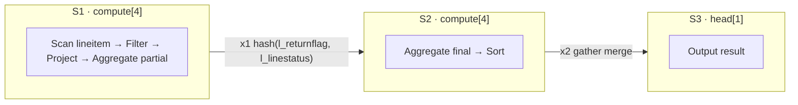
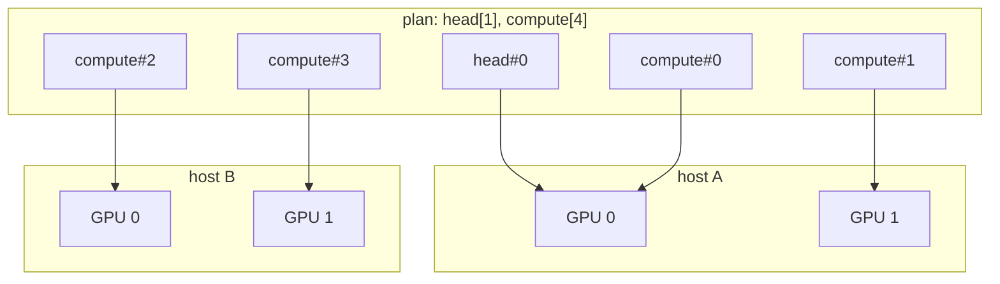

# Stages and bindings

In the pricing-summary query, the four workers that build partial sums also receive the shuffled
sums. Those are two stages on the same worker set. The exchanges tell us where one stage ends and
the next begins. Bindings tell us which GPUs run them.

## Stages fall out of the plan

Take Q2 (pricing summary) from the [exchanges chapter](03-exchanges.md). Its joined form has two
exchanges, `x1` and `x2`.

```text
Plan "q2_pricing_summary" (joined)
worker sets: head[1], compute[4]
Output "result" on head[1]
└─ Exchange x2 gather order=merge[l_returnflag asc, l_linestatus asc] -> head[1]
   └─ Sort [l_returnflag asc, l_linestatus asc]
      └─ Aggregate final keys=[l_returnflag, l_linestatus]
         └─ Exchange x1 hash(l_returnflag, l_linestatus) -> compute[4]
            └─ Aggregate partial keys=[l_returnflag, l_linestatus] ...
               └─ Project ...
                  └─ Filter l_shipdate <= 1998-09-02
                     └─ Scan lineitem ...  on compute[4]  shards=files_round_robin
```

Cut the tree at every `Exchange`. Each exchange becomes an `ExchangeSink` that ends the piece below
and an `ExchangeSource` that starts the piece above. A **stage** is a connected component of the
plan after that cut. Q2 has three, S1 to S3.

A **stage instance** is one stage running on one worker. S1 and S2 run on `compute[4]`, so each has
four instances; S3 runs on `head[1]` and has one. That makes nine stage instances.



Four properties follow from the definition:

- **One set per stage.** Nothing moves between workers inside a stage, so all its nodes are on one
  worker set (V2, see [Validation](07-validation.md)). A join whose inputs are on two sets is
  missing an exchange.
- **Stage ids in this tree follow the exchanges.** S1 sends on x1, S2 sends on x2, and S3
  owns the output. A shared subplan can have several consumers, so this shortcut applies to
  trees with one sink per stage.
- **Value edges do not join stages.** Only data edges connect nodes into a stage, so a runtime
  filter built in one stage and applied in another leaves them two stages. In split form its
  `ValueExchange` becomes a `ValueSink` in the producing stage and a `ValueSource` in the consuming
  one (see [Runtime filters](05-runtime-filters.md)).
- **Adaptive exchanges keep the stage graph.** Every alternative of a decided exchange targets the
  same set, so the stages are the same whichever label wins (see
  [Stage graphs do not change](06-adaptive-plans.md#stage-graphs-do-not-change)).

Stages are derived because a declared stage would be a second description of the same program, and
two descriptions can disagree.

[From plan to pipelines](../part-5/01-from-plan-to-pipelines.md) shows what the engine does with a
stage instance.

## Split form and instance form

`rewrite::split` turns a joined plan into **split form**: one block per stage, with each exchange
replaced by a sink and a source that both carry its id. The result is another `Plan` (rule 6) that
you can print, fingerprint and diff.

```cpp
#include <sirius/sirius.hpp>
using namespace sirius;

Result<void> show_stages(const Plan& plan, const WorkerSet& compute) {
  SIRIUS_TRY(split, rewrite::split(plan));
  std::cout << split.explain();

  SIRIUS_TRY(view, rewrite::instance(split, compute.at(2)));
  std::cout << view.explain();
  return {};
}
```
```rust
use sirius::prelude::*;

fn show_stages(plan: &Plan, compute: &WorkerSet) -> Result<(), PlanError> {
    let split = rewrite::split(plan)?;
    println!("{}", split.explain(&ExplainOptions::default()));

    let view = rewrite::instance(&split, &compute.at(2))?;
    println!("{}", view.explain(&ExplainOptions::default()));
    Ok(())
}
```

The first `explain()` prints the split form:

```text
Plan "q2_pricing_summary" (split)
worker sets: head[1], compute[4]
Stage S1 on compute[4]
ExchangeSink x1 hash(l_returnflag, l_linestatus) -> S2 [compute#0..3]
└─ Aggregate partial keys=[l_returnflag, l_linestatus] ...
   └─ Project ...
      └─ Filter l_shipdate <= 1998-09-02
         └─ Scan lineitem ...  on compute[4]  shards=files_round_robin
Stage S2 on compute[4]
ExchangeSink x2 gather order=merge[l_returnflag asc, l_linestatus asc] -> S3 [head#0]
└─ Sort [l_returnflag asc, l_linestatus asc]
   └─ Aggregate final keys=[l_returnflag, l_linestatus]
      └─ ExchangeSource x1 <- S1 senders=[compute#0..3]
Stage S3 on head[1]
Output "result"
└─ ExchangeSource x2 <- S2 senders=[compute#0..3]
```

Each source lists its **senders**: every worker of the set below the exchange. `x1` expects end of
stream from each of `compute#0..3`.

`rewrite::instance` gives one worker's view. The **instance form** keeps only the stages that run
on that worker and replaces each set-level description with that worker's facts: the files it
reads, the partition it receives, and the worker each partition goes to.

```text
Plan "q2_pricing_summary" (instance compute#2)
worker sets: head[1], compute[4]
Stage S1 instance compute#2
ExchangeSink x1 hash(l_returnflag, l_linestatus)  partitions->workers {0:#0, 1:#1, 2:#2, 3:#3}
└─ Aggregate partial keys=[l_returnflag, l_linestatus] ...
   └─ Project ...
      └─ Filter l_shipdate <= 1998-09-02
         └─ Scan lineitem ...  files=[2, 6, 10, ..., 254] (64 of 256)
Stage S2 instance compute#2
ExchangeSink x2 gather order=merge[l_returnflag asc, l_linestatus asc] -> [head#0]
└─ Sort [l_returnflag asc, l_linestatus asc]
   └─ Aggregate final keys=[l_returnflag, l_linestatus]
      └─ ExchangeSource x1 partition=2/4 <- senders=[compute#0..3]
```

`compute#2` reads files 2, 6, 10 and so on because `files_round_robin` deals file *i* to worker
*i* mod 4 (see [Shard kinds](02-workers-and-distribution.md#shard-kinds)). Every line follows from
the joined plan; nothing is decided at run time.

To print these views without keeping the rewritten plans, pass
`ExplainOptions::defaults().with_form(PlanForm::split)` or `ExplainOptions::instance(worker)` to
`explain`. `plan.stages()` lists the derived stages. The
[plan notation reference](../reference/plan-notation.md) has the rules for each form.

## Endpoints: where workers can live

An **endpoint** is a place a worker can run: one GPU in one process. You never construct one. A
`Context` creates one endpoint per GPU it admits:

```cpp
SIRIUS_TRY(context, Context::create(config));
for (const Endpoint& endpoint : context.device_endpoints()) {
  std::vector<std::byte> bytes = endpoint.to_bytes();
  launcher.publish(bytes);   // your own coordination channel, not part of Sirius
}
```
```rust
let context = Context::try_new(&config)?;
for endpoint in context.device_endpoints() {
    let bytes = endpoint.to_bytes();
    launcher.publish(&bytes); // your own coordination channel, not part of Sirius
}
```

An endpoint is opaque and comparable, and it round-trips as bytes. Each process publishes its
endpoints over a channel you already have (a launcher, a job scheduler, a shared file) and reads
the complete list back with `Endpoint::from_bytes`.

The two-host cluster of the running example has four endpoints, one per GPU: `a_gpu0`, `a_gpu1`,
`b_gpu0` and `b_gpu1`.

## Bindings: where, never what

A `Bindings` value maps the plan's logical names to physical things:

- every worker of every set to one endpoint (for an unsized hosting set, only the worker the plan
  runs as, with `BindingsBuilder::worker`);
- every named `Input` instance to an `InputSource` (see
  [Prepare and execute](../part-1/06-prepare-and-execute.md)).

It can do nothing else (rule 4, see
[The ownership rule](01-everything-in-the-plan.md#the-ownership-rule)). A binding cannot add an
exchange, change a partition count, swap broadcast for hash, move a filter, or change which splits
a worker reads. Deployments that need different communication need different plans.

In the cluster binding for Q2, a `WorkerBinding` lists one endpoint per worker, in index order:

```cpp
SIRIUS_TRY(compute_binding, WorkerBinding::to({a_gpu0, a_gpu1, b_gpu0, b_gpu1}));
SIRIUS_TRY(head_binding, WorkerBinding::to({a_gpu0}));
// shared_id_bytes: the 16 id bytes your launcher shared with every process
SIRIUS_TRY(execution_id, ExecutionId::from_bytes(shared_id_bytes));

SIRIUS_TRY(bindings, Bindings::builder()
                         .execution(execution_id)
                         .workers(head, std::move(head_binding))
                         .workers(compute, std::move(compute_binding))
                         .build());
SIRIUS_TRY(prepared, context.prepare(plan, std::move(bindings)));
```
```rust
let compute_binding = WorkerBinding::to(vec![a_gpu0.clone(), a_gpu1, b_gpu0, b_gpu1])?;
let head_binding = WorkerBinding::to(vec![a_gpu0])?;
// shared_id_bytes: the 16 id bytes your launcher shared with every process
let execution_id = ExecutionId::from_bytes(&shared_id_bytes)?;

let bindings = Bindings::builder()
    .execution(execution_id)
    .workers(&head, head_binding)
    .workers(&compute, compute_binding)
    .build()?;
let prepared = context.prepare(&plan, bindings)?;
```

`head#0` and `compute#0` share `a_gpu0`: **one endpoint can host several workers.** They remain
two workers, and the gather `x2` still runs from `compute#0` to `head#0`, as a hand-off on the same
device.

The bindings determine the transport for each pair of endpoints: same device, a peer copy between
GPUs, or the network. The engine chooses how the transport carries an edge. Neither changes what a
worker receives (see [The logical edge and its physical
shape](01-everything-in-the-plan.md#the-logical-edge-and-its-physical-shape)).

The `ExecutionId` names one run. One process creates it with `ExecutionId::random()` and shares its
bytes the way it shares endpoints, because every process must use the same id. The id is part of
every message key, so two executions of the same plan never mix rows. It is single use per hosted
worker: a second execution needs a fresh one (see [Every message has a
key](../part-5/07-failure-cancellation-and-recovery.md#every-message-has-a-key)).



## Every process prepares the same plan

Sirius has no coordinator process. For a closed plan, every process does the same thing:

1. Build the same plan from the same ordered inputs, including file lists, and apply the same rewrites.
2. Build the same `Bindings`: same execution id, same endpoint list in the same order.
3. Call `prepare`, then `start`.

`prepare` finds the workers this process hosts: those bound to one of its own
`device_endpoints()`. On host A, `prepared.local_workers()` is `[compute#0, compute#1, head#0]`;
on host B it is `[compute#2, compute#3]`. Each process runs the stage instances of its own workers
only.

At `start`, each process shakes hands with every peer it exchanges rows or values with, without
waiting for the first batch. The handshake checks that the processes already agree.

A **closed plan** contains both ends of every exchange and every value edge. For one, the handshake
compares the execution id, the plan fingerprint and a digest of the bindings. On any difference,
both sides fail with `binding_mismatch` (V25) before exchanging data on that edge. This is a
peer check. An unrelated edge may have already started.

Three details:

- A peer that never answers fails the edge with `transport` once [the first-contact
  deadline](../part-5/07-failure-cancellation-and-recovery.md#the-first-contact-deadline) expires
  (set it with `PrepareOptions::with_first_contact_deadline`).
- When a host retries a failed stage instance on a new endpoint, the bindings gain a **binding
  epoch** and the moved instance shakes hands again. The plan and its fingerprint stay the same (see
  [Binding epochs](../part-5/07-failure-cancellation-and-recovery.md#binding-epochs)).
- The fingerprint covers the plan as built, with every `auto` property still `auto`. Processes may
  resolve a worker-local `auto`, such as a join's build side, differently without breaking
  agreement.

Every exchange and value edge also has an **edge signature**: its id, the execution id, and
everything both ends must agree on, such as mode, schema, partitioning, destinations and senders.
The [node catalog](../reference/node-catalog.md#exchangesink-and-exchangesource-pairs) lists every
field. For a closed plan the shared fingerprint covers the plan fields. The execution id and
bindings are checked separately. Peers running open plans compare their edge signatures directly.

## Readers go where the Output lives

`start` returns a `StartedExecution`. Its `outputs` field holds one `OutputReader` per `Output`
worker that this process hosts. Q2's output is on `head[1]`, and `head#0` is bound to host A, so
host A gets one reader and host B gets none:

```cpp
SIRIUS_TRY(started, std::move(prepared).start());
for (OutputReader& out : started.outputs) {   // one entry on host A, empty on host B
  while (true) {
    SIRIUS_TRY(batch, out.reader.next());
    if (!batch) break;   // clean end of stream
    consume(*batch);
  }
}
SIRIUS_TRY(report, std::move(started.execution).wait());
```
```rust
let StartedExecution { execution, mut outputs } = prepared.start()?;
for out in outputs.iter_mut() {   // one entry on host A, empty on host B
    for batch in &mut out.reader {
        consume(&batch?);
    }
}
let report = execution.wait()?;
```

Host B still calls `start` and `wait`: its workers scan, aggregate and send. Its `wait()` returns
when its own stage instances finish, and its report covers them. `ExecutionReport::combine`
merges the per-process reports.

With `Output "result" on compute[4]` instead (no gather), each process gets one reader per hosted
compute worker: partitioned output, expressed in the plan.

## Same plan, different machines

To run Q2 on one machine with four GPUs, change only the bindings:

```cpp
SIRIUS_TRY(prepared_local, context.prepare(plan, Bindings::local()));
```
```rust
let prepared_local = context.prepare(&plan, Bindings::local())?;
```

`Bindings::local()` binds every set round-robin over this context's device endpoints. With four
GPUs, `compute#0..3` land on GPUs 0 to 3, and `head#0` shares GPU 0 with `compute#0`, as on the
cluster. The plan text, its fingerprint, its stages and every instance view are identical. Only
the transports differ: `x1` now moves every partition between GPUs in one process, where on the
cluster some crossed the network.

## Open plans: authoring stages and instances directly

A host whose own scheduler decides which stages exist and which machine runs each one can author a
split-form stage plan directly instead of calling `rewrite::split`. The stage starts at an
`ExchangeSource` and ends at an `ExchangeSink`, and the far side of each is not in the plan. That is
an **open plan**.

Here is S2 of Q2 as an open plan. The host chooses the exchange ids, because there is no joined
plan to number them. `states` is the schema that S1's partial aggregate produces. It carries the
state types, so the final aggregate needs nothing else.

```cpp
std::vector<SortKey> order_keys{SortKey::asc("l_returnflag"), SortKey::asc("l_linestatus")};
SIRIUS_TRY(x1_id, ExchangeId::create(1));
SIRIUS_TRY(x2_id, ExchangeId::create(2));
auto by_group = Exchange::hash({"l_returnflag", "l_linestatus"}, compute);
auto to_head = Exchange::gather(head, GatherOrder::merge(order_keys));

SIRIUS_TRY(source, Relation::exchange_source(x1_id, states, by_group, compute));
SIRIUS_TRY(groups, source.aggregate_final());
SIRIUS_TRY(sorted, groups.sort(order_keys));
SIRIUS_TRY(sink, sorted.exchange_sink(x2_id, to_head));
SIRIUS_TRY(stage_plan, Plan::create({sink}));
```
```rust
let order_keys = vec![SortKey::asc("l_returnflag"), SortKey::asc("l_linestatus")];
let x1_id = ExchangeId::try_new(1)?;
let x2_id = ExchangeId::try_new(2)?;
let by_group = Exchange::hash(&["l_returnflag", "l_linestatus"], &compute,
                              Partitions::one_per_worker(), HashScheme::v1());
let to_head = Exchange::gather(&head, GatherOrder::merge(order_keys.clone()));

let source = Relation::exchange_source(x1_id, &states, &by_group, &compute)?;
let groups = source.aggregate_final()?;
let sorted = groups.sort(order_keys)?;
let sink = sorted.exchange_sink(x2_id, &to_head)?;
let stage_plan = Plan::try_new(vec![sink], vec![])?;
```

`Plan::create` validates an open plan, `explain()` prints it in split form, and `prepare` binds it.
The plan does not contain its peers, so the handshake has no shared fingerprint to compare. It
compares edge signatures instead and fails with `binding_mismatch` on any difference. It never
checks the membership of a set that only sends.

### Instance plans

Some schedulers hand out work per instance: this machine runs instance 2 of the scan stage, with
these scan ranges. For such a host, `Plan::create_instance` builds an **instance plan**, which
describes one worker's work. Make the same builder calls as for a stage plan, give the scan its
splits with `Shards::splits`, and name the worker the plan runs as.

Here is S1 of Q2 as an instance plan for `compute#2`. `ranges` holds the splits the host's
scheduler assigned to this instance, and `price_lineitem` stands for Q2's filter and projection.
`keys` and `measures` come from [Exchanges](03-exchanges.md). `x1_id` and `by_group` are those of
the S2 plan above, because the two plans must agree on `x1`.

```cpp
SIRIUS_TRY(given, Shards::splits(std::move(ranges)));
SIRIUS_TRY(rows, Relation::scan(lineitem,
    ScanOptions::on(compute)
        .with_columns({"l_returnflag", "l_linestatus", "l_quantity", "l_extendedprice",
                       "l_discount", "l_shipdate"})
        .with_shards(std::move(given))));
SIRIUS_TRY(priced, price_lineitem(rows));
SIRIUS_TRY(partial, priced.aggregate_partial(keys, measures));
SIRIUS_TRY(sink, partial.exchange_sink(x1_id, by_group));
SIRIUS_TRY(instance_plan, Plan::create_instance(compute.at(2), {sink}));
```
```rust
let given = Shards::splits(ranges)?;
let rows = Relation::scan(&lineitem,
    ScanOptions::on(&compute)
        .with_columns(&["l_returnflag", "l_linestatus", "l_quantity", "l_extendedprice",
                        "l_discount", "l_shipdate"])
        .with_shards(given))?;
let priced = price_lineitem(&rows)?;
let partial = priced.aggregate_partial(&keys, measures)?;
let sink = partial.exchange_sink(x1_id, &by_group)?;
let instance_plan = Plan::try_new_instance(&compute.at(2), vec![sink], vec![])?;
```

An instance plan prints in instance form:

```text
Plan "q2_s1" (instance compute#2)
worker sets: compute[4]
Stage S1 instance compute#2
ExchangeSink x1 hash(l_returnflag, l_linestatus) -> compute[4]  partitions->workers {0:#0, 1:#1, 2:#2, 3:#3}
└─ Aggregate partial keys=[l_returnflag, l_linestatus] ...
   └─ Project ...
      └─ Filter l_shipdate <= 1998-09-02
         └─ Scan lineitem ...
                          splits=[lineitem/02.parquet, lineitem/06.parquet[0, 128MiB), ..., lineitem/254.parquet] (17 splits)
```

Two lines differ from the instance view of `compute#2` above. The scan lists the scheduler's splits
instead of the files `files_round_robin` dealt, and the sink names its far side as a set, because
S2 is not in this plan. The splits are in the plan and covered by its fingerprint; the bindings
only map `compute#2` and the workers it exchanges with to endpoints.

`compute` is sized even though the plan describes one worker. `x1` hashes into one partition per
worker of `compute`, and every sender must agree on what "partition 2 of 4" means, so the plan
depends on the size (V24).

A stage that only scans and sends to another set has no such dependency, so its host can declare
the hosting set with `WorkerSet::unsized` (see
[Sized and unsized sets](02-workers-and-distribution.md#sized-and-unsized-sets)). The header then
reads, for example, `worker sets: scan[?], compute[4]`. The receiver still lists its senders with a
size, because it counts their ends of stream. A sender from an unsized set matches that sender set
by name, and its index must fall inside the size.

`rewrite::join_stages` goes the other way: it composes stage or instance plans whose ids match into
one joined plan, so a host that works in stages can still `explain` and diff the whole query (see
[split, instance and
join_stages](../part-5/05-plan-to-plan-rewrites.md#split-instance-and-join_stages-the-forms)).
[Under someone else's scheduler](../part-4/02-starrocks.md) builds a four-fragment example with one
instance plan per fragment instance, including runtime filters that cross fragments.

## Host-carried edges

A host can also move rows between two plans itself. Rows leave one plan through an `Output`, the
host carries them, and they enter another plan through an `Input`. This is a **host-carried
edge**. Sirius sees two closed plans and no edge between them.

The ownership rule still holds: the plan owns every fact two *workers* must agree on, and here the
two parties are the host's own tasks. The facts they must agree on (partition function, partition
count, row format) are the host's, and the host enforces them. What each Sirius plan produces is
still stated: a partition id is a column, the schema is the `Output`'s, and both are in the
fingerprint.

Two consequences follow:

- **There is no handshake.** Edge signatures, the first-contact deadline and gang admission concern
  edges between Sirius workers. A plan with no exchange to another process never waits for a peer.
- **Durability is the host's.** The consumer reads a producer's output only after the producer
  finished, which is the contract of `durability=spooled`
  ([Failure, cancellation and
  recovery](../part-5/07-failure-cancellation-and-recovery.md#durability-pipelined-or-spooled)),
  carried out by the host. A failed task is rerun by the host as a new execution.

The consumer binds the carried rows as a
[completed input](../part-1/06-prepare-and-execute.md#feeding-completed-inputs). A Spark shuffle
between two tasks is a host-carried edge
([Bolt under Spark](../part-4/05-plans-from-other-systems.md#one-task-at-a-time-bolt-under-spark)),
and so are the edges of [StarRocks's first step](../part-4/02-starrocks.md#getting-there).
