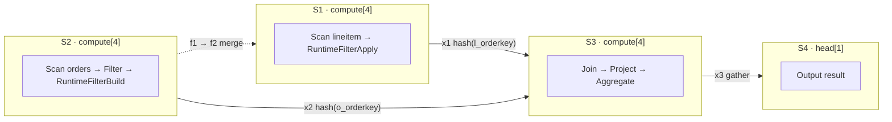

# Runtime filters

Suppose a join needs only the line items for urgent March orders. As the build side reads the
orders, it collects their keys. If a Bloom filter built from those keys reaches the lineitem scan
in time, the scan can discard many rows before the shuffle. A possible match still goes to the
join. Two things determine whether this is safe: which orders the filter covers, and whether the
join may discard an unmatched line item.

## Data edges and value edges

A **data edge** carries batches with a schema, followed by an end of stream from each sender. A
**value edge** carries *one small runtime value per producing worker*, of one of five kinds:

| Kind | Produced by | Used for | Optional or required |
|---|---|---|---|
| `Filter` | `RuntimeFilterBuild` | dropping rows that cannot match | optional |
| `Statistics` | `Observe` | row counts, byte counts, key samples, partition histograms | required |
| `Boundaries` | `ComputeBoundaries` | splitters for a `range` exchange | required |
| `Decision` | `Decide` | choosing an exchange mode or partition count | required |
| `Assignment` | `AssignPartitions` | mapping partitions to workers ([Running at scale](../part-5/08-running-at-scale.md#skew-more-partitions-than-workers)) | required |

A **filter is optional**. It drops only rows whose key is *definitely absent* from the build (no
false negatives), so the result is correct without it: if the filter is missing, late, skipped or
failed, every row passes.

The other four kinds are **required**: a range exchange cannot route a row without its boundaries.
A consumer waits for a required value, and if the value fails, the execution fails with
`execution`. The [next chapter](06-adaptive-plans.md) uses statistics and decisions.

In the text notation, a producer line ends with `~> f1` and a consumer line contains `<~ f2`. In
Mermaid, value edges are dotted. `explain()` shows every runtime value.

## Building and applying a filter

Take Q4 (urgent March revenue) from [Everything in the
plan](01-everything-in-the-plan.md#the-questions-a-single-worker-plan-leaves-open). Few orders
qualify, so most `lineitem` rows find no partner in the join. A runtime filter on the order key
drops them early.

Build a filter from a relation and a list of key columns. Keys are column names, not expressions,
so project a computed key first. `build_runtime_filter` returns the relation, which passes every
row through unchanged, and the filter handle.

```cpp
#include <sirius/sirius.hpp>
using namespace sirius;

Result<Relation> urgent_join(const Relation& lineitem, const Relation& urgent,
                             const WorkerSet& compute) {
  SIRIUS_TRY(geometry, BloomGeometry::fixed(8 << 20));
  SIRIUS_TRY(built, urgent.build_runtime_filter({"o_orderkey"},
                                                RuntimeFilterSpec::bloom(geometry)));
  // built.relation: the same rows as `urgent`; built.filter: the value it publishes
  bool partial = built.filter.scope().kind == ValueScope::Kind::partial;   // true
```
```rust
use sirius::prelude::*;
use std::time::Duration;

fn urgent_join(lineitem: &Relation, urgent: &Relation, compute: &WorkerSet)
    -> Result<Relation, PlanError> {
    let geometry = BloomGeometry::fixed(8 << 20)?;
    let built = urgent.build_runtime_filter(&["o_orderkey"],
                                            RuntimeFilterSpec::bloom(geometry))?;
    // built.relation: the same rows as `urgent`; built.filter: the value it publishes
    let partial = built.filter.scope() == ValueScope::Partial; // true
```

Continue from `built.relation`, not from `urgent`. The `RuntimeFilterBuild` node sits on the data
path and publishes its filter once it has seen its complete input on its worker. Continuing from
`urgent` is legal, but `urgent` is then a
[shared node](../reference/extension-points.md#shared-subplans) with two consumers, the build and
the exchange, and the engine buffers or recomputes it for both.

The filter's scope is `partial` (see the next section). Merge it, apply it to the lineitem side,
and join:

```cpp
  SIRIUS_TRY(f2, built.filter.merge_to(compute));
  SIRIUS_TRY(probe, lineitem.apply_runtime_filter(f2, {"l_orderkey"}, WaitPolicy::never()));
  SIRIUS_TRY(left, probe.exchange(Exchange::hash({"l_orderkey"}, compute)));
  SIRIUS_TRY(right, built.relation.exchange(Exchange::hash({"o_orderkey"}, compute)));
  SIRIUS_TRY(on, JoinOn::keys({{"l_orderkey", "o_orderkey"}}));
  return left.join(right, JoinType::inner, std::move(on), JoinOptions::defaults());
}
```
```rust
    let f2 = built.filter.merge_to(compute)?;
    let probe = lineitem.apply_runtime_filter(&f2, &["l_orderkey"], WaitPolicy::never())?;
    let left = probe.exchange(&Exchange::hash(&["l_orderkey"], compute,
                                              Partitions::one_per_worker(), HashScheme::v1()))?;
    let right = built.relation.exchange(&Exchange::hash(&["o_orderkey"], compute,
                                                        Partitions::one_per_worker(), HashScheme::v1()))?;
    let on = JoinOn::keys(&[("l_orderkey", "o_orderkey")])?;
    left.join(&right, JoinType::Inner, on, JoinOptions::default())
}
```

Add the projection, the aggregate and the gather to `head[1]` (Part III builds them step by step),
and `explain()` prints the canonical Q4 plan:

```text
Plan "q4_urgent_march_revenue" (joined)
worker sets: head[1], compute[4]
values:
  f2 = ValueExchange merge f1 -> compute[4]
Output "result" on head[1]
└─ Exchange x3 gather -> head[1]
   └─ Aggregate keys=[o_orderkey, o_orderdate] measures=[revenue = sum(rev)]
      └─ Project [o_orderkey, o_orderdate, rev = l_extendedprice * (1 - l_discount)]
         └─ Join inner keys=[l_orderkey == o_orderkey] build=right  mode=co_partitioned(x1, x2)
            ├─ Exchange x1 hash(l_orderkey) -> compute[4]
            │  └─ RuntimeFilterApply [l_orderkey] <~ f2  wait=never
            │     └─ Scan lineitem [l_orderkey, l_extendedprice, l_discount]  on compute[4]  shards=files_round_robin
            └─ Exchange x2 hash(o_orderkey) -> compute[4]
               └─ RuntimeFilterBuild keys=[o_orderkey] spec=bloom(fixed 8MiB)  scope=partial ~> f1
                  └─ Filter o_orderdate >= 1995-03-01 and o_orderdate < 1995-04-01 and o_orderpriority == "1-URGENT"
                     └─ Scan orders [o_orderkey, o_orderdate, o_orderpriority]  on compute[4]  shards=files_round_robin
```

`RuntimeFilterBuild ~> f1` produces one partial filter per compute worker. The `values:` block says
`f2` is their merge, delivered to every compute worker. `RuntimeFilterApply <~ f2` sits *below*
`x1`, so rows the Bloom filter rules out after it arrives can skip the shuffle. In the stage graph, the filter
travels from the orders stage to the lineitem stage:



## Scope: which rows does a filter know about?

A filter is safe to apply only where it knows *every* key that could match, and a filter built on
one worker knows only the keys that passed through that worker. Every filter therefore carries a
**scope**: the slice of the key space it covers. The builder derives the scope from the
distribution of the relation you build on. You never set it.

| Scope | Built on | Knows | Safe to apply |
|---|---|---|---|
| `global` | a `replicated` relation, or any relation on a size-1 set | every build key | anywhere on the probe-side lineage of its join (V18) |
| `partition(xK)` | a relation `hashed` by exchange `xK` on exactly the filter keys | every build key in this worker's partition of `xK` | only on the same worker, to rows hashed like `xK` |
| `partial` | anything else, typically `arbitrary` rows | only the keys this worker happened to see | nowhere, until merged |

In Q4 the filter is built on the orders scan, before `x2`. Those rows are `arbitrary`: an order
sits on whichever worker read its file, so each worker's filter is `partial`. If `compute#1`
applied its partial filter to its lineitem rows, it would drop rows whose matching order is on
`compute#3`. V16 forbids applying a `partial` filter. Merge it first.

### Merging to global

`merge_to(set)` inserts a `ValueExchange` node in mode `merge`. Every receiver in the target set
gets the merge of every sender's share, combined with the merge rule of the filter's kind. The
result knows every build key, so it is `global`. Like a data exchange, a value edge between sets
or workers is a node in the plan (rule 1, and V12 in [Validation](07-validation.md)).

Bitwise OR of equal-sized Bloom filters gives the same result in any order (V13). The engine chooses how to combine the
shares ([The logical edge and its physical
shape](01-everything-in-the-plan.md#the-logical-edge-and-its-physical-shape)).

`merge_to` works from any scope. Merging `partition(xK)` filters gives a global filter, since the
partitions together hold the whole build. Merging a filter that is already global, such as one
built on `head[1]`, delivers that one value to every worker of the target set.

A merged filter is `published` only if every partial was. If any worker skips its part, the merged
filter is skipped and the probe side runs unfiltered.

### Partition scope: no merge needed

A filter is also safe without a value exchange if you build it *after* the hash exchange on the
build side and apply it *after* the matching hash exchange on the probe side:

```cpp
SIRIUS_TRY(right_hashed, urgent.exchange(Exchange::hash({"o_orderkey"}, compute)));
SIRIUS_TRY(built_after, right_hashed.build_runtime_filter({"o_orderkey"},
                                                          RuntimeFilterSpec::bloom(geometry)));
// built_after.filter.scope(): partition(x2)
SIRIUS_TRY(left_hashed, lineitem.exchange(Exchange::hash({"l_orderkey"}, compute)));
SIRIUS_TRY(probe_after, left_hashed.apply_runtime_filter(built_after.filter, {"l_orderkey"}));
```
```rust
let right_hashed = urgent.exchange(&Exchange::hash(&["o_orderkey"], compute,
                                                   Partitions::one_per_worker(), HashScheme::v1()))?;
let built_after = right_hashed.build_runtime_filter(&["o_orderkey"],
                                                    RuntimeFilterSpec::bloom(geometry))?;
// built_after.filter.scope(): ValueScope::Partition(x2)
let left_hashed = lineitem.exchange(&Exchange::hash(&["l_orderkey"], compute,
                                                    Partitions::one_per_worker(), HashScheme::v1()))?;
let probe_after = left_hashed.apply_runtime_filter(&built_after.filter, &["l_orderkey"],
                                                   WaitPolicy::never())?;
```

`x1` and `x2` are co-partitioned (same hash scheme, key types, partition count and set). After
`x2`, `compute#2` holds every urgent March order whose key hashes to partition 2. After `x1`, it
holds every lineitem row whose key hashes to partition 2. The filter built on `compute#2`
therefore knows every key a lineitem row on `compute#2` could match. It is complete *for that
worker* and needs no merge:

```text
Join inner keys=[l_orderkey == o_orderkey] build=right  mode=co_partitioned(x1, x2)
├─ RuntimeFilterApply [l_orderkey] <~ f1  wait=never
│  └─ Exchange x1 hash(l_orderkey) -> compute[4]
│     └─ Scan lineitem [l_orderkey, l_extendedprice, l_discount]  on compute[4]  shards=files_round_robin
└─ RuntimeFilterBuild keys=[o_orderkey] spec=bloom(fixed 8MiB)  scope=partition(x2) ~> f1
   └─ Exchange x2 hash(o_orderkey) -> compute[4]
      └─ Filter ...
```

The lineitem rows have already crossed `x1` when the filter sees them, so a partition-scope filter
saves join work, not transfer.

V17: a `partition(xK)` filter is applied only on the same set and the same worker, to a relation
hashed with `xK`'s signature on the corresponding columns. *Below* `x1` the rows are not yet hashed
like `x2`, so the validator rejects an apply there:

```text
invalid_plan: V17: runtime filter f1 has scope partition(x2), so it can only be applied on the
  same worker to rows hashed like x2; RuntimeFilterApply [l_orderkey] reads arbitrary(compute[4])
  rows from Scan lineitem. Apply it above Exchange x1, or merge it with merge_to(compute).
  at: RuntimeFilterApply [l_orderkey] (stage S1)
```

## Where a filter may be applied

Scope (V16, V17) says whether the filter knows all the relevant keys. V18 says whether dropping a
non-matching row is harmless. A filter is applied only on the probe-side lineage of the join whose
build feeds it. On the way from the apply to the join, the rows may pass only key-preserving nodes
(`Filter`, a plain `Project`, or an `Exchange` of any mode, including a decided one), and the join
type must discard non-matching probe rows. A filter with a key from a null-safe pair of that join
has `NullKeys::pass`.

An inner join discards probe rows without a match, so removing them early changes nothing. A left
join probing its left input keeps them, padded with nulls, so a filter on its probe side would delete result rows. A
`Project` that recomputes the key column would make the filtered value differ from the one the join
compares. [Validation](07-validation.md) lists the error for each.

A filter never stores a null key. By default an apply drops every row with a null in a filter key,
because under a plain key pair such a row matches nothing. Under a
[null-safe pair](../part-1/07-aggregates-joins-and-ordering.md#null-safe-keys) a null key can
match, so the filter must pass those rows on to the join. Say so on the spec:

```cpp
// a fresh scenario
SIRIUS_TRY(geometry, BloomGeometry::fixed(8 << 20));
RuntimeFilterSpec keeps_nulls = RuntimeFilterSpec::bloom(geometry).with_null_keys(NullKeys::pass);
```
```rust
// a fresh scenario
let geometry = BloomGeometry::fixed(8 << 20)?;
let keeps_nulls = RuntimeFilterSpec::bloom(geometry).with_null_keys(NullKeys::Pass);
```

The build then prints `spec=bloom(fixed 8MiB) nulls=pass`. Passing a row is always safe, so `pass`
is legal on any filter. The null rule is part of the spec, so every apply of the filter follows
it, in whichever stage it sits.

## Filter specs and geometry agreement

A `RuntimeFilterSpec` names one of three kinds, or a chain:

| Spec | What it is | Merge rule |
|---|---|---|
| `bloom(geometry)` | a Bloom filter; may report false positives, never false negatives | bitwise OR |
| `in_list(max_values)` | the exact set of keys, up to `max_values` | union |
| `min_max()` | the smallest and largest key | min of mins, max of maxes |
| `a.or_else(b)` | use `a`; if it overflows, degrade to `b` | the merged value degrades if any share does |

Partials merge only if every worker built its partial the same way: two Bloom filters can be ORed
only if they have the same number of bits, the same hash and the same key domain. This is
**geometry agreement**, and V13 enforces it for every merged filter. V13 also requires the partials
to share the null rule, which `merge_to` guarantees because every share comes from one build node.

The plan states the geometry in one of two ways:

- `BloomGeometry::fixed(bytes)` fixes the size in the plan. Every worker knows it before it inserts
  a key, but the false-positive rate is high when the build is much larger than expected.
- `BloomGeometry::sized_by(global_rows, bits_per_key, max_bytes)` sizes the filter from a *global*
  row count, so every worker computes the same size. The count is itself a runtime value: observe
  it and merge it first.

```cpp
SIRIUS_TRY(observed, urgent.observe(StatisticsSpec::rows()));
SIRIUS_TRY(rows, observed.statistics.merge_to(compute));
SIRIUS_TRY(sized, BloomGeometry::sized_by(rows, 16, 64 << 20));
SIRIUS_TRY(built_sized, observed.relation.build_runtime_filter({"o_orderkey"},
                                                               RuntimeFilterSpec::bloom(sized)));
```
```rust
let observed = urgent.observe(StatisticsSpec::rows())?;
let rows = observed.statistics.merge_to(compute)?;
let sized = BloomGeometry::sized_by(&rows, 16, 64 << 20)?;
let built_sized = observed.relation.build_runtime_filter(&["o_orderkey"],
                                                         RuntimeFilterSpec::bloom(sized))?;
```

`sized_by` costs one extra round of value exchange before any filter can publish. Which to prefer
is [open question 7](../reference/open-questions.md#7-bloom-geometry-and-kinds).

Kinds follow the same rule. For a filter merged across workers, the plan fixes the kind chain, so
all workers agree before they build. `in_list(1 << 16).or_else(min_max())` degrades
deterministically: the merged filter uses min-max if a local list or their union exceeds the cap.
The fallback must cover all keys already seen, including those a different worker stored in its list. For a filter that never leaves one worker (`global` from a replicated input, or
`partition`-scoped), the engine may choose among the kinds the spec allows, per worker.

## Waiting, or not

A filter races the rows it filters: in Q4, the lineitem scan starts before `f2` is built on every
worker and merged. `WaitPolicy` says what the apply does:

- `WaitPolicy::never()` (the default) takes a snapshot of the filter at each checkpoint. Rows that
  arrive before the filter pass unfiltered; later rows are filtered. The scan never stalls.
- `WaitPolicy::up_to(limit)` holds the apply's input for up to `limit`, then continues with
  whatever state the filter has. If the filter has not arrived, rows pass unfiltered and nothing
  fails.

```cpp
SIRIUS_TRY(probe_waiting, lineitem.apply_runtime_filter(f2, {"l_orderkey"},
                                                        WaitPolicy::up_to(std::chrono::milliseconds{20})));
```
```rust
let probe_waiting = lineitem.apply_runtime_filter(&f2, &["l_orderkey"],
                                                  WaitPolicy::up_to(Duration::from_millis(20)))?;
```

The policy changes how much work the filter saves, never the result. A short wait pays off when the
build side is small and fast and the probe side is huge. Use `never` when you cannot predict which
side finishes first. The apply line prints the policy (`wait=never`, `wait=up_to(20ms)`).

## How a filter ends

Each worker that produces a value finishes exactly once, in one of four states. For a filter:

- **published**: the filter is ready and applies from then on.
- **skipped**: the producer chose not to publish. For example, the build exceeded what the spec can
  represent, or its stage stopped early because its output was closed, so it saw only part of its
  input ([Close is not end of
  stream](../part-5/07-failure-cancellation-and-recovery.md#close-is-not-end-of-stream)). The
  filter behaves as absent.
- **failed**: the build went wrong. A filter failure degrades to `skipped` and never fails the
  query.
- **cancelled**: the execution was cancelled.

An empty build has no matching key. An empty filter can reject every non-null probe key.
With `NullKeys::pass`, null probe keys still reach the join.

After the run, `report.values()` lists one `ValueReport` per runtime value: its outcome, the kind
used, its size in bytes, the rows it pruned on each worker, and when it arrived. Use it to check
whether a filter saved work and whether a `WaitPolicy::up_to` paid off.

## Values across stage boundaries

In split form, a `ValueExchange` becomes two halves, like a data exchange: a `ValueSink` in the
stage that produces the value and a `ValueSource` in each stage that consumes it. Both print at the
top of their stage blocks:

```text
Plan "q4_urgent_march_revenue" (split)
worker sets: head[1], compute[4]
Stage S1 on compute[4]
values:
  ValueSource f2 = merge f1 <- S2 senders=[compute#0..3]
ExchangeSink x1 hash(l_orderkey) -> S3 [compute#0..3]
└─ RuntimeFilterApply [l_orderkey] <~ f2  wait=never
   └─ Scan lineitem [l_orderkey, l_extendedprice, l_discount]  on compute[4]  shards=files_round_robin
Stage S2 on compute[4]
values:
  ValueSink f1 merge -> S1
ExchangeSink x2 hash(o_orderkey) -> S3 [compute#0..3]
└─ RuntimeFilterBuild keys=[o_orderkey] spec=bloom(fixed 8MiB)  scope=partial ~> f1
   └─ Filter ...
      └─ Scan orders ...
...
```

A host that authors open instance plans uses the halves directly. `RuntimeFilter::value_sink` sends
a filter to another worker set. `RuntimeFilter::value_source` declares the merged filter a stage
expects to receive, with its spec, key types and senders
([Under someone else's scheduler](../part-4/02-starrocks.md)).

The target set of a value sink and the sender set of a value source are always sized: every
receiver gets exactly one share from each sender, merged. The handshake compares the edge
signature of every value edge, as it does for every exchange.

## Runtime filters today

The single-process engine calls runtime filters *dynamic filters*. A hash
join publishes Bloom, in-list and (optionally) min-max filters for its probe side. Consumers apply
them at scans or at filter operators in the probe subtree. They take a snapshot at each checkpoint
and never wait, which is `WaitPolicy::never()`.

On a multi-GPU machine, each GPU can build a partial Bloom filter. The partials are ORed on one GPU
and copied to the others. Every partial uses one shared geometry, sized from a build row count
known before any key is inserted. The proposal moves that agreement into the plan.

A top-N also publishes the current bound of its leading sort key into a filter object the host
supplies, and tightens it as better rows arrive. It publishes only once it holds limit plus offset
rows, only for a sort that puts nulls last, and never a null bound. With several sort keys the
bound is inclusive, so rows that tie on the leading key stay in.  The
bound is a refinable value, which the Plan IR lists as
[additive later](../reference/extension-points.md#additive-later).

The edge is implicit today. A planner pass finds the scans a join's filter can reach and connects
them through a shared object outside the operator tree, so the tree does not show the edge. The
filter kind is chosen at run time from the build size and the GPU's cache size. In distributed mode the existing publisher can all-gather compatible Bloom
filters across ranks and OR the shares. If a rank cannot supply a usable share, the key's filter
is skipped. The proposed `ValueExchange` makes this dependency visible in the plan.
[Upstream cross-rank filter protocol](https://github.com/sirius-db/sirius/blob/ef7eb2951a370f4293784549bc05fc46c7cc64f6/docs/super-sirius/distributed-sirius.md#dynamic-filters-across-ranks)
[Runtime values in the engine](../part-5/03-runtime-values-in-the-engine.md) maps each piece to
the proposal, and [Related designs](../appendix/related-designs.md#dynamic-filters) compares
Apache DataFusion's dynamic filters.
