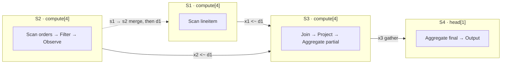

# Adaptive plans

A date predicate might leave a few megabytes of orders or several gigabytes. Broadcasting the
smaller result can save a shuffle of the much larger lineitem table. Broadcasting the larger one
can exhaust memory. An adaptive plan measures the filtered orders before choosing. Its printed
form gives both alternatives and the rule for choosing between them.

## The adaptive loop

An adaptive choice takes three steps on runtime values ([Runtime filters](05-runtime-filters.md))
and ends in a [decided exchange](03-exchanges.md#decided):

1. **`Observe`** watches a data edge without changing it, and publishes `Statistics` (rows, bytes,
   or a key sample) when its input ends on that worker. It never blocks.
2. **`merge_to`** turns the per-worker statistics into one global value on every worker, through a
   `ValueExchange`. Rows and bytes are summed; samples are pooled in sender order.
3. **`Decide`** is a pure function from that global value to a label. It publishes a `Decision`.
4. **A decided exchange** (`Exchange::decided_by`) has one alternative per label and routes rows
   by the decision.



Solid edges are rows; the dotted edge is a value. The orders stage observes its own output, and its
sink waits for the decision before it routes that output. The plan stays acyclic (V1): `Observe`
sits below `x2`, so the value flows in the same direction as the rows.

## Building Q5 step by step

Q5 (one day's revenue) computes the revenue per order for orders placed on 1995-03-15. Whether
that day's filtered orders, `day_orders`, are small enough to broadcast is unknown, so observe
their size:

```cpp
#include <sirius/sirius.hpp>
using namespace sirius;

Result<Relation> day_join(const Relation& lineitem, const Relation& day_orders,
                          const WorkerSet& compute) {
  SIRIUS_TRY(observed, day_orders.observe(StatisticsSpec::bytes()));
  SIRIUS_TRY(s2, observed.statistics.merge_to(compute));
  SIRIUS_TRY(d1, Decision::threshold(s2, Metric::bytes, 64 << 20,
                                     "broadcast", "partitioned"));
```
```rust
use sirius::prelude::*;

fn day_join(lineitem: &Relation, day_orders: &Relation, compute: &WorkerSet)
    -> Result<Relation, PlanError> {
    let observed = day_orders.observe(StatisticsSpec::bytes())?;
    let s2 = observed.statistics.merge_to(compute)?;
    let d1 = Decision::threshold(&s2, Metric::Bytes, 64 << 20,
                                 "broadcast", "partitioned")?;
```

`observe` returns a named struct, like `build_runtime_filter`: `observed.relation` passes the rows
through, and `observed.statistics` is the value handle. `Decision::threshold` picks `broadcast` when
the global byte count is at most 64 MiB, and `partitioned` otherwise. `d1.labels()` returns the
labels in that order.

Next, describe both exchanges, one alternative per label. Under `broadcast` the probe side
(lineitem) must not move, so its alternative is `forward`:

```cpp
  SIRIUS_TRY(build_exchange, Exchange::decided_by(d1, {
      {"broadcast", Exchange::broadcast(compute)},
      {"partitioned", Exchange::hash({"o_orderkey"}, compute)}}));
  SIRIUS_TRY(probe_exchange, Exchange::decided_by(d1, {
      {"broadcast", Exchange::forward()},
      {"partitioned", Exchange::hash({"l_orderkey"}, compute)}}));
  SIRIUS_TRY(right, observed.relation.exchange(build_exchange));
  SIRIUS_TRY(left, lineitem.exchange(probe_exchange));
  SIRIUS_TRY(on, JoinOn::keys({{"l_orderkey", "o_orderkey"}}));
  return left.join(right, JoinType::inner, std::move(on), JoinOptions::defaults());
}
```
```rust
    let build_exchange = Exchange::decided_by(&d1, vec![
        ("broadcast", Exchange::broadcast(compute)),
        ("partitioned", Exchange::hash(&["o_orderkey"], compute, Partitions::one_per_worker(),
                                       HashScheme::v1()))])?;
    let probe_exchange = Exchange::decided_by(&d1, vec![
        ("broadcast", Exchange::forward()),
        ("partitioned", Exchange::hash(&["l_orderkey"], compute, Partitions::one_per_worker(),
                                       HashScheme::v1()))])?;
    let right = observed.relation.exchange(&build_exchange)?;
    let left = lineitem.exchange(&probe_exchange)?;
    let on = JoinOn::keys(&[("l_orderkey", "o_orderkey")])?;
    left.join(&right, JoinType::Inner, on, JoinOptions::default())
}
```

`Exchange::decided_by` checks that the alternatives name exactly the decision's labels and target
the same worker set (V19). The join sees two exchanges decided by the same decision and derives
`mode=decided(d1)`: a broadcast-build join under `broadcast`, a co-partitioned join under
`partitioned`. The validator checks the join once per label (V10).

Add the aggregate and the gather to `head[1]`, and `explain()` prints the canonical Q5 plan:

```text
Plan "q5_day_revenue" (joined)
worker sets: head[1], compute[4]
values:
  s2 = ValueExchange merge s1 -> compute[4]
  d1 = Decide threshold(s2.bytes, at_most=64MiB) -> [broadcast, partitioned]
Output "result" on head[1]
└─ Aggregate final keys=[o_orderkey, o_orderdate]
   └─ Exchange x3 gather -> head[1]
      └─ Aggregate partial keys=[o_orderkey, o_orderdate] measures=[revenue = sum(rev)]
         └─ Project [o_orderkey, o_orderdate, rev = l_extendedprice * (1 - l_discount)]
            └─ Join inner keys=[l_orderkey == o_orderkey] build=right  mode=decided(d1)
               ├─ Exchange x1 <~ d1 {broadcast: forward, partitioned: hash(l_orderkey)} -> compute[4]
               │  └─ Scan lineitem [l_orderkey, l_extendedprice, l_discount]  on compute[4]  shards=files_round_robin
               └─ Exchange x2 <~ d1 {broadcast: broadcast, partitioned: hash(o_orderkey)} -> compute[4]
                  └─ Observe bytes ~> s1
                     └─ Filter o_orderdate == 1995-03-15
                        └─ Scan orders [o_orderkey, o_orderdate]  on compute[4]  shards=files_round_robin
```

The tree holds both possible executions. [Adaptive join](../part-3/05-adaptive-join.md) walks
through Q5 as a query, with its trade-offs.

## Why every worker picks the same label

No coordinator collects the statistics and tells the workers what to do. Each compute worker
decides on its own, and three facts make them agree:

- **Every worker sees the same input.** `s2` is the merge of every worker's `s1`, and a `Decide`
  input must be global on every set it controls (V15). The value is the same bit for bit, because
  its units do not depend on the engine: `Metric::rows` is a row count, and `Metric::bytes` counts
  **logical bytes** computed from Arrow type widths (see
  [Observe](../reference/node-catalog.md#observe)). Sums are exact and samples are ordered by
  sender, so arrival order cannot matter.
- **The rule is pure.** `Decide threshold(s2.bytes, at_most=64MiB)` depends only on `s2`: no
  clocks, no memory pressure, no per-worker state. Its parameters are integers or decimals, never
  floating point, so rounding cannot split two workers.
- **The alternatives are fixed.** The plan lists every label and its exchange, so a label means the
  same routing on every worker.

If each worker decided from its own `s1`, `compute#0` might see 10 MiB and broadcast while
`compute#3` sees 70 MiB and hashes. The join would get neither a complete broadcast nor a clean
partitioning, and rows would be lost. V15 makes that a construction error.

Most engines that adapt at run time have a coordinator that decides once.
[Related designs](../appendix/related-designs.md#where-sirius-differs) compares the two.

The engine still checks, in case a bug breaks one of the three facts. Every batch and every end of
stream on a decided exchange carries a digest of the label its sender chose, and every delivered
`Boundaries` or `Assignment` value carries a digest of the value. A receiver that sees a digest
other than its own fails the execution with an `execution` error.

A `Decision` is a required value: the senders on both sides wait for `d1` before they route a row.
The scans may run ahead while buffering capacity remains. The lineitem scan starts with the query, and its output waits at `x1`'s
sender, in memory that can spill. The wait is one cost of adaptivity: `d1` cannot exist until
every worker has seen the end of its filtered orders.

### Deciding on a leader

Merging `s1` to every worker of `compute[4]` is logically all to all. Direct delivery would
carry N contributions to each of N recipients. When that cost matters, or when a decision must happen in exactly one place (two workers
could not evaluate a policy with a timeout alike), name a leader. Merge the statistics to
`head[1]`, decide there, and deliver the `Decision` to `compute[4]` through a `ValueExchange` with
one sender:

```cpp
SIRIUS_TRY(at_head, observed.statistics.merge_to(head));
SIRIUS_TRY(chosen, Decision::threshold(at_head, Metric::bytes, 64 << 20,
                                       "broadcast", "partitioned"));
SIRIUS_TRY(d2, chosen.merge_to(compute));   // one sender: delivery
```
```rust
let at_head = observed.statistics.merge_to(head)?;
let chosen = Decision::threshold(&at_head, Metric::Bytes, 64 << 20,
                                 "broadcast", "partitioned")?;
let d2 = chosen.merge_to(compute)?; // one sender: delivery
```

The decided exchanges then read the delivered decision:

```text
values:
  s2 = ValueExchange merge s1 -> head[1]
  d1 = Decide threshold(s2.bytes, at_most=64MiB) -> [broadcast, partitioned]
  d2 = ValueExchange merge d1 -> compute[4]
...
├─ Exchange x1 <~ d2 {broadcast: forward, partitioned: hash(l_orderkey)} -> compute[4]
...
└─ Exchange x2 <~ d2 {broadcast: broadcast, partitioned: hash(o_orderkey)} -> compute[4]
```

Here `d2` is the delivered decision, not the partition count of a later section. With direct delivery, the leader receives N statistics and sends N decisions. Forwarding or a
tree reduction can change the physical message counts for either plan. It needs no new rule (V12, V15):
`Decide` reads a value that is global on `head[1]`, where it runs, and the `Decision` reaches
`compute[4]` as a global value. The plan says which form runs.
[Value merges at scale](../part-5/08-running-at-scale.md#value-merges-all-to-all-in-the-plan-a-tree-on-the-wire)
has the numbers for a thousand workers, and how the engine reduces an all-to-all merge as a tree.

## Stage graphs do not change

Under `broadcast` the probe side does not move, but its alternative is still an exchange,
[`forward`](03-exchanges.md#forward). Both labels therefore give the same stages: S1 (lineitem), S2
(orders), S3 (join and partial aggregate), S4 (head). Only the routing inside `x1` and `x2`
changes, so every process can prepare the plan, and every handshake can succeed, without knowing
the label.

## The other cost: a weaker distribution

Q5's join has two possible output distributions:

- under `broadcast`, a broadcast-build join keeps the probe's distribution, and the probe was only
  forwarded, so the output is `arbitrary`;
- under `partitioned`, the output is `hashed` on the order key.

A plan must be correct under every label, so downstream nodes see the **meet** of the alternatives,
the strongest guarantee they all share (see
[The Distribution property](02-workers-and-distribution.md#the-distribution-property)). Here that
is `arbitrary`, and a grouped single-phase aggregate on `arbitrary` rows violates V6. Q5 uses
`Aggregate partial`, a gather and `Aggregate final`. Another legal plan would hash on the group
keys before a single aggregate.

Under `partitioned` that is an extra aggregation phase on `head[1]` that a fixed partitioned plan,
such as Q4 (urgent March revenue), does not need. If you know the size in advance, use a fixed
plan.

## Deciding the partition count

A hash exchange normally makes one partition per worker. For large data you may want more, so each
worker receives its share as several smaller partitions; partition *p* still goes to worker
*p* mod |W|. Splitting rows further inside one worker is the engine's business, but workers must
agree on this count, so it is in the plan.

`Decision::partition_count` picks the count from a global byte count. In Q5, a second decision
reads the same `s2` and sets the count for the `partitioned` label:

```cpp
SIRIUS_TRY(d2, Decision::partition_count(s2, PartitionCountPolicy{1ull << 30, 4, 64}));
auto partitions = Partitions::decided_by(d2);
auto probe_by_count = Exchange::hash({"l_orderkey"}, compute, partitions);
auto build_by_count = Exchange::hash({"o_orderkey"}, compute, partitions);
```
```rust
let d2 = Decision::partition_count(&s2,
    PartitionCountPolicy { target_bytes: 1 << 30, min: 4, max: 64 })?;
let partitions = Partitions::decided_by(&d2);
let probe_by_count = Exchange::hash(&["l_orderkey"], compute, partitions.clone(),
                                    HashScheme::v1());
let build_by_count = Exchange::hash(&["o_orderkey"], compute, partitions, HashScheme::v1());
```

Pass `probe_by_count` and `build_by_count` as the `partitioned` alternatives of the two
`decided_by` calls above. The rule is `ceil(bytes / target_bytes)`, clamped to `[min, max]`. It
prints in the `values:` block, and each exchange shows where its count comes from:

```text
values:
  s2 = ValueExchange merge s1 -> compute[4]
  d1 = Decide threshold(s2.bytes, at_most=64MiB) -> [broadcast, partitioned]
  d2 = Decide partition_count(s2.bytes, target=1GiB, min=4, max=64)
...
├─ Exchange x1 <~ d1 {broadcast: forward, partitioned: hash(l_orderkey) partitions=<~d2} -> compute[4]
...
└─ Exchange x2 <~ d1 {broadcast: broadcast, partitioned: hash(o_orderkey) partitions=<~d2} -> compute[4]
```

Both exchanges must use `d2`, because the join pairs partition *p* of `x1` with partition *p* of
`x2`. With 16 partitions on one side and 32 on the other, a key could land in partition 5 on one
side and partition 21 on the other, and the pair would never meet. The partition count is part of
the partitioning signature, so the validator requires the same decided partitions on both sides of
a co-partitioned join (V20).

## The sugar, and what it expands to

For the common case, `JoinOptions` has a helper:

```cpp
SIRIUS_TRY(on, JoinOn::keys({{"l_orderkey", "o_orderkey"}}));
SIRIUS_TRY(joined, lineitem.join(day_orders, JoinType::inner, std::move(on),
                                 JoinOptions::defaults().with_adaptive_broadcast(64 << 20)));
```
```rust
let on = JoinOn::keys(&[("l_orderkey", "o_orderkey")])?;
let joined = lineitem.join(&day_orders, JoinType::Inner, on,
                           JoinOptions::default().with_adaptive_broadcast(64 << 20))?;
```

The helper creates no special node. It inserts the nodes built by hand in
[Building Q5 step by step](#building-q5-step-by-step). `explain()` prints the Q5 tree, and the two
plans have equal fingerprints (rule 5).

The helper requires both inputs on the same worker set, with no exchange directly below the join,
because it adds those exchanges itself.

## Choosing between subtrees

A decided exchange changes where rows go, never what the plan does with them. Some choices need
more. [Aggregation](../part-3/02-aggregation.md#plan-b-finish-on-the-head-worker) compares two
plans for Q2 (pricing summary): plan A hashes the partial rows over `compute[4]` and finishes
there, plan B gathers them to `head[1]` and finishes there. B is better with few groups, A with
many, and the group count is unknown before the run. A decided exchange cannot switch between them:
the two plans send `x1` to different sets (V19) and run different nodes after it.

`Choose` picks one of several **arms**, whole subtrees with the same schema, by the label of a
`Decision`. Q2's arms share everything up to the partial aggregate, so observe the partial rows,
decide on `head[1]`, and deliver the label to `compute[4]`:

```cpp
#include <sirius/sirius.hpp>
using namespace sirius;

Result<Plan> q2_adaptive(const Relation& partial, const Example& ex) {
  SIRIUS_TRY(observed, partial.observe(StatisticsSpec::rows()));
  SIRIUS_TRY(at_head, observed.statistics.merge_to(ex.head));
  SIRIUS_TRY(d1, Decision::threshold(at_head, Metric::rows, 1'000'000, "on_head", "on_compute"));
  SIRIUS_TRY(d2, d1.merge_to(ex.compute));   // one sender: delivery
```
```rust
use sirius::prelude::*;

fn q2_adaptive(partial: &Relation, ex: &Example) -> Result<Plan, PlanError> {
    let observed = partial.observe(StatisticsSpec::rows())?;
    let at_head = observed.statistics.merge_to(&ex.head)?;
    let d1 = Decision::threshold(&at_head, Metric::Rows, 1_000_000, "on_head", "on_compute")?;
    let d2 = d1.merge_to(&ex.compute)?; // one sender: delivery
```

The statistic is plan B's cost: the number of partial rows B would send to `head#0`. Build both
arms from the same `observed.relation`, and choose:

```cpp
  std::vector<std::string> keys = {"l_returnflag", "l_linestatus"};
  std::vector<SortKey> order = {SortKey::asc("l_returnflag"), SortKey::asc("l_linestatus")};
  // plan B: gather the partials and finish on head[1]
  SIRIUS_TRY(at_head_rows, observed.relation.exchange(Exchange::gather(ex.head)));
  SIRIUS_TRY(head_totals, at_head_rows.aggregate_final());
  SIRIUS_TRY(on_head, head_totals.sort(order));
  // plan A: hash the partials, finish on compute[4], merge the sorted runs on head[1]
  SIRIUS_TRY(by_group, observed.relation.exchange(Exchange::hash(keys, ex.compute)));
  SIRIUS_TRY(totals, by_group.aggregate_final());
  SIRIUS_TRY(sorted, totals.sort(order));
  SIRIUS_TRY(on_compute, sorted.exchange(Exchange::gather(ex.head, GatherOrder::merge(order))));
  SIRIUS_TRY(chosen, Relation::choose({d1, d2}, {{"on_head", on_head}, {"on_compute", on_compute}}));
  return Plan::from_root(chosen);
}
```
```rust
    let keys = ["l_returnflag", "l_linestatus"];
    let order = vec![SortKey::asc("l_returnflag"), SortKey::asc("l_linestatus")];
    // plan B: gather the partials and finish on head[1]
    let at_head_rows = observed.relation.exchange(&Exchange::gather(&ex.head, GatherOrder::any()))?;
    let head_totals = at_head_rows.aggregate_final()?;
    let on_head = head_totals.sort(order.clone())?;
    // plan A: hash the partials, finish on compute[4], merge the sorted runs on head[1]
    let by_group = observed.relation.exchange(&Exchange::hash(&keys, &ex.compute,
        Partitions::one_per_worker(), HashScheme::v1()))?;
    let totals = by_group.aggregate_final()?;
    let sorted = totals.sort(order.clone())?;
    let on_compute = sorted.exchange(&Exchange::gather(&ex.head, GatherOrder::merge(order)))?;
    let chosen = Relation::choose(&[&d1, &d2],
        vec![("on_head", on_head), ("on_compute", on_compute)])?;
    Plan::from_root(&chosen, "result")
}
```

`Relation::choose` takes the `Decision` and its deliveries. Each arm prints under the `Choose`,
headed by its label. The shared input, marked `#A`, prints once and runs once per worker:

```text
Plan "q2_pricing_summary_adaptive" (joined)
worker sets: head[1], compute[4]
values:
  s2 = ValueExchange merge s1 -> head[1]
  d1 = Decide threshold(s2.rows, at_most=1000000) -> [on_head, on_compute]
  d2 = ValueExchange merge d1 -> compute[4]
Output "result" on head[1]
└─ Choose <~ d1, d2
   ├─ [on_head] Sort [l_returnflag asc, l_linestatus asc]
   │  └─ Aggregate final keys=[l_returnflag, l_linestatus]
   │     └─ Exchange x1 gather -> head[1]
   │        └─ Observe rows ~> s1  #A
   │           └─ Aggregate partial keys=[l_returnflag, l_linestatus] ...
   │              └─ Project ...
   │                 └─ Filter l_shipdate <= 1998-09-02
   │                    └─ Scan lineitem ...  on compute[4]  shards=files_round_robin
   └─ [on_compute] Exchange x3 gather order=merge[l_returnflag asc, l_linestatus asc] -> head[1]
      └─ Sort [l_returnflag asc, l_linestatus asc]
         └─ Aggregate final keys=[l_returnflag, l_linestatus]
            └─ Exchange x2 hash(l_returnflag, l_linestatus) -> compute[4]
               └─ Ref #A
```

What the validator checks (V26):

- **One arm per label**, in the `Decision`'s label order, all with the same schema: names, types
  and nullability.
- **The label reaches every worker that needs it.** The arms here run on two sets: plan A's final
  aggregate on `compute[4]`, plan B's on `head[1]`. The handles together must be global on every
  set that runs a node of any arm. The first handle is the `Decision`; the others must be
  one-sender deliveries of it, so they carry the same label.
- **The decision does not depend on its own arms.** Its inputs come from outside every arm, as `s1`
  does here. Otherwise the arms would wait for the decision and the decision for an arm.
- **A value made inside an arm stays inside it.** A runtime filter built in one arm applies only in
  that arm, because an arm that is not chosen never publishes anything.
- **Each arm is a valid plan on its own**, and the facts above the `Choose` are the meet of the
  arms, as for decided exchanges. Here both arms end `single` on `head[1]`, sorted on the same
  keys, so the meet loses nothing.

The stage graph is still fixed: it is the union of every arm's stages. Every stage instance of
every arm is prepared, bound and admitted before the run, so every handshake succeeds without the
label. The cost is that the losing arms are prepared and admitted too.

The nodes of the losing arms never run. A stage that belongs only to them, such as plan A's final
aggregate under `on_head`, ends `closed` without reading anything, and a sink of theirs in a shared
stage sends end of stream with no rows. They must not run on empty input instead, because an
aggregate without keys turns empty input into one row.

The shared input waits for the label as the input of a decided exchange does: the partial rows sit
at both arms' sinks, in memory that can spill, until `d2` arrives. That costs little here, because
a partial aggregate emits most of its rows at the end of its input.

In the resolved plan the chosen arm replaces the `Choose`, the shared subtree prints inline, and
`d1 = on_head (resolved)` records why.

The same shape picks between a distributed and a single-worker subtree when the input turns out
small, between join orders the plan lists, or between a sort-based and a hash-based strategy.
Policies that compare two candidates are
[open question 11](../reference/open-questions.md#11-choose-limits-and-richer-policies). Every arm
is written out in advance; choices that cannot be are
[open question 33](../reference/open-questions.md#33-re-planning-beyond-the-plans-alternatives).

## After the run: decisions and the resolved plan

`report.decisions()` holds one `DecisionRecord` per `Decide` node: the label that won, the input
value it saw, and the resolved counts. Every worker computed the same label, so
`ExecutionReport::combine` merges records from different processes without conflict.

The report also gives the **resolved plan**, the same plan with every decision substituted:

```cpp
SIRIUS_TRY(report, std::move(started.execution).wait());
std::cout << report.resolved_plan().explain();
SIRIUS_TRY(again, rewrite::resolve(plan, report.decisions()));   // the decisions substituted
```
```rust
let report = started.execution.wait()?;
println!("{}", report.resolved_plan().explain(&ExplainOptions::default()));
let again = rewrite::resolve(&plan, report.decisions())?; // the decisions substituted
```

`rewrite::resolve` substitutes only the decisions. `resolved_plan()` also substitutes assignments
and dynamic split claims, so the two are equal for a plan with neither, such as Q5.

If the day's orders came to 3 MiB, the resolved plan shows a broadcast join:

```text
Plan "q5_day_revenue" (resolved)
worker sets: head[1], compute[4]
values:
  s2 = ValueExchange merge s1 -> compute[4]
  d1 = broadcast (resolved)
Output "result" on head[1]
└─ Aggregate final keys=[o_orderkey, o_orderdate]
   └─ Exchange x3 gather -> head[1]
      └─ Aggregate partial keys=[o_orderkey, o_orderdate] measures=[revenue = sum(rev)]
         └─ Project [o_orderkey, o_orderdate, rev = l_extendedprice * (1 - l_discount)]
            └─ Join inner keys=[l_orderkey == o_orderkey] build=right  mode=broadcast_build
               ├─ Exchange x1 forward -> compute[4]
               │  └─ Scan lineitem [l_orderkey, l_extendedprice, l_discount]  on compute[4]  shards=files_round_robin
               └─ Exchange x2 broadcast -> compute[4]
                  └─ Observe bytes ~> s1
                     └─ Filter o_orderdate == 1995-03-15
                        └─ Scan orders [o_orderkey, o_orderdate]  on compute[4]  shards=files_round_robin
```

The resolved plan records what ran and is never re-optimized, so the aggregate stays two-phase. It
is an ordinary plan: you can diff it against the joined plan, keep it with the query's logs, or
run it again with the recorded decision labels. Input contents, arrival order and ties can still vary.

Re-running the joined plan on the same data reaches the same label whenever the decision reads
exact rows or logical bytes. Whether a key sample must also be reproducible across runs is
[open question 12](../reference/open-questions.md#12-decision-determinism-and-replay).

## Which runtime decisions go where

By [the ownership rule](01-everything-in-the-plan.md#the-ownership-rule), a choice that changes
what a receiving worker gets, or which nodes run, is in the plan. A choice that changes only
how one worker does its own work is the engine's.

| Runtime decision | Decided by | How | Read more |
|---|---|---|---|
| Broadcast the build side or hash both sides | Plan | `Decide` and `Exchange::decided_by` | [Adaptive join](../part-3/05-adaptive-join.md) |
| How many partitions an exchange makes | Plan | `Partitions::decided_by` | [Above](#deciding-the-partition-count) |
| Which worker gets which partition, to even out skew | Plan | `AssignPartitions` and `Partitions::assigned_by` | [Running at scale](../part-5/08-running-at-scale.md#skew-more-partitions-than-workers) |
| Which worker reads which split | Plan | Splits fixed at build, or `Shards::dynamic()` with every claim in the report | [Running at scale](../part-5/08-running-at-scale.md#dynamic-splits) |
| Range splitters for a distributed sort | Plan | `ComputeBoundaries` from a pooled key sample | [Q6b](../part-3/06-sort-top-n-and-limit.md#range-partitioning-with-boundaries) |
| How large a Bloom filter is | Plan | `BloomGeometry::sized_by` a global row count | [Runtime filters](05-runtime-filters.md#filter-specs-and-geometry-agreement) |
| How long a probe waits for a filter | Plan | `WaitPolicy::never` or `WaitPolicy::up_to` | [Runtime filters](05-runtime-filters.md#waiting-or-not) |
| Which subtree runs: finish on one worker or many, which listed join order | Plan | `Choose` | [Above](#choosing-between-subtrees) |
| Which side to broadcast, by comparing two sizes | Plan, once a policy can read two statistics | A richer `Decide` policy | [Question 11](../reference/open-questions.md#11-choose-limits-and-richer-policies) |
| Whether a partial aggregate combines rows or passes them on | Engine | A partial may emit several state rows per group; the final combines them | [Aggregation](../part-3/02-aggregation.md#building-it) |
| A join's build side, when the plan leaves it `auto` | Preparation | Resolved from the plan, the engine build and the bound devices, with no cost search; the explain prints `build=auto->right` | [The build side](../part-1/07-aggregates-joins-and-ordering.md#the-build-side) |
| Join algorithm, sub-partitioning to fit memory, spilling | Engine | Local to one worker | [Adaptivity in the engine](../part-5/04-adaptivity-in-the-engine.md#where-each-decision-goes) |
| Which GPU runs which worker | Bindings | Fixed at `prepare` | [Stages and bindings](04-stages-and-bindings.md#bindings-where-never-what) |
| How many workers a set has | Plan, fixed when it is built | Set sizes | [Question 3](../reference/open-questions.md#3-fixed-set-sizes) |
| A join order or plan shape nobody listed in advance | Not covered yet | Re-planning | [Question 33](../reference/open-questions.md#33-re-planning-beyond-the-plans-alternatives) |

Some engine-owned choices are adaptive too: the engine can stop combining in a partial aggregate
that reduces nothing, or switch join algorithms when a build side is larger than expected. None of
that changes what a receiver gets, so none of it needs agreement. Whether the report should still
list such choices is [open question 19](../reference/open-questions.md#19-the-implicit-boundary).

## Adaptivity today

Today's engine adapts inside its operators. When a hash join's inputs are partitioned across GPUs,
the join chooses at run time whether to broadcast its build side and how many partitions to use,
from statistics measured on its inputs. A configured size limit (256 MiB by default) caps broadcast
builds. The plan shows neither the alternatives nor the rule, and the choice is not recorded.

The proposal keeps the measurements and moves the choice into `Observe` and `Decide` nodes.
[Adaptivity in the engine](../part-5/04-adaptivity-in-the-engine.md) shows how the existing logic
lowers onto them.
