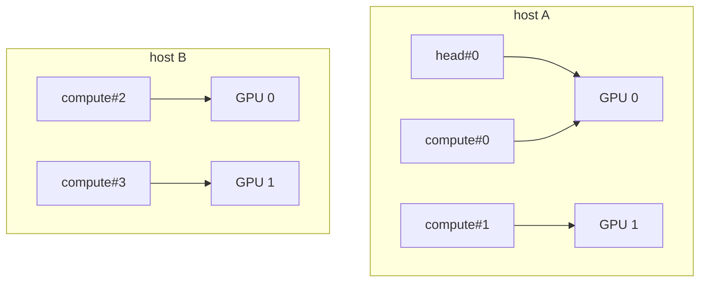

# The running example

The examples use four tables from TPC-H. Each plan has four workers for the main computation
and one for results. The same logical workers can run on one four-GPU machine or on two
two-GPU machines. The query numbers belong to this book.

## The tables

The data is a subset of the TPC-H schema: four tables, all columns `required` (no nulls).

| Table | Columns |
|---|---|
| `nation` | `n_nationkey int32`, `n_name string`, `n_regionkey int32` |
| `customer` | `c_custkey int64`, `c_name string`, `c_nationkey int32`, `c_mktsegment string`, `c_acctbal decimal(15,2)` |
| `orders` | `o_orderkey int64`, `o_custkey int64`, `o_orderstatus string`, `o_totalprice decimal(15,2)`, `o_orderdate date32`, `o_orderpriority string`, `o_shippriority int32` |
| `lineitem` | `l_orderkey int64`, `l_partkey int64`, `l_suppkey int64`, `l_linenumber int32`, `l_quantity decimal(15,2)`, `l_extendedprice decimal(15,2)`, `l_discount decimal(15,2)`, `l_tax decimal(15,2)`, `l_returnflag string`, `l_linestatus string`, `l_shipdate date32` |

The tables live in Parquet files:

| Table | Files | Count |
|---|---|---|
| `nation` | `data/nation.parquet` | 1 |
| `customer` | `data/customer/part-000.parquet` ... `part-015.parquet` | 16 |
| `orders` | `data/orders/part-000.parquet` ... `part-063.parquet` | 64 |
| `lineitem` | `data/lineitem/part-000.parquet` ... `part-255.parquet` | 256 |

File order matters: a scan with `shards=files_round_robin` gives file `i` to worker `i mod n`
(see [Shard kinds](../part-2/02-workers-and-distribution.md#shard-kinds)). Every process that
builds the plan computes the same assignment from the file list and the set size alone.

The paths are relative to keep the examples short. A relative path resolves against the working
directory of the preparing process, so on the cluster every process starts in a directory that
holds the same `data/` tree. A real deployment uses absolute URIs
([Declaring a table](../part-1/05-relations-and-plans.md#declaring-a-table)).

## Schemas in code

Each `TableSource` carries an explicit schema, built as in
[Fields and schemas](../part-1/04-schemas-and-expressions.md#fields-and-schemas). This is the
widest one. `nation_schema()`, `customer_schema()` and `orders_schema()` follow the same pattern.

```cpp
#include <sirius/sirius.hpp>
using namespace sirius;

Result<Schema> lineitem_schema() {
  SIRIUS_TRY(money, DataType::decimal(15, 2));
  return Schema::create({
      Field::required("l_orderkey", DataType::int64()),
      Field::required("l_partkey", DataType::int64()),
      Field::required("l_suppkey", DataType::int64()),
      Field::required("l_linenumber", DataType::int32()),
      Field::required("l_quantity", money),
      Field::required("l_extendedprice", money),
      Field::required("l_discount", money),
      Field::required("l_tax", money),
      Field::required("l_returnflag", DataType::string()),
      Field::required("l_linestatus", DataType::string()),
      Field::required("l_shipdate", DataType::date32()),
  });
}
```
```rust
use sirius::prelude::*;

fn lineitem_schema() -> Result<Schema, PlanError> {
    let money = DataType::decimal(15, 2)?;
    Schema::try_new(vec![
        Field::required("l_orderkey", DataType::int64()),
        Field::required("l_partkey", DataType::int64()),
        Field::required("l_suppkey", DataType::int64()),
        Field::required("l_linenumber", DataType::int32()),
        Field::required("l_quantity", money.clone()),
        Field::required("l_extendedprice", money.clone()),
        Field::required("l_discount", money.clone()),
        Field::required("l_tax", money),
        Field::required("l_returnflag", DataType::string()),
        Field::required("l_linestatus", DataType::string()),
        Field::required("l_shipdate", DataType::date32()),
    ])
}
```

## Table sources

The examples use a helper, `parquet_table`, to list files in a fixed order.

```cpp
// Book helper: data/<name>/part-000.parquet, part-001.parquet, ... in this order.
Result<TableSource> parquet_table(const std::string& name, int file_count,
                                  const Schema& schema) {
  std::vector<DataFile> files;
  for (int i = 0; i < file_count; ++i)
    files.push_back(std::format("data/{}/part-{:03}.parquet", name, i));
  return TableSource::parquet(name, std::move(files), schema);
}
```
```rust
// Book helper: data/<name>/part-000.parquet, part-001.parquet, ... in this order.
fn parquet_table(name: &str, file_count: usize,
                 schema: &Schema) -> Result<TableSource, PlanError> {
    let files = (0..file_count).map(|i| format!("data/{name}/part-{i:03}.parquet"));
    TableSource::parquet(name, files, schema)
}
```

One `Example` value bundles the two worker sets and the four table sources. Q1 to Q3 take the
`Example` and write `ex.compute`, `ex.lineitem` and so on. Later chapters pass the sets and
sources as separate arguments.

```cpp
struct Example {
  WorkerSet head, compute;
  TableSource nation, customer, orders, lineitem;
};

Result<Example> running_example() {
  SIRIUS_TRY(head, WorkerSet::create("head", 1));
  SIRIUS_TRY(compute, WorkerSet::create("compute", 4));
  SIRIUS_TRY(nation_fields, nation_schema());
  SIRIUS_TRY(customer_fields, customer_schema());
  SIRIUS_TRY(orders_fields, orders_schema());
  SIRIUS_TRY(lineitem_fields, lineitem_schema());

  SIRIUS_TRY(nation, TableSource::parquet("nation", {"data/nation.parquet"}, nation_fields));
  SIRIUS_TRY(customer, parquet_table("customer", 16, customer_fields));
  SIRIUS_TRY(orders, parquet_table("orders", 64, orders_fields));
  SIRIUS_TRY(lineitem, parquet_table("lineitem", 256, lineitem_fields));
  return Example{head, compute, nation, customer, orders, lineitem};
}
```
```rust
pub struct Example {
    pub head: WorkerSet,
    pub compute: WorkerSet,
    pub nation: TableSource,
    pub customer: TableSource,
    pub orders: TableSource,
    pub lineitem: TableSource,
}

fn running_example() -> Result<Example, PlanError> {
    let head = WorkerSet::try_new("head", 1)?;
    let compute = WorkerSet::try_new("compute", 4)?;
    let nation_fields = nation_schema()?;
    let customer_fields = customer_schema()?;
    let orders_fields = orders_schema()?;
    let lineitem_fields = lineitem_schema()?;

    let nation = TableSource::parquet("nation", ["data/nation.parquet"], &nation_fields)?;
    let customer = parquet_table("customer", 16, &customer_fields)?;
    let orders = parquet_table("orders", 64, &orders_fields)?;
    let lineitem = parquet_table("lineitem", 256, &lineitem_fields)?;
    Ok(Example { head, compute, nation, customer, orders, lineitem })
}
```

In the proposed API, building and printing these plans needs only the file lists and schemas.

## Two worker sets

The example uses two worker sets (see
[Workers and worker sets](../part-2/02-workers-and-distribution.md#workers-and-worker-sets)):

- **`compute[4]`**, workers `compute#0` to `compute#3`. The large scans, the joins and most of the
  aggregation run here.
- **`head[1]`**, the single worker `head#0`. Results arrive here, and so do the steps that need
  every row in one place: a global top-N, an ungrouped final aggregate, a merge of sorted runs.

`head#0` coordinates nothing and has no special role: it is the worker the plan sends those rows
to. A worker set names no machine. The bindings decide at `prepare` which GPU each worker lands on.

## Two deployments

The walkthroughs use two example deployments.

**The cluster** is two hosts with two GPUs each. `compute#0` and `compute#1` run on host A,
`compute#2` and `compute#3` on host B. `head#0` shares host A's GPU 0 with `compute#0`.



Each process creates its `Context`. A launcher collects every process's `device_endpoints()` and
hands the lists back with one shared `ExecutionId`. Every process then builds the same `Bindings`
from them (see [Every process prepares the same
plan](../part-2/04-stages-and-bindings.md#every-process-prepares-the-same-plan)).

**The single machine** is one host with four GPUs. `Bindings::local()` assigns every set
round-robin over this context's device endpoints: `compute#k` lands on GPU `k`, and `head#0` on
GPU 0, again shared with `compute#0`.

```cpp
// One machine, four GPUs: every set round-robin over this context's endpoints.
Bindings single_machine() { return Bindings::local(); }

// Two hosts, two GPUs each. host_a and host_b are the device_endpoints() lists
// that the launcher collected from the two processes.
Result<Bindings> cluster(const Example& ex, ExecutionId id,
                         std::span<const Endpoint> host_a,
                         std::span<const Endpoint> host_b) {
  SIRIUS_TRY(head_on, WorkerBinding::to({host_a[0]}));
  SIRIUS_TRY(compute_on, WorkerBinding::to({host_a[0], host_a[1], host_b[0], host_b[1]}));
  return Bindings::builder()
      .execution(id)
      .workers(ex.head, std::move(head_on))
      .workers(ex.compute, std::move(compute_on))
      .build();
}
```
```rust
// One machine, four GPUs: every set round-robin over this context's endpoints.
fn single_machine() -> Bindings { Bindings::local() }

// Two hosts, two GPUs each. host_a and host_b are the device_endpoints() lists
// that the launcher collected from the two processes.
fn cluster(ex: &Example, id: ExecutionId,
           host_a: &[Endpoint], host_b: &[Endpoint]) -> Result<Bindings, PrepareError> {
    let head_on = WorkerBinding::to(vec![host_a[0].clone()])?;
    let compute_on = WorkerBinding::to(vec![host_a[0].clone(), host_a[1].clone(),
                                            host_b[0].clone(), host_b[1].clone()])?;
    Bindings::builder()
        .execution(id)
        .workers(&ex.head, head_on)
        .workers(&ex.compute, compute_on)
        .build()
}
```

The bindings say where each worker runs, never what the plan does (rule 4,
[Bindings: where, never what](../part-2/04-stages-and-bindings.md#bindings-where-never-what)). So
both deployments use the same plan and fingerprint. A hash exchange preserves the same key-to-worker
assignment. Arrival order, filter timing and the rows selected by an unordered limit can vary.

To run a plan, the host would create a `Context`
([The context](../part-1/03-context-and-session.md)), call `context.prepare(plan, bindings)`,
then `collect()` or `start()` ([Prepare and execute](../part-1/06-prepare-and-execute.md)).

## The queries

| Query | The question, in short | What it teaches | Chapter |
|---|---|---|---|
| Q1 (shipped line revenue) | Revenue of every line item shipped by a cutoff date | Shards, gather, partitioned output, filter pushdown | [Scan, filter and project](01-scan-filter-project.md) |
| Q2 (pricing summary), Q2b, Q2r, Q3d | Totals per return flag and line status; one grand total; the same with subtotals; distinct customers per priority | Two-phase aggregation, state types, identity rows, grouping sets | [Aggregation](02-aggregation.md) |
| Q3 (BUILDING customers per nation) | Customer count and balance per nation for one segment | Broadcast exchange, broadcast_build joins | [Broadcast join](03-broadcast-join.md) |
| Q4 (urgent March revenue) | Revenue per urgent order placed in March 1995 | Co-partitioned joins, runtime filters merged across workers | [Partitioned join and runtime filters](04-partitioned-join-and-runtime-filters.md) |
| Q5 (one day's revenue) | Revenue per order for one day, size unknown in advance | `Observe`, `Decide` and decided exchanges | [Adaptive join](05-adaptive-join.md) |
| Q6a, Q6b, Q6c (ordering) | Top 10 orders, all orders sorted, any 100 orders | TopN, also per key, range exchange with Boundaries, Limit and close | [Sort, top-N and limit](06-sort-top-n-and-limit.md) |
| Q7 (shipping priority) | Top 10 orders by revenue for one segment and date window | Broadcast, co-partitioned join, runtime filters and top-N in one plan, shown in every form | [A multi-stage query](07-a-multi-stage-query.md) |
