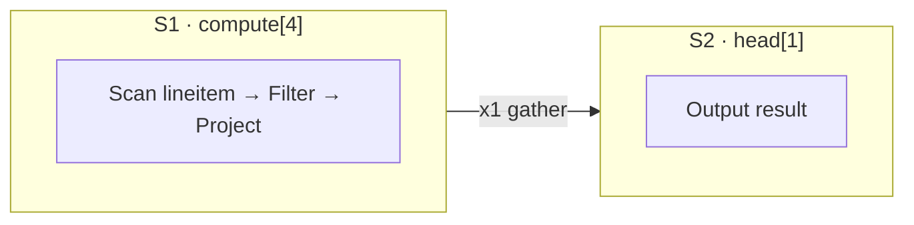

# Scan, filter and project

Q1 has no join and no aggregate. Its plan still says which worker reads which file (a shard rule),
where the result rows go (an `Exchange`) and how many result streams your program gets (the worker
set of the `Output` node).

## The question

**Q1 (shipped line revenue).** For every line item shipped on or before 1998-09-02, return its
order key, its line number and its revenue, defined as `l_extendedprice * (1 - l_discount)`.

## The single-worker plan

Start with one worker, `local[1]`, reading every lineitem file.

```text
Plan "q1_shipped_revenue" (joined)
worker sets: local[1]
Output "result" on local[1]
└─ Project [l_orderkey, l_linenumber, revenue = l_extendedprice * (1 - l_discount)]
   └─ Filter l_shipdate <= 1998-09-02
      └─ Scan lineitem [l_orderkey, l_linenumber, l_extendedprice, l_discount, l_shipdate]
                       on local[1]  shards=files_round_robin
```

Round robin deals all 256 files to `local#0`. `Output "result"` hands the rows to your program
through one `BatchReader`.

## Building it

The next chapter reuses two expressions, so each gets a function. Each takes the relation that
scopes its columns (see [Types, schemas and expressions](../part-1/04-schemas-and-expressions.md)).

```cpp
#include <sirius/sirius.hpp>
using namespace sirius;

// l_shipdate <= 1998-09-02, scoped to `rel`.
Result<Expression> shipped_by_cutoff(const Relation& rel) {
  SIRIUS_TRY(shipdate, rel.column("l_shipdate"));
  SIRIUS_TRY(cutoff, Value::date32(1998, 9, 2));
  return shipdate.le(Expression::literal(cutoff));
}

// l_extendedprice * (1 - l_discount), scoped to `rel`.
Result<Expression> revenue_of(const Relation& rel) {
  SIRIUS_TRY(price, rel.column("l_extendedprice"));
  SIRIUS_TRY(discount, rel.column("l_discount"));
  SIRIUS_TRY(one, Value::decimal("1", 15, 2));
  SIRIUS_TRY(kept, Expression::literal(one).sub(discount));
  return price.mul(kept);
}
```
```rust
use sirius::prelude::*;

// l_shipdate <= 1998-09-02, scoped to `rel`.
fn shipped_by_cutoff(rel: &Relation) -> Result<Expression, PlanError> {
    let shipdate = rel.column("l_shipdate")?;
    let cutoff = Value::date32(1998, 9, 2)?;
    shipdate.le(&Expression::literal(cutoff))
}

// l_extendedprice * (1 - l_discount), scoped to `rel`.
fn revenue_of(rel: &Relation) -> Result<Expression, PlanError> {
    let price = rel.column("l_extendedprice")?;
    let discount = rel.column("l_discount")?;
    let one = Value::decimal("1", 15, 2)?;
    let kept = Expression::literal(one).sub(&discount)?;
    price.mul(&kept)
}
```

The literal `1` is a `decimal(15,2)`, the type of `l_discount`, because Sirius never converts an
operand ([No implicit conversion](../part-1/04-schemas-and-expressions.md#no-implicit-conversion)).

The scan is the first distribution decision: it runs on `compute[4]`, and
`Shards::files_round_robin()` says which worker reads which file.

```cpp
Result<Plan> q1(const Example& ex) {
  SIRIUS_TRY(scan, Relation::scan(ex.lineitem,
      ScanOptions::on(ex.compute)
          .with_columns({"l_orderkey", "l_linenumber", "l_extendedprice",
                         "l_discount", "l_shipdate"})
          .with_shards(Shards::files_round_robin())));
  // ... continues below
```
```rust
fn q1(ex: &Example) -> Result<Plan, PlanError> {
    let scan = Relation::scan(&ex.lineitem,
        ScanOptions::on(&ex.compute)
            .with_columns(&["l_orderkey", "l_linenumber", "l_extendedprice",
                            "l_discount", "l_shipdate"])
            .with_shards(Shards::files_round_robin()))?;
    // ... continues below
```

The filter and the projection are the same as on one worker. Their rows sit on four workers, so
the second distribution decision is a gather exchange to `head#0`.

```cpp
  SIRIUS_TRY(shipped, shipped_by_cutoff(scan));
  SIRIUS_TRY(filtered, scan.filter(shipped));
  SIRIUS_TRY(revenue, revenue_of(filtered));
  SIRIUS_TRY(columns, filtered.pass_through({"l_orderkey", "l_linenumber"}));
  columns.push_back(revenue.named("revenue"));
  SIRIUS_TRY(projected, filtered.project(std::move(columns)));

  SIRIUS_TRY(gathered, projected.exchange(Exchange::gather(ex.head)));
  return Plan::from_root(gathered);
}
```
```rust
    let shipped = shipped_by_cutoff(&scan)?;
    let filtered = scan.filter(&shipped)?;
    let revenue = revenue_of(&filtered)?;
    let mut columns = filtered.pass_through(&["l_orderkey", "l_linenumber"])?;
    columns.push(revenue.named("revenue"));
    let projected = filtered.project(columns)?;

    let gathered = projected.exchange(&Exchange::gather(&ex.head, GatherOrder::any()))?;
    Plan::from_root(&gathered, "result")
}
```

`Plan::from_root` adds `Output "result"` on the root's worker set, which after the gather is
`head[1]`. In C++ the gather order defaults to `GatherOrder::any()`; Rust spells it out.

## The joined plan

```text
Plan "q1_shipped_revenue" (joined)
worker sets: head[1], compute[4]
Output "result" on head[1]
└─ Exchange x1 gather -> head[1]
   └─ Project [l_orderkey, l_linenumber, revenue = l_extendedprice * (1 - l_discount)]
      └─ Filter l_shipdate <= 1998-09-02
         └─ Scan lineitem [l_orderkey, l_linenumber, l_extendedprice, l_discount, l_shipdate]
                          on compute[4]  shards=files_round_robin
```

The distribution, from the scan up:

- The `Scan` produces `arbitrary(compute[4])`: each row is on exactly one compute worker, with no
  promise about which.
- `Filter` and `Project` stream and keep that distribution. They run where their input is, so
  they need no `on` annotation.
- `Exchange x1 gather -> head[1]` moves every row to `head#0`. Its output is `single(head[1])`.
- `Output "result" on head[1]` delivers one reader, to the process that hosts `head#0`.

Compared with the single-worker plan, the worker sets changed and one `Exchange` was added.

## Stages

Cutting the plan at its one exchange gives two stages (see [Stages fall out of the
plan](../part-2/04-stages-and-bindings.md#stages-fall-out-of-the-plan)): `S1` below `x1`, and the
output stage `S2`.



In the split form, `x1` becomes an `ExchangeSink` at the root of `S1` and an `ExchangeSource` in
`S2`:

```text
Plan "q1_shipped_revenue" (split)
worker sets: head[1], compute[4]
Stage S1 on compute[4]
ExchangeSink x1 gather -> S2 [head#0]
└─ Project [l_orderkey, l_linenumber, revenue = l_extendedprice * (1 - l_discount)]
   └─ Filter l_shipdate <= 1998-09-02
      └─ Scan lineitem [l_orderkey, l_linenumber, l_extendedprice, l_discount, l_shipdate]
                       on compute[4]  shards=files_round_robin
Stage S2 on head[1]
Output "result"
└─ ExchangeSource x1 <- S1 senders=[compute#0..3]
```

The source lists its senders, so `head#0` is done receiving after four end-of-stream messages, one
per compute worker. A worker that filtered out every row still sends one (see [The exchange
protocol](../part-2/03-exchanges.md#the-exchange-protocol)).

## One worker's view

The instance form shows what one worker does, with concrete files and destinations.

```cpp
  std::cout << plan.explain(ExplainOptions::instance(ex.compute.at(2)));
```
```rust
    println!("{}", plan.explain(&ExplainOptions::instance(ex.compute.at(2))));
```

```text
Plan "q1_shipped_revenue" (instance compute#2)
worker sets: head[1], compute[4]
Stage S1 instance compute#2
ExchangeSink x1 gather -> [head#0]
└─ Project [l_orderkey, l_linenumber, revenue = l_extendedprice * (1 - l_discount)]
   └─ Filter l_shipdate <= 1998-09-02
      └─ Scan lineitem [l_orderkey, l_linenumber, l_extendedprice, l_discount, l_shipdate]
                       files=[2, 6, 10, ..., 254] (64 of 256)
```

File `i` goes to worker `i mod 4`, which gives `compute#2` this list. The list was fixed when the
plan was built, and the fingerprint covers it (see [Putting a scan on a
set](../part-2/02-workers-and-distribution.md#putting-a-scan-on-a-set)). The instance prints the
same text on host B of the cluster and on a single machine.

## Alternatives and trade-offs

### Partitioned output: four readers instead of one

A gather suits one consumer that wants the whole result. To write each worker's rows to its own
file, or to feed four consumers in parallel, skip the gather and put the `Output` on `compute[4]`:

```text
Plan "q1_shipped_revenue" (joined)
worker sets: compute[4]
Output "result" on compute[4]
└─ Project [l_orderkey, l_linenumber, revenue = l_extendedprice * (1 - l_discount)]
   └─ Filter l_shipdate <= 1998-09-02
      └─ Scan lineitem [l_orderkey, l_linenumber, l_extendedprice, l_discount, l_shipdate]
                       on compute[4]  shards=files_round_robin
```

In code, call `Plan::from_root(projected)` without the exchange. An `Output` gives one reader per
worker of its set, so `start()` returns four `OutputReader`s, each tagged with its worker:

```cpp
  SIRIUS_TRY(prepared, context.prepare(plan, Bindings::local()));
  SIRIUS_TRY(started, std::move(prepared).start());
  for (auto& out : started.outputs) {          // one per compute worker
    while (true) {
      SIRIUS_TRY(batch, out.reader.next());
      if (!batch) break;                        // clean end of this worker's stream
      write_part(out.worker, *batch);
    }
  }
  SIRIUS_TRY(report, std::move(started.execution).wait());
```
```rust
    let prepared = context.prepare(&plan, Bindings::local())?;
    let StartedExecution { execution, outputs } = prepared.start()?;
    for out in outputs {                         // one per compute worker
        for batch in out.reader {
            write_part(&out.worker, batch?);
        }
    }
    let report = execution.wait()?;
```

A real program would read the four streams on four threads. A reader's end of stream means only
that this worker's output is complete. `wait()` reports the outcome of the execution (see [End of
stream is not success](../part-1/06-prepare-and-execute.md#end-of-stream-is-not-success)).

The result shape is part of the plan, so `explain()` shows it and the fingerprint covers it.
[Routing moves into the plan](../part-2/01-everything-in-the-plan.md#routing-moves-into-the-plan)
lists the shapes.

On the cluster, only a process that hosts an `Output` worker gets readers (see [Readers go where
the Output lives](../part-2/04-stages-and-bindings.md#readers-go-where-the-output-lives)). With
the gather that is host A, which hosts `head#0`. With partitioned output, each host gets readers
for its own two compute workers.

### Pushing the filter into the scan

A Parquet reader can skip row groups whose statistics rule out the predicate, and drop rows while
decoding, but only if the predicate reaches the scan. `rewrite::push_filters_into_scans` puts it
there (see [Plan-to-plan
rewrites](../part-5/05-plan-to-plan-rewrites.md#push_filters_into_scans-pushdown-made-visible))
and returns a new plan:

```cpp
  SIRIUS_TRY(pushed, rewrite::push_filters_into_scans(plan));
  std::cout << pushed.explain();
```
```rust
    let pushed = rewrite::push_filters_into_scans(&plan)?;
    println!("{}", pushed.explain(&ExplainOptions::default()));
```

The scan gains a `pushed=` line. Nothing else changes:

```text
Output "result" on head[1]
└─ Exchange x1 gather -> head[1]
   └─ Project [l_orderkey, l_linenumber, revenue = l_extendedprice * (1 - l_discount)]
      └─ Filter l_shipdate <= 1998-09-02
         └─ Scan lineitem [l_orderkey, l_linenumber, l_extendedprice, l_discount, l_shipdate]
                          on compute[4]  shards=files_round_robin
                          pushed=l_shipdate <= 1998-09-02
```

The `Filter` stays. A pushed predicate is a pruning hint: the scan may drop rows it proves cannot
match, but need not drop every non-matching row, so the plan is exact only with the `Filter` above
it. The rewrite never adds, removes or changes an `Exchange`.

Preparation never applies a rewrite for you: to run with the pushed predicate, prepare the pushed
plan. On the cluster, every process applies the same rewrite before it prepares, so all get the
same fingerprint (see [Every process prepares the same
plan](../part-2/04-stages-and-bindings.md#every-process-prepares-the-same-plan)). `prepared.plan()`
returns the plan you passed in, pushed predicate included:

```cpp
  SIRIUS_TRY(prepared, context.prepare(pushed, Bindings::local()));
  std::cout << prepared.plan().explain();
```
```rust
    let prepared = context.prepare(&pushed, Bindings::local())?;
    println!("{}", prepared.plan().explain(&ExplainOptions::default()));
```

### Other ways to shard the scan

`files_round_robin` fits Q1 because the files are about the same size. Other
[shard kinds](../part-2/02-workers-and-distribution.md#shard-kinds) fit other cases:

- **`Shards::byte_ranges(target_bytes)`** gives workers similar amounts of data when file sizes
  vary. It cuts by sizes you declare, so the source must list
  [sized files](../part-2/02-workers-and-distribution.md#sized-files).
- **`Shards::explicit_splits(...)`** lists each worker's splits by hand.
- **`Shards::replicated()`** makes every worker read everything. For Q1 that would multiply every
  result row. It suits a small table that every worker needs, as in the
  [broadcast join](03-broadcast-join.md) chapter.

A host that plans its own scan ranges, one instance at a time, passes them with `Shards::splits`
(see [Under someone else's scheduler](../part-4/02-starrocks.md)).

### Ordered arrival

Q1 asks for no order, so it uses `GatherOrder::any()`, which interleaves batches from the four
senders as they arrive. [Gather](../part-2/03-exchanges.md#gather) covers
`GatherOrder::by_worker()` and `GatherOrder::merge(keys)`, and the [sort
chapter](06-sort-top-n-and-limit.md) uses both.

## On one machine with four GPUs

The same plan runs on the four-GPU machine from [Two
deployments](00-running-example.md#two-deployments). Only the bindings change:

```cpp
  SIRIUS_TRY(plan, q1(ex));
  SIRIUS_TRY(prepared, context.prepare(plan, Bindings::local()));
  SIRIUS_TRY(result, std::move(prepared).collect());
```
```rust
    let plan = q1(&ex)?;
    let prepared = context.prepare(&plan, Bindings::local())?;
    let result = prepared.collect()?;
```

Only `x1`'s transport differs from the cluster. From `compute#0` to `head#0` the bytes stay on
GPU 0, which the two workers share. From `compute#1..3` they are copied between GPUs in one
process. On the cluster, `compute#2` and `compute#3` send over the network instead. The transport
for each pair of endpoints comes from the bindings and never changes the result.

## What the engine does

On each worker, stage `S1` runs as one chain of streaming engine operators. A `GPU_SCAN` source
decodes each split into GPU columns. The Parquet path already skips row groups by footer
statistics and can apply a row filter during decode, keeping the full predicate as a residual.
`FILTER` and `PROJECTION` stream batch by batch, and `PROJECTION` passes `l_orderkey` and
`l_linenumber` through without copying.

What changes is who chooses the splits. Today the scan manager coalesces row groups into splits
and balances them onto the GPUs of one process. With the plan, each worker reads the splits the
plan lists for it.

`x1` lowers by endpoint pair: a hand-off on the same device, a copy between GPUs in one process,
and the exchange sink and source operators across processes. `Output` lowers to the result sink
that feeds your `BatchReader`. See [From plan to pipelines](../part-5/01-from-plan-to-pipelines.md)
and [Exchanges in the engine](../part-5/02-exchanges-in-the-engine.md).
