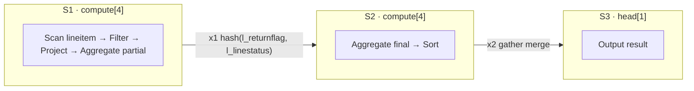
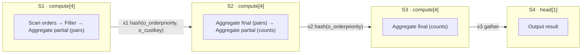

# Aggregation

The four scan workers each read 64 lineitem files. A return flag can occur in every file, so
summing on each worker gives up to four totals for the same flag. Q2 sends partial aggregate
states to the worker that will finish each group. For an average, the state carries both a sum and
a count, so workers with different numbers of line items contribute the right weight.

## The question

**Q2 (pricing summary).** Over line items shipped on or before 1998-09-02, for each return flag
and line status: the total quantity, the total discounted revenue, the average extended price, and
the number of lines. Order the result by return flag, then line status.

## The single-worker plan

On `local[1]` a single-phase `Aggregate` is enough:

```text
Plan "q2_pricing_summary" (joined)
worker sets: local[1]
Output "result" on local[1]
└─ Sort [l_returnflag asc, l_linestatus asc]
   └─ Aggregate keys=[l_returnflag, l_linestatus]
      │  measures=[sum_qty = sum(l_quantity), sum_revenue = sum(revenue),
      │            avg_price = avg(l_extendedprice), count_order = count_star()]
      └─ Project [l_returnflag, l_linestatus, l_quantity, l_extendedprice,
         │        revenue = l_extendedprice * (1 - l_discount)]
         └─ Filter l_shipdate <= 1998-09-02
            └─ Scan lineitem [l_returnflag, l_linestatus, l_quantity, l_extendedprice,
                              l_discount, l_shipdate]  on local[1]  shards=files_round_robin
```

A grouped single-phase aggregate needs every row of a group on one worker, which a set of one
worker guarantees. Keys are column names, so to group by a computed value, project it first (see
[Keys are names, values are expressions](../conventions.md#keys-are-names-values-are-expressions)).

## Building it

The scan, filter and projection reuse `shipped_by_cutoff` and `revenue_of` from
[Q1](01-scan-filter-project.md):

```cpp
#include <sirius/sirius.hpp>
using namespace sirius;

Result<Plan> q2_plan_a(const Example& ex) {
  SIRIUS_TRY(scan, Relation::scan(ex.lineitem,
      ScanOptions::on(ex.compute)
          .with_columns({"l_returnflag", "l_linestatus", "l_quantity",
                         "l_extendedprice", "l_discount", "l_shipdate"})
          .with_shards(Shards::files_round_robin())));
  SIRIUS_TRY(shipped, shipped_by_cutoff(scan));
  SIRIUS_TRY(filtered, scan.filter(shipped));
  SIRIUS_TRY(revenue, revenue_of(filtered));
  SIRIUS_TRY(columns, filtered.pass_through(
      {"l_returnflag", "l_linestatus", "l_quantity", "l_extendedprice"}));
  columns.push_back(revenue.named("revenue"));
  SIRIUS_TRY(projected, filtered.project(std::move(columns)));
  // ... continues below
```
```rust
use sirius::prelude::*;

fn q2_plan_a(ex: &Example) -> Result<Plan, PlanError> {
    let scan = Relation::scan(&ex.lineitem,
        ScanOptions::on(&ex.compute)
            .with_columns(&["l_returnflag", "l_linestatus", "l_quantity",
                            "l_extendedprice", "l_discount", "l_shipdate"])
            .with_shards(Shards::files_round_robin()))?;
    let shipped = shipped_by_cutoff(&scan)?;
    let filtered = scan.filter(&shipped)?;
    let revenue = revenue_of(&filtered)?;
    let mut columns = filtered.pass_through(
        &["l_returnflag", "l_linestatus", "l_quantity", "l_extendedprice"])?;
    columns.push(revenue.named("revenue"));
    let projected = filtered.project(columns)?;
    // ... continues below
```

The first phase, `aggregate_partial`, takes the same keys and measures as a single-phase
`aggregate`. Each worker reduces its rows to one or more state rows per group. Whether it emits
one per batch or accumulates first is the engine's choice, because the final phase combines them
all:

```cpp
  SIRIUS_TRY(qty, projected.column("l_quantity"));
  SIRIUS_TRY(price, projected.column("l_extendedprice"));
  SIRIUS_TRY(rev, projected.column("revenue"));
  SIRIUS_TRY(sum_qty, Measure::sum("sum_qty", qty));
  SIRIUS_TRY(sum_revenue, Measure::sum("sum_revenue", rev));
  SIRIUS_TRY(avg_price, Measure::avg("avg_price", price));
  std::vector<std::string> keys = {"l_returnflag", "l_linestatus"};
  SIRIUS_TRY(partial, projected.aggregate_partial(
      keys, {sum_qty, sum_revenue, avg_price, Measure::count_star("count_order")}));
```
```rust
    let qty = projected.column("l_quantity")?;
    let price = projected.column("l_extendedprice")?;
    let rev = projected.column("revenue")?;
    let sum_qty = Measure::sum("sum_qty", &qty)?;
    let sum_revenue = Measure::sum("sum_revenue", &rev)?;
    let avg_price = Measure::avg("avg_price", &price)?;
    let keys = ["l_returnflag", "l_linestatus"];
    let partial = projected.aggregate_partial(
        &keys, vec![sum_qty, sum_revenue, avg_price, Measure::count_star("count_order")])?;
```

A hash exchange on the group keys sends every partial row of a group to one worker, where
`aggregate_final` combines them. Then the plan sorts and gathers:

```cpp
  SIRIUS_TRY(by_group, partial.exchange(Exchange::hash(keys, ex.compute)));
  SIRIUS_TRY(totals, by_group.aggregate_final());
  std::vector<SortKey> order = {SortKey::asc("l_returnflag"), SortKey::asc("l_linestatus")};
  SIRIUS_TRY(sorted, totals.sort(order));
  SIRIUS_TRY(gathered, sorted.exchange(Exchange::gather(ex.head, GatherOrder::merge(order))));
  return Plan::from_root(gathered);
}
```
```rust
    let by_group = partial.exchange(&Exchange::hash(&keys, &ex.compute,
        Partitions::one_per_worker(), HashScheme::v1()))?;
    let totals = by_group.aggregate_final()?;
    let order = vec![SortKey::asc("l_returnflag"), SortKey::asc("l_linestatus")];
    let sorted = totals.sort(order.clone())?;
    let gathered = sorted.exchange(&Exchange::gather(&ex.head, GatherOrder::merge(order)))?;
    Plan::from_root(&gathered, "result")
}
```

`aggregate_final()` takes no arguments. It reads the measures from its input schema, which must be
exactly the keys plus the state columns of one partial (V5).

## State types: the contract on the wire

A partial aggregate emits the keys, then one state column per measure, each with a state type
fixed in the plan (see [State types travel in the
schema](../part-2/03-exchanges.md#state-types-travel-in-the-schema)). The table gives the storage
behind each of Q2's state types:

| Measure | State type | Storage | Final step |
|---|---|---|---|
| `sum_qty = sum(l_quantity)` | `sum_state<decimal(38,2)>` | `decimal(38,2)` | the sum |
| `sum_revenue = sum(revenue)` | `sum_state<decimal(38,4)>` | `decimal(38,4)` | the sum |
| `avg_price = avg(l_extendedprice)` | `avg_state<decimal(15,2)>` | struct{sum: `decimal(38,2)`, count: `int64`} | sum / count |
| `count_order = count_star()` | `count_state` | `int64` | the count |

`revenue` is a product of two scale-2 decimals, so its sum state has scale 4. The average travels
as a sum and a count, and only the final phase divides. Apache DataFusion splits aggregation into
phases the same way (see [Related designs](../appendix/related-designs.md#aggregation-in-phases)).

## The joined plan

This is plan A in full. The `-> (...)` line is the partial's output schema with its state types.

```text
Plan "q2_pricing_summary" (joined)
worker sets: head[1], compute[4]
Output "result" on head[1]
└─ Exchange x2 gather order=merge[l_returnflag asc, l_linestatus asc] -> head[1]
   └─ Sort [l_returnflag asc, l_linestatus asc]
      └─ Aggregate final keys=[l_returnflag, l_linestatus]
         └─ Exchange x1 hash(l_returnflag, l_linestatus) -> compute[4]
            └─ Aggregate partial keys=[l_returnflag, l_linestatus]
               │  measures=[sum_qty = sum(l_quantity), sum_revenue = sum(revenue),
               │            avg_price = avg(l_extendedprice), count_order = count_star()]
               │  -> (l_returnflag string, l_linestatus string, sum_qty sum_state<decimal(38,2)>,
               │      sum_revenue sum_state<decimal(38,4)>, avg_price avg_state<decimal(15,2)>,
               │      count_order count_state)
               └─ Project [l_returnflag, l_linestatus, l_quantity, l_extendedprice,
                  │        revenue = l_extendedprice * (1 - l_discount)]
                  └─ Filter l_shipdate <= 1998-09-02
                     └─ Scan lineitem [l_returnflag, l_linestatus, l_quantity, l_extendedprice,
                                       l_discount, l_shipdate]  on compute[4]  shards=files_round_robin
```

Follow the distribution up from the scan:

- Up to the partial aggregate, rows are `arbitrary(compute[4])`. A partial aggregate accepts any
  distribution except `replicated` on more than one worker (V7). Its output here stays `arbitrary`.
- `x1` makes them `hashed([l_returnflag, l_linestatus])` on `compute[4]`. A grouped final
  aggregate needs its input `single` or hashed on a subset of its keys (V6).
- `Sort` sorts within each worker. `x2` with `order=merge[...]` merges the four sorted runs into
  one stream on `head#0`. The merge requires input sorted on its keys (V14).

## Stages

Two exchanges, three stages:



`S1` and `S2` run on the same set. They are separate stages because rows change workers between
them, as the split form shows:

```text
Plan "q2_pricing_summary" (split)
worker sets: head[1], compute[4]
Stage S1 on compute[4]
ExchangeSink x1 hash(l_returnflag, l_linestatus) -> S2 [compute#0..3]
└─ Aggregate partial keys=[l_returnflag, l_linestatus] ...
   └─ Project ...
      └─ Filter l_shipdate <= 1998-09-02
         └─ Scan lineitem ...  on compute[4]  shards=files_round_robin
Stage S2 on compute[4]
ExchangeSink x2 gather order=merge[l_returnflag asc, l_linestatus asc] -> S3 [head#0]
└─ Sort [l_returnflag asc, l_linestatus asc]
   └─ Aggregate final keys=[l_returnflag, l_linestatus]
      └─ ExchangeSource x1 <- S1 senders=[compute#0..3]
Stage S3 on head[1]
Output "result"
└─ ExchangeSource x2 <- S2 senders=[compute#0..3]
```

## One worker's view

`compute#1` hosts an instance of both `S1` and `S2`:

```text
Plan "q2_pricing_summary" (instance compute#1)
worker sets: head[1], compute[4]
Stage S1 instance compute#1
ExchangeSink x1 hash(l_returnflag, l_linestatus)  partitions->workers {0:#0, 1:#1, 2:#2, 3:#3}
└─ Aggregate partial keys=[l_returnflag, l_linestatus] ...
   └─ Project ...
      └─ Filter l_shipdate <= 1998-09-02
         └─ Scan lineitem ...  files=[1, 5, 9, ..., 253] (64 of 256)
Stage S2 instance compute#1
ExchangeSink x2 gather order=merge[l_returnflag asc, l_linestatus asc] -> [head#0]
└─ Sort [l_returnflag asc, l_linestatus asc]
   └─ Aggregate final keys=[l_returnflag, l_linestatus]
      └─ ExchangeSource x1 partition=1/4 <- senders=[compute#0..3]
```

The sink line shows the hash contract: partition `p` of `x1` goes to `compute#p`.
`HashScheme::v1` maps a row's keys to a partition ([Hash](../part-2/03-exchanges.md#hash)), so
every worker computes the same partition for the same group.

`x1` has `one_per_worker` partitions: four, fixed by the worker set, and printed. If a worker's
partition is too large for its GPU's memory, the engine may split it further inside that worker.
That never changes which groups a worker gets, so it stays with the engine (see [Inside one
worker](../part-2/01-everything-in-the-plan.md#inside-one-worker)).

Q2 has few groups, so some partitions of `x1` may be empty. Every sender still sends end of stream
to every receiver ([The exchange protocol](../part-2/03-exchanges.md#the-exchange-protocol)). A
worker with an empty partition finishes its final aggregate with zero groups and sends its own end
of stream on `x2`, so `head#0` still completes after four of them.

## Alternatives and trade-offs

### The plan that does not build

Calling `aggregate` instead of `aggregate_partial` on `compute[4]` returns `invalid_plan`, citing
V6 (see [Workers and
distribution](../part-2/02-workers-and-distribution.md#a-grouped-aggregate-over-scattered-rows)).
The input is `arbitrary(compute[4])`, so a group's rows may sit on four workers, and each would
emit its own total. `Plan::create` rejects the same shape in a plan assembled another way. The
message reads like this:

```text
invalid_plan: V6: Aggregate keys=[l_returnflag, l_linestatus] reads arbitrary(compute[4]);
a group's rows may be on several workers. Use aggregate_partial and aggregate_final with an
exchange, or hash on the keys first.
```

Three plan shapes fix it, and the host chooses: two phases with a hash exchange (plan A), two
phases with a gather (plan B), or a hash exchange of raw rows followed by a single-phase
`Aggregate`.

### Plan B: finish on the head worker

Q2 has about four groups. Plan A sends about 16 partial rows through `x1` (four groups from each of
four workers, more if a worker emits a state row per batch), then four final rows through `x2`.
Plan B gathers the partial rows to `head#0` and finishes there:

```text
Plan "q2_pricing_summary" (joined)
worker sets: head[1], compute[4]
Output "result" on head[1]
└─ Sort [l_returnflag asc, l_linestatus asc]
   └─ Aggregate final keys=[l_returnflag, l_linestatus]
      └─ Exchange x1 gather -> head[1]
         └─ Aggregate partial keys=[l_returnflag, l_linestatus] ...
            └─ Project ...
               └─ Filter l_shipdate <= 1998-09-02
                  └─ Scan lineitem ...  on compute[4]  shards=files_round_robin
```

The code changes from `partial` on:

```cpp
  SIRIUS_TRY(at_head, partial.exchange(Exchange::gather(ex.head)));
  SIRIUS_TRY(totals, at_head.aggregate_final());
  std::vector<SortKey> order = {SortKey::asc("l_returnflag"), SortKey::asc("l_linestatus")};
  SIRIUS_TRY(sorted, totals.sort(order));
  return Plan::from_root(sorted);
```
```rust
    let at_head = partial.exchange(&Exchange::gather(&ex.head, GatherOrder::any()))?;
    let totals = at_head.aggregate_final()?;
    let order = vec![SortKey::asc("l_returnflag"), SortKey::asc("l_linestatus")];
    let sorted = totals.sort(order)?;
    Plan::from_root(&sorted, "result")
```

| | Plan A | Plan B |
|---|---|---|
| Stages | 3 | 2 |
| Rows crossing workers | about 16 partials, then 4 finals | about 16 partials |
| Final aggregation runs on | 4 workers, in parallel | `head#0` alone |
| Sort | 4 local sorts, merged on `head#0` | one sort on `head#0` |
| Better when | there are many groups | there are few groups |

With ten million groups, B sends at least one partial per group to `head#0`, and possibly
several partials for each group. A
spreads the final work over four workers.

A decided exchange cannot switch between the two at run time: all its alternatives must target
the same worker set (V19), and `x1` targets `compute[4]` in A but `head[1]` in B. A `Choose` can.
It keeps both plans as arms and picks one from the number of partial rows (see [Choosing between
subtrees](../part-2/06-adaptive-plans.md#choosing-between-subtrees)). Within plan A, the partition
count of `x1` can be decided too.

### Hashing raw rows

The third shape skips the partial phase: `Exchange hash(l_returnflag, l_linestatus)` directly
above the `Project`, then a single-phase `Aggregate`. It is valid, because the input is hashed on
the keys, but it moves every shipped line item between workers. It pays off only when partials
barely reduce the data, for example when nearly every row is its own group.

## On one machine with four GPUs

Under `Bindings::local()` the plan is unchanged. `x1` moves partial rows between four GPUs in one
process, and `x2` delivers to `head#0` on GPU 0.

## Q2b: one grand total

**Q2b (total shipped revenue).** The total discounted revenue of all line items shipped on or
before 1998-09-02, as a single number.

An ungrouped aggregate has no keys to hash on. Its final phase needs every partial on one worker,
so the exchange is a gather:

```text
Plan "q2b_total_revenue" (joined)
worker sets: head[1], compute[4]
Output "result" on head[1]
└─ Aggregate final
   └─ Exchange x1 gather -> head[1]
      └─ Aggregate partial measures=[total_revenue = sum(revenue)]
         │  -> (total_revenue sum_state<decimal(38,4)>?)
         └─ Project [revenue = l_extendedprice * (1 - l_discount)]
            └─ Filter l_shipdate <= 1998-09-02
               └─ Scan lineitem [l_extendedprice, l_discount, l_shipdate]
                                on compute[4]  shards=files_round_robin
```

With `projected` now holding only `revenue`, the builder steps are:

```cpp
  SIRIUS_TRY(rev, projected.column("revenue"));
  SIRIUS_TRY(total, Measure::sum("total_revenue", rev));
  SIRIUS_TRY(partial, projected.aggregate_partial({}, {total}));
  SIRIUS_TRY(at_head, partial.exchange(Exchange::gather(ex.head)));
  SIRIUS_TRY(result, at_head.aggregate_final());
  return Plan::from_root(result);
```
```rust
    let rev = projected.column("revenue")?;
    let no_keys: [&str; 0] = [];
    let partial = projected.aggregate_partial(&no_keys, vec![
        Measure::sum("total_revenue", &rev)?,
    ])?;
    let at_head = partial.exchange(&Exchange::gather(&ex.head, GatherOrder::any()))?;
    let result = at_head.aggregate_final()?;
    Plan::from_root(&result, "result")
```

An ungrouped partial **always emits at least one row per worker**. A worker that saw no matching
row emits the identity state, a sum that has seen nothing. That state is null, so the schema line
prints `sum_state<decimal(38,4)>?`.

`head#0` therefore receives at least four partial rows, and an ungrouped final emits exactly one
row. If no worker saw a matching item, that row holds a null sum (a count over nothing would be
0). The rule is part of the node's definition, so the final phase never has to detect empty input.

## Q2r: subtotals with grouping sets

**Q2r (pricing summary with subtotals).** Q2's sums per return flag and line status, per return
flag alone, and for all shipped items together.

The three groupings are the rollup of the two keys
([Grouping sets](../part-1/07-aggregates-joins-and-ordering.md#grouping-sets)). The partial phase
takes the sets; the grouping id it adds is one more key for the exchange and the final phase:

```text
Plan "q2r_pricing_subtotals" (joined)
worker sets: head[1], compute[4]
Output "result" on head[1]
└─ Exchange x2 gather -> head[1]
   └─ Aggregate final keys=[l_returnflag, l_linestatus, grouping_id]
      └─ Exchange x1 hash(l_returnflag, l_linestatus, grouping_id) -> compute[4]
         └─ Aggregate partial keys=[l_returnflag, l_linestatus]
            │  sets=[(l_returnflag, l_linestatus), (l_returnflag), ()]
            │  measures=[sum_qty = sum(l_quantity), sum_revenue = sum(revenue),
            │            count_order = count_star()]
            │  -> (l_returnflag string?, l_linestatus string?, grouping_id int32,
            │      sum_qty sum_state<decimal(38,2)>?, sum_revenue sum_state<decimal(38,4)>?,
            │      count_order count_state)
            └─ Project ...
               └─ Filter l_shipdate <= 1998-09-02
                  └─ Scan lineitem ...  on compute[4]  shards=files_round_robin
```

The builder steps:

```cpp
  // a fresh scenario: projected, sum_qty and sum_revenue as in Q2
  SIRIUS_TRY(sets, GroupingSets::rollup({"l_returnflag", "l_linestatus"}));
  SIRIUS_TRY(partial, projected.aggregate_partial_sets(
      sets, {sum_qty, sum_revenue, Measure::count_star("count_order")}));
  SIRIUS_TRY(by_group, partial.exchange(Exchange::hash(
      {"l_returnflag", "l_linestatus", "grouping_id"}, ex.compute)));
  SIRIUS_TRY(totals, by_group.aggregate_final());
  SIRIUS_TRY(gathered, totals.exchange(Exchange::gather(ex.head)));
  return Plan::from_root(gathered);
```
```rust
    // a fresh scenario: projected, sum_qty and sum_revenue as in Q2
    let sets = GroupingSets::rollup(&["l_returnflag", "l_linestatus"])?;
    let partial = projected.aggregate_partial_sets(
        &sets, vec![sum_qty, sum_revenue, Measure::count_star("count_order")])?;
    let by_group = partial.exchange(&Exchange::hash(
        &["l_returnflag", "l_linestatus", "grouping_id"], &ex.compute,
        Partitions::one_per_worker(), HashScheme::v1()))?;
    let totals = by_group.aggregate_final()?;
    let gathered = totals.exchange(&Exchange::gather(&ex.head, GatherOrder::any()))?;
    Plan::from_root(&gathered, "result")
```

- **Ids are positions.** `rollup` expands to the list the plan prints, and a set's position in it
  is its grouping id: 0 for (flag, status), 1 for (flag), 2 for `()`. Every process that builds
  the plan gets the same list, so the ids agree.
- **The id is a key.** `aggregate_final()` reads `grouping_id` as a key because the column has no
  state type (V5), and `x1` hashes on the final's keys, which meets V6. A null key hashes like any
  other value, so the rows of a subtotal meet on one worker. The id keeps a subtotal row apart
  from a detail row whose key is null.
- **The grand total.** As an ungrouped partial does, every worker emits at least one partial row
  for `()`, with two null keys and id 2. They all hash to one worker, which emits the single total
  row, even when no line item qualified.
- **No single-phase form here.** A single-phase `aggregate_sets` on `compute[4]` would need its
  input hashed on keys that are in every set. A rollup has none, so it fails V6.

## Q3d: counting distinct values across workers

**Q3d (distinct customers per priority).** For orders placed in 1995, the number of distinct
customers per order priority.

Per-worker distinct counts do not add up: two workers can each have seen customer 42 for priority
"1-URGENT", and the sum would count 42 twice. Plan it as **two levels of grouping**: make the
(priority, customer) pairs distinct, then count the pairs per priority.

```text
Plan "q3d_distinct_customers" (joined)
worker sets: head[1], compute[4]
Output "result" on head[1]
└─ Exchange x3 gather -> head[1]
   └─ Aggregate final keys=[o_orderpriority]
      └─ Exchange x2 hash(o_orderpriority) -> compute[4]
         └─ Aggregate partial keys=[o_orderpriority] measures=[customers = count_star()]
            └─ Aggregate final keys=[o_orderpriority, o_custkey]
               └─ Exchange x1 hash(o_orderpriority, o_custkey) -> compute[4]
                  └─ Aggregate partial keys=[o_orderpriority, o_custkey]
                     └─ Filter o_orderdate >= 1995-01-01 and o_orderdate < 1996-01-01
                        └─ Scan orders [o_custkey, o_orderdate, o_orderpriority]
                                       on compute[4]  shards=files_round_robin
```

An aggregate with keys and no measures is a distinct. The first partial removes duplicate pairs
within each worker, `x1` brings every copy of a pair to one worker, and the first final removes the
rest. Each pair then exists exactly once, so a two-phase `count_star` per priority counts distinct
customers.

The two levels repeat one pattern. `filtered` holds the 1995 orders on `compute[4]`:

```cpp
  std::vector<std::string> pair_keys = {"o_orderpriority", "o_custkey"};
  SIRIUS_TRY(pairs_partial, filtered.aggregate_partial(pair_keys, {}));
  SIRIUS_TRY(pairs_hashed, pairs_partial.exchange(Exchange::hash(pair_keys, ex.compute)));
  SIRIUS_TRY(pairs, pairs_hashed.aggregate_final());   // each pair exactly once

  SIRIUS_TRY(counts_partial, pairs.aggregate_partial(
      {"o_orderpriority"}, {Measure::count_star("customers")}));
  SIRIUS_TRY(counts_hashed, counts_partial.exchange(
      Exchange::hash({"o_orderpriority"}, ex.compute)));
  SIRIUS_TRY(counts, counts_hashed.aggregate_final());
  SIRIUS_TRY(gathered, counts.exchange(Exchange::gather(ex.head)));
  return Plan::from_root(gathered);
```
```rust
    let pair_keys = ["o_orderpriority", "o_custkey"];
    let pairs_partial = filtered.aggregate_partial(&pair_keys, vec![])?;
    let pairs_hashed = pairs_partial.exchange(&Exchange::hash(&pair_keys, &ex.compute,
        Partitions::one_per_worker(), HashScheme::v1()))?;
    let pairs = pairs_hashed.aggregate_final()?;          // each pair exactly once

    let counts_partial = pairs.aggregate_partial(
        &["o_orderpriority"], vec![Measure::count_star("customers")])?;
    let counts_hashed = counts_partial.exchange(&Exchange::hash(&["o_orderpriority"],
        &ex.compute, Partitions::one_per_worker(), HashScheme::v1()))?;
    let counts = counts_hashed.aggregate_final()?;
    let gathered = counts.exchange(&Exchange::gather(&ex.head, GatherOrder::any()))?;
    Plan::from_root(&gathered, "result")
```

Three exchanges make four stages:



### Why not `count_distinct`?

`Measure::count_distinct` exists. Its partial state is `distinct_state<T>`: the set of values
seen, stored as a list. A partial with `customers = count_distinct(o_custkey)`, a hash exchange on
`o_orderpriority` and a final is a valid plan, and `Plan::create` accepts it. `Context::check`
reports it as `unsupported` (V21), because this engine build cannot move a `distinct_state` column
between workers (see [Three gates](../part-2/07-validation.md#three-gates)). How nested states
travel between workers is [open question
8](../reference/open-questions.md#8-nested-types-on-the-wire).

The two-level plan needs only flat keys and `count_state` at its exchanges. Its
intermediate data is bounded by the number of distinct pairs, not by the largest set one worker
accumulates.

Two other shapes work:

- **Hash raw rows, then a single-phase distinct count.** Put `Exchange hash(o_orderpriority)`
  directly above the `Filter`, then `Aggregate keys=[o_orderpriority]` with
  `count_distinct(o_custkey)`. No state crosses a worker, so it is supported. But every 1995 order
  moves, and with only five priorities the final work is skewed across the four workers.
- **Hash once on the priority.** If `x1` hashes on `o_orderpriority` alone, its output is also
  hashed on a subset of the pair keys, so both finals are valid without `x2`. That saves one
  exchange at the cost of the same five-key skew.

## What the engine does

A grouped `Aggregate partial` lowers to `HASH_GROUP_BY`, which reduces each batch to per-group
partials. `x1` lowers by endpoint pair: across GPUs in one process to the `PARTITION` operator in
hash mode, across processes to the exchange sink and source operators. `Aggregate final` lowers to
`MERGE_GROUP_BY`. The ungrouped pair in Q2b lowers to `UNGROUPED_AGGREGATE` and
`MERGE_AGGREGATE`. A partial with grouping sets lowers to the same `HASH_GROUP_BY`, which computes
every set of a batch and emits a set id next to the keys; `MERGE_GROUP_BY` groups on that id too.

The proposal exposes state types and their wire layouts. Upstream already has distributed
aggregation. For a grouped distinct count, the distributed rewrite can hash the raw rows before
local aggregation because its wire format cannot carry partial distinct lists.
[Upstream distribution rewrite](https://github.com/sirius-db/sirius/blob/ef7eb2951a370f4293784549bc05fc46c7cc64f6/docs/super-sirius/distributed-sirius.md#the-plan-rewrite)
