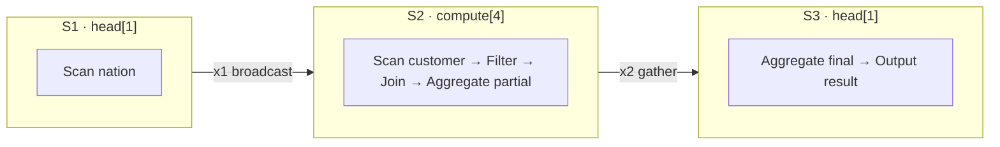

# Broadcast join

Q3 joins customers to the 25 nations. Copying those 25 rows to each customer worker lets the
large customer table stay where it was scanned. The replicated input tells the join it can
build a complete nation lookup table on every worker.

## The question

**Q3 (BUILDING customers per nation).** For customers in the BUILDING market segment, the number
of customers and their total account balance, per nation name.

`customer` is spread over 16 files. `nation` is one file with 25 rows.

## The single-worker plan

```text
Plan "q3_building_by_nation" (joined)
worker sets: local[1]
Output "result" on local[1]
└─ Aggregate keys=[n_name] measures=[customers = count_star(), balance = sum(c_acctbal)]
   └─ Join inner keys=[c_nationkey == n_nationkey] build=right  mode=single
      ├─ Filter c_mktsegment == "BUILDING"
      │  └─ Scan customer [c_nationkey, c_mktsegment, c_acctbal]  on local[1]  shards=files_round_robin
      └─ Scan nation [n_nationkey, n_name]  on local[1]  shards=files_round_robin
```

The right input is the [build side](../part-1/07-aggregates-joins-and-ordering.md#the-build-side)
(`build=right`, the default): the join builds a hash table from `nation` and streams the filtered
customers, the probe side, through it.

Both inputs are `single(local[1])`, so `mode=single`. On `compute[4]` the mode depends on the
exchanges below the join.

## Building it

`compute[4]` reads and filters the customers, a quarter of the files each. `head[1]` reads the
nations once and broadcasts them to every compute worker:

```cpp
#include <sirius/sirius.hpp>
using namespace sirius;

Result<Plan> q3(const Example& ex) {
  SIRIUS_TRY(customers, Relation::scan(ex.customer,
      ScanOptions::on(ex.compute)
          .with_columns({"c_nationkey", "c_mktsegment", "c_acctbal"})
          .with_shards(Shards::files_round_robin())));
  SIRIUS_TRY(segment, customers.column("c_mktsegment"));
  SIRIUS_TRY(building, segment.eq(Expression::literal(Value::string("BUILDING"))));
  SIRIUS_TRY(probe, customers.filter(building));

  SIRIUS_TRY(nations, Relation::scan(ex.nation,
      ScanOptions::on(ex.head).with_columns({"n_nationkey", "n_name"})));
  SIRIUS_TRY(build, nations.exchange(Exchange::broadcast(ex.compute)));
  // ... continues below
```
```rust
use sirius::prelude::*;

fn q3(ex: &Example) -> Result<Plan, PlanError> {
    let customers = Relation::scan(&ex.customer,
        ScanOptions::on(&ex.compute)
            .with_columns(&["c_nationkey", "c_mktsegment", "c_acctbal"])
            .with_shards(Shards::files_round_robin()))?;
    let segment = customers.column("c_mktsegment")?;
    let building = segment.eq(&Expression::literal(Value::string("BUILDING")))?;
    let probe = customers.filter(&building)?;

    let nations = Relation::scan(&ex.nation,
        ScanOptions::on(&ex.head).with_columns(&["n_nationkey", "n_name"]))?;
    let build = nations.exchange(&Exchange::broadcast(&ex.compute))?;
    // ... continues below
```

`build` is now `replicated(compute[4])`: every compute worker holds all 25 nations. `probe` is
`arbitrary(compute[4])`. A join needs both inputs on the same set. Joining a relation on `head[1]`
directly with one on `compute[4]` is `invalid_plan`.

Now join, then aggregate. Join keys are column names, one pair per key. Both keys of a pair need
the same type, here `int32`
([No implicit conversion](../part-1/04-schemas-and-expressions.md#no-implicit-conversion)).

```cpp
  SIRIUS_TRY(on, JoinOn::keys({{"c_nationkey", "n_nationkey"}}));
  SIRIUS_TRY(joined, probe.join(build, JoinType::inner, std::move(on), JoinOptions::defaults()));
  SIRIUS_TRY(balance, joined.column("c_acctbal"));
  SIRIUS_TRY(sum_balance, Measure::sum("balance", balance));
  SIRIUS_TRY(partial, joined.aggregate_partial(
      {"n_name"}, {Measure::count_star("customers"), sum_balance}));
  SIRIUS_TRY(at_head, partial.exchange(Exchange::gather(ex.head)));
  SIRIUS_TRY(result, at_head.aggregate_final());
  return Plan::from_root(result);
}
```
```rust
    let on = JoinOn::keys(&[("c_nationkey", "n_nationkey")])?;
    let joined = probe.join(&build, JoinType::Inner, on, JoinOptions::default())?;
    let balance = joined.column("c_acctbal")?;
    let sum_balance = Measure::sum("balance", &balance)?;
    let partial = joined.aggregate_partial(
        &["n_name"], vec![Measure::count_star("customers"), sum_balance])?;
    let at_head = partial.exchange(&Exchange::gather(&ex.head, GatherOrder::any()))?;
    let result = at_head.aggregate_final()?;
    Plan::from_root(&result, "result")
}
```

## The joined plan

```text
Plan "q3_building_by_nation" (joined)
worker sets: head[1], compute[4]
Output "result" on head[1]
└─ Aggregate final keys=[n_name]
   └─ Exchange x2 gather -> head[1]
      └─ Aggregate partial keys=[n_name] measures=[customers = count_star(), balance = sum(c_acctbal)]
         └─ Join inner keys=[c_nationkey == n_nationkey] build=right  mode=broadcast_build
            ├─ Filter c_mktsegment == "BUILDING"
            │  └─ Scan customer [c_nationkey, c_mktsegment, c_acctbal]  on compute[4]  shards=files_round_robin
            └─ Exchange x1 broadcast -> compute[4]
               └─ Scan nation [n_nationkey, n_name]  on head[1]  shards=files_round_robin
```

The code sets no broadcast flag. `x1` made the build `replicated(compute[4])` and the probe is on
`compute[4]`, so the validator derives `broadcast_build` (V8). The other modes are in the
[node catalog](../reference/node-catalog.md#join).

A `broadcast_build` join keeps the *probe's* distribution: each customer row is joined where it
was read, so the output is `arbitrary(compute[4])`.

Rows for one nation can come out of all four workers, so the aggregate above the join has two
phases. Each worker contributes to at most 25 groups, though it may emit several partial states for a
group. The gather sends those states to `head#0` to finish. [Aggregation](02-aggregation.md)

## Stages

Two exchanges give three stages:



In split form:

```text
Plan "q3_building_by_nation" (split)
worker sets: head[1], compute[4]
Stage S1 on head[1]
ExchangeSink x1 broadcast -> S2 [compute#0..3]
└─ Scan nation [n_nationkey, n_name]  on head[1]  shards=files_round_robin
Stage S2 on compute[4]
ExchangeSink x2 gather -> S3 [head#0]
└─ Aggregate partial keys=[n_name] measures=[customers = count_star(), balance = sum(c_acctbal)]
   └─ Join inner keys=[c_nationkey == n_nationkey] build=right  mode=broadcast_build
      ├─ Filter c_mktsegment == "BUILDING"
      │  └─ Scan customer [c_nationkey, c_mktsegment, c_acctbal]  on compute[4]  shards=files_round_robin
      └─ ExchangeSource x1 <- S1 senders=[head#0]
Stage S3 on head[1]
Output "result"
└─ Aggregate final keys=[n_name]
   └─ ExchangeSource x2 <- S2 senders=[compute#0..3]
```

`head#0` hosts two stage instances, `S1` and `S3`. Sharing a worker does not order them: `S3`
waits only on `x2`.

## One worker's view

```text
Plan "q3_building_by_nation" (instance compute#3)
worker sets: head[1], compute[4]
Stage S2 instance compute#3
ExchangeSink x2 gather -> [head#0]
└─ Aggregate partial keys=[n_name] measures=[customers = count_star(), balance = sum(c_acctbal)]
   └─ Join inner keys=[c_nationkey == n_nationkey] build=right  mode=broadcast_build
      ├─ Filter c_mktsegment == "BUILDING"
      │  └─ Scan customer [c_nationkey, c_mktsegment, c_acctbal]  files=[3, 7, 11, 15] (4 of 16)
      └─ ExchangeSource x1 <- senders=[head#0]
```

`compute#3` receives the whole of `x1` from its single sender. The build input is blocking: the
hash table needs every nation before the first probe, so `compute#3` builds once `x1` reaches end
of stream.

The customer scan does not wait. It starts at once, and its batches queue, in memory or spilled,
until the build is ready.

## Alternatives and trade-offs

### Read the small table everywhere

`x1` moves 25 rows from one worker to four. Instead, every compute worker can read
`data/nation.parquet` itself, with `Shards::replicated()`:

```text
Plan "q3_building_by_nation" (joined)
worker sets: head[1], compute[4]
Output "result" on head[1]
└─ Aggregate final keys=[n_name]
   └─ Exchange x1 gather -> head[1]
      └─ Aggregate partial keys=[n_name] measures=[customers = count_star(), balance = sum(c_acctbal)]
         └─ Join inner keys=[c_nationkey == n_nationkey] build=right  mode=broadcast_build
            ├─ Filter c_mktsegment == "BUILDING"
            │  └─ Scan customer [c_nationkey, c_mktsegment, c_acctbal]  on compute[4]  shards=files_round_robin
            └─ Scan nation [n_nationkey, n_name]  on compute[4]  shards=replicated
```

The only change in code is the nation scan:

```cpp
  SIRIUS_TRY(build, Relation::scan(ex.nation,
      ScanOptions::on(ex.compute)
          .with_columns({"n_nationkey", "n_name"})
          .with_shards(Shards::replicated())));
```
```rust
    let build = Relation::scan(&ex.nation,
        ScanOptions::on(&ex.compute)
            .with_columns(&["n_nationkey", "n_name"])
            .with_shards(Shards::replicated()))?;
```

A replicated scan also produces `replicated(compute[4])`, so the mode is still `broadcast_build`.
The plan has one exchange fewer (the remaining one is now `x1`) and one stage fewer.

You trade network traffic for I/O: four reads of one small file instead of one read plus a
fan-out. Latency and caching on the shared storage determine which costs less. A
table only one worker can read, or an input computed by other nodes, needs the broadcast exchange.

### Hash both sides

You could hash both inputs on the nation key, the co-partitioned join of the
[next chapter](04-partitioned-join-and-runtime-filters.md). That is legal here but a poor choice: it
repartitions all BUILDING customers to save copying 25 rows. Popular nations can also concentrate
much of the work on one worker. Hashing pays off when *both* sides are large.

When you cannot tell in advance, [Adaptive join](05-adaptive-join.md) decides between broadcast
and hash from the measured size of the build side. That decision is a plan node too.

### When the build side must be preserved

Suppose you want *every* nation in the result, including those with no BUILDING customers. That
is a `right` join, which keeps unmatched right rows. With the broadcast build, the builder rejects
the join:

```cpp
  SIRIUS_TRY(on, JoinOn::keys({{"c_nationkey", "n_nationkey"}}));
  auto kept = probe.join(build, JoinType::right, std::move(on), JoinOptions::defaults());
  // kept.error().code == ErrorCode::invalid_plan, citing V9
```
```rust
    let on = JoinOn::keys(&[("c_nationkey", "n_nationkey")])?;
    let kept = probe.join(&build, JoinType::Right, on, JoinOptions::default());
    // kept is Err(PlanError::Invalid { .. }), citing V9
```

The message, roughly:

```text
invalid_plan: V9: Join right keys=[c_nationkey == n_nationkey] build=right preserves
build rows, so its build cannot be broadcast; hash both sides instead.
```

Each worker knows only which nations matched *its* customers. A nation matched on `compute#1`
but not on `compute#0` would also be emitted as unmatched by `compute#0`, and a nation matched
nowhere would be emitted four times. The same applies to `full` joins and to `right_semi` and
`right_anti` with `build=right`.

Two legal plans answer the question:

- **Co-partition the join.** Hash both sides on the nation key. Each nation then lives on one
  worker, which sees all of its customers and can decide "unmatched" alone.
- **Aggregate first, then join on one worker.** The customer aggregate can group by `c_nationkey`
  instead of the nation name. Finish it on `head#0`, scan nation there too, and join on `head[1]`,
  where both sides are `single`:

```text
Plan "q3r_all_nations" (joined)
worker sets: head[1], compute[4]
Output "result" on head[1]
└─ Join right keys=[c_nationkey == n_nationkey] build=right  mode=single
   ├─ Aggregate final keys=[c_nationkey]
   │  └─ Exchange x1 gather -> head[1]
   │     └─ Aggregate partial keys=[c_nationkey]
   │        │  measures=[customers = count_star(), balance = sum(c_acctbal)]
   │        └─ Filter c_mktsegment == "BUILDING"
   │           └─ Scan customer [c_nationkey, c_mktsegment, c_acctbal]
   │                            on compute[4]  shards=files_round_robin
   └─ Scan nation [n_nationkey, n_name]  on head[1]  shards=files_round_robin
```

Nations without BUILDING customers come out with null `customers` and `balance`. Distributed
outer joins with a preserved broadcast build are
[open question 17](../reference/open-questions.md#17-join-coverage).

## On one machine with four GPUs

Prepare the same plan with `Bindings::local()`. The plan text is unchanged. Both the broadcast and the gather now stay within one process ([Two deployments](00-running-example.md#two-deployments)).

`head#0` and `compute#0` share GPU 0, so that copy stays on one device. The copies to
`compute#1..3` move between GPUs in one process. On the cluster, the copies to `compute#2` and
`compute#3` on host B cross the network. Whether `head#0` sends each copy itself, or sends one to
host B for a worker there to forward, is the engine's choice.

## What the engine does

The `Join` lowers to `HASH_JOIN`. Each worker builds a hash table from its own copy of the 25
rows. The engine's multi-GPU broadcast join works the same way today: the small build is
replicated to one slot per GPU and each GPU joins its local probe rows.

The *decision* moves out of the operator. In one process the hash join considers measured build size,
cardinality estimates and memory budgets when it chooses its layout
([Adaptivity in the engine](../part-5/04-adaptivity-in-the-engine.md)). In the plan it is the
exchange you wrote, or a `Decide` node ([Adaptive join](05-adaptive-join.md)).

The local join algorithm stays with the engine. A worker may keep one resident hash table, or
split its build into local sub-partitions to fit in memory.
