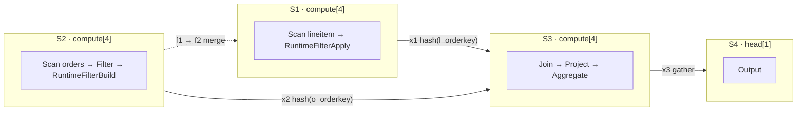

# Partitioned join and runtime filters

Q4 hashes orders and line items on the order key so matching rows reach the same worker.
A Bloom filter can save some of that traffic. Once the orders workers have merged their filters,
the lineitem scan can discard keys the filter rules out. Earlier rows and false positives still
go through the exchange.

## The question

**Q4 (urgent March revenue).** For every order placed in March 1995 with priority "1-URGENT",
compute the total discounted revenue of its line items, `l_extendedprice * (1 - l_discount)`, and
return it with the order key and order date.

The example assumes a selective orders predicate and partitions both inputs. File counts alone
cannot tell us whether the filtered orders would fit in a broadcast.

## The single-worker plan

On `local[1]` every non-replicated relation counts as `single`
([The Distribution property](../part-2/02-workers-and-distribution.md#the-distribution-property)),
so the join and the aggregate need no exchanges:

```text
Plan "q4_urgent_march_revenue" (joined)
worker sets: local[1]
Output "result" on local[1]
└─ Aggregate keys=[o_orderkey, o_orderdate] measures=[revenue = sum(rev)]
   └─ Project [o_orderkey, o_orderdate, rev = l_extendedprice * (1 - l_discount)]
      └─ Join inner keys=[l_orderkey == o_orderkey] build=right  mode=single
         ├─ Scan lineitem [l_orderkey, l_extendedprice, l_discount]  on local[1]  shards=files_round_robin
         └─ Filter o_orderdate >= 1995-03-01 and o_orderdate < 1995-04-01 and o_orderpriority == "1-URGENT"
            └─ Scan orders [o_orderkey, o_orderdate, o_orderpriority]  on local[1]  shards=files_round_robin
```

## Building the joined plan

The joined plan uses the `head[1]` and `compute[4]` sets and the `TableSource`s from
[the running example](00-running-example.md). The build side comes first: the probe side needs
its filter.

### Step 1: the urgent March orders

```cpp
#include <sirius/sirius.hpp>
using namespace sirius;

Result<Plan> q4_plan(const TableSource& lineitem, const TableSource& orders,
                     const WorkerSet& head, const WorkerSet& compute) {
  SIRIUS_TRY(orders_scan, Relation::scan(orders, ScanOptions::on(compute)
      .with_columns({"o_orderkey", "o_orderdate", "o_orderpriority"})
      .with_shards(Shards::files_round_robin())));
  SIRIUS_TRY(date, orders_scan.column("o_orderdate"));
  SIRIUS_TRY(priority, orders_scan.column("o_orderpriority"));
  SIRIUS_TRY(march_1, Value::date32(1995, 3, 1));
  SIRIUS_TRY(april_1, Value::date32(1995, 4, 1));
  SIRIUS_TRY(from, date.ge(Expression::literal(march_1)));
  SIRIUS_TRY(until, date.lt(Expression::literal(april_1)));
  SIRIUS_TRY(urgent, priority.eq(Expression::literal(Value::string("1-URGENT"))));
  SIRIUS_TRY(in_march, from.and_(until));
  SIRIUS_TRY(predicate, in_march.and_(urgent));
  SIRIUS_TRY(urgent_orders, orders_scan.filter(predicate));
```
```rust
use sirius::prelude::*;

fn q4_plan(lineitem: &TableSource, orders: &TableSource,
           head: &WorkerSet, compute: &WorkerSet) -> Result<Plan, PlanError> {
    let orders_scan = Relation::scan(orders, ScanOptions::on(compute)
        .with_columns(&["o_orderkey", "o_orderdate", "o_orderpriority"])
        .with_shards(Shards::files_round_robin()))?;
    let date = orders_scan.column("o_orderdate")?;
    let priority = orders_scan.column("o_orderpriority")?;
    let march_1 = Value::date32(1995, 3, 1)?;
    let april_1 = Value::date32(1995, 4, 1)?;
    let from = date.ge(&Expression::literal(march_1))?;
    let until = date.lt(&Expression::literal(april_1))?;
    let urgent = priority.eq(&Expression::literal(Value::string("1-URGENT")))?;
    let in_march = from.and(&until)?;
    let predicate = in_march.and(&urgent)?;
    let urgent_orders = orders_scan.filter(&predicate)?;
```

### Step 2: build a filter, then merge it

`build_runtime_filter` returns a `FilterBuild`. Its `relation` passes the rows through unchanged;
its `filter` is a handle to the published value.

```cpp
  SIRIUS_TRY(bloom, BloomGeometry::fixed(8 << 20));
  SIRIUS_TRY(build, urgent_orders.build_runtime_filter({"o_orderkey"},
                                                       RuntimeFilterSpec::bloom(bloom)));
  // build.filter.scope() is partial: each worker saw only its own orders files
  SIRIUS_TRY(merged, build.filter.merge_to(compute));   // inserts ValueExchange f2
```
```rust
    let bloom = BloomGeometry::fixed(8 << 20)?;
    let build = urgent_orders.build_runtime_filter(&["o_orderkey"],
                                                   RuntimeFilterSpec::bloom(bloom))?;
    // build.filter.scope() is ValueScope::Partial: each worker saw only its own orders files
    let merged = build.filter.merge_to(compute)?;   // inserts ValueExchange f2
```

The filter's input is `arbitrary(compute[4])`, so each worker's filter knows only the keys in its
own orders files. Its
[scope](../part-2/05-runtime-filters.md#scope-which-rows-does-a-filter-know-about) is `partial`,
and a partial filter is never applied (V16).

`merge_to(compute)` inserts `ValueExchange f2`, which ORs the four Bloom partials and delivers one
`global` filter to every compute worker
([Merging to global](../part-2/05-runtime-filters.md#merging-to-global)). The merge needs all four
partials to share kind, geometry, hash and key domain (V13), so the plan fixes the geometry at
8 MiB. How the partials travel is the engine's choice.

### Step 3: the probe side

```cpp
  SIRIUS_TRY(lineitem_scan, Relation::scan(lineitem, ScanOptions::on(compute)
      .with_columns({"l_orderkey", "l_extendedprice", "l_discount"})
      .with_shards(Shards::files_round_robin())));
  SIRIUS_TRY(pruned, lineitem_scan.apply_runtime_filter(merged, {"l_orderkey"},
                                                        WaitPolicy::never()));
  SIRIUS_TRY(probe, pruned.exchange(Exchange::hash({"l_orderkey"}, compute)));
  SIRIUS_TRY(build_side, build.relation.exchange(Exchange::hash({"o_orderkey"}, compute)));
```
```rust
    let lineitem_scan = Relation::scan(lineitem, ScanOptions::on(compute)
        .with_columns(&["l_orderkey", "l_extendedprice", "l_discount"])
        .with_shards(Shards::files_round_robin()))?;
    let pruned = lineitem_scan.apply_runtime_filter(&merged, &["l_orderkey"], WaitPolicy::never())?;
    let probe = pruned.exchange(&Exchange::hash(&["l_orderkey"], compute,
                                                Partitions::one_per_worker(), HashScheme::v1()))?;
    let build_side = build.relation.exchange(&Exchange::hash(&["o_orderkey"], compute,
                                                             Partitions::one_per_worker(), HashScheme::v1()))?;
```

The line items apply the merged filter right after the scan.

The two exchanges are **co-partitioned**: same `HashScheme::v1`, same key type (`int64`), same
target set, one partition per worker. Their
[partitioning signatures](../part-2/03-exchanges.md#the-partitioning-signature-and-co-partitioning)
are equal, so a line item and its order land on the same worker. The join checks that (V8).

### Step 4: join, aggregate, gather

```cpp
  SIRIUS_TRY(on, JoinOn::keys({{"l_orderkey", "o_orderkey"}}));
  SIRIUS_TRY(joined, probe.join(build_side, JoinType::inner, std::move(on), JoinOptions::defaults()));
  SIRIUS_TRY(price, joined.column("l_extendedprice"));
  SIRIUS_TRY(discount, joined.column("l_discount"));
  SIRIUS_TRY(one, Value::decimal("1", 15, 2));
  SIRIUS_TRY(one_minus, Expression::literal(one).sub(discount));
  SIRIUS_TRY(rev, price.mul(one_minus));
  SIRIUS_TRY(columns, joined.pass_through({"o_orderkey", "o_orderdate"}));
  columns.push_back(rev.named("rev"));
  SIRIUS_TRY(projected, joined.project(std::move(columns)));
  SIRIUS_TRY(rev_col, projected.column("rev"));
  SIRIUS_TRY(revenue, Measure::sum("revenue", rev_col));
  SIRIUS_TRY(per_order, projected.aggregate({"o_orderkey", "o_orderdate"}, {revenue}));
  SIRIUS_TRY(gathered, per_order.exchange(Exchange::gather(head)));
  return Plan::from_root(gathered);
}
```
```rust
    let on = JoinOn::keys(&[("l_orderkey", "o_orderkey")])?;
    let joined = probe.join(&build_side, JoinType::Inner, on, JoinOptions::default())?;
    let price = joined.column("l_extendedprice")?;
    let discount = joined.column("l_discount")?;
    let one = Value::decimal("1", 15, 2)?;
    let one_minus = Expression::literal(one).sub(&discount)?;
    let rev = price.mul(&one_minus)?;
    let mut columns = joined.pass_through(&["o_orderkey", "o_orderdate"])?;
    columns.push(rev.named("rev"));
    let projected = joined.project(columns)?;
    let rev_col = projected.column("rev")?;
    let revenue = Measure::sum("revenue", &rev_col)?;
    let per_order = projected.aggregate(&["o_orderkey", "o_orderdate"], vec![revenue])?;
    let gathered = per_order.exchange(&Exchange::gather(head, GatherOrder::any()))?;
    Plan::from_root(&gathered, "result")
}
```

The aggregate is single-phase: `aggregate`, not `aggregate_partial` plus `aggregate_final`. V6
allows that because a co-partitioned inner join's output is `hashed` on either key list.
`o_orderkey` is a group key, so every row of an order is already on one worker. A two-phase plan
would add a hash exchange on `(o_orderkey, o_orderdate)` and move every group a second time.

The builder rejects the single-phase aggregate when the join output is not hashed on a group key.
A left join is such a case. An unmatched line item has a null `o_orderkey` but stays on the worker
its `l_orderkey` hashed to, so the output is hashed on `l_orderkey` only. The projection drops
that column.

## The joined plan

`plan.explain()` prints the canonical Q4 plan:

```text
Plan "q4_urgent_march_revenue" (joined)
worker sets: head[1], compute[4]
values:
  f2 = ValueExchange merge f1 -> compute[4]
Output "result" on head[1]
└─ Exchange x3 gather -> head[1]
   └─ Aggregate keys=[o_orderkey, o_orderdate] measures=[revenue = sum(rev)]
      └─ Project [o_orderkey, o_orderdate, rev = l_extendedprice * (1 - l_discount)]
         └─ Join inner keys=[l_orderkey == o_orderkey] build=right  mode=co_partitioned(x1, x2)
            ├─ Exchange x1 hash(l_orderkey) -> compute[4]
            │  └─ RuntimeFilterApply [l_orderkey] <~ f2  wait=never
            │     └─ Scan lineitem [l_orderkey, l_extendedprice, l_discount]  on compute[4]  shards=files_round_robin
            └─ Exchange x2 hash(o_orderkey) -> compute[4]
               └─ RuntimeFilterBuild keys=[o_orderkey] spec=bloom(fixed 8MiB)  scope=partial ~> f1
                  └─ Filter o_orderdate >= 1995-03-01 and o_orderdate < 1995-04-01 and o_orderpriority == "1-URGENT"
                     └─ Scan orders [o_orderkey, o_orderdate, o_orderpriority]  on compute[4]  shards=files_round_robin
```

`RuntimeFilterBuild` publishes `f1` on each worker, `f2` merges the four partials, and
`RuntimeFilterApply` consumes `f2`
([Plan notation](../reference/plan-notation.md#node-lines-by-kind)). The
[ids](../reference/node-catalog.md#ids) are deterministic: the lineitem side is the join's left
child, so its exchange is `x1`.

## Stages

Cutting the plan at every exchange gives four stages. The dotted value edge runs against the data
flow, from the orders stage to the lineitem stage.



S1 and S2 start together. S1 does not wait for the filter (`wait=never`): its first batches may
pass unfiltered, and once `f2` is published the scan prunes from its next checkpoint on
([Waiting, or not](../part-2/05-runtime-filters.md#waiting-or-not)). A selective orders predicate can help `f2` arrive early. File counts alone cannot predict its arrival.

The answer is the same either way. A filter is an
[optional value](../part-2/05-runtime-filters.md#data-edges-and-value-edges): rows pass unfiltered while the filter is unavailable.

## One worker's view

`rewrite::split(plan)` followed by `rewrite::instance(split, compute.at(2))` shows what `compute#2`
runs, one instance of each compute stage:

```text
Plan "q4_urgent_march_revenue" (instance compute#2)
worker sets: head[1], compute[4]
Stage S1 instance compute#2
values:
  ValueSource f2 = merge f1 <- S2 senders=[compute#0..3]
ExchangeSink x1 hash(l_orderkey)  partitions->workers {0:#0, 1:#1, 2:#2, 3:#3}
└─ RuntimeFilterApply [l_orderkey] <~ f2  wait=never
   └─ Scan lineitem [l_orderkey, l_extendedprice, l_discount]  files=[2, 6, 10, ..., 254] (64 of 256)
Stage S2 instance compute#2
values:
  ValueSink f1 merge -> S1
ExchangeSink x2 hash(o_orderkey)  partitions->workers {0:#0, 1:#1, 2:#2, 3:#3}
└─ RuntimeFilterBuild keys=[o_orderkey] spec=bloom(fixed 8MiB)  scope=partial ~> f1
   └─ Filter o_orderdate >= 1995-03-01 and o_orderdate < 1995-04-01 and o_orderpriority == "1-URGENT"
      └─ Scan orders [o_orderkey, o_orderdate, o_orderpriority]  files=[2, 6, 10, ..., 62] (16 of 64)
Stage S3 instance compute#2
ExchangeSink x3 gather -> [head#0]
└─ Aggregate keys=[o_orderkey, o_orderdate] measures=[revenue = sum(rev)]
   └─ Project [o_orderkey, o_orderdate, rev = l_extendedprice * (1 - l_discount)]
      └─ Join inner keys=[l_orderkey == o_orderkey] build=right  mode=co_partitioned(x1, x2)
         ├─ ExchangeSource x1 partition=2/4 <- senders=[compute#0..3]
         └─ ExchangeSource x2 partition=2/4 <- senders=[compute#0..3]
```

S3 on `compute#2` completes after four end-of-stream messages on `x1` and four on `x2`, one per
sender, including senders with no matching rows.

## Alternatives and trade-offs

### Partition scope: build the filter after the exchange

Move the `RuntimeFilterBuild` above `x2`. Its input is now `hashed` by `x2` on the filter key, so
the filter on `compute#2` covers all urgent March order keys of partition 2. Its scope is
`partition(x2)`: valid for rows that `x2`'s signature would also send to partition 2. Those rows
arrive through `x1`, so the filter is applied above `x1`:

```text
Plan "q4_urgent_march_revenue" (joined)
worker sets: head[1], compute[4]
Output "result" on head[1]
└─ Exchange x3 gather -> head[1]
   └─ Aggregate keys=[o_orderkey, o_orderdate] measures=[revenue = sum(rev)]
      └─ Project [o_orderkey, o_orderdate, rev = l_extendedprice * (1 - l_discount)]
         └─ Join inner keys=[l_orderkey == o_orderkey] build=right  mode=co_partitioned(x1, x2)
            ├─ RuntimeFilterApply [l_orderkey] <~ f1  wait=never
            │  └─ Exchange x1 hash(l_orderkey) -> compute[4]
            │     └─ Scan lineitem [l_orderkey, l_extendedprice, l_discount]  on compute[4]  shards=files_round_robin
            └─ RuntimeFilterBuild keys=[o_orderkey] spec=bloom(fixed 8MiB)  scope=partition(x2) ~> f1
               └─ Exchange x2 hash(o_orderkey) -> compute[4]
                  └─ Filter o_orderdate >= 1995-03-01 and o_orderdate < 1995-04-01 and o_orderpriority == "1-URGENT"
                     └─ Scan orders [o_orderkey, o_orderdate, o_orderpriority]  on compute[4]  shards=files_round_robin
```

The filter never leaves its worker, so there is no `ValueExchange` and no `values:` block. It can save
join work. It cannot reduce shuffle traffic because the line items have already crossed `x1`. The first plan merges four 8 MiB Bloom filters so the scan can reject definite misses before the shuffle.

In code, only the position of the two calls changes:

```cpp
  // replaces q4_plan from the filter build through the join
  SIRIUS_TRY(build_side, urgent_orders.exchange(Exchange::hash({"o_orderkey"}, compute)));
  SIRIUS_TRY(build, build_side.build_runtime_filter({"o_orderkey"},
                                                    RuntimeFilterSpec::bloom(bloom)));
  SIRIUS_TRY(probe, lineitem_scan.exchange(Exchange::hash({"l_orderkey"}, compute)));
  SIRIUS_TRY(pruned, probe.apply_runtime_filter(build.filter, {"l_orderkey"},
                                                WaitPolicy::never()));
  SIRIUS_TRY(on, JoinOn::keys({{"l_orderkey", "o_orderkey"}}));
  SIRIUS_TRY(joined, pruned.join(build.relation, JoinType::inner, std::move(on),
                                 JoinOptions::defaults()));
```
```rust
    // replaces q4_plan from the filter build through the join
    let build_side = urgent_orders.exchange(&Exchange::hash(&["o_orderkey"], compute,
                                                            Partitions::one_per_worker(), HashScheme::v1()))?;
    let build = build_side.build_runtime_filter(&["o_orderkey"], RuntimeFilterSpec::bloom(bloom))?;
    let probe = lineitem_scan.exchange(&Exchange::hash(&["l_orderkey"], compute,
                                                       Partitions::one_per_worker(), HashScheme::v1()))?;
    let pruned = probe.apply_runtime_filter(&build.filter, &["l_orderkey"], WaitPolicy::never())?;
    let on = JoinOn::keys(&[("l_orderkey", "o_orderkey")])?;
    let joined = pruned.join(&build.relation, JoinType::Inner, on, JoinOptions::default())?;
```

Applying the `partition(x2)` filter below `x1`, at the lineitem scan, fails with V17. The line
items there are `arbitrary(compute[4])`, and `compute#2`'s filter knows only partition 2's order
keys, so it would drop rows the other workers need. The error, shown in
[Partition scope: no merge needed](../part-2/05-runtime-filters.md#partition-scope-no-merge-needed),
suggests applying the filter above `Exchange x1` or merging it with `merge_to(compute)`.

Merging the partition shares is legal: together they cover every key, so `merge_to(compute)` turns
them into a `global` filter. The cost is timing. A filter built above `x2` cannot publish until
`x2` has delivered every orders row; the pre-shuffle filter can publish as soon as each worker's
orders scan ends.

A host that schedules stages itself may build its filters this way, as partition shares merged
before they reach the scan; [Part IV](../part-4/02-starrocks.md) shows one.

### Other choices

- **Broadcast the orders instead.** If urgent March orders are few, `Exchange::broadcast(compute)`
  on the orders side and no exchange on the lineitem side gives a `broadcast_build` join, as in
  [Broadcast join](03-broadcast-join.md). A filter built above the broadcast exchange is `global`
  without a merge, because its input is `replicated`;
  [Q7](07-a-multi-stage-query.md)'s customer filter does this. The build size is usually unknown
  in advance; [the next chapter](05-adaptive-join.md) puts that choice into the plan.
- **No runtime filter.** Without the build and apply nodes the plan is still correct, but `x1`
  moves every line item across the network.
- **Filter geometry.** `fixed 8MiB` is a guess made when the plan is built. With far more keys
  than expected, the Bloom filter saturates and prunes little, but never drops a matching row.
  `BloomGeometry::sized_by` sizes it from a global row count at the cost of a round trip; see
  [open question 7](../reference/open-questions.md#7-bloom-geometry-and-kinds).
- **Waiting.** `WaitPolicy::up_to(20ms)` would hold the first lineitem batches briefly for `f2`.
  The [multi-stage query](07-a-multi-stage-query.md) makes that trade.

## On one machine

With `Bindings::local()`, the two hash exchanges and the Bloom merge all run between GPUs of
one process. The workers still use the same hash scheme and Bloom geometry.

## What the engine does

In one process Sirius wraps eligible hash joins in `CONCAT` and `PARTITION` operators. The
planner discovers consumers for the join's dynamic filters. In distributed mode each participating
rank can contribute a Bloom filter of the same geometry. The publisher merges them across ranks
before it lets a probe scan exclude keys. The proposed `ValueExchange` exposes that dependency.
[Upstream Bloom merge](https://github.com/sirius-db/sirius/blob/ef7eb2951a370f4293784549bc05fc46c7cc64f6/docs/super-sirius/distributed-sirius.md#dynamic-filters-across-ranks)
