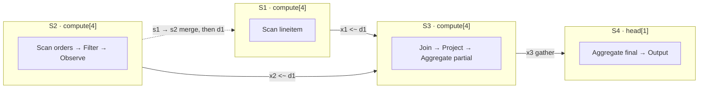

# Adaptive join

For a single day's orders, the filtered build side might be small enough to broadcast. Q5
measures its size before choosing. Both join inputs must follow the same decision: if one worker
keeps its line items locally while another expects them to arrive by hash partition, they can
miss matches.

## The question

**Q5 (one day's revenue).** For orders placed on 1995-03-15, compute each order's discounted
revenue from its line items, returned with the order key and order date. How many orders match is
unknown when you build the plan.

## The single-worker plan

On one worker there is no exchange, so there is nothing to choose.

```text
Plan "q5_day_revenue" (joined)
worker sets: local[1]
Output "result" on local[1]
└─ Aggregate keys=[o_orderkey, o_orderdate] measures=[revenue = sum(rev)]
   └─ Project [o_orderkey, o_orderdate, rev = l_extendedprice * (1 - l_discount)]
      └─ Join inner keys=[l_orderkey == o_orderkey] build=right  mode=single
         ├─ Scan lineitem [l_orderkey, l_extendedprice, l_discount]  on local[1]  shards=files_round_robin
         └─ Filter o_orderdate == 1995-03-15
            └─ Scan orders [o_orderkey, o_orderdate]  on local[1]  shards=files_round_robin
```

## Building the adaptive plan

The steps below build the adaptive join by hand. [The shortcut](#the-shortcut) produces the same
plan in one call.

### Step 1: measure the build side

`observe` passes rows through without blocking and publishes a `Statistics` value when its input
ends. Here it counts the bytes of the filtered orders on each worker.

```cpp
#include <sirius/sirius.hpp>
using namespace sirius;

Result<Plan> q5_plan(const TableSource& lineitem, const TableSource& orders,
                     const WorkerSet& head, const WorkerSet& compute) {
  SIRIUS_TRY(orders_scan, Relation::scan(orders, ScanOptions::on(compute)
      .with_columns({"o_orderkey", "o_orderdate"})
      .with_shards(Shards::files_round_robin())));
  SIRIUS_TRY(date, orders_scan.column("o_orderdate"));
  SIRIUS_TRY(march_15, Value::date32(1995, 3, 15));
  SIRIUS_TRY(on_day, date.eq(Expression::literal(march_15)));
  SIRIUS_TRY(day_orders, orders_scan.filter(on_day));
  SIRIUS_TRY(observed, day_orders.observe(StatisticsSpec::bytes()));   // ~> s1, partial
  SIRIUS_TRY(total, observed.statistics.merge_to(compute));            // s2, global
```
```rust
use sirius::prelude::*;

fn q5_plan(lineitem: &TableSource, orders: &TableSource,
           head: &WorkerSet, compute: &WorkerSet) -> Result<Plan, PlanError> {
    let orders_scan = Relation::scan(orders, ScanOptions::on(compute)
        .with_columns(&["o_orderkey", "o_orderdate"])
        .with_shards(Shards::files_round_robin()))?;
    let date = orders_scan.column("o_orderdate")?;
    let march_15 = Value::date32(1995, 3, 15)?;
    let on_day = date.eq(&Expression::literal(march_15))?;
    let day_orders = orders_scan.filter(&on_day)?;
    let observed = day_orders.observe(StatisticsSpec::bytes())?;   // ~> s1, partial
    let total = observed.statistics.merge_to(compute)?;            // s2, global
```

Each worker's `s1` counts only its own rows, so it is `partial`. `merge_to(compute)` inserts a
`ValueExchange` that sums the four counts and delivers the total, `s2`, to every compute worker.
That makes `s2` `global` on `compute[4]`. Here every compute worker evaluates the decision from the same value. A leader can
also evaluate it once and deliver its label to the other workers (V15).

### Step 2: decide

`Decision::threshold` is a pure rule over a global statistic: at most 64 MiB gives the first label,
anything more gives the second.

```cpp
  SIRIUS_TRY(choice, Decision::threshold(total, Metric::bytes, 64 << 20,
                                         "broadcast", "partitioned"));   // d1
```
```rust
    let choice = Decision::threshold(&total, Metric::Bytes, 64 << 20,
                                     "broadcast", "partitioned")?;   // d1
```

There is no coordinator. Every worker receives the same `s2`, applies the same rule, and gets the
same label. `Metric::bytes` counts *logical* bytes and the threshold is an integer, so neither a
storage format nor rounding can make two workers disagree.
[Why every worker picks the same label](../part-2/06-adaptive-plans.md#why-every-worker-picks-the-same-label)
has the reasons and the engine's run-time check of the label.

The alternative is to decide once on `head[1]` and deliver the `Decision` through a `ValueExchange`
(see [Deciding on a leader](../part-2/06-adaptive-plans.md#deciding-on-a-leader)).

### Step 3: two exchanges, one decision

Each side of the join gets an exchange decided by `d1`, with one alternative per label.

```cpp
  SIRIUS_TRY(build_route, Exchange::decided_by(choice, {
      {"broadcast", Exchange::broadcast(compute)},
      {"partitioned", Exchange::hash({"o_orderkey"}, compute)}}));
  SIRIUS_TRY(probe_route, Exchange::decided_by(choice, {
      {"broadcast", Exchange::forward()},
      {"partitioned", Exchange::hash({"l_orderkey"}, compute)}}));
  SIRIUS_TRY(lineitem_scan, Relation::scan(lineitem, ScanOptions::on(compute)
      .with_columns({"l_orderkey", "l_extendedprice", "l_discount"})
      .with_shards(Shards::files_round_robin())));
  SIRIUS_TRY(probe, lineitem_scan.exchange(probe_route));
  SIRIUS_TRY(build, observed.relation.exchange(build_route));
```
```rust
    let build_route = Exchange::decided_by(&choice, vec![
        ("broadcast", Exchange::broadcast(compute)),
        ("partitioned", Exchange::hash(&["o_orderkey"], compute,
                                       Partitions::one_per_worker(), HashScheme::v1()))])?;
    let probe_route = Exchange::decided_by(&choice, vec![
        ("broadcast", Exchange::forward()),
        ("partitioned", Exchange::hash(&["l_orderkey"], compute,
                                       Partitions::one_per_worker(), HashScheme::v1()))])?;
    let lineitem_scan = Relation::scan(lineitem, ScanOptions::on(compute)
        .with_columns(&["l_orderkey", "l_extendedprice", "l_discount"])
        .with_shards(Shards::files_round_robin()))?;
    let probe = lineitem_scan.exchange(&probe_route)?;
    let build = observed.relation.exchange(&build_route)?;
```

The probe side's "broadcast" alternative is `forward`: worker *i* sends to worker *i*, which moves
nothing. It is still an exchange, so the stage graph is the same whichever label wins (see
[Stage graphs do not change](../part-2/06-adaptive-plans.md#stage-graphs-do-not-change)).

The join checks each label separately (V10). Under "broadcast" it sees a replicated build and a
forwarded probe, a valid `broadcast_build`. Under "partitioned" it sees two co-partitioned hash
exchanges, a valid `co_partitioned` join. One `Decision` drives both exchanges, so a broadcast
build can never meet a hashed probe.

### Step 4: join and a two-phase aggregate

```cpp
  SIRIUS_TRY(on, JoinOn::keys({{"l_orderkey", "o_orderkey"}}));
  SIRIUS_TRY(joined, probe.join(build, JoinType::inner, std::move(on), JoinOptions::defaults()));
  SIRIUS_TRY(price, joined.column("l_extendedprice"));
  SIRIUS_TRY(discount, joined.column("l_discount"));
  SIRIUS_TRY(one, Value::decimal("1", 15, 2));
  SIRIUS_TRY(one_minus, Expression::literal(one).sub(discount));
  SIRIUS_TRY(rev, price.mul(one_minus));
  SIRIUS_TRY(columns, joined.pass_through({"o_orderkey", "o_orderdate"}));
  columns.push_back(rev.named("rev"));
  SIRIUS_TRY(projected, joined.project(std::move(columns)));
  SIRIUS_TRY(rev_col, projected.column("rev"));
  SIRIUS_TRY(revenue, Measure::sum("revenue", rev_col));
  SIRIUS_TRY(partial, projected.aggregate_partial({"o_orderkey", "o_orderdate"}, {revenue}));
  SIRIUS_TRY(gathered, partial.exchange(Exchange::gather(head)));
  SIRIUS_TRY(totals, gathered.aggregate_final());
  return Plan::from_root(totals);
}
```
```rust
    let on = JoinOn::keys(&[("l_orderkey", "o_orderkey")])?;
    let joined = probe.join(&build, JoinType::Inner, on, JoinOptions::default())?;
    let price = joined.column("l_extendedprice")?;
    let discount = joined.column("l_discount")?;
    let one = Value::decimal("1", 15, 2)?;
    let one_minus = Expression::literal(one).sub(&discount)?;
    let rev = price.mul(&one_minus)?;
    let mut columns = joined.pass_through(&["o_orderkey", "o_orderdate"])?;
    columns.push(rev.named("rev"));
    let projected = joined.project(columns)?;
    let rev_col = projected.column("rev")?;
    let revenue = Measure::sum("revenue", &rev_col)?;
    let partial = projected.aggregate_partial(&["o_orderkey", "o_orderdate"], vec![revenue])?;
    let gathered = partial.exchange(&Exchange::gather(head, GatherOrder::any()))?;
    let totals = gathered.aggregate_final()?;
    Plan::from_root(&totals, "result")
}
```

Q4's aggregate had one phase. This one needs two, because the join's output distribution is now
`decided` and downstream checks use the meet of the alternatives (see
[The other cost](../part-2/06-adaptive-plans.md#the-other-cost-a-weaker-distribution)). Under
"broadcast" the output has the probe's distribution, `arbitrary(compute[4])`. Under "partitioned"
it is `hashed` on the order key. The meet is `arbitrary`, and V6 rejects a single-phase grouped
aggregate over `arbitrary` rows, so `projected.aggregate(...)` fails here.

The second phase costs little for Q5: one day's orders give few groups, and the partial aggregate
shrinks them before `x3`.

## The joined plan

```text
Plan "q5_day_revenue" (joined)
worker sets: head[1], compute[4]
values:
  s2 = ValueExchange merge s1 -> compute[4]
  d1 = Decide threshold(s2.bytes, at_most=64MiB) -> [broadcast, partitioned]
Output "result" on head[1]
└─ Aggregate final keys=[o_orderkey, o_orderdate]
   └─ Exchange x3 gather -> head[1]
      └─ Aggregate partial keys=[o_orderkey, o_orderdate] measures=[revenue = sum(rev)]
         └─ Project [o_orderkey, o_orderdate, rev = l_extendedprice * (1 - l_discount)]
            └─ Join inner keys=[l_orderkey == o_orderkey] build=right  mode=decided(d1)
               ├─ Exchange x1 <~ d1 {broadcast: forward, partitioned: hash(l_orderkey)} -> compute[4]
               │  └─ Scan lineitem [l_orderkey, l_extendedprice, l_discount]  on compute[4]  shards=files_round_robin
               └─ Exchange x2 <~ d1 {broadcast: broadcast, partitioned: hash(o_orderkey)} -> compute[4]
                  └─ Observe bytes ~> s1
                     └─ Filter o_orderdate == 1995-03-15
                        └─ Scan orders [o_orderkey, o_orderdate]  on compute[4]  shards=files_round_robin
```

The adaptive mechanism is the `Observe` line, the two `values:` lines and the two decided
exchanges. None of it is inside the join.

### The shortcut

`JoinOptions::with_adaptive_broadcast(b)` writes steps 1 to 3 for you. Both inputs must be on the
same worker set with no exchange directly below them.

```cpp
  SIRIUS_TRY(on, JoinOn::keys({{"l_orderkey", "o_orderkey"}}));
  SIRIUS_TRY(joined, lineitem_scan.join(day_orders, JoinType::inner, std::move(on),
      JoinOptions::defaults().with_adaptive_broadcast(64 << 20)));
```
```rust
    let on = JoinOn::keys(&[("l_orderkey", "o_orderkey")])?;
    let joined = lineitem_scan.join(&day_orders, JoinType::Inner, on,
        JoinOptions::default().with_adaptive_broadcast(64 << 20))?;
```

`explain()` of a plan built this way prints the same tree as above
([rule 5](../part-2/01-everything-in-the-plan.md#the-ownership-rule); see
[The sugar, and what it expands to](../part-2/06-adaptive-plans.md#the-sugar-and-what-it-expands-to)).
A host that already decides broadcast from measured bytes builds its adaptive joins this way;
[Part IV](../part-4/01-duckdb-extension.md) shows one.

## Stages



The merged statistic also goes back to S2, whose `x2` needs `d1` too.

Statistics and decisions are required values. A runtime filter is optional, but `x1` and `x2`
cannot send a row until `d1` exists. That happens only after every orders worker has finished,
because `Observe` publishes at end of stream and the merge needs all four.

Neither scan waits. Scanned line items and filtered orders queue at the inputs of `x1` and `x2`.
The queues are backed by spillable repositories, so a large backlog moves to host memory or disk
instead of stalling a scan.

## One worker's view

Here is `compute#1` (S1 and S2 only). `d1` is not in the `values:` blocks: each stage that consumes
it evaluates `Decide` locally from the merged `s2`. Both S1 and S2 need `s2`, so the `ValueSink` in
S2 names both stages.

```text
Plan "q5_day_revenue" (instance compute#1)
worker sets: head[1], compute[4]
Stage S1 instance compute#1
values:
  ValueSource s2 = merge s1 <- S2 senders=[compute#0..3]
ExchangeSink x1 <~ d1 {broadcast: forward -> [compute#1],
│                      partitioned: hash(l_orderkey) partitions->workers {0:#0, 1:#1, 2:#2, 3:#3}}
└─ Scan lineitem [l_orderkey, l_extendedprice, l_discount]  files=[1, 5, 9, ..., 253] (64 of 256)
Stage S2 instance compute#1
values:
  ValueSink s1 merge -> S1, S2
  ValueSource s2 = merge s1 <- S2 senders=[compute#0..3]
ExchangeSink x2 <~ d1 {broadcast: broadcast -> [compute#0..3],
│                      partitioned: hash(o_orderkey) partitions->workers {0:#0, 1:#1, 2:#2, 3:#3}}
└─ Observe bytes ~> s1
   └─ Filter o_orderdate == 1995-03-15
      └─ Scan orders [o_orderkey, o_orderdate]  files=[1, 5, 9, ..., 61] (16 of 64)
```

## What actually ran

The report records each decision: its label, the inputs it saw and the resolved counts.
`resolved_plan()` is the plan with every decision substituted (see
[After the run](../part-2/06-adaptive-plans.md#after-the-run-decisions-and-the-resolved-plan)).

```cpp
  SIRIUS_TRY(prepared, context.prepare(plan, Bindings::local()));
  SIRIUS_TRY(result, std::move(prepared).collect());
  std::cout << result.report.decisions().size() << " decision(s)\n";
  std::cout << result.report.resolved_plan().explain();
```
```rust
    let prepared = context.prepare(&plan, Bindings::local())?;
    let result = prepared.collect()?;
    println!("{} decision(s)", result.report.decisions().len());
    println!("{}", result.report.resolved_plan().explain(&ExplainOptions::default()));
```

With a few megabytes of orders, `d1` chooses "broadcast" and the resolved plan reads:

```text
Plan "q5_day_revenue" (resolved)
worker sets: head[1], compute[4]
values:
  s2 = ValueExchange merge s1 -> compute[4]
  d1 = broadcast (resolved)
Output "result" on head[1]
└─ Aggregate final keys=[o_orderkey, o_orderdate]
   └─ Exchange x3 gather -> head[1]
      └─ Aggregate partial keys=[o_orderkey, o_orderdate] measures=[revenue = sum(rev)]
         └─ Project [o_orderkey, o_orderdate, rev = l_extendedprice * (1 - l_discount)]
            └─ Join inner keys=[l_orderkey == o_orderkey] build=right  mode=broadcast_build
               ├─ Exchange x1 forward -> compute[4]
               │  └─ Scan lineitem [l_orderkey, l_extendedprice, l_discount]  on compute[4]  shards=files_round_robin
               └─ Exchange x2 broadcast -> compute[4]
                  └─ Observe bytes ~> s1
                     └─ Filter o_orderdate == 1995-03-15
                        └─ Scan orders [o_orderkey, o_orderdate]  on compute[4]  shards=files_round_robin
```

The aggregate stays two-phase: resolving substitutes the decision and does not re-plan.

## Alternatives and trade-offs

### Deciding the partition count too

Under "partitioned" the hash exchanges produce one partition per worker by default. A large build
may be better split into more, smaller partitions, which each worker handles one at a time. A
second decision chooses the count from the same merged statistic:

```text
values:
  s2 = ValueExchange merge s1 -> compute[4]
  d1 = Decide threshold(s2.bytes, at_most=64MiB) -> [broadcast, partitioned]
  d2 = Decide partition_count(s2.bytes, target=1GiB, min=4, max=64)
...
├─ Exchange x1 <~ d1 {broadcast: forward, partitioned: hash(l_orderkey) partitions=<~d2} -> compute[4]
...
└─ Exchange x2 <~ d1 {broadcast: broadcast, partitioned: hash(o_orderkey) partitions=<~d2} -> compute[4]
```

```cpp
  SIRIUS_TRY(count, Decision::partition_count(total, PartitionCountPolicy{1ull << 30, 4, 64}));
  auto hashed_build = Exchange::hash({"o_orderkey"}, compute, Partitions::decided_by(count));
  auto hashed_probe = Exchange::hash({"l_orderkey"}, compute, Partitions::decided_by(count));
```
```rust
    let count = Decision::partition_count(&total,
        PartitionCountPolicy { target_bytes: 1 << 30, min: 4, max: 64 })?;
    let hashed_build = Exchange::hash(&["o_orderkey"], compute, Partitions::decided_by(&count), HashScheme::v1());
    let hashed_probe = Exchange::hash(&["l_orderkey"], compute, Partitions::decided_by(&count), HashScheme::v1());
```

Pass `hashed_build` and `hashed_probe` as the "partitioned" alternatives of the two `decided_by`
calls from step 3. `partition_count` takes `ceil(bytes / target)` and clamps it to `[min, max]`.
Partition *p* goes to worker `p mod 4`, so with 64 partitions `compute#2` receives
`partitions=[2, 6, ..., 62] (16 of 64)`.

Both exchanges must use the same decision (V20). The join pairs partition *p* of one side with
partition *p* of the other, so with different counts the same key would land in different
partitions and the join would silently lose matches (see
[Deciding the partition count](../part-2/06-adaptive-plans.md#deciding-the-partition-count)).

### Other choices

- **Pick statically.** If you know the build is small, write Q3's broadcast join. If you know it is
  large, write Q4's partitioned join and keep its single-phase aggregate. Adaptivity costs a
  weaker output distribution (the meet), a wait for `d1`, and buffered rows.
- **Measure rows instead of bytes.** `StatisticsSpec::rows()` with `Metric::rows` works the same
  way. Logical bytes track memory and network cost more directly.
- **Final aggregate on compute.** Hash the partial states on the group keys across `compute[4]`,
  finish there, and gather the results. With few groups the extra exchange is not worth it.

## On one machine

`context.prepare(plan, Bindings::local())` binds the four compute workers to four local GPUs. The
plan text and the decision rule do not change.

## What the engine does

For a local multi-GPU join, the layout callback in Sirius already uses measurements and
estimates to choose among eligible strategies. For a cross-rank join, the distributed planner
chooses the exchange earlier from estimates. Q5 instead makes the measured statistic, threshold
and two routing alternatives visible before the run. The report records the chosen label.
[Local and cross-rank policies](../part-2/06-adaptive-plans.md#adaptivity-today)
