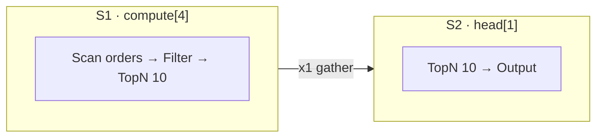
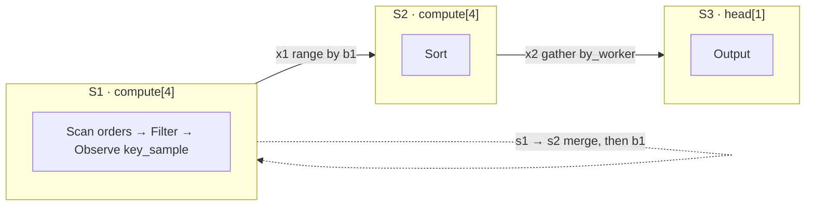
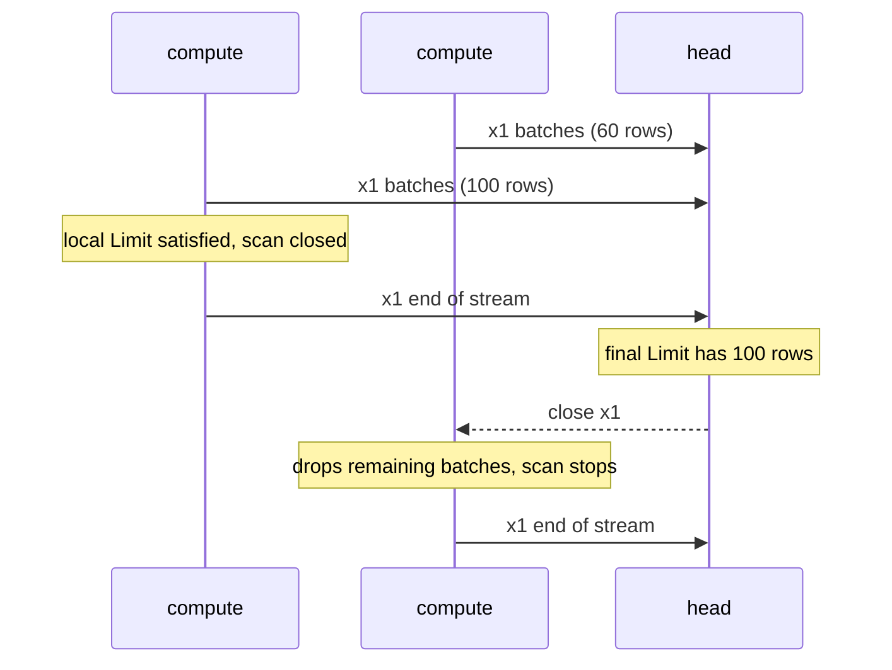

# Sort, top-N and limit

On one worker, ordering is one node. On four workers, a top-N, a full sort and a limit each need a
different plan. The plan says where the global answer is assembled, which rows go to which worker,
and how a scan learns that it can stop.

The three queries, Q6a, Q6b and Q6c, read `orders`.

## The shared starting point

Q6a and Q6b start from the orders placed in 1996, scanned on `compute[4]`:

```cpp
#include <sirius/sirius.hpp>
using namespace sirius;

Result<Relation> orders_in_1996(const TableSource& orders, const WorkerSet& compute) {
  SIRIUS_TRY(scan, Relation::scan(orders, ScanOptions::on(compute)
      .with_columns({"o_orderkey", "o_orderdate", "o_totalprice"})
      .with_shards(Shards::files_round_robin())));
  SIRIUS_TRY(date, scan.column("o_orderdate"));
  SIRIUS_TRY(jan_1_1996, Value::date32(1996, 1, 1));
  SIRIUS_TRY(jan_1_1997, Value::date32(1997, 1, 1));
  SIRIUS_TRY(from, date.ge(Expression::literal(jan_1_1996)));
  SIRIUS_TRY(until, date.lt(Expression::literal(jan_1_1997)));
  SIRIUS_TRY(in_year, from.and_(until));
  return scan.filter(in_year);
}
```
```rust
use sirius::prelude::*;

fn orders_in_1996(orders: &TableSource, compute: &WorkerSet) -> Result<Relation, PlanError> {
    let scan = Relation::scan(orders, ScanOptions::on(compute)
        .with_columns(&["o_orderkey", "o_orderdate", "o_totalprice"])
        .with_shards(Shards::files_round_robin()))?;
    let date = scan.column("o_orderdate")?;
    let jan_1_1996 = Value::date32(1996, 1, 1)?;
    let jan_1_1997 = Value::date32(1997, 1, 1)?;
    let from = date.ge(&Expression::literal(jan_1_1996))?;
    let until = date.lt(&Expression::literal(jan_1_1997))?;
    let in_year = from.and(&until)?;
    scan.filter(&in_year)
}
```

## Q6a: top-N

**Q6a.** The 10 most expensive orders placed in 1996: total price descending, ties broken by order
key ascending.

### The single-worker plan

```text
Plan "q6a_priciest_orders" (joined)
worker sets: local[1]
Output "result" on local[1]
└─ TopN 10 [o_totalprice desc, o_orderkey asc]
   └─ Filter o_orderdate >= 1996-01-01 and o_orderdate < 1997-01-01
      └─ Scan orders [o_orderkey, o_orderdate, o_totalprice]  on local[1]  shards=files_round_robin
```

### Building it

`TopN` keeps the top *n* rows **within each worker**: on `compute[4]`, four local top-10 lists. A
global top-N holds only on `single` (V14), so the rows must meet on one worker.

`TopN` composes with itself: the top 10 of four top-10 lists is the global top 10. The same node is
the local and the final step:

```cpp
  // inside a function that has orders, head and compute in scope
  SIRIUS_TRY(in_1996, orders_in_1996(orders, compute));
  std::vector<SortKey> priciest = {SortKey::desc("o_totalprice"), SortKey::asc("o_orderkey")};
  SIRIUS_TRY(local_top, in_1996.top_n(10, priciest));
  SIRIUS_TRY(gathered, local_top.exchange(Exchange::gather(head)));
  SIRIUS_TRY(top, gathered.top_n(10, priciest));
  SIRIUS_TRY(plan, Plan::from_root(top));
```
```rust
    // inside a function that has orders, head and compute in scope
    let in_1996 = orders_in_1996(&orders, &compute)?;
    let priciest = vec![SortKey::desc("o_totalprice"), SortKey::asc("o_orderkey")];
    let local_top = in_1996.top_n(10, priciest.clone())?;
    let gathered = local_top.exchange(&Exchange::gather(&head, GatherOrder::any()))?;
    let top = gathered.top_n(10, priciest)?;
    let plan = Plan::from_root(&top, "result")?;
```

### The joined plan

```text
Plan "q6a_priciest_orders" (joined)
worker sets: head[1], compute[4]
Output "result" on head[1]
└─ TopN 10 [o_totalprice desc, o_orderkey asc]
   └─ Exchange x1 gather -> head[1]
      └─ TopN 10 [o_totalprice desc, o_orderkey asc]
         └─ Filter o_orderdate >= 1996-01-01 and o_orderdate < 1997-01-01
            └─ Scan orders [o_orderkey, o_orderdate, o_totalprice]  on compute[4]  shards=files_round_robin
```

At most 40 rows cross `x1`. The local `TopN` only saves traffic: without it the result is the
same, but `x1` carries every 1996 order to one worker.

The tie-break key `o_orderkey asc` makes the order total, so the local and final steps agree on the
top 10 when prices tie.



### Top-N per key

**Q6a per customer.** Each customer's most expensive order of 1996.

A per-key `TopN`
([Top-N per key](../part-1/07-aggregates-joins-and-ordering.md#top-n-per-key)) composes with
itself the same way. The final step needs all rows of a key on one worker (V14), so the exchange
hashes on the key and the final step runs on all four workers:

```cpp
  // a fresh scenario: in_1996 as above, with o_custkey among its scanned columns
  std::vector<SortKey> priciest = {SortKey::desc("o_totalprice"), SortKey::asc("o_orderkey")};
  SIRIUS_TRY(local_best, in_1996.top_n_per_key({"o_custkey"}, 1, priciest));
  SIRIUS_TRY(by_customer, local_best.exchange(Exchange::hash({"o_custkey"}, compute)));
  SIRIUS_TRY(best, by_customer.top_n_per_key({"o_custkey"}, 1, priciest));
```
```rust
    // a fresh scenario: in_1996 as above, with o_custkey among its scanned columns
    let priciest = vec![SortKey::desc("o_totalprice"), SortKey::asc("o_orderkey")];
    let local_best = in_1996.top_n_per_key(&["o_custkey"], 1, priciest.clone())?;
    let by_customer = local_best.exchange(&Exchange::hash(&["o_custkey"], &compute,
        Partitions::one_per_worker(), HashScheme::v1()))?;
    let best = by_customer.top_n_per_key(&["o_custkey"], 1, priciest)?;
```

```text
TopN 1 [o_totalprice desc, o_orderkey asc]  per=[o_custkey]
└─ Exchange x1 hash(o_custkey) -> compute[4]
   └─ TopN 1 [o_totalprice desc, o_orderkey asc]  per=[o_custkey]
      └─ Filter o_orderdate >= 1996-01-01 and o_orderdate < 1997-01-01
         └─ Scan orders [o_orderkey, o_custkey, o_orderdate, o_totalprice]
                        on compute[4]  shards=files_round_robin
```

At most one row per customer per worker crosses `x1`. A gather to `head[1]` in place of the hash
exchange is also legal, because `single` meets the same rule, but then one worker holds a row for
every customer.

## Q6b: a full sort

**Q6b.** All orders placed in 1996, sorted by order date, then by total price descending.

Every 1996 order comes back, so there is no small answer to gather. Two plans do this.

### Range partitioning with boundaries

The first plan splits the key space into four ranges, sends each range to one worker, sorts there,
and reads the workers back in order. Balanced ranges need a look at the data, which takes three
runtime-value nodes:

1. `Observe key_sample(...)` takes up to 1024 sort keys per worker. At the end of its input it
   publishes them with the number of rows the worker saw (`s1`, `partial`).
2. `merge_to(compute)` pools the four samples into one global sample on every worker (`s2`).
3. `Boundaries::from_sample` turns the global sample into three splitters for `compute[4]` (`b1`).
   It is deterministic and reads the pooled samples in sender order, so every worker computes the
   same splitters. It weights each worker's sample by its row count (see
   [Range](../part-2/03-exchanges.md#range)).

```cpp
  SIRIUS_TRY(in_1996, orders_in_1996(orders, compute));
  std::vector<SortKey> by_date = {SortKey::asc("o_orderdate"), SortKey::desc("o_totalprice")};
  SIRIUS_TRY(sample_spec, StatisticsSpec::key_sample(by_date, 1024));
  SIRIUS_TRY(observed, in_1996.observe(sample_spec));                       // ~> s1
  SIRIUS_TRY(sample, observed.statistics.merge_to(compute));                // s2
  SIRIUS_TRY(boundaries, Boundaries::from_sample(sample, compute));         // b1
  SIRIUS_TRY(ranged, observed.relation.exchange(Exchange::range(by_date, boundaries, compute)));
  SIRIUS_TRY(sorted, ranged.sort(by_date));
  SIRIUS_TRY(gathered, sorted.exchange(Exchange::gather(head, GatherOrder::by_worker())));
  SIRIUS_TRY(plan, Plan::from_root(gathered));
```
```rust
    let in_1996 = orders_in_1996(&orders, &compute)?;
    let by_date = vec![SortKey::asc("o_orderdate"), SortKey::desc("o_totalprice")];
    let sample_spec = StatisticsSpec::key_sample(by_date.clone(), 1024)?;
    let observed = in_1996.observe(sample_spec)?;                      // ~> s1
    let sample = observed.statistics.merge_to(&compute)?;              // s2
    let boundaries = Boundaries::from_sample(&sample, &compute)?;      // b1
    let ranged = observed.relation.exchange(&Exchange::range(by_date.clone(), &boundaries, &compute))?;
    let sorted = ranged.sort(by_date)?;
    let gathered = sorted.exchange(&Exchange::gather(&head, GatherOrder::by_worker()))?;
    let plan = Plan::from_root(&gathered, "result")?;
```

```text
Plan "q6b_orders_sorted" (joined)
worker sets: head[1], compute[4]
values:
  s2 = ValueExchange merge s1 -> compute[4]
  b1 = ComputeBoundaries s2 -> compute[4]
Output "result" on head[1]
└─ Exchange x2 gather order=by_worker -> head[1]
   └─ Sort [o_orderdate asc, o_totalprice desc]
      └─ Exchange x1 range([o_orderdate asc, o_totalprice desc]) <~ b1 -> compute[4]
         └─ Observe key_sample([o_orderdate asc, o_totalprice desc], 1024/worker) ~> s1
            └─ Filter o_orderdate >= 1996-01-01 and o_orderdate < 1997-01-01
               └─ Scan orders [o_orderkey, o_orderdate, o_totalprice]  on compute[4]  shards=files_round_robin
```

After `x1`, worker *i* holds exactly the rows of interval *i*, so the output of `x1` is `ranged`.
`Sort` then orders each worker's rows. It gives global order only on `single`, or on `ranged` input
followed by a [gather](../part-2/03-exchanges.md#gather) with `order=by_worker`.

`x2` is that gather. It delivers all of `compute#0`'s rows, then all of `compute#1`'s, and so on,
so the result arrives in global order with no merge on `head`.



Boundaries are a *required* value: `x1` cannot route a row until `b1` exists, and `b1` needs every
worker's sample, so the dotted edge loops back into S1. Each worker keeps scanning while it waits,
and its filtered rows sit in `x1`'s spillable input queue. Every 1996 order is read before any
moves. That is the cost of balanced ranges.

This is `compute#2`'s instance of the sort stage:

```text
Stage S2 instance compute#2
ExchangeSink x2 gather order=by_worker -> [head#0]
└─ Sort [o_orderdate asc, o_totalprice desc]
   └─ ExchangeSource x1 partition=2/4 <- senders=[compute#0..3]
```

Partition 2 is the third interval in sort order: from the second splitter up to, but not including,
the third. A key equal to a splitter goes to the higher partition on every sender, so equal keys
land on one worker.

### Alternative: sort locally, merge on head

The second plan has no boundaries. Each worker sorts what it scanned, and `head` merges four sorted
streams:

```text
Plan "q6b_orders_sorted_merge" (joined)
worker sets: head[1], compute[4]
Output "result" on head[1]
└─ Exchange x1 gather order=merge[o_orderdate asc, o_totalprice desc] -> head[1]
   └─ Sort [o_orderdate asc, o_totalprice desc]
      └─ Filter o_orderdate >= 1996-01-01 and o_orderdate < 1997-01-01
         └─ Scan orders [o_orderkey, o_orderdate, o_totalprice]  on compute[4]  shards=files_round_robin
```

`gather order=merge[...]` requires input sorted on its keys (V14) and does a k-way merge on the
receiving worker.

| | Range + `by_worker` | Local sort + `merge` |
|---|---|---|
| Runtime values | key sample, merge, boundaries | none |
| Rows crossing workers | most rows twice (`x1`, then `x2`) | each row once |
| Waits | every row waits for `b1` | none |
| Work on `head` | concatenate in worker order | k-way merge of every row |
| Skew risk | uneven ranges if the sample misleads | none |
| Best when | the sorted result stays on `compute[4]`, or `head` would be the bottleneck | the result is gathered anyway |

To keep the sorted data distributed, put the range variant's `Output` on `compute[4]` instead of
gathering. Reader *i* receives interval *i*, sorted, so reading the readers in worker order gives
the global order.

## Q6c: limit and early termination

**Q6c.** Any 100 orders with status "F".

Without an order, `Limit` keeps whichever rows arrive first, so the result may differ from run to
run. The plan has the same shape as top-N: a local `Limit`, a gather and a final `Limit`.

```cpp
  SIRIUS_TRY(scan, Relation::scan(orders, ScanOptions::on(compute)
      .with_columns({"o_orderkey", "o_orderstatus", "o_totalprice"})
      .with_shards(Shards::files_round_robin())));
  SIRIUS_TRY(status, scan.column("o_orderstatus"));
  SIRIUS_TRY(finished, status.eq(Expression::literal(Value::string("F"))));
  SIRIUS_TRY(done, scan.filter(finished));
  SIRIUS_TRY(local_any, done.limit(100));
  SIRIUS_TRY(gathered, local_any.exchange(Exchange::gather(head)));
  SIRIUS_TRY(any_100, gathered.limit(100));
  SIRIUS_TRY(plan, Plan::from_root(any_100));
```
```rust
    let scan = Relation::scan(&orders, ScanOptions::on(&compute)
        .with_columns(&["o_orderkey", "o_orderstatus", "o_totalprice"])
        .with_shards(Shards::files_round_robin()))?;
    let status = scan.column("o_orderstatus")?;
    let finished = status.eq(&Expression::literal(Value::string("F")))?;
    let done = scan.filter(&finished)?;
    let local_any = done.limit(100, 0)?;
    let gathered = local_any.exchange(&Exchange::gather(&head, GatherOrder::any()))?;
    let any_100 = gathered.limit(100, 0)?;
    let plan = Plan::from_root(&any_100, "result")?;
```

```text
Plan "q6c_any_finished_orders" (joined)
worker sets: head[1], compute[4]
Output "result" on head[1]
└─ Limit 100
   └─ Exchange x1 gather -> head[1]
      └─ Limit 100
         └─ Filter o_orderstatus == "F"
            └─ Scan orders [o_orderkey, o_orderstatus, o_totalprice]  on compute[4]  shards=files_round_robin
```

### How the plan stops work

A `Limit` that has its rows **closes** its input (see [Exchanges](../part-2/03-exchanges.md)). Here
that happens twice:

- **Within a worker.** The local `Limit 100` on `compute#0` closes its scan once it has 100 rows.
  The scan stops reading files, and the stage instance sends end of stream on `x1`.
- **Across workers.** The final `Limit 100` on `head#0` closes `x1` once it has 100 rows. Close
  travels upstream to every sender. Each sender drops further batches, still sends its end of
  stream, and stops early because its only receiver has closed.



No counter is shared between workers. In `report.stages()`, the S1 instances whose receiver closed
end with the outcome `closed`, and their row and byte counts show how little they read. Closed is
not a failure: the execution succeeds (see
[How an execution ends](../part-5/07-failure-cancellation-and-recovery.md#how-an-execution-ends)).

An `offset` is legal only on `single`: "skip the first 20" means nothing per worker. To skip 20 and
keep 100, cap each worker at 120 locally, then apply `limit(100, 20)` on `head`.

## On one machine

All three plans bind to four local GPUs with `Bindings::local()`, and their text does not change.
`x1` in Q6a and Q6c becomes a move from four GPUs to the GPU that hosts `head#0`. In Q6b, `x1`
becomes an in-process range repartition, and `s1 -> s2` merges four samples in one process.

## What the engine does

The engine already has most of the pieces, wired implicitly on one machine:

| Engine operators today | Plan nodes | What changes |
|---|---|---|
| `TOP_N` per partition, then `MERGE_TOP_N` | local `TopN`, gather, final `TopN` | the merge step is a gather and a second `TopN` |
| `HASH_GROUP_BY` that picks one row per group, `PARTITION`, `MERGE_GROUP_BY` | local per-key `TopN`, hash exchange, final per-key `TopN` | today only one arbitrary row per group, which is n = 1 with an empty order |
| `ORDER_BY`, `SORT_SAMPLE`, `SORT_PARTITION`, `MERGE_SORT` | `Observe key_sample`, `ValueExchange`, `b1`, range exchange, `Sort`, `gather order=by_worker` | a direct pointer becomes the `b1` edge |
| `UNORDERED_STREAMING_LIMIT` or `STREAMING_LIMIT` | local `Limit`, gather, final `Limit`, the close protocol | the plan nodes work across processes too |

`MERGE_SORT` output is read in range order, whatever order the merge tasks finish in. In the plan,
that is `gather order=by_worker`. How the sort itself runs (sorted runs, then a merge) stays
engine-owned.

Both limit operators work only inside one process. `UNORDERED_STREAMING_LIMIT` streams input known
to carry no order, and `STREAMING_LIMIT` waits for the complete input of anything else. The `Limit`
node has the same two contracts: it streams when its input carries no order and is a full barrier
when its input is sorted, so only a sorted input pays for the wait.

[From plan to pipelines](../part-5/01-from-plan-to-pipelines.md) shows how a local `TopN` and a
`Sort` become pipeline sinks, and
[Runtime values in the engine](../part-5/03-runtime-values-in-the-engine.md) covers the
`Boundaries` value edge.
