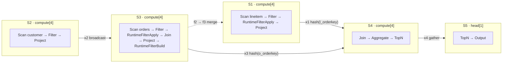

# A multi-stage query

This chapter combines the earlier walkthroughs in one query and follows the plan through each form,
from the joined plan to the report after the run.

## The question

**Q7 (shipping priority).** Take customers in the BUILDING market segment, their orders placed
before 1995-03-15, and those orders' line items shipped after 1995-03-15. For each (order key,
order date, ship priority), compute the revenue `sum(l_extendedprice * (1 - l_discount))`. Return
the 10 groups with the highest revenue, ties broken by earlier order date.

`customer` is small (16 files), `orders` medium (64) and `lineitem` large (256), so the plan treats
each join differently.

## The single-worker plan

```text
Plan "q7_shipping_priority" (joined)
worker sets: local[1]
Output "result" on local[1]
└─ TopN 10 [revenue desc, o_orderdate asc]
   └─ Aggregate keys=[l_orderkey, o_orderdate, o_shippriority] measures=[revenue = sum(rev)]
      └─ Join inner keys=[l_orderkey == o_orderkey] build=right  mode=single
         ├─ Project [l_orderkey, rev = l_extendedprice * (1 - l_discount)]
         │  └─ Filter l_shipdate > 1995-03-15
         │     └─ Scan lineitem [l_orderkey, l_extendedprice, l_discount, l_shipdate]
         │                      on local[1]  shards=files_round_robin
         └─ Project [o_orderkey, o_orderdate, o_shippriority]
            └─ Join inner keys=[o_custkey == c_custkey] build=right  mode=single
               ├─ Filter o_orderdate < 1995-03-15
               │  └─ Scan orders [o_orderkey, o_custkey, o_orderdate, o_shippriority]
               │                 on local[1]  shards=files_round_robin
               └─ Project [c_custkey]
                  └─ Filter c_mktsegment == "BUILDING"
                     └─ Scan customer [c_custkey, c_mktsegment]  on local[1]  shards=files_round_robin
```

## Building the plan

To spread the plan over `compute[4]`, the builder code works in dependency order, not tree order:

1. The customers come first, because the orders join needs them. They are few, so broadcast them
   (`x2`). The broadcast also makes filter `f1` global without a merge.
2. The orders come next, because the lineitem scan needs the filter that the orders side builds.
   Few line items belong to a BUILDING customer's early order, and `f2`, merged into `f3`, tells
   the scan which.
3. Orders and line items are both large, so hash both on the order key (`x3`, `x1`) and join them
   last.
4. The answer is small, so gather it to `head` (`x4`).

```cpp
#include <sirius/sirius.hpp>
using namespace sirius;

Result<Plan> q7_plan(const TableSource& customer, const TableSource& orders,
                     const TableSource& lineitem, const WorkerSet& head, const WorkerSet& compute) {
  auto on_compute = [&](std::vector<std::string> columns) {
    return ScanOptions::on(compute).with_columns(std::move(columns))
        .with_shards(Shards::files_round_robin());
  };
  auto hash = [&](std::string key) { return Exchange::hash({std::move(key)}, compute); };
  SIRIUS_TRY(march_15, Value::date32(1995, 3, 15));
  const Expression cutoff = Expression::literal(march_15);

  // S2: BUILDING customers, broadcast to every compute worker (x2); filter f1
  SIRIUS_TRY(cust, Relation::scan(customer, on_compute({"c_custkey", "c_mktsegment"})));
  SIRIUS_TRY(segment, cust.column("c_mktsegment"));
  SIRIUS_TRY(building, segment.eq(Expression::literal(Value::string("BUILDING"))));
  SIRIUS_TRY(cust_f, cust.filter(building));
  SIRIUS_TRY(cust_keys, cust_f.pass_through({"c_custkey"}));
  SIRIUS_TRY(cust_p, cust_f.project(std::move(cust_keys)));
  SIRIUS_TRY(cust_all, cust_p.exchange(Exchange::broadcast(compute)));
  SIRIUS_TRY(bloom_1m, BloomGeometry::fixed(1 << 20));
  SIRIUS_TRY(f1_build, cust_all.build_runtime_filter({"c_custkey"}, RuntimeFilterSpec::bloom(bloom_1m)));

  // S3: early orders joined with the replicated customers; filter f2, merged into f3
  SIRIUS_TRY(ord, Relation::scan(orders, on_compute(
      {"o_orderkey", "o_custkey", "o_orderdate", "o_shippriority"})));
  SIRIUS_TRY(odate, ord.column("o_orderdate"));
  SIRIUS_TRY(early, odate.lt(cutoff));
  SIRIUS_TRY(ord_f, ord.filter(early));
  SIRIUS_TRY(ord_pruned, ord_f.apply_runtime_filter(f1_build.filter, {"o_custkey"}, WaitPolicy::never()));
  SIRIUS_TRY(by_cust, JoinOn::keys({{"o_custkey", "c_custkey"}}));
  SIRIUS_TRY(cust_orders, ord_pruned.join(f1_build.relation, JoinType::inner, std::move(by_cust),
                                          JoinOptions::defaults()));
  SIRIUS_TRY(ord_cols, cust_orders.pass_through({"o_orderkey", "o_orderdate", "o_shippriority"}));
  SIRIUS_TRY(ord_p, cust_orders.project(std::move(ord_cols)));
  SIRIUS_TRY(bloom_8m, BloomGeometry::fixed(8 << 20));
  SIRIUS_TRY(f2_build, ord_p.build_runtime_filter({"o_orderkey"}, RuntimeFilterSpec::bloom(bloom_8m)));
  SIRIUS_TRY(f3, f2_build.filter.merge_to(compute));
  SIRIUS_TRY(ord_hashed, f2_build.relation.exchange(hash("o_orderkey")));   // x3

  // S1: line items shipped after the cutoff, pruned by f3, hashed by order key (x1)
  SIRIUS_TRY(li, Relation::scan(lineitem, on_compute(
      {"l_orderkey", "l_extendedprice", "l_discount", "l_shipdate"})));
  SIRIUS_TRY(sdate, li.column("l_shipdate"));
  SIRIUS_TRY(late, sdate.gt(cutoff));
  SIRIUS_TRY(li_f, li.filter(late));
  SIRIUS_TRY(li_pruned, li_f.apply_runtime_filter(f3, {"l_orderkey"},
                                                  WaitPolicy::up_to(std::chrono::milliseconds{20})));
  SIRIUS_TRY(price, li_pruned.column("l_extendedprice"));
  SIRIUS_TRY(discount, li_pruned.column("l_discount"));
  SIRIUS_TRY(one, Value::decimal("1", 15, 2));
  SIRIUS_TRY(one_minus, Expression::literal(one).sub(discount));
  SIRIUS_TRY(rev, price.mul(one_minus));
  SIRIUS_TRY(li_key, li_pruned.column("l_orderkey"));
  SIRIUS_TRY(li_p, li_pruned.project({li_key.named("l_orderkey"), rev.named("rev")}));
  SIRIUS_TRY(li_hashed, li_p.exchange(hash("l_orderkey")));   // x1

  // S4: co-partitioned join, single-phase aggregate, local top 10
  SIRIUS_TRY(by_order, JoinOn::keys({{"l_orderkey", "o_orderkey"}}));
  SIRIUS_TRY(joined, li_hashed.join(ord_hashed, JoinType::inner, std::move(by_order),
                                    JoinOptions::defaults()));
  SIRIUS_TRY(rev_col, joined.column("rev"));
  SIRIUS_TRY(revenue, Measure::sum("revenue", rev_col));
  SIRIUS_TRY(per_order, joined.aggregate({"l_orderkey", "o_orderdate", "o_shippriority"}, {revenue}));
  const std::vector<SortKey> best = {SortKey::desc("revenue"), SortKey::asc("o_orderdate")};
  SIRIUS_TRY(local_top, per_order.top_n(10, best));

  // S5: gather the candidates on head and keep the global top 10 (x4)
  SIRIUS_TRY(gathered, local_top.exchange(Exchange::gather(head)));
  SIRIUS_TRY(top, gathered.top_n(10, best));
  return Plan::from_root(top);
}
```
```rust
use std::time::Duration;
use sirius::prelude::*;

fn q7_plan(customer: &TableSource, orders: &TableSource, lineitem: &TableSource,
           head: &WorkerSet, compute: &WorkerSet) -> Result<Plan, PlanError> {
    let on_compute = |columns: &[&str]| {
        ScanOptions::on(compute).with_columns(columns).with_shards(Shards::files_round_robin())
    };
    let hash = |key: &str| Exchange::hash(&[key], compute, Partitions::one_per_worker(), HashScheme::v1());
    let march_15 = Value::date32(1995, 3, 15)?;
    let cutoff = Expression::literal(march_15);

    // S2: BUILDING customers, broadcast to every compute worker (x2); filter f1
    let cust = Relation::scan(customer, on_compute(&["c_custkey", "c_mktsegment"]))?;
    let segment = cust.column("c_mktsegment")?;
    let building = segment.eq(&Expression::literal(Value::string("BUILDING")))?;
    let cust_f = cust.filter(&building)?;
    let cust_keys = cust_f.pass_through(&["c_custkey"])?;
    let cust_p = cust_f.project(cust_keys)?;
    let cust_all = cust_p.exchange(&Exchange::broadcast(compute))?;
    let bloom_1m = BloomGeometry::fixed(1 << 20)?;
    let f1_build = cust_all.build_runtime_filter(&["c_custkey"], RuntimeFilterSpec::bloom(bloom_1m))?;

    // S3: early orders joined with the replicated customers; filter f2, merged into f3
    let ord = Relation::scan(orders,
        on_compute(&["o_orderkey", "o_custkey", "o_orderdate", "o_shippriority"]))?;
    let odate = ord.column("o_orderdate")?;
    let early = odate.lt(&cutoff)?;
    let ord_f = ord.filter(&early)?;
    let ord_pruned = ord_f.apply_runtime_filter(&f1_build.filter, &["o_custkey"], WaitPolicy::never())?;
    let by_cust = JoinOn::keys(&[("o_custkey", "c_custkey")])?;
    let cust_orders = ord_pruned.join(&f1_build.relation, JoinType::Inner, by_cust,
                                      JoinOptions::default())?;
    let ord_cols = cust_orders.pass_through(&["o_orderkey", "o_orderdate", "o_shippriority"])?;
    let ord_p = cust_orders.project(ord_cols)?;
    let bloom_8m = BloomGeometry::fixed(8 << 20)?;
    let f2_build = ord_p.build_runtime_filter(&["o_orderkey"], RuntimeFilterSpec::bloom(bloom_8m))?;
    let f3 = f2_build.filter.merge_to(compute)?;
    let ord_hashed = f2_build.relation.exchange(&hash("o_orderkey"))?;   // x3

    // S1: line items shipped after the cutoff, pruned by f3, hashed by order key (x1)
    let li = Relation::scan(lineitem,
        on_compute(&["l_orderkey", "l_extendedprice", "l_discount", "l_shipdate"]))?;
    let sdate = li.column("l_shipdate")?;
    let late = sdate.gt(&cutoff)?;
    let li_f = li.filter(&late)?;
    let li_pruned = li_f.apply_runtime_filter(&f3, &["l_orderkey"],
                                              WaitPolicy::up_to(Duration::from_millis(20)))?;
    let price = li_pruned.column("l_extendedprice")?;
    let discount = li_pruned.column("l_discount")?;
    let one = Value::decimal("1", 15, 2)?;
    let one_minus = Expression::literal(one).sub(&discount)?;
    let rev = price.mul(&one_minus)?;
    let li_key = li_pruned.column("l_orderkey")?;
    let li_p = li_pruned.project(vec![li_key.named("l_orderkey"), rev.named("rev")])?;
    let li_hashed = li_p.exchange(&hash("l_orderkey"))?;   // x1

    // S4: co-partitioned join, single-phase aggregate, local top 10
    let by_order = JoinOn::keys(&[("l_orderkey", "o_orderkey")])?;
    let joined = li_hashed.join(&ord_hashed, JoinType::Inner, by_order, JoinOptions::default())?;
    let rev_col = joined.column("rev")?;
    let revenue = Measure::sum("revenue", &rev_col)?;
    let per_order = joined.aggregate(&["l_orderkey", "o_orderdate", "o_shippriority"], vec![revenue])?;
    let best = vec![SortKey::desc("revenue"), SortKey::asc("o_orderdate")];
    let local_top = per_order.top_n(10, best.clone())?;

    // S5: gather the candidates on head and keep the global top 10 (x4)
    let gathered = local_top.exchange(&Exchange::gather(head, GatherOrder::any()))?;
    let top = gathered.top_n(10, best)?;
    Plan::from_root(&top, "result")
}
```

The comments name stages, but the code declares none. Stages and the ids `x1..x4` and `f1..f3` are
derived
([Stages fall out of the plan](../part-2/04-stages-and-bindings.md#stages-fall-out-of-the-plan)).
Ids are assigned in post-order when the plan is built, here by `Plan::from_root`, so the lineitem
exchange is `x1` although the code writes it third.

## The joined plan

```text
Plan "q7_shipping_priority" (joined)
worker sets: head[1], compute[4]
values:
  f3 = ValueExchange merge f2 -> compute[4]
Output "result" on head[1]
└─ TopN 10 [revenue desc, o_orderdate asc]
   └─ Exchange x4 gather -> head[1]
      └─ TopN 10 [revenue desc, o_orderdate asc]
         └─ Aggregate keys=[l_orderkey, o_orderdate, o_shippriority] measures=[revenue = sum(rev)]
            └─ Join inner keys=[l_orderkey == o_orderkey] build=right  mode=co_partitioned(x1, x3)
               ├─ Exchange x1 hash(l_orderkey) -> compute[4]
               │  └─ Project [l_orderkey, rev = l_extendedprice * (1 - l_discount)]
               │     └─ RuntimeFilterApply [l_orderkey] <~ f3  wait=up_to(20ms)
               │        └─ Filter l_shipdate > 1995-03-15
               │           └─ Scan lineitem [l_orderkey, l_extendedprice, l_discount, l_shipdate]
               │                            on compute[4]  shards=files_round_robin
               └─ Exchange x3 hash(o_orderkey) -> compute[4]
                  └─ RuntimeFilterBuild keys=[o_orderkey] spec=bloom(fixed 8MiB)  scope=partial ~> f2
                     └─ Project [o_orderkey, o_orderdate, o_shippriority]
                        └─ Join inner keys=[o_custkey == c_custkey] build=right  mode=broadcast_build
                           ├─ RuntimeFilterApply [o_custkey] <~ f1  wait=never
                           │  └─ Filter o_orderdate < 1995-03-15
                           │     └─ Scan orders [o_orderkey, o_custkey, o_orderdate, o_shippriority]
                           │                    on compute[4]  shards=files_round_robin
                           └─ RuntimeFilterBuild keys=[c_custkey] spec=bloom(fixed 1MiB)  scope=global ~> f1
                              └─ Exchange x2 broadcast -> compute[4]
                                 └─ Project [c_custkey]
                                    └─ Filter c_mktsegment == "BUILDING"
                                       └─ Scan customer [c_custkey, c_mktsegment]  on compute[4]  shards=files_round_robin
```

Six details of this tree:

1. **`f1` is global without a `ValueExchange`.** Its input comes out of a broadcast, so it is
   `replicated(compute[4])`: every worker builds the filter from *all* BUILDING customers. The
   filter applies on the same worker with no merge, so `f1` is not in `values:`.
2. **`f2` is `partial` and must be merged.** It is built *before* `x3`, on orders that are still
   `arbitrary`, so each worker's filter knows only the early BUILDING orders in its own files.
   `merge_to(compute)` ORs the four partials into `f3`
   ([Merging to global](../part-2/05-runtime-filters.md#merging-to-global)).
   [Alternatives and trade-offs](#alternatives-and-trade-offs) covers building it after `x3`.
3. **`x1` and `x3` are co-partitioned (V8).** They share `HashScheme::v1`, the key type (`int64`),
   one partition per worker and the target `compute[4]`, so the join prints
   `mode=co_partitioned(x1, x3)`.
4. **The single-phase `Aggregate` is legal (V6).** The join output is `hashed` on `l_orderkey`,
   a group key, so no exchange is needed between join and aggregate.
5. **There are two `TopN` nodes (V14).** The local one keeps at most 10 groups per worker, so `x4`
   carries at most 40 rows. The one on `head[1]` sits on `single`, where a global top-N is legal.
6. **`f3` races the lineitem scan.** `f3` exists only after every worker has scanned its orders,
   joined them with the customers and published its `f2` share. The lineitem scan is running by
   then. `wait=up_to(20ms)` lets `RuntimeFilterApply` hold its first batches for up to 20 ms.
   After that they pass unfiltered, and pruning starts when `f3` arrives
   ([Waiting, or not](../part-2/05-runtime-filters.md#waiting-or-not)).

## Stages



The five stages make 17 stage instances: four each of S1 to S4, and one of S5. The only value edge
across stages is `f2` -> `f3`. `f1` is built and used inside S3 on the same worker.

## The split form

`rewrite::split(plan)` returns the same plan with one block per stage. Each exchange becomes a sink
and source pair, and each cross-stage value edge a `ValueSink` and `ValueSource` pair
([Split form and instance form](../part-2/04-stages-and-bindings.md#split-form-and-instance-form)):

```text
Plan "q7_shipping_priority" (split)
worker sets: head[1], compute[4]
Stage S1 on compute[4]
values:
  ValueSource f3 = merge f2 <- S3 senders=[compute#0..3]
ExchangeSink x1 hash(l_orderkey) -> S4 [compute#0..3]
└─ Project [l_orderkey, rev = l_extendedprice * (1 - l_discount)]
   └─ RuntimeFilterApply [l_orderkey] <~ f3  wait=up_to(20ms)
      └─ Filter l_shipdate > 1995-03-15
         └─ Scan lineitem [l_orderkey, l_extendedprice, l_discount, l_shipdate]
                          on compute[4]  shards=files_round_robin
Stage S2 on compute[4]
ExchangeSink x2 broadcast -> S3 [compute#0..3]
└─ Project [c_custkey]
   └─ Filter c_mktsegment == "BUILDING"
      └─ Scan customer [c_custkey, c_mktsegment]  on compute[4]  shards=files_round_robin
Stage S3 on compute[4]
values:
  ValueSink f2 merge -> S1
ExchangeSink x3 hash(o_orderkey) -> S4 [compute#0..3]
└─ RuntimeFilterBuild keys=[o_orderkey] spec=bloom(fixed 8MiB)  scope=partial ~> f2
   └─ Project [o_orderkey, o_orderdate, o_shippriority]
      └─ Join inner keys=[o_custkey == c_custkey] build=right  mode=broadcast_build
         ├─ RuntimeFilterApply [o_custkey] <~ f1  wait=never
         │  └─ Filter o_orderdate < 1995-03-15
         │     └─ Scan orders [o_orderkey, o_custkey, o_orderdate, o_shippriority]
         │                    on compute[4]  shards=files_round_robin
         └─ RuntimeFilterBuild keys=[c_custkey] spec=bloom(fixed 1MiB)  scope=global ~> f1
            └─ ExchangeSource x2 <- S2 senders=[compute#0..3]
Stage S4 on compute[4]
ExchangeSink x4 gather -> S5 [head#0]
└─ TopN 10 [revenue desc, o_orderdate asc]
   └─ Aggregate keys=[l_orderkey, o_orderdate, o_shippriority] measures=[revenue = sum(rev)]
      └─ Join inner keys=[l_orderkey == o_orderkey] build=right  mode=co_partitioned(x1, x3)
         ├─ ExchangeSource x1 <- S1 senders=[compute#0..3]
         └─ ExchangeSource x3 <- S3 senders=[compute#0..3]
Stage S5 on head[1]
Output "result"
└─ TopN 10 [revenue desc, o_orderdate asc]
   └─ ExchangeSource x4 <- S4 senders=[compute#0..3]
```

`rewrite::join_stages` composes the blocks back into the joined plan.

## One worker's view

`rewrite::instance(split, compute.at(2))` narrows the split plan to what `compute#2` runs. Its S4
instance receives partition 2 of both hash exchanges, from all four senders:

```text
Plan "q7_shipping_priority" (instance compute#2)
worker sets: head[1], compute[4]
...
Stage S4 instance compute#2
ExchangeSink x4 gather -> [head#0]
└─ TopN 10 [revenue desc, o_orderdate asc]
   └─ Aggregate keys=[l_orderkey, o_orderdate, o_shippriority] measures=[revenue = sum(rev)]
      └─ Join inner keys=[l_orderkey == o_orderkey] build=right  mode=co_partitioned(x1, x3)
         ├─ ExchangeSource x1 partition=2/4 <- senders=[compute#0..3]
         └─ ExchangeSource x3 partition=2/4 <- senders=[compute#0..3]
```

The S1 instance of `compute#3` lists its files:

```text
Plan "q7_shipping_priority" (instance compute#3)
worker sets: head[1], compute[4]
Stage S1 instance compute#3
values:
  ValueSource f3 = merge f2 <- S3 senders=[compute#0..3]
ExchangeSink x1 hash(l_orderkey)  partitions->workers {0:#0, 1:#1, 2:#2, 3:#3}
└─ Project [l_orderkey, rev = l_extendedprice * (1 - l_discount)]
   └─ RuntimeFilterApply [l_orderkey] <~ f3  wait=up_to(20ms)
      └─ Filter l_shipdate > 1995-03-15
         └─ Scan lineitem [l_orderkey, l_extendedprice, l_discount, l_shipdate]
                          files=[3, 7, 11, ..., 255] (64 of 256)
...
```

`plan.explain(ExplainOptions::instance(compute.at(3)))` prints the same view without building the
intermediate plans.

## Bound to two hosts

On the cluster of [Two deployments](00-running-example.md#two-deployments), every process runs the
same builder code and gets the same plan and fingerprint
([SPMD: the same plan
everywhere](../part-4/03-distributed-sirius.md#spmd-the-same-plan-everywhere)). Each binds it with
the running example's `cluster` helper:

```cpp
  // ex: the running example; host_a, host_b and execution_id come from your launcher
  SIRIUS_TRY(bindings, cluster(ex, execution_id, host_a, host_b));
  SIRIUS_TRY(prepared, context.prepare(plan, std::move(bindings)));
```
```rust
    // ex: the running example; host_a, host_b and execution_id come from your launcher
    let bindings = cluster(&ex, execution_id, &host_a, &host_b)?;
    let prepared = context.prepare(&plan, bindings)?;
```

The bound plan is the joined plan with a `binding:` block under it. `prepared.local_workers()` is
`[compute#0, compute#1, head#0]` on host A and `[compute#2, compute#3]` on host B:

```text
Plan "q7_shipping_priority" (joined)
worker sets: head[1], compute[4]
...
binding:
  compute#0 -> hostA/gpu0
  compute#1 -> hostA/gpu1
  compute#2 -> hostB/gpu0
  compute#3 -> hostB/gpu1
  head#0    -> hostA/gpu0
```

Each host runs every stage instance of its local workers. `head#0` shares GPU 0 with `compute#0`:
one endpoint can host several workers.

The engine picks the transport from the bindings; the plan never names one. `x4` from `compute#0`
to `head#0` stays on one GPU, `x1` from `compute#0` to `compute#1` crosses GPUs in one process,
and `x1` from `compute#0` to `compute#2` crosses the network.

Only host A hosts `head#0`, so only host A gets a reader for the result ([Readers go where the
Output lives](../part-2/04-stages-and-bindings.md#readers-go-where-the-output-lives)).
[Sirius on its own: Distributed Sirius](../part-4/03-distributed-sirius.md) covers how the
processes check that they agree before any row moves, and how each one starts, reads and finishes.

## Bound to one machine

On one host with four GPUs, binding is one call:

```cpp
  SIRIUS_TRY(prepared, context.prepare(plan, Bindings::local()));
```
```rust
    let prepared = context.prepare(&plan, Bindings::local())?;
```

`Bindings::local()` binds `compute#0..3` round-robin over this context's four device endpoints and
`head#0` to the first one. The plan text, its fingerprint and the 17 stage instances are unchanged.
All four exchanges and the `f2` -> `f3` merge now run inside one process
([Same plan, different machines](../part-2/04-stages-and-bindings.md#same-plan-different-machines)).

## The resolved plan and the report

Q7 has no `Decide` nodes, so `report.resolved_plan()` is the joined plan with the header
`(resolved)`. In [Q5](05-adaptive-join.md#what-actually-ran), resolving turned decided exchanges
into concrete ones.

`report.values()` has one entry per value, with figures per worker
([How a filter ends](../part-2/05-runtime-filters.md#how-a-filter-ends)). The numbers below are
illustrative:

| Value | Worker | Outcome | Kind | Bytes | Arrived (after the scan started) | Rows pruned |
|---|---|---|---|---|---|---|
| `f1` | `compute#0..3` | published | bloom | 1 MiB | before the first orders batch | most non-BUILDING orders |
| `f3` | `compute#0` | published | bloom | 8 MiB | after 14 ms | 31.2 M line items |
| `f3` | `compute#1` | published | bloom | 8 MiB | after 14 ms | 30.9 M line items |
| `f3` | `compute#2` | published | bloom | 8 MiB | after 15 ms | 31.4 M line items |
| `f3` | `compute#3` | published | bloom | 8 MiB | after 15 ms | 31.0 M line items |

The kind is always bloom because the `RuntimeFilterSpec` allows nothing else, and each size is the
fixed geometry. `f3` arrived inside the 20 ms budget, so the lineitem scan pruned from its first
batch.

`report.stages()` and `report.exchanges()` add rows, bytes and time per stage instance and per
sender-receiver pair. They show, for example, how much less `x1` carried because of `f3`. Each
process's report covers the stage instances it hosted, and `ExecutionReport::combine` merges them.

## Alternatives and trade-offs

- **`wait=never` instead of `wait=up_to(20ms)`.** The lineitem scan never pauses. Batches read
  before `f3` is published cross `x1` unfiltered, and the join drops them later. The cost is more
  traffic on `x1`, the largest exchange in the plan. The wait costs up to 20 ms of latency
  instead. The answer is the same either way, because filters are optional.
- **Build `f2` after `x3`.** The filter gets scope `partition(x3)` and needs no merge, but it can
  apply only above `x1`, where it saves join work and no network; see
  [Partition scope: build the filter after the exchange](04-partitioned-join-and-runtime-filters.md#partition-scope-build-the-filter-after-the-exchange).
- **Replicate the customer scan.** With `Shards::replicated()` on the customer scan and no `x2`,
  every worker reads all 16 customer files. `f1` stays global, because its input is still
  `replicated`. That trades network for I/O, as in
  [Q3](03-broadcast-join.md#read-the-small-table-everywhere).
- **Decide the big join at run time.** `x1` and `x3` become decided exchanges, as in
  [Q5](05-adaptive-join.md), for when the number of early BUILDING orders is unknown. The
  [meet](../part-2/06-adaptive-plans.md#the-other-cost-a-weaker-distribution) of the two labels is
  then `arbitrary`, so the aggregate must become two-phase.
- **Drop the local `TopN`.** The plan stays correct, since the final `TopN` sees every group, but
  `x4` carries every group to `head` instead of at most 40 rows.

## What the engine does

On one machine, today's engine runs a query of this shape with the same building blocks, chosen
implicitly: `CONCAT` over `PARTITION` wrappers on the children of both joins and runtime filters
found while planning, as in [Q4](04-partitioned-join-and-runtime-filters.md#what-the-engine-does),
and `TOP_N` then `MERGE_TOP_N`, as in [Q6a](06-sort-top-n-and-limit.md#what-the-engine-does). Each
join decides at run time, from measured bytes, whether to broadcast
([Q5](05-adaptive-join.md#what-the-engine-does)). The customer build is small, so the engine would
most likely broadcast it. In the plan, `x2` says so up front.

Filter consumers never wait today. `wait=up_to(20ms)` is new, and the engine needs a timer in its
task creator to honor the deadline.

Across machines, the multi-process prototype starts from the same single-machine plan. It infers
its exchanges from the shapes of those wrappers and merges Bloom filters across processes with a
collective hidden inside the filter publisher. With the proposed API you write the exchanges and
the merge, and the engine checks them.

[From plan to pipelines](../part-5/01-from-plan-to-pipelines.md) gives the rules that turn each
stage into pipelines,
[Exchanges in the engine](../part-5/02-exchanges-in-the-engine.md) covers `x1` to `x4`, and
[Runtime values in the engine](../part-5/03-runtime-values-in-the-engine.md) covers `f1` to `f3`.
