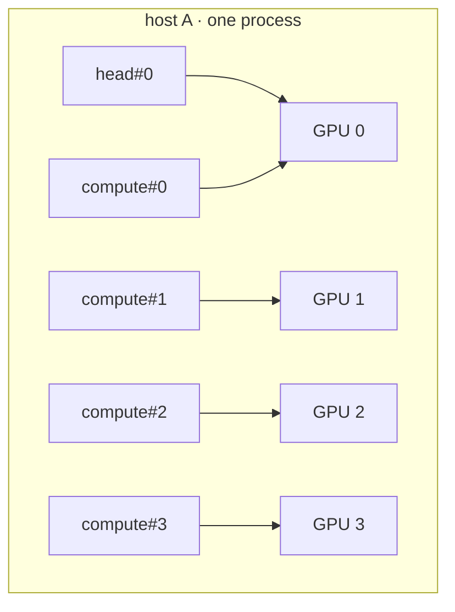
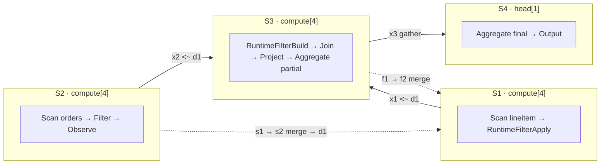

# Embedded in a host: sirius-duckdb

> [!TIP]
> **TL;DR**
>
> - One process, one engine: `compute[N]` plus `head[1]`, bound with `Bindings::local()`. Rows
>   move between workers only through `Exchange`s.
> - DuckDB owns catalog, transactions and optimization. sirius-duckdb translates its plan with the
>   builder; native tables use `TableSource::registered` with an opaque `ScanHandle`.
> - Host join-filter edges become `RuntimeFilterBuild`, `ValueExchange` and `RuntimeFilterApply`.
>   A filter built above a decided exchange is `partial`, so it is merged.
> - Broadcast or partition waits for measured bytes: `Observe`, `Decide`, `Exchange::decided_by`.
> - `check` and `prepare` reject a plan the engine cannot run with a typed `unsupported`, and the
>   host keeps its own plan, as it does on `runtime_unavailable`. Sirius never replays on the CPU.
> - Results stream through a `BatchReader`; only `wait()` means success. Interrupts cancel through
>   a `CancellationHandle`.
> - Today's implicit multi-GPU placement moves into the plan, the bindings or the engine. Open
>   questions 34 and 35 cover GPU-pinned scans and GPU choice at admission.

Part III built every query by hand. Usually a plan comes from the optimizer of another system,
one that already has a catalog, transactions, a client protocol and its own join ordering. This
part shows three such systems. All three use the same Plan IR and the same `Context::prepare`.

The first is sirius-duckdb, the DuckDB extension: one process on one machine with several GPUs.

## The host's role

| Concern | Owned by |
|---|---|
| Catalog, transactions, table snapshots, file lists | DuckDB |
| Join order, pushdown, build side, join-filter edges | DuckDB's optimizer |
| Translating the host's optimized plan into Plan IR | sirius-duckdb, through the plan builder |
| Distribution across the machine's GPUs | The plan sirius-duckdb builds |
| Kernels, batches, scheduling, memory and spilling | The engine |
| Delivering rows to the client | DuckDB, fed by a `BatchReader` |

The extension walks the host's optimized plan and calls the builder for each operator it
understands. This book does not describe the mapping. The result is an immutable `Plan`, like
any plan in Part III.

If the walk meets an operator with no Plan IR node, the extension stops and keeps the host's own
plan. Nothing has reached Sirius yet.

## One process, N workers

A [worker](../part-2/02-workers-and-distribution.md) is bound to exactly one GPU, so a machine
with four admitted GPUs gives the extension `compute[4]`. The extension also declares `head[1]` to
receive the final result. `Bindings::local()` binds each set round-robin over the context's device
endpoints.

The process has one engine. The extension gets its `Context` through an internal get-or-create, so
every Sirius-enabled DuckDB database in the process shares it
([How long a context lives](../part-1/03-context-and-session.md#how-long-a-context-lives)). How
the sharing shows in the public API is
[open question 15](../reference/open-questions.md#15-one-context-per-process).

There is no per-query object. The extension makes worker sets per query and checks and prepares
each plan on the shared context.

```cpp
#include <sirius/sirius.hpp>
using namespace sirius;

// Once per process, for the first database. Later databases share this engine.
Result<Context> on_load() {
  SIRIUS_TRY(config, ContextConfigBuilder{}.with_devices(DeviceSelection::all()).build());
  return Context::create(config);
}

// Per query: the worker sets for this machine. Plans are prepared on the shared context.
Result<void> per_query(const Context& context) {
  auto gpu_count = static_cast<std::uint32_t>(context.device_endpoints().size());
  SIRIUS_TRY(head, WorkerSet::create("head", 1));
  SIRIUS_TRY(compute, WorkerSet::create("compute", gpu_count));
  // ... build, check, prepare and run the plan, as in the rest of this chapter
  return {};
}
```
```rust
use sirius::prelude::*;

// Once per process, for the first database. Later databases share this engine.
fn on_load() -> sirius::Result<Context> {
    let config = ContextConfigBuilder::try_new()?.with_devices(DeviceSelection::all()).build()?;
    Ok(Context::try_new(&config)?)
}

// Per query: the worker sets for this machine. Plans are prepared on the shared context.
fn per_query(context: &Context) -> sirius::Result<()> {
    let gpu_count = context.device_endpoints().len() as u32;
    let head = WorkerSet::try_new("head", 1)?;
    let compute = WorkerSet::try_new("compute", gpu_count)?;
    // ... build, check, prepare and run the plan, as in the rest of this chapter
    Ok(())
}
```

A small query does not have to use every GPU. The extension can build `compute[2]`, which
`Bindings::local()` puts on the first two device endpoints. The set size is part of the plan, so
`explain()` shows the choice. To pick specific GPUs, the extension uses `Bindings::builder()`
(Part II, [Stages and bindings](../part-2/04-stages-and-bindings.md)).

On a four-GPU machine, `head#0` shares GPU 0 with `compute#0`, so the final gather from
`compute#0` never leaves the device.



The arrows are bindings. Rows move between these workers only through an `Exchange` in the plan,
even inside one process. The transport for each endpoint pair (same device, or a peer copy between
GPUs) comes from the bindings and never changes what a worker receives.

One process driving every GPU of one machine is single-node multi-GPU (SNMG) execution. Sirius
has no SNMG mode: it is an ordinary `compute[N]` plan bound to one process. The same plan runs
unchanged on N processes with one GPU each, or on several hosts. Putting every GPU in one process
has two consequences:

- **The GPUs share one engine**, and with it the memory tiers, the pinned host memory of each NUMA
  node, the table cache and the I/O reactors
  ([Memory](../part-5/06-memory.md#workers-and-memory-spaces)).
- **They share one fate.** A fatal device error on any GPU makes the engine unavailable, so every
  GPU of the machine stops taking Sirius work until the process restarts
  ([Failure, cancellation and recovery](../part-5/07-failure-cancellation-and-recovery.md#when-the-device-itself-fails)).

[One machine: one process or one per GPU](../part-5/08-running-at-scale.md#one-machine-one-process-or-one-per-gpu)
compares this shape with one process per GPU. [Inside one machine](#inside-one-machine) lists what
today's multi-GPU engine decides on its own and where each decision goes.

## What sirius-duckdb builds

sirius-duckdb uses the following slice of the IR.
[One IR, three integrations](04-one-ir-three-integrations.md) compares it with the other two
hosts.

- **Host-owned scans.** DuckDB-native tables, through `TableSource::registered` with an opaque
  snapshot handle.
- **Parquet scans.** Files the host already resolved, through `TableSource::parquet`, with an
  explicit schema and, where it wants `byte_ranges`, their sizes.
- **Imported runtime filters.** Each join-filter edge of the host's optimizer becomes plan nodes
  ([Importing the host's join-filter edges](#importing-the-hosts-join-filter-edges)).
- **Adaptive exchanges.** The host's row counts are estimates, so broadcast or partition waits for
  measured bytes: `Observe`, `Decide` and `Exchange::decided_by` (Part II,
  [Adaptive plans](../part-2/06-adaptive-plans.md)).
- **The relational core.** Filters, projections, two-phase aggregates, joins, windows, sorts, top-N
  and limits, built as in Parts I to III. Grouping sets cover the host's subtotals, null-safe key
  pairs and `Repeat` its set operations
  ([Set operations](../part-1/07-aggregates-joins-and-ordering.md#set-operations)), the per-key
  top-N one row per group, and shared subplans its decorrelated subqueries.
- **Types.** Every column type the extension runs on the GPU has a `DataType`
  ([Host types](#host-types) has the table). Where a host type travels as another `DataType`, the extension restores it when it hands batches
  back. A column of any other host type, such as a time of day or an interval, keeps the query on
  the host's own plan ([Additive later](../reference/extension-points.md#additive-later)).

### Host types

The engine's `type_id` members map onto `DataType` as follows:

| Engine `type_id` | `DataType` |
|---|---|
| `BOOLEAN` | `boolean` |
| `TINYINT`, `SMALLINT`, `INTEGER`, `BIGINT` | `int8`, `int16`, `int32`, `int64` |
| `UTINYINT`, `USMALLINT`, `UINTEGER`, `UBIGINT` | `uint8`, `uint16`, `uint32`, `uint64` |
| `FLOAT`, `DOUBLE` | `float32`, `float64` |
| `DECIMAL` | `decimal(p,s)` |
| `VARCHAR` | `string` |
| `DATE` | `date32` |
| `TIMESTAMP_SEC`, `TIMESTAMP_MS`, `TIMESTAMP`, `TIMESTAMP_NS` | `timestamp(s)`, `timestamp(ms)`, `timestamp(us)`, `timestamp(ns)` |
| `LIST`, `STRUCT` | `list`, `struct` |
| `HUGEINT` | `decimal(38,0)`, the 128-bit decimal with scale 0 that carries it on the GPU |
| `ARRAY` | `list` of its element type, which is how the engine carries it |
| `UHUGEINT` | None yet; the engine narrows it to 64 bits |
| `SQLNULL` | None; a null always has a type, so the extension gives an untyped null column one |

The engine carries a host map as a `LIST`, so the extension declares one as a list of key-value
structs. `TIME`, `TIMESTAMP_TZ`, `INTERVAL` and `BLOB` are not in `type_id`.

### A scan the host owns

Sirius can open a Parquet file by itself. It cannot open a DuckDB-native table, whose blocks,
visibility rules and query snapshot belong to the host. sirius-duckdb registers a scan kind,
`duckdb.native`, and hands each scan an opaque `ScanHandle` that pins the query's snapshot.

```cpp
// orders_fields, lineitem_fields: the Schemas, built from the host's catalog.
// The host already bound the rest; the extension only states it explicitly.
ScanHandle handle = host_query.snapshot_handle("orders");   // host code
SIRIUS_TRY(orders, TableSource::registered("duckdb.native", "orders", orders_fields,
                                           std::move(handle)));
SIRIUS_TRY(lineitem, TableSource::parquet("lineitem", host_query.files("lineitem"),
                                          lineitem_fields));
```
```rust
// orders_fields, lineitem_fields: the Schemas, built from the host's catalog.
// The host already bound the rest; the extension only states it explicitly.
let handle = host_query.snapshot_handle("orders"); // host code
let orders = TableSource::registered("duckdb.native", "orders", &orders_fields, handle)?;
let lineitem = TableSource::parquet("lineitem", host_query.files("lineitem"), &lineitem_fields)?;
```

The schemas are the ones from [the running example](../part-3/00-running-example.md). Sirius
looks nothing up. The table's identity, the snapshot and the file list are parameters of the
source, so they are part of the plan and of its fingerprint. How a `ScanHandle` is made and how a
scan kind is registered are
[open question 14](../reference/open-questions.md#14-host-registered-scan-kinds).

A registered scan still has shards: whatever units the kind lists from its handle. For
`duckdb.native` those are the snapshot's row groups, and `files_round_robin` deals them as it
deals files. That reading is a proposal under the same open question.

### Importing the host's join-filter edges

A join-filter edge from DuckDB's optimizer says that the keys seen while building a join can
prune a scan on the probe side. In Plan IR, such an edge is three nodes: a `RuntimeFilterBuild` on
the build input, a `ValueExchange` that merges the per-worker filters, and a `RuntimeFilterApply`
on the probe scan. V16-V18 check it (Part II, [Runtime filters](../part-2/05-runtime-filters.md)).
The host only says which build feeds which probe column; sirius-duckdb chooses the filter kind.

## A worked plan: Q5 on four local GPUs

Q5 from [Adaptive join](../part-3/05-adaptive-join.md) computes revenue per order for orders
placed on 1995-03-15. The number of matching orders is not known in advance. Two things change
when DuckDB is the host:

1. `orders` is a native DuckDB table, so its scan uses the registered kind.
2. DuckDB's optimizer produced a join-filter edge from `o_orderkey` to `l_orderkey`, so the plan
   carries an imported runtime filter.

The build side's date filter and adaptive exchange are the same as in Part III.

```cpp
SIRIUS_TRY(orders_scan, Relation::scan(orders, ScanOptions::on(compute)
                                                   .with_columns({"o_orderkey", "o_orderdate"})));
SIRIUS_TRY(order_date, orders_scan.column("o_orderdate"));
SIRIUS_TRY(day, Value::date32(1995, 3, 15));
SIRIUS_TRY(on_day, order_date.eq(Expression::literal(day)));
SIRIUS_TRY(orders_on_day, orders_scan.filter(on_day));

SIRIUS_TRY(observed, orders_on_day.observe(StatisticsSpec::bytes()));     // ~> s1
SIRIUS_TRY(total, observed.statistics.merge_to(compute));                // s2, global
SIRIUS_TRY(d1, Decision::threshold(total, Metric::bytes, 64 << 20, "broadcast", "partitioned"));
SIRIUS_TRY(x2, Exchange::decided_by(d1, {{"broadcast", Exchange::broadcast(compute)},
                                         {"partitioned", Exchange::hash({"o_orderkey"}, compute)}}));
SIRIUS_TRY(build_side, observed.relation.exchange(x2));
```
```rust
let orders_scan = Relation::scan(&orders, ScanOptions::on(&compute)
                                              .with_columns(&["o_orderkey", "o_orderdate"]))?;
let order_date = orders_scan.column("o_orderdate")?;
let day = Value::date32(1995, 3, 15)?;
let on_day = order_date.eq(&Expression::literal(day))?;
let orders_on_day = orders_scan.filter(&on_day)?;

let observed = orders_on_day.observe(StatisticsSpec::bytes())?;   // ~> s1
let total = observed.statistics.merge_to(&compute)?;              // s2, global
let d1 = Decision::threshold(&total, Metric::Bytes, 64 << 20, "broadcast", "partitioned")?;
let x2 = Exchange::decided_by(&d1, vec![
    ("broadcast", Exchange::broadcast(&compute)),
    ("partitioned", Exchange::hash(&["o_orderkey"], &compute, Partitions::one_per_worker(),
                                   HashScheme::v1())),
])?;
let build_side = observed.relation.exchange(&x2)?;
```

The imported filter is built *above* `x2`, at the join's build input, where DuckDB's edge starts.

```cpp
SIRIUS_TRY(geometry, BloomGeometry::fixed(8 << 20));
SIRIUS_TRY(built, build_side.build_runtime_filter({"o_orderkey"}, RuntimeFilterSpec::bloom(geometry)));
SIRIUS_TRY(merged, built.filter.merge_to(compute));                      // f1 -> f2, global

SIRIUS_TRY(lineitem_scan, Relation::scan(lineitem, ScanOptions::on(compute).with_columns(
                                             {"l_orderkey", "l_extendedprice", "l_discount"})));
SIRIUS_TRY(pruned, lineitem_scan.apply_runtime_filter(merged, {"l_orderkey"}, WaitPolicy::never()));
SIRIUS_TRY(x1, Exchange::decided_by(d1, {{"broadcast", Exchange::forward()},
                                         {"partitioned", Exchange::hash({"l_orderkey"}, compute)}}));
SIRIUS_TRY(probe_side, pruned.exchange(x1));

SIRIUS_TRY(on, JoinOn::keys({{"l_orderkey", "o_orderkey"}}));
SIRIUS_TRY(joined, probe_side.join(built.relation, JoinType::inner, std::move(on),
                                   JoinOptions::defaults()));
```
```rust
let geometry = BloomGeometry::fixed(8 << 20)?;
let built = build_side.build_runtime_filter(&["o_orderkey"], RuntimeFilterSpec::bloom(geometry))?;
let merged = built.filter.merge_to(&compute)?;                    // f1 -> f2, global

let lineitem_scan = Relation::scan(&lineitem, ScanOptions::on(&compute).with_columns(
    &["l_orderkey", "l_extendedprice", "l_discount"]))?;
let pruned = lineitem_scan.apply_runtime_filter(&merged, &["l_orderkey"], WaitPolicy::never())?;
let x1 = Exchange::decided_by(&d1, vec![
    ("broadcast", Exchange::forward()),
    ("partitioned", Exchange::hash(&["l_orderkey"], &compute, Partitions::one_per_worker(),
                                   HashScheme::v1())),
])?;
let probe_side = pruned.exchange(&x1)?;

let on = JoinOn::keys(&[("l_orderkey", "o_orderkey")])?;
let joined = probe_side.join(&built.relation, JoinType::Inner, on, JoinOptions::default())?;
```

The rest (the revenue projection, the partial aggregate, the gather to `head[1]` and the final
aggregate) is Q5 unchanged. `explain()` prints the whole plan:

```text
Plan "q5_day_revenue" (joined)
worker sets: head[1], compute[4]
values:
  s2 = ValueExchange merge s1 -> compute[4]
  d1 = Decide threshold(s2.bytes, at_most=64MiB) -> [broadcast, partitioned]
  f2 = ValueExchange merge f1 -> compute[4]
Output "result" on head[1]
└─ Aggregate final keys=[o_orderkey, o_orderdate]
   └─ Exchange x3 gather -> head[1]
      └─ Aggregate partial keys=[o_orderkey, o_orderdate] measures=[revenue = sum(rev)]
         └─ Project [o_orderkey, o_orderdate, rev = l_extendedprice * (1 - l_discount)]
            └─ Join inner keys=[l_orderkey == o_orderkey] build=right  mode=decided(d1)
               ├─ Exchange x1 <~ d1 {broadcast: forward, partitioned: hash(l_orderkey)} -> compute[4]
               │  └─ RuntimeFilterApply [l_orderkey] <~ f2  wait=never
               │     └─ Scan lineitem [l_orderkey, l_extendedprice, l_discount]  on compute[4]
               │                      shards=files_round_robin
               └─ RuntimeFilterBuild keys=[o_orderkey] spec=bloom(fixed 8MiB)  scope=partial ~> f1
                  └─ Exchange x2 <~ d1 {broadcast: broadcast, partitioned: hash(o_orderkey)} -> compute[4]
                     └─ Observe bytes ~> s1
                        └─ Filter o_orderdate == 1995-03-15
                           └─ Scan orders [o_orderkey, o_orderdate]  on compute[4]
                                          shards=files_round_robin
                                          kind=duckdb.native
```

The filter needs a merge because the plan must be valid under both labels of `d1`.

| Label | Each worker's build input | A filter built there would be |
|---|---|---|
| `broadcast` | The whole build side (`replicated`) | `global` on its own |
| `partitioned` | Only the keys hashed to it by `x2` | `partition(x2)`, which V17 forbids applying to the lineitem scan, because that scan runs *before* `x1` |

The checks use the meet of the two distributions, `arbitrary`. The node prints `scope=partial`,
and V16 says a partial filter is never applied
([Scope](../part-2/05-runtime-filters.md#scope-which-rows-does-a-filter-know-about)).

`merge_to(compute)` makes the filter usable under both labels. The `ValueExchange` ORs the four
Bloom filters (same fixed geometry, so V13 holds) and delivers one `global` filter to every worker.
Under `broadcast` the four filters are identical, so the merge is a small cost that a non-adaptive
broadcast plan would not pay.

In the stage graph, the two dotted value edges race the lineitem scan:



The lineitem scan starts at once. Its rows wait in `x1`'s spillable input queue until `d1` arrives,
because no destination is known before then. With `wait=never`, the apply node lets batches
through until `f2` is published and prunes the ones it sees after that
([Waiting, or not](../part-2/05-runtime-filters.md#waiting-or-not)).

## Check, prepare, and the typed rejection

Before anything runs, sirius-duckdb asks whether this engine build can run the plan.
`Context::check` runs V21 and V22: every node, type, function and value kind is supported, and
every registered scan kind is implemented. `prepare` runs them again, this time against the GPUs
it binds, then runs the binding checks
([Engine support](../part-2/07-validation.md#engine-support-check-and-prepare)).

A plan the engine cannot run comes back as a typed `unsupported` error whose `PlanLocation` names
a node. There is no partial acceptance and Sirius never replans, so the extension keeps DuckDB's
own plan. The snippets leave out the `unsupported` that `prepare` returns for a node a bound GPU
cannot run; it takes the same path.

```cpp
auto support = context.check(plan);
if (!support) {
  auto code = support.error().code;
  if (code == ErrorCode::unsupported || code == ErrorCode::runtime_unavailable) {
    // Nothing started. The host keeps its own plan and carries on without Sirius.
    return host_query.keep_own_plan(support.error());               // host code
  }
  return std::unexpected(support.error());
}
SIRIUS_TRY(prepared, context.prepare(plan, Bindings::local()));
```
```rust
match context.check(&plan) {
    Ok(_) => {}
    // Nothing started. The host keeps its own plan and carries on without Sirius.
    Err(e @ (PrepareError::Unsupported { .. } | PrepareError::RuntimeUnavailable { .. })) => {
        return host_query.keep_own_plan(e)
    }
    Err(e) => return Err(e.into()),
}
let prepared = context.prepare(&plan, Bindings::local())?;
```

`runtime_unavailable` takes the same path. A fatal GPU error has made the engine unavailable
until the process restarts
([How long a context lives](../part-1/03-context-and-session.md#how-long-a-context-lives)), so the
extension keeps DuckDB's own plan for every later query.

Sirius never replays work on the CPU. A query already running on the GPU gets
`runtime_unavailable` from its reader or `wait()`, and DuckDB reruns it from the start on its own
plan if it can.

## Running it: readers and interrupts

`start()` consumes the prepared plan. The only `Output` worker is `head#0`, so `outputs` holds one
reader. sirius-duckdb wires the host's interrupt to a `CancellationHandle`, then pulls batches and
copies them into the host's result chunks.

```cpp
SIRIUS_TRY(started, std::move(prepared).start());
auto& [execution, outputs] = started;
host_query.on_interrupt([cancel = execution.cancellation()] { cancel.request_cancel(); });

BatchReader& reader = outputs.front().reader;
while (true) {
  SIRIUS_TRY(batch, reader.next());
  if (!batch) break;                      // clean end of stream, not yet success
  host_query.append(*batch);              // host code: fill the host's result chunks
}
SIRIUS_TRY(report, std::move(execution).wait());
host_query.record(report.decisions());    // host code: which label d1 chose
```
```rust
let StartedExecution { execution, mut outputs } = prepared.start()?;
let cancel = execution.cancellation();
host_query.on_interrupt(move || cancel.request_cancel());

let reader = &mut outputs[0].reader;
for batch in reader {                     // ends at a clean end of stream, not yet success
    host_query.append(batch?);            // host code: fill the host's result chunks
}
let report = execution.wait()?;
host_query.record(report.decisions());    // host code: which label d1 chose
```

Only `wait()` means success
([Prepare and execute](../part-1/06-prepare-and-execute.md#end-of-stream-is-not-success)).
`request_cancel()` is safe to call from the host's interrupt thread at any time; the reader then
returns a `cancelled` error. Batches stream, so the host can send rows to its client while later
batches are still being produced.

## What prepare binds

| Binding | sirius-duckdb |
|---|---|
| Workers to endpoints | `Bindings::local()`: `compute#i` to GPU i, `head#0` to GPU 0 |
| Named inputs to sources | None in Q5. An input would use `BindingsBuilder::input`, with a completed `InputSource` first. |
| Scan splits | None. Every scan's splits are fixed in the plan when it is built. |
| Execution id | Generated locally, with a sequence number in its leading bytes, which keeps admission first come, first served ([Admission across processes](../part-5/08-running-at-scale.md#admission-across-processes)). There are no peers to agree with. |

Besides the bindings, `prepare` only resolves worker-local `auto` properties, such as a join's
build side. Q5 has none: its join says `build=right`. `prepared.plan()` is the plan the extension
built.

## Today versus explicit

The extension already does most of what this chapter describes, but much of it is implicit. The
integration itself (optimizer hook, plan translation, CPU replay, result collection) is compiled
into the Sirius library, which links its own DuckDB, and the sirius-duckdb project registers it
with the host.

Each row below names something the extension or the engine does today and its place in an
explicit plan. No row needs a new execution model: the engine already runs exchanges between
GPUs, two-phase aggregates and runtime filters.

| Today | In the plan |
|---|---|
| The engine's only input is the host's own optimized plan objects. The extension copies them and checks that the copy reads the same tables and files as the host's plan. | The extension builds one immutable plan. The source identity (table, snapshot, files) is a parameter of each `Scan`. |
| To keep plans within what the engine can lower, the extension switches off a handful of the host's optimizer passes for every query. | Each plan is checked on its own. One that cannot run gets a typed `unsupported` rejection. |
| A plan the engine cannot lower is declined by an exception thrown while the operator tree is built. The integration catches it and, unless fallback is switched off, runs DuckDB's own plan. | `check` or `prepare` returns the `unsupported` error with a `PlanLocation`, and the extension keeps the host's plan. |
| A GPU query that fails while it runs is replayed on DuckDB's CPU executor, unless fallback is switched off or replay is unsafe. A query whose own cleanup could not be confirmed is never replayed. | No CPU replay inside Sirius: the execution fails with its error, and the extension decides whether DuckDB reruns the query from its own plan. |
| While lowering, the engine inserts its own exchange and merge steps. Inside the join, it picks broadcast or hash at runtime from measured bytes. | `Exchange` nodes the extension writes; whether a one-machine helper writes them is [open question 36](../reference/open-questions.md#36-a-distribution-helper-for-one-machine). The adaptive choice is `Decide` with labelled alternatives, recorded in `report.decisions()`. Partition count, GPU placement and per-query GPU admission are in [Inside one machine](#inside-one-machine). |
| The engine rediscovers runtime filters while lowering. An adapter that snapshots the host's join-filter edges exists, but only tests use it. | The host's edges become `RuntimeFilterBuild`, `ValueExchange` and `RuntimeFilterApply` nodes. |
| The engine reads row estimates, min/max statistics and key constraints through host APIs while lowering. | Not settled: [open question 13](../reference/open-questions.md#13-hints-and-certified-properties) (hints and certified properties). |
| The result is fully materialized in the host's own types before the host fetches its first row. | A `BatchReader` streams batches. Success is `wait()`. |

### Inside one machine

Today each query is admitted onto a set of GPUs in its process, and the engine places work on them
while the query runs. After the change, a placement lives in one of three places:

- in the plan, when it changes what a worker ends up with;
- in the bindings, when it says where a worker runs;
- in the engine, when it only says how.

| Today, on several GPUs in one process | After the change |
|---|---|
| Admission narrows each query to the first *k* GPUs of the engine's list (`gpus_per_query`, or fewer from estimated scan bytes when `admission_bytes_per_gpu` is set). | The plan fixes how many: `compute[k]`. The bindings say which. Whether admission may choose them for `Bindings::local()` is [open question 35](../reference/open-questions.md#35-choosing-gpus-at-admission). |
| The scan manager hands out scan splits one at a time, round robin over the GPUs by default. | A `Shards` kind, fixed when the scan is built, or `Shards::dynamic()` when workers should claim splits at run time. |
| `pin_table` spreads a table's chunks round robin over the GPUs, and a scan runs each chunk on the GPU that holds it. | Not settled: [open question 34](../reference/open-questions.md#34-scans-over-gpu-resident-data). |
| The task creator places other tasks by locality: on the GPU holding most of their input bytes, or on a GPU of the NUMA node holding them. Any ready GPU may claim a task with no preference. | A stage instance runs on its worker's GPU. Moving rows to another GPU is an `Exchange`. |
| Partition *p* goes to `active_gpu_ids[p % n]`. | Partition *p* goes to worker *p* mod \|W\|, and the bindings map workers to GPUs. |
| Every task of a `BUILD_PROBE` partition must run on the GPU that holds its hash table. The pin is a correctness constraint, carried across an OOM reschedule. | A partition belongs to one worker and a worker to one GPU, so the constraint holds by construction. |
| A broadcast join places one build copy per GPU. | A `broadcast` exchange to `compute[k]`: one copy per worker. |
| Joins and sorts choose their partition count at run time from measured bytes, and often partition into as many GPUs as there are, even when fewer would do. | `Partitions::fixed`, `one_per_worker`, or `Partitions::decided_by` to choose the count at run time. A count below the set size leaves some workers without partitions, and the report shows it. |
| A batch needed on another GPU is cloned there by a peer copy or through host staging. | The engine's transport for that endpoint pair ([Exchanges in the engine](../part-5/02-exchanges-in-the-engine.md)). |
| Each GPU builds a partial Bloom filter, and the partials are merged. | `RuntimeFilterBuild` with `partial` scope, merged through a `ValueExchange`. |
| The background prefetcher (off by default) runs only for a query admitted onto exactly one GPU. With more, it could upload a batch to a GPU other than the one its scan task runs on. | With fixed shards and bindings, every split's GPU is known at prepare, so a prefetcher has a target. Under `Shards::dynamic()` it is known when a worker claims the split. This stays engine work. |

The one loss is balancing inside one machine. Today a ready GPU may claim any task that has no device
preference, so a GPU that runs ahead picks up work the others have not started. With one worker per
GPU, only `Shards::dynamic()` and decided partitions give some of that back.
[Running at scale](../part-5/08-running-at-scale.md#worker-granularity) weighs the trade-off.
