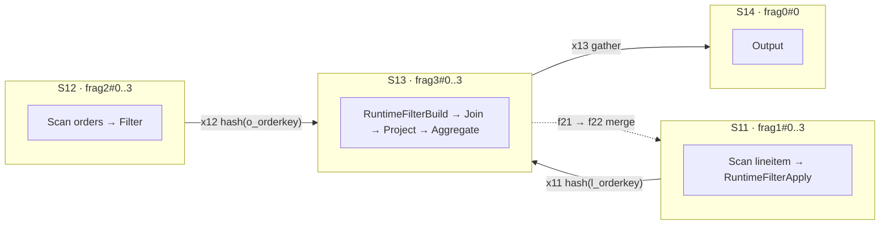

# Under someone else's scheduler: StarRocks

> [!TIP]
> **TL;DR**
>
> - StarRocks plans and schedules. Each compute node builds one open instance plan per fragment
>   instance with `Plan::create_instance`. First step: closed plans, chained by completed inputs.
> - Cross-plan edges are nodes with frontend ids: `exchange_sink`/`exchange_source`,
>   `value_sink`/`value_source`.
> - Only the hosting set may be unsized (`frag1[?]`), and only where the plan does not depend on
>   its size (V24).
> - Scan ranges go into the plan as `Shards::splits`; bindings hold only execution id and endpoints.
> - Peers compare edge signatures at start (V25). `HashScheme::v1()` means every worker in a hash
>   exchange must be a Sirius worker.
> - `partition(x12)` filter shares merge into one global filter. Filters are optional and waits
>   are bounded (`up_to(30s)`).
> - `rewrite::join_stages` composes the instance plans into one joined plan for diffing.

With sirius-duckdb in the [previous chapter](01-duckdb-extension.md), Sirius sees the whole plan
and all its workers live in one process. StarRocks is the opposite case. Its frontend plans the
query, cuts it into *fragments*, and decides how many instances of each run and where. Sirius gets
one piece at a time and never sees the whole query.

The same Plan IR still works. Each Sirius compute node builds a small **open instance plan** for
every fragment instance it runs. Each exchange and runtime filter that crosses to another fragment
is a node in that plan, with an id the frontend chose. What peers must agree on, such as an
exchange's hash scheme and partition count, is written in each piece
([rule 2](../part-2/01-everything-in-the-plan.md#the-ownership-rule)).

Apache Doris works the same way: a frontend plans the query, cuts it into fragments, and schedules
fragment instances onto backends. What this chapter says about StarRocks applies to Doris with
Doris's own names for the same parts.

## The host's role

The host is two things: the StarRocks frontend and the Sirius compute nodes it schedules onto.

- **The frontend** plans the query and cuts it into fragments. It places the instances on compute
  nodes, assigns scan ranges to each, and plans the runtime filters and where their shares merge.
- **A Sirius compute node** is a process that embeds Sirius and registers with the frontend as a
  compute node. It owns one GPU, so it hosts one worker per fragment instance it runs. For each
  instance it receives, it builds an instance plan, prepares it and starts it.
- **Sirius** executes each instance plan: it scans, joins, aggregates, moves exchange data to the
  other compute nodes and delivers runtime filters.

The frontend never sees a Plan IR object. This chapter does not cover how a compute node turns a
fragment instance into builder calls, only what comes out: the nodes, the ids, the worker sets and
the bindings.

## Mapping the frontend's vocabulary

Every concept the frontend uses to describe a fragment instance has a place in the IR. None needs
a new node. [Open instance plans](#open-instance-plans) defines the terms in the right column.

| The frontend says | Plan IR |
|---|---|
| A fragment instance, with sender id k | One instance plan, `Plan::create_instance(frag1.at(k), ...)`, that runs as worker `frag1#k` |
| The fragment that instance belongs to | The plan's hosting set: `frag1[?]`, unsized unless the plan depends on its size |
| Exchange node 11 | `ExchangeId` 11: `x11`, in the sending and in the receiving instance plans |
| Data stream sink, hash-partitioned on `l_orderkey` | `exchange_sink(x11, Exchange::hash({"l_orderkey"}, frag3))` |
| Data stream sink, unpartitioned, to one destination | `Exchange::gather(frag0)` |
| Data stream sink, unpartitioned, to several destinations | `Exchange::broadcast(frag3)`: every row to every destination |
| Data stream sink, random | `Exchange::round_robin(frag3)` |
| The sink's `destinations` | A sized target set, `frag3[4]`; destination i is worker `frag3#i` |
| An exchange node's `per_exch_num_senders` | A sized sender set: `exchange_source(x11, schema, exchange, frag1)` on `frag1[4]` |
| Merging exchange node, with sort info, offset and limit | `Exchange::gather(frag0, GatherOrder::merge(order))`, then `limit(n, offset)` |
| Runtime filter 21 | `ValueId` 21: `f21`, from `value_sink` to `value_source` |
| Scan ranges for this instance | `Shards::splits(ranges)`, stored in the plan |
| Instance placement on compute nodes | Endpoints in bindings, for the hosted worker and every far-side worker |
| Query id | `ExecutionId`, shared by every instance plan of the query; single use per hosted worker |
| Result sink | `Output "result"` on `frag0[1]` |

The host chooses the ids, because the far side of an edge lives in another plan and neither plan
can compute a shared id alone. It creates them with `ExchangeId::create(n)` and
`ValueId::create(n)`, reusing the frontend's numbers.

## Open instance plans

An **open plan** is one where the far side of at least one exchange or value edge is not in the
plan (see
[Open plans](../part-2/04-stages-and-bindings.md#open-plans-authoring-stages-and-instances-directly)).
The plan for `frag1#2` sends to `frag3[4]`, but other compute nodes build the `frag3` plans.

Four builder calls make a plan open. With them the host writes the halves that `rewrite::split`
produces from a joined plan:

- `Relation::exchange_source(id, schema, exchange, senders)`: a leaf that receives rows sent by
  `senders` on exchange `id`. It ends after an end of stream from every sender.
- `relation.exchange_sink(id, exchange)`: a terminal that sends rows on exchange `id` to the
  exchange's target set.
- `filter.value_sink(id, to)`: sends this worker's runtime filter share to every worker of `to`.
- `RuntimeFilter::value_source(id, spec, key_types, senders, on)`: receives one share from every
  worker of `senders` and merges them into one filter on every worker of `on`.

The compute node builds one plan per instance.
`Plan::create_instance(worker, terminals, value_sinks)` takes the same builder output as
`Plan::create`, plus the worker the plan runs as, and builds an
[instance plan](../part-2/04-stages-and-bindings.md#instance-plans), printed `instance frag1#2`.

### Sized and unsized sets

Two workers that talk must agree on the edge between them, not on who else runs their stage. An
instance plan is therefore explicit about the far side of every edge and about nothing else.

A set is [sized or unsized](../part-2/02-workers-and-distribution.md#sized-and-unsized-sets):
`WorkerSet::create("frag3", 4)` makes the sized `frag3[4]`, and `WorkerSet::unsized("frag1")`
makes `frag1[?]`, whose size this plan does not state. `set.at(k)` works on both.

Only the hosting set of an instance plan may be unsized, and V24 requires a set to be sized
wherever the plan depends on its size. [Validation](../part-2/07-validation.md) has the full list.
Three cases matter here:

- every sender set of an `ExchangeSource` or `ValueSource`, because the receiver counts one end of
  stream or one share per sender;
- every target set of an exchange or value edge, in the plan that sends on it, because routing
  needs it. That includes the hosting set when the plan receives a partitioned or gathered
  exchange: receiver and senders must agree on "partition k of N", and a gather needs exactly one
  target (V19);
- any set whose scans use a shard rule (`files_round_robin`, `byte_ranges`, `explicit_splits`,
  `dynamic`).

For Q4 below, that gives:

| Instance plan | Hosting set | Why |
|---|---|---|
| `frag1#k` | `frag1[?]` | It scans its own splits and sends. Its sink needs the size of `frag3`, and so does its filter source. Nothing needs the size of `frag1`. |
| `frag2#k` | `frag2[?]` | It scans its own splits and sends. Only the size of `frag3` matters. |
| `frag3#k` | `frag3[4]` | It receives partition k of 4 on `x11` and `x12`, so it must agree with the senders on 4. |
| `frag0#0` | `frag0[1]` | It receives a gather, which needs exactly one target (V19). |

With six lineitem instances instead of four, the plan for `frag1#2` would change only in the
splits it reads. The `frag3` plans would say `frag1[6]`, because they count the senders. If the
frontend then started only five of the six, every edge signature would still match, and `frag3`
would wait for a sender that never comes. The
[first-contact deadline](../part-5/07-failure-cancellation-and-recovery.md#the-first-contact-deadline)
turns that into a `transport` error.

A hosting set whose size the plan depends on cannot stay unsized:

```text
invalid_plan: V24: Scan lineitem uses files_round_robin on frag1[?]; a shard rule needs a sized set
```

## A worked plan: Q4 as four fragments

Take Q4 (urgent March revenue) from
[Partitioned join and runtime filters](../part-3/04-partitioned-join-and-runtime-filters.md): the
total discounted revenue per order, for orders placed in March 1995 with priority "1-URGENT". The
frontend plans four fragments:

| Fragment | Instances | Role |
|---|---|---|
| `frag0` | 1 | Receives the result. |
| `frag1` | 4 | Scans `lineitem` on its scan ranges, applies the runtime filter, hash-sends on `x11`. |
| `frag2` | 4 | Scans and filters `orders`, hash-sends on `x12`. |
| `frag3` | 4 | Joins `x11` with `x12`, builds the runtime filter, aggregates per order, gathers on `x13`. |

That makes 13 instance plans. The frontend placed instance k of `frag1`, `frag2` and `frag3` on
compute node k, and `frag0#0` on compute node 0. Stage ids follow the usual rule: `S<k>` is the
stage whose root is `ExchangeSink x<k>`, and the Output stage is numbered after the last exchange.



### frag3: the join, and the filter shares

A `frag3` instance receives both join inputs, builds the runtime filter from the build side, and
sends its filter share to the lineitem scanners.

```cpp
#include <sirius/sirius.hpp>
using namespace sirius;

// k: the frontend's sender id for this instance.
// probe_schema and build_schema are described below.
SIRIUS_TRY(frag0, WorkerSet::create("frag0", 1));   // the destination of x13
SIRIUS_TRY(frag1, WorkerSet::create("frag1", 4));   // the senders of x11, the targets of f21
SIRIUS_TRY(frag2, WorkerSet::create("frag2", 4));   // the senders of x12
SIRIUS_TRY(frag3, WorkerSet::create("frag3", 4));   // receives partition k of 4
SIRIUS_TRY(x11, ExchangeId::create(11));
SIRIUS_TRY(x12, ExchangeId::create(12));
SIRIUS_TRY(x13, ExchangeId::create(13));
SIRIUS_TRY(f21, ValueId::create(21));
SIRIUS_TRY(in_list, RuntimeFilterSpec::in_list(1 << 24));
RuntimeFilterSpec share_spec = std::move(in_list).or_else(RuntimeFilterSpec::min_max());

Exchange by_l = Exchange::hash({"l_orderkey"}, frag3);
Exchange by_o = Exchange::hash({"o_orderkey"}, frag3);
SIRIUS_TRY(probe, Relation::exchange_source(x11, probe_schema, by_l, frag1));
SIRIUS_TRY(build_in, Relation::exchange_source(x12, build_schema, by_o, frag2));
SIRIUS_TRY(built, build_in.build_runtime_filter({"o_orderkey"}, share_spec));  // partition(x12)
SIRIUS_TRY(shares, built.filter.value_sink(f21, frag1));                         // one share each
```
```rust
use sirius::prelude::*;
use std::time::Duration;

// k: the frontend's sender id for this instance.
// probe_schema and build_schema are described below.
let frag0 = WorkerSet::try_new("frag0", 1)?;  // the destination of x13
let frag1 = WorkerSet::try_new("frag1", 4)?;  // the senders of x11, the targets of f21
let frag2 = WorkerSet::try_new("frag2", 4)?;  // the senders of x12
let frag3 = WorkerSet::try_new("frag3", 4)?;  // receives partition k of 4
let x11 = ExchangeId::try_new(11)?;
let x12 = ExchangeId::try_new(12)?;
let x13 = ExchangeId::try_new(13)?;
let f21 = ValueId::try_new(21)?;
let share_spec = RuntimeFilterSpec::in_list(1 << 24)?.or_else(RuntimeFilterSpec::min_max());

let by_l = Exchange::hash(&["l_orderkey"], &frag3, Partitions::one_per_worker(), HashScheme::v1());
let by_o = Exchange::hash(&["o_orderkey"], &frag3, Partitions::one_per_worker(), HashScheme::v1());
let probe = Relation::exchange_source(x11, &probe_schema, &by_l, &frag1)?;
let build_in = Relation::exchange_source(x12, &build_schema, &by_o, &frag2)?;
let built = build_in.build_runtime_filter(&["o_orderkey"], share_spec)?; // partition(x12)
let shares = built.filter.value_sink(f21, &frag1)?;                     // one share each
```

`probe_schema` holds the columns `frag1` sends (`l_orderkey`, `l_extendedprice`, `l_discount`),
and `build_schema` the columns `frag2` sends (`o_orderkey`, `o_orderdate`, `o_orderpriority`).
The relational middle is Q4 unchanged: the join, the revenue projection and a single-phase
aggregate, which V6 allows because the join output is `hashed` on `o_orderkey`, a group key.

```cpp
SIRIUS_TRY(on, JoinOn::keys({{"l_orderkey", "o_orderkey"}}));
SIRIUS_TRY(joined, probe.join(built.relation, JoinType::inner, std::move(on), JoinOptions::defaults()));
SIRIUS_TRY(price, joined.column("l_extendedprice"));
SIRIUS_TRY(discount, joined.column("l_discount"));
SIRIUS_TRY(one, Value::decimal("1", 15, 2));
SIRIUS_TRY(kept, Expression::literal(one).sub(discount));
SIRIUS_TRY(rev, price.mul(kept));
SIRIUS_TRY(columns, joined.pass_through({"o_orderkey", "o_orderdate"}));
columns.push_back(rev.named("rev"));
SIRIUS_TRY(projected, joined.project(std::move(columns)));
SIRIUS_TRY(rev_column, projected.column("rev"));
SIRIUS_TRY(revenue, Measure::sum("revenue", rev_column));
SIRIUS_TRY(per_order, projected.aggregate({"o_orderkey", "o_orderdate"}, {revenue}));
SIRIUS_TRY(sink, per_order.exchange_sink(x13, Exchange::gather(frag0)));
SIRIUS_TRY(frag3_plan, Plan::create_instance(frag3.at(k), {sink}, {shares}));
```
```rust
let on = JoinOn::keys(&[("l_orderkey", "o_orderkey")])?;
let joined = probe.join(&built.relation, JoinType::Inner, on, JoinOptions::default())?;
let price = joined.column("l_extendedprice")?;
let discount = joined.column("l_discount")?;
let one = Value::decimal("1", 15, 2)?;
let kept = Expression::literal(one).sub(&discount)?;
let rev = price.mul(&kept)?;
let mut columns = joined.pass_through(&["o_orderkey", "o_orderdate"])?;
columns.push(rev.named("rev"));
let projected = joined.project(columns)?;
let rev_column = projected.column("rev")?;
let revenue = Measure::sum("revenue", &rev_column)?;
let per_order = projected.aggregate(&["o_orderkey", "o_orderdate"], vec![revenue])?;
let sink = per_order.exchange_sink(x13, &Exchange::gather(&frag0, GatherOrder::any()))?;
let frag3_plan = Plan::try_new_instance(&frag3.at(k), vec![sink], vec![shares])?;
```

`Plan::create_instance` also takes the value sink, because nothing inside this plan consumes
`f21`. For `frag3#2` it builds:

```text
Plan "q4_frag3" (instance frag3#2)
worker sets: frag0[1], frag1[4], frag2[4], frag3[4]
Stage S13 instance frag3#2
values:
  ValueSink f21 merge -> frag1[4]
ExchangeSink x13 gather -> frag0[1] [frag0#0]
└─ Aggregate keys=[o_orderkey, o_orderdate] measures=[revenue = sum(rev)]
   └─ Project [o_orderkey, o_orderdate, rev = l_extendedprice * (1 - l_discount)]
      └─ Join inner keys=[l_orderkey == o_orderkey] build=right  mode=co_partitioned(x11, x12)
         ├─ ExchangeSource x11 partition=2/4 <- senders=[frag1#0..3]
         └─ RuntimeFilterBuild keys=[o_orderkey] spec=in_list(1<<24) or_else min_max
            │                  scope=partition(x12) ~> f21
            └─ ExchangeSource x12 partition=2/4 <- senders=[frag2#0..3]
```

The far side of an edge prints as its worker set (`-> frag1[4]`, `-> frag0[1]`), because that
stage is not in this plan. `partition=2/4` is why `frag3` is sized.

### Filter shares

The frontend put the filter build above `x12`, which hashes on the filter key. Each worker's
filter is therefore `partition(x12)`: it knows only the order keys that hashed to its own
partition (see
[Scope](../part-2/05-runtime-filters.md#scope-which-rows-does-a-filter-know-about)). V17 allows
such a filter only on the same worker, on rows hashed like `x12`. The lineitem scan in `frag1`
runs before `x11`, so it cannot use a single share.

The scan can use all four shares merged, because the union of the per-partition key sets is the
full key set. `value_sink` sends each worker's share to every worker of `frag1`, and
`value_source` there merges the four into one `global` filter. Together the two halves are a
`ValueExchange`, which V12 requires when a value crosses sets. The engine chooses how the shares
travel, directly or reduced through a tree (see
[Value merges](../part-5/08-running-at-scale.md#value-merges-all-to-all-in-the-plan-a-tree-on-the-wire)).

The spec says how shares merge, so every worker of `frag1` gets the same filter (see
[Filter specs](../part-2/05-runtime-filters.md#filter-specs-and-geometry-agreement)).
`in_list(1 << 24)` merges by union. If the union would hold more than 2^24 keys, or any share
overflows, the filter degrades along `or_else` to `min_max` on every receiver. A filter is
optional: if a share is skipped or fails, the merged filter is absent and every row passes.

### frag1: the probe scan

A `frag1` instance receives the merged filter, applies it to its scan, and hash-sends the rest to
`frag3`. It builds `x11`, `f21` and `share_spec` as `frag3` does; the handshake checks that
agreement.

```cpp
SIRIUS_TRY(frag1, WorkerSet::unsized("frag1"));             // printed frag1[?]
SIRIUS_TRY(frag3, WorkerSet::create("frag3", 4));           // the destinations of x11
SIRIUS_TRY(f22, RuntimeFilter::value_source(f21, share_spec, {DataType::int64()}, frag3, frag1));
std::vector<Split> ranges = splits_for(scan_ranges);        // host code: this instance's ranges
SIRIUS_TRY(lineitem_shards, Shards::splits(std::move(ranges)));
ScanOptions scan_options = ScanOptions::on(frag1)
                               .with_columns({"l_orderkey", "l_extendedprice", "l_discount"})
                               .with_shards(std::move(lineitem_shards));
SIRIUS_TRY(scan, Relation::scan(lineitem, std::move(scan_options)));
SIRIUS_TRY(pruned, scan.apply_runtime_filter(f22, {"l_orderkey"},
                                            WaitPolicy::up_to(std::chrono::seconds(30))));
SIRIUS_TRY(frag1_sink, pruned.exchange_sink(x11, Exchange::hash({"l_orderkey"}, frag3)));
SIRIUS_TRY(frag1_plan, Plan::create_instance(frag1.at(k), {frag1_sink}));
```
```rust
let frag1 = WorkerSet::try_new_unsized("frag1")?;       // printed frag1[?]
let frag3 = WorkerSet::try_new("frag3", 4)?;            // the destinations of x11
let f22 = RuntimeFilter::value_source(f21, share_spec, vec![DataType::int64()], &frag3, &frag1)?;
let ranges = splits_for(&scan_ranges);                  // host code: this instance's ranges
let scan_options = ScanOptions::on(&frag1)
    .with_columns(&["l_orderkey", "l_extendedprice", "l_discount"])
    .with_shards(Shards::splits(ranges)?);
let scan = Relation::scan(&lineitem, scan_options)?;
let pruned = scan.apply_runtime_filter(&f22, &["l_orderkey"],
                                       WaitPolicy::up_to(Duration::from_secs(30)))?;
let by_l = Exchange::hash(&["l_orderkey"], &frag3, Partitions::one_per_worker(), HashScheme::v1());
let frag1_sink = pruned.exchange_sink(x11, &by_l)?;
let frag1_plan = Plan::try_new_instance(&frag1.at(k), vec![frag1_sink], vec![])?;
```

For instance 2:

```text
Plan "q4_frag1" (instance frag1#2)
worker sets: frag1[?], frag3[4]
Stage S11 instance frag1#2
values:
  ValueSource f22 = merge f21 <- senders=[frag3#0..3]
ExchangeSink x11 hash(l_orderkey) -> frag3[4]  partitions->workers {0:#0, 1:#1, 2:#2, 3:#3}
└─ RuntimeFilterApply [l_orderkey] <~ f22  wait=up_to(30s)
   └─ Scan lineitem [l_orderkey, l_extendedprice, l_discount]
                    splits=[lineitem/07.parquet[0, 256MiB), lineitem/07.parquet[256MiB, 512MiB), lineitem/19.parquet] (3 splits)
```

Every line names `frag3`, never another worker of `frag1`. Two choices come straight from the
frontend:

- **The splits.** `splits=[...]` lists the frontend's scan ranges for instance 2. A `Split` is a
  file plus an optional byte range, and a row group belongs to the split that holds its start
  offset. The frontend gives the instances disjoint ranges, so together they read every row
  exactly once.
- **The wait.** `wait=up_to(30s)` holds the scan back until the filter arrives, for at most 30
  seconds, then runs it unfiltered. The wait cannot deadlock: `f22` depends only on `frag2`'s
  rows, and the `frag3` instances that build it run alongside `frag1` (see
  [What prepare binds](#what-prepare-binds)).

### frag2 and frag0

A `frag2` instance scans its own splits of `orders`, filters them and hash-sends to `frag3`.

```cpp
SIRIUS_TRY(frag2, WorkerSet::unsized("frag2"));
SIRIUS_TRY(frag3, WorkerSet::create("frag3", 4));           // the destinations of x12
SIRIUS_TRY(orders_shards, Shards::splits(splits_for(scan_ranges)));   // host code: the ranges
ScanOptions orders_options = ScanOptions::on(frag2)
                                 .with_columns({"o_orderkey", "o_orderdate", "o_orderpriority"})
                                 .with_shards(std::move(orders_shards));
SIRIUS_TRY(orders_scan, Relation::scan(orders, std::move(orders_options)));
SIRIUS_TRY(urgent_orders, orders_scan.filter(predicate));   // Q4's predicate, as in Part III
SIRIUS_TRY(frag2_sink, urgent_orders.exchange_sink(x12, Exchange::hash({"o_orderkey"}, frag3)));
SIRIUS_TRY(frag2_plan, Plan::create_instance(frag2.at(k), {frag2_sink}));
```
```rust
let frag2 = WorkerSet::try_new_unsized("frag2")?;
let frag3 = WorkerSet::try_new("frag3", 4)?;            // the destinations of x12
let orders_options = ScanOptions::on(&frag2)
    .with_columns(&["o_orderkey", "o_orderdate", "o_orderpriority"])
    .with_shards(Shards::splits(splits_for(&scan_ranges))?);   // host code: the ranges
let orders_scan = Relation::scan(&orders, orders_options)?;
let urgent_orders = orders_scan.filter(&predicate)?;   // Q4's predicate, as in Part III
let by_o = Exchange::hash(&["o_orderkey"], &frag3, Partitions::one_per_worker(), HashScheme::v1());
let frag2_sink = urgent_orders.exchange_sink(x12, &by_o)?;
let frag2_plan = Plan::try_new_instance(&frag2.at(k), vec![frag2_sink], vec![])?;
```

The single `frag0` instance receives the gather.

```cpp
SIRIUS_TRY(frag0, WorkerSet::create("frag0", 1));           // receives a gather
SIRIUS_TRY(frag3, WorkerSet::create("frag3", 4));           // the senders of x13
SIRIUS_TRY(gathered, Relation::exchange_source(x13, result_schema, Exchange::gather(frag0), frag3));
SIRIUS_TRY(result, gathered.output("result"));
SIRIUS_TRY(frag0_plan, Plan::create_instance(frag0.at(0), {result}));
```
```rust
let frag0 = WorkerSet::try_new("frag0", 1)?;            // receives a gather
let frag3 = WorkerSet::try_new("frag3", 4)?;            // the senders of x13
let to_frag0 = Exchange::gather(&frag0, GatherOrder::any());
let gathered = Relation::exchange_source(x13, &result_schema, &to_frag0, &frag3)?;
let result = gathered.output("result")?;
let frag0_plan = Plan::try_new_instance(&frag0.at(0), vec![result], vec![])?;
```

```text
Plan "q4_frag2" (instance frag2#2)
worker sets: frag2[?], frag3[4]
Stage S12 instance frag2#2
ExchangeSink x12 hash(o_orderkey) -> frag3[4]  partitions->workers {0:#0, 1:#1, 2:#2, 3:#3}
└─ Filter o_orderdate >= 1995-03-01 and o_orderdate < 1995-04-01 and o_orderpriority == "1-URGENT"
   └─ Scan orders [o_orderkey, o_orderdate, o_orderpriority]
                  splits=[orders/02.parquet, orders/06.parquet, ..., orders/62.parquet] (16 splits)

Plan "q4_frag0" (instance frag0#0)
worker sets: frag0[1], frag3[4]
Stage S14 instance frag0#0
Output "result"
└─ ExchangeSource x13 <- senders=[frag3#0..3]
```

## What prepare binds

A node prepares each instance plan on its own. The bindings hold the query's execution id, an
endpoint for the hosted worker, and an endpoint for every worker on the far side of the plan's
edges (V23). They carry no scan ranges, because the plan already holds them. For `frag1#k`, the
far side is the four workers of `frag3`:

```cpp
// Host code: this node's GPU, and the frontend's destinations for x11, in index order.
const Endpoint& here = context.device_endpoints().front();
std::vector<Endpoint> frag3_nodes = endpoints_of(destinations);
SIRIUS_TRY(query, ExecutionId::from_bytes(frontend_query_id));      // the frontend's query id
SIRIUS_TRY(frag3_on, WorkerBinding::to(std::move(frag3_nodes)));
SIRIUS_TRY(bindings, Bindings::builder()
                         .execution(query)
                         .worker(frag1.at(k), here)
                         .workers(frag3, std::move(frag3_on))
                         .build());
SIRIUS_TRY(prepared, context.prepare(frag1_plan, std::move(bindings)));
```
```rust
// Host code: this node's GPU, and the frontend's destinations for x11, in index order.
let here = context.device_endpoints()[0].clone();
let frag3_nodes = endpoints_of(&destinations);
let query = ExecutionId::from_bytes(&frontend_query_id)?;           // the frontend's query id
let frag3_on = WorkerBinding::to(frag3_nodes)?;
let bindings = Bindings::builder()
    .execution(query)
    .worker(frag1.at(k), here)
    .workers(&frag3, frag3_on)
    .build()?;
let prepared = context.prepare(&frag1_plan, bindings)?;
```

`worker(frag1.at(k), here)` binds one worker, which is all an unsized hosting set has to bind.
When the same node prepares `frag3#k`, it binds all four workers of `frag1` with
`workers(frag1, ...)`, because that plan's exchange source counts them.

All of a node's instance plans for the query share one execution id, which is allowed because an
`ExecutionId` is single use per hosted worker. The node admits those plans as one unit, so they
all wait or all run, and `frag1#k` never holds the engine while `frag3#k` waits for it. How the
node starts them as one unit is not designed yet
([open question 15](../reference/open-questions.md#15-one-context-per-process)). Across nodes,
[gang admission](../part-5/08-running-at-scale.md#admission-across-processes) does the same.

The frontend carries no Sirius field. For each destination it ships what it already sends: the
instance's id and its backend address. A compute node fetches each peer's `device_endpoints()`
once and caches them; that lookup is `endpoints_of(destinations)` above.

When the instance plans start, peers compare the
[edge signature](../part-2/04-stages-and-bindings.md#every-process-prepares-the-same-plan) of
every exchange and value edge they share. They never compare the membership of a side that only
sends: `frag1#2` names itself and its set, and the receivers' sized `frag1[4]` supplies the count.
If `frag1#2`'s sink and `frag3#2`'s source disagree on any part of a signature, both fail with
`binding_mismatch` before a row moves (V25):

```text
binding_mismatch: V25: exchange x11: frag1#2 hashes into 16 partitions, but frag3#2 expects 4.
```

## The hash contract

The join in `frag3` is `co_partitioned(x11, x12)`, which holds only if the senders in `frag1` and
in `frag2` send order key 42 to the same worker of `frag3`. `HashScheme::v1` guarantees that: it
fixes the hash function, the seed and the key canonicalization for every worker of every Sirius
exchange (see [Hash](../part-2/03-exchanges.md#hash)).

`v1` is defined by Sirius and does not reproduce StarRocks's own hash, so **every worker in a hash
exchange must be a Sirius worker**. A native StarRocks backend cannot send rows into `x11` or
receive rows from it, and the frontend has to schedule the whole data path of a query on Sirius
compute nodes. In return, no hash has to be compatible across engines. Whether `v1` stays stable
across releases is
[open question 18](../reference/open-questions.md#18-hash-scheme-stability).

## Putting the instances back together

`rewrite::join_stages` composes the 13 instance plans back into one joined plan (see
[split, instance and join_stages](../part-5/05-plan-to-plan-rewrites.md#split-instance-and-join_stages-the-forms)).
The result is for `explain()` and for diffing; it does not change how the instances run.

`join_stages` needs one instance for every worker of each set, with indices 0 to n-1. An unsized
set becomes sized by the number of instances supplied: four `frag1` instances make `frag1[4]`,
which must match the size the `frag3` plans state. A missing index, a size disagreement or an edge
signature mismatch fails with `invalid_plan`.

A tool that has the frontend's description of every instance can build all 13 plans in one
process and compose them:

```cpp
// instance_plans: frag0#0, frag1#0..3, frag2#0..3 and frag3#0..3, built as above.
SIRIUS_TRY(composed, rewrite::join_stages(std::move(instance_plans)));
std::cout << composed.explain();
```
```rust
// instance_plans: frag0#0, frag1#0..3, frag2#0..3 and frag3#0..3, built as above.
let composed = rewrite::join_stages(instance_plans)?;
println!("{}", composed.explain(&ExplainOptions::default()));
```

Each instance's `Shards::splits` list becomes that worker's entry of `explicit_splits`, so the
joined plan's scans print `shards=explicit_splits`:

```text
Plan "q4_starrocks" (joined)
worker sets: frag0[1], frag1[4], frag2[4], frag3[4]
values:
  f22 = ValueExchange merge f21 -> frag1[4]
Output "result" on frag0[1]
└─ Exchange x13 gather -> frag0[1]
   └─ Aggregate keys=[o_orderkey, o_orderdate] measures=[revenue = sum(rev)]
      └─ Project [o_orderkey, o_orderdate, rev = l_extendedprice * (1 - l_discount)]
         └─ Join inner keys=[l_orderkey == o_orderkey] build=right  mode=co_partitioned(x11, x12)
            ├─ Exchange x11 hash(l_orderkey) -> frag3[4]
            │  └─ RuntimeFilterApply [l_orderkey] <~ f22  wait=up_to(30s)
            │     └─ Scan lineitem [l_orderkey, l_extendedprice, l_discount]  on frag1[4]
            │                      shards=explicit_splits
            └─ RuntimeFilterBuild keys=[o_orderkey] spec=in_list(1<<24) or_else min_max
               │                  scope=partition(x12) ~> f21
               └─ Exchange x12 hash(o_orderkey) -> frag3[4]
                  └─ Filter o_orderdate >= 1995-03-01 and o_orderdate < 1995-04-01
                     │      and o_orderpriority == "1-URGENT"
                     └─ Scan orders [o_orderkey, o_orderdate, o_orderpriority]  on frag2[4]
                                    shards=explicit_splits
```

`join_stages` keeps the ids the host chose. Compared with Q4 in Part III, the differences are the
frontend's choices:

| Aspect | Part III Q4 | StarRocks |
|---|---|---|
| Worker sets | One shared `compute[4]` | One set per fragment (`frag1`, `frag2`, `frag3`). Each instance plan sizes only the sets it depends on; the composed plan sizes them all. |
| Filter placement | Built below `x2` with `scope=partial`, and merged to `compute[4]` for the lineitem scan. | Built above `x12` with `scope=partition(x12)`. The shares are merged to `frag1[4]`, so the lineitem scan can use them too. |
| Filter kind and wait | A fixed 8 MiB Bloom filter with `wait=never` | `in_list` degrading to `min_max`, and a 30-second budget |
| Shards | `files_round_robin` | `explicit_splits`, because the frontend chose each instance's scan ranges. Either way, the splits were fixed when the plans were built. |

Everything else is the same plan, and the engine runs it the same way whether the cut came from
`rewrite::split` or from a StarRocks frontend. Because the frontend placed `frag1#k` and `frag3#k`
on the same compute node, the part of `x11` that stays on node k never leaves the GPU.

## Today versus explicit

There are two prototypes. The first materializes every exchange. It runs fragments across several
compute nodes on GPUs, and the compute node moves exchange data between nodes itself. It
translates each fragment instance on its own and turns that instance's scan ranges into explicit
files or byte-range splits in the translated plan, which is the instance plan's `Shards::splits`.

A newer prototype also puts exchange sources and sinks, with their ids, senders and destinations,
into the translated plan and runs them inside Sirius. That is the open instance plan of this
chapter, minus the value edges. Much of the rest is today held next to the plan or inside the
compute node:

| Today, in the prototypes | In the plan |
|---|---|
| In the materialized prototype, the translated plan does not contain the data stream sink. The sink mode, hash keys and destinations are passed beside it, through a sequence of imperative calls. | `ExchangeSink x11 hash(l_orderkey) -> frag3[4]  partitions->workers {0:#0, 1:#1, 2:#2, 3:#3}` |
| An exchange input is a named stream view. Its schema, sender set and row counts are declared through separate calls. | `ExchangeSource x11 partition=2/4 <- senders=[frag1#0..3]`, with its schema |
| Partial and final aggregates are two independent translations that must agree on the state layout, including an extra count column for averages that no plan shows. | State types in the schema, checked by V5 |
| Runtime filters live in the compute node: filter streams use reserved id ranges, the share header is encoded in output column names, and an extra request to the merge node finds the probers. | `value_sink f21` and `value_source f22`, with a typed spec |
| A second copy of each plan without filters is kept in case the filter keys are gone. | Filters are optional: an absent filter lets every row pass, so one plan suffices. |
| A probing scan is deferred until its filter arrives, for up to 30 seconds, and then runs unfiltered. The filter is applied as a join after the full scan and partitioning. | `RuntimeFilterApply ... wait=up_to(30s)`, which the host can fuse into the scan with `rewrite::push_filters_into_scans` |
| In the materialized prototype, every exchange is fully materialized, and each compute node runs its fragments one at a time. None of this ordering is written down. | Exchanges with a streaming protocol. A materialized boundary is an exchange with `durability=spooled` (see [Durability](../part-5/07-failure-cancellation-and-recovery.md#durability-pipelined-or-spooled) and [open question 9](../reference/open-questions.md#9-open-plan-composition)). |
| The materialized prototype's compute node runs its own transport, configured outside Sirius. The newer prototype runs a NIXL agent per context, with exchange sink and source operators, and speaks no StarRocks exchange protocol. | Endpoints in bindings; Sirius picks the transport for each endpoint pair. |

### Getting there

The instance plans of this chapter stream into each other while they all run. That needs live
streaming and concurrent admission, which come after the first, materialized delivery. The first
step keeps the compute node's current shape (build, prepare, execute, collect), and the host
carries every edge between nodes, producer first.

Each producer builds a closed plan that ends in an `Exchange` onto the destination set, `hash` or
`broadcast` as the frontend's sink says, followed by an `Output` on that set. This is the lineitem
instance of [frag1](#frag1-the-probe-scan) in that form:

```cpp
// The first step: the lineitem producer as a closed plan, bound to this node alone.
SIRIUS_TRY(frag3, WorkerSet::create("frag3", 4));           // the destinations of x11
std::vector<Split> ranges = splits_for(scan_ranges);        // host code: this instance's ranges
SIRIUS_TRY(lineitem_shards, Shards::explicit_splits({std::move(ranges)}));
ScanOptions scan_options = ScanOptions::defaults()
                               .with_columns({"l_orderkey", "l_extendedprice", "l_discount"})
                               .with_shards(std::move(lineitem_shards));
SIRIUS_TRY(scan, Relation::scan(lineitem, std::move(scan_options)));
SIRIUS_TRY(routed, scan.exchange(Exchange::hash({"l_orderkey"}, frag3)));
SIRIUS_TRY(producer_plan, Plan::from_root(routed, "x11"));  // Output "x11" on frag3[4]
SIRIUS_TRY(prepared, context.prepare(producer_plan, Bindings::local()));
```
```rust
// The first step: the lineitem producer as a closed plan, bound to this node alone.
let frag3 = WorkerSet::try_new("frag3", 4)?;            // the destinations of x11
let ranges = splits_for(&scan_ranges);                  // host code: this instance's ranges
let scan_options = ScanOptions::default()
    .with_columns(&["l_orderkey", "l_extendedprice", "l_discount"])
    .with_shards(Shards::explicit_splits(vec![ranges])?);
let scan = Relation::scan(&lineitem, scan_options)?;
let by_l = Exchange::hash(&["l_orderkey"], &frag3, Partitions::one_per_worker(), HashScheme::v1());
let routed = scan.exchange(&by_l)?;
let producer_plan = Plan::from_root(&routed, "x11")?;   // Output "x11" on frag3[4]
let prepared = context.prepare(&producer_plan, Bindings::local())?;
```

```text
Plan "q4_frag1_producer" (joined)
worker sets: local[1], frag3[4]
Output "x11" on frag3[4]
└─ Exchange x1 hash(l_orderkey) -> frag3[4]
   └─ Scan lineitem [l_orderkey, l_extendedprice, l_discount]  on local[1]  shards=explicit_splits
```

The scan runs on `local[1]` and reads this instance's scan ranges, as the one entry of
`explicit_splits`. `Bindings::local()` binds `local#0` and all four workers of `frag3` to this
node's GPU, so the exchange runs inside one process. `start()` gives the node four
`OutputReader`s, one per destination. The exchange's own id, `x1`, is local to this plan; the
`Output` carries the frontend's id in its name. A sink with a single destination, such as the
gather `x13`, needs no exchange: its plan ends in an `Output` on `local[1]`.

The node reads each output to its end. The host carries output *d* to the node that runs instance
*d* of the consumer. That node binds the batches from all producers of an exchange as one
completed input, then executes the consumer, a closed plan on `local[1]` that reads `Input "x11"`
and `Input "x12"`.

These are [host-carried edges](../part-2/04-stages-and-bindings.md#host-carried-edges), not open instance plans. No
`ExchangeSink` or `ExchangeSource` crosses a node, so there is no handshake and no edge signature.
Each producer's plan still states its hash scheme and partition count, but nothing in Sirius
checks them across plans: the frontend must give the producers of both join sides the same ones.

Value edges need both plans running, so in this step a runtime filter between fragments stays in
the compute node, as in the prototypes. Where the frontend splits an aggregate across fragments,
that input carries state types, which the API cannot declare yet
([open question 31](../reference/open-questions.md#31-dialect-semantics)).
