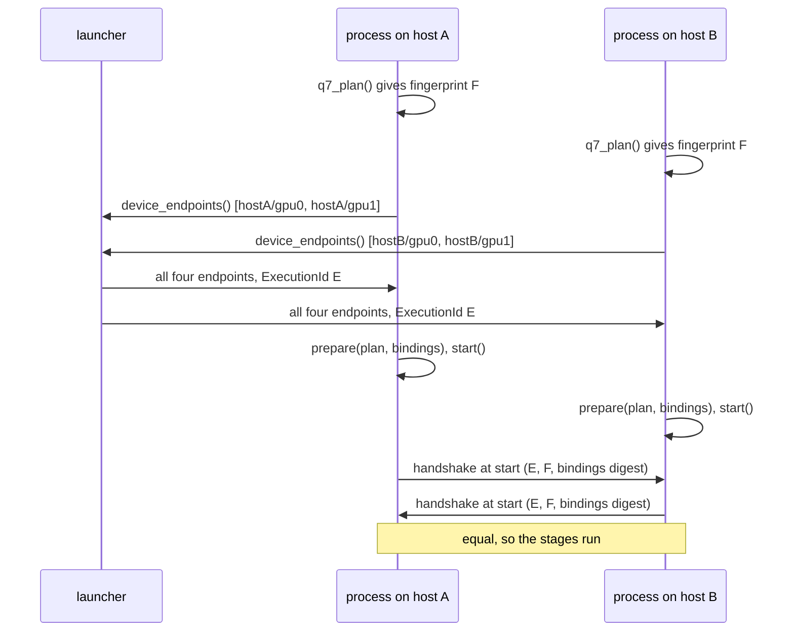
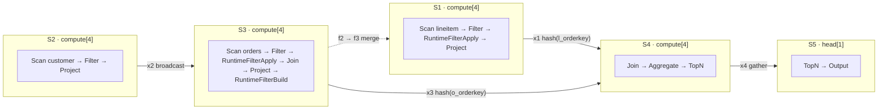
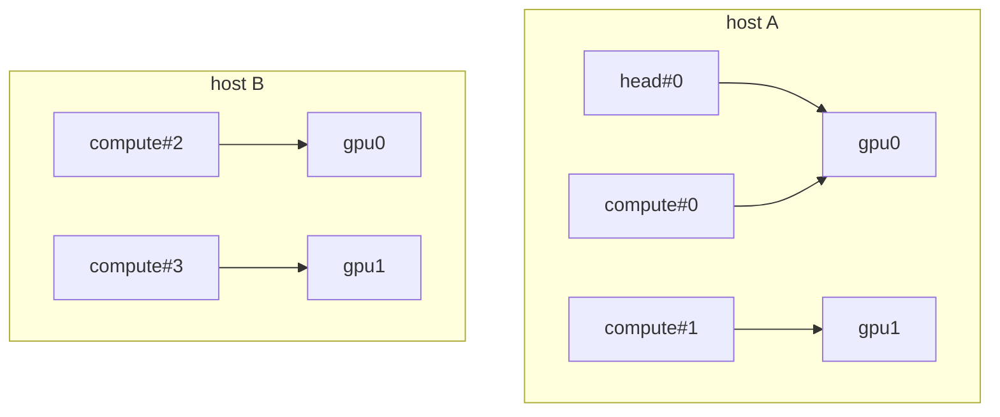

# Sirius on its own: Distributed Sirius

> [!TIP]
> **TL;DR**
>
> - Closed plan, no coordinator: every process runs the same builder code and builds the same plan.
> - The launcher starts processes, gathers `device_endpoints()` and hands out one `ExecutionId`;
>   peers handshake at start on execution id, fingerprint and bindings digest (V25).
> - Every cross-host link is an `Exchange` or `ValueExchange`; only `head#0`'s process reads.
> - Bindings say only where, so the same plan runs on two hosts, four processes or one machine.
> - Fail-stop: any failure fails the execution, filters stay optional, retries are the launcher's.
> - Every process builds and checks the whole plan, which fits tens to the low hundreds of GPUs.
> - The prototype infers exchanges from local plans; the plan states each of them explicitly.

[sirius-duckdb](01-duckdb-extension.md) runs one plan in one process.
[StarRocks](02-starrocks.md) runs many small plans under a scheduler that Sirius never sees.
Distributed Sirius has neither a host database nor a foreign scheduler. It runs across several
machines on its own.

Nothing outside the plan coordinates the processes. The plan says who scans which files, where
each row goes, which filter crosses which link and who receives the result.

## The host's role

Here the "host" is a small program that embeds Sirius, plus a launcher that starts one copy of
it per machine:

- **Every process** runs identical builder code on identical inputs (SPMD: single program,
  multiple data), so every process builds the same plan, with the same fingerprint. The plan is
  **closed**: it contains both ends of every exchange and every value edge. StarRocks instead builds
  [open instance plans](../part-2/04-stages-and-bindings.md#open-plans-authoring-stages-and-instances-directly),
  whose far sides live in other plans.
- **The launcher** starts the processes, gathers each one's `device_endpoints()` so that every
  process can bind every worker, and hands out one `ExecutionId`. It does not plan, schedule or
  move data.
- **Sirius** executes the plan on every process: stages, exchanges, value edges and the final
  gather.



Every process builds and checks the whole plan and takes part in admitting every query. That fits
tens of GPUs up to the low hundreds
([Three hosts, three scales](../part-5/08-running-at-scale.md#three-hosts-three-scales)).

## What it builds

Nobody else makes distribution choices for Distributed Sirius, so its builder writes every one of
them:

- **Several worker sets in one plan:** `head[1]` for the result and `compute[4]` for the work.
- **Deterministic shards:** `files_round_robin` or `byte_ranges`. `Relation::scan` resolves each
  worker's share from the file list, its declared sizes and the set size, so every set is sized
  and the splits are in the plan.
- **Every exchange mode it needs:** hash for co-partitioned joins, broadcast for small builds,
  gather (including `by_worker` and `merge`) for results, range for global sorts.
- **Value edges:** `RuntimeFilterBuild` -> `ValueExchange` -> `RuntimeFilterApply` across workers,
  and `Observe key_sample` -> `ValueExchange` -> `ComputeBoundaries` for range exchanges.
- **Two-phase nodes:** `Aggregate partial` / `final` with state types, and a local `TopN`
  before the gather plus a final one after it.
- **Adaptivity:** an `Observe` / `Decide` pair when a join's build size is unknown, or a fixed
  choice when the builder knows enough.

## A worked plan: Q7 on two hosts

The plan is Q7 (shipping priority), unchanged from
[A multi-stage query](../part-3/07-a-multi-stage-query.md);
[The question](../part-3/07-a-multi-stage-query.md#the-question) says what it computes.

```text
Plan "q7_shipping_priority" (joined)
worker sets: head[1], compute[4]
values:
  f3 = ValueExchange merge f2 -> compute[4]
Output "result" on head[1]
└─ TopN 10 [revenue desc, o_orderdate asc]
   └─ Exchange x4 gather -> head[1]
      └─ TopN 10 [revenue desc, o_orderdate asc]
         └─ Aggregate keys=[l_orderkey, o_orderdate, o_shippriority] measures=[revenue = sum(rev)]
            └─ Join inner keys=[l_orderkey == o_orderkey] build=right  mode=co_partitioned(x1, x3)
               ├─ Exchange x1 hash(l_orderkey) -> compute[4]
               │  └─ Project [l_orderkey, rev = l_extendedprice * (1 - l_discount)]
               │     └─ RuntimeFilterApply [l_orderkey] <~ f3  wait=up_to(20ms)
               │        └─ Filter l_shipdate > 1995-03-15
               │           └─ Scan lineitem [l_orderkey, l_extendedprice, l_discount, l_shipdate]
               │                            on compute[4]  shards=files_round_robin
               └─ Exchange x3 hash(o_orderkey) -> compute[4]
                  └─ RuntimeFilterBuild keys=[o_orderkey] spec=bloom(fixed 8MiB)  scope=partial ~> f2
                     └─ Project [o_orderkey, o_orderdate, o_shippriority]
                        └─ Join inner keys=[o_custkey == c_custkey] build=right  mode=broadcast_build
                           ├─ RuntimeFilterApply [o_custkey] <~ f1  wait=never
                           │  └─ Filter o_orderdate < 1995-03-15
                           │     └─ Scan orders [o_orderkey, o_custkey, o_orderdate, o_shippriority]
                           │                    on compute[4]  shards=files_round_robin
                           └─ RuntimeFilterBuild keys=[c_custkey] spec=bloom(fixed 1MiB)  scope=global ~> f1
                              └─ Exchange x2 broadcast -> compute[4]
                                 └─ Project [c_custkey]
                                    └─ Filter c_mktsegment == "BUILDING"
                                       └─ Scan customer [c_custkey, c_mktsegment]  on compute[4]  shards=files_round_robin
```

Four of its five stages run on `compute[4]`, across both hosts. One runs on `head[1]`:



[The joined plan](../part-3/07-a-multi-stage-query.md#the-joined-plan) explains each choice. Three
facts matter across hosts:

- **Every link between hosts is a node.** Only the exchanges `x1` to `x4` and the value edge
  `f2 -> f3` cross a host boundary.
- **The Bloom merge is a node.** The `ValueExchange` that merges the `partial` `f2` into `f3` is
  the only value merge between workers, and it is in the `values:` block. `f1` is already
  `global` on every worker.
- **The wait is a parameter.** `wait=up_to(20ms)` says how long the lineitem scan may hold back
  for `f3`. The merge takes longer across hosts than inside one, and the node is where you change
  that trade-off.

## SPMD: the same plan everywhere

Every process runs the function below, so no process sends its plan to another.

```cpp
#include <sirius/sirius.hpp>
using namespace sirius;

// Runs unchanged in the process on host A and in the process on host B.
Result<Collected> run_q7(const Context& context, Launcher& launcher) {
  SIRIUS_TRY(ex, running_example());                 // head[1], compute[4], table sources
  SIRIUS_TRY(plan, q7_plan(ex.customer, ex.orders, ex.lineitem, ex.head, ex.compute));
  // plan is identical on every process

  // Host code: every process contributes its endpoints and gets all of them, host A first.
  std::vector<Endpoint> gpus = launcher.gather_endpoints(context.device_endpoints());
  ExecutionId id = launcher.execution_id();          // made once, the same everywhere
```
```rust
use sirius::prelude::*;

// Runs unchanged in the process on host A and in the process on host B.
fn run_q7(context: &Context, launcher: &mut Launcher) -> sirius::Result<Collected> {
    let ex = running_example()?;                    // head[1], compute[4], table sources
    let plan = q7_plan(&ex.customer, &ex.orders, &ex.lineitem, &ex.head, &ex.compute)?;
    // plan is identical on every process

    // Host code: every process contributes its endpoints and gets all of them, host A first.
    let gpus = launcher.gather_endpoints(context.device_endpoints());
    let id = launcher.execution_id();               // made once, the same everywhere
```

`running_example()` supplies the worker sets and table sources of
[the running example](../part-3/00-running-example.md), and `q7_plan` is the Q7 builder from
Part III.

`Launcher` is not part of Sirius: it is whatever the deployment uses to start processes and pass
a few bytes between them. An `Endpoint` travels as bytes (`to_bytes()` and `from_bytes()`), and
so do the 16 bytes of the `ExecutionId`.

At start the peers handshake on the execution id, the plan fingerprint and a digest of the
bindings. If one process built a different plan (say, an older binary with a different filter
size), the execution fails with `binding_mismatch` before any row moves (V25).

`prepare` does not rewrite the plan. A program that wants a rewrite, such as
`rewrite::push_filters_into_scans`, calls it before preparing, and every process must call the
same ones.
[Every process prepares the same plan](../part-2/04-stages-and-bindings.md#every-process-prepares-the-same-plan)
has the details, and [open question 1](../reference/open-questions.md#1-how-plans-travel) covers
how plans might travel between processes instead.

## What prepare binds

The cluster from [Two deployments](../part-3/00-running-example.md#two-deployments) has two hosts
with two GPUs each, and one process per host that admits both GPUs. The launcher returns four
endpoints in host order: `hostA/gpu0`, `hostA/gpu1`, `hostB/gpu0`, `hostB/gpu1`.

```cpp
  SIRIUS_TRY(head_on, WorkerBinding::to({gpus[0]}));
  SIRIUS_TRY(compute_on, WorkerBinding::to(gpus));   // all four, in host order
  SIRIUS_TRY(bindings, Bindings::builder()
                           .execution(id)
                           .workers(ex.head, std::move(head_on))
                           .workers(ex.compute, std::move(compute_on))
                           .build());
  SIRIUS_TRY(prepared, context.prepare(plan, std::move(bindings)));
```
```rust
    let head_on = WorkerBinding::to(vec![gpus[0].clone()])?;
    let compute_on = WorkerBinding::to(gpus)?;     // all four, in host order
    let bindings = Bindings::builder()
        .execution(id)
        .workers(&ex.head, head_on)
        .workers(&ex.compute, compute_on)
        .build()?;
    let prepared = context.prepare(&plan, bindings)?;
```

Every process passes the same bindings and hosts the workers bound to its own
`device_endpoints()`. `prepared.local_workers()` is `[compute#0, compute#1, head#0]` on host A
and `[compute#2, compute#3]` on host B:

```text
Plan "q7_shipping_priority" (joined)
worker sets: head[1], compute[4]
...
binding:
  compute#0 -> hostA/gpu0
  compute#1 -> hostA/gpu1
  compute#2 -> hostB/gpu0
  compute#3 -> hostB/gpu1
  head#0    -> hostA/gpu0
```



`prepare` receives no splits, no routing, no filter topology and no stage list. Those follow from
the plan (the shards are `files_round_robin`, so worker k reads files k, k+4, k+8 and so on).
[Bindings say only where](../part-2/04-stages-and-bindings.md#bindings-where-never-what) each
logical worker lives.

## Starting, reading, finishing

```cpp
  SIRIUS_TRY(started, std::move(prepared).start());
  std::vector<RecordBatch> batches;
  for (OutputReader& output : started.outputs) {       // host A: one reader; host B: none
    while (true) {
      SIRIUS_TRY(batch, output.reader.next());
      if (!batch) break;
      batches.push_back(std::move(*batch));
    }
  }
  SIRIUS_TRY(report, std::move(started.execution).wait());
  return Collected{std::move(batches), std::move(report)};
}
```
```rust
    let StartedExecution { execution, outputs } = prepared.start()?;
    let mut batches = Vec::new();
    for output in outputs {                           // host A: one reader; host B: none
        for batch in output.reader {
            batches.push(batch?);
        }
    }
    let report = execution.wait()?;
    Ok(Collected { batches, report })
}
```

Only the process that hosts `head#0` gets a reader, because `Output "result"` sits on `head[1]`
([Readers go where the Output lives](../part-2/04-stages-and-bindings.md#readers-go-where-the-output-lives)).
The process on host B has an empty `outputs` list and only waits.

Each process's `wait()` returns a report for the stage instances it hosted. If the launcher
collects them, `ExecutionReport::combine` merges them into one report for the whole execution.
For `f3` it says whether the filter was published, its kind, its size and the lineitem rows it
pruned on each worker.

## Failure and cancellation

Distributed Sirius is
[fail-stop](../part-5/07-failure-cancellation-and-recovery.md#fail-stop-along-the-edges):

- **Any failure fails the execution.** An error on `compute#3` reaches every reader and every
  `wait()` on both hosts, with its worker and plan location.
- **A filter failure only drops the filter.** If the merge for `f3` fails, `f3` counts as skipped
  and the lineitem scan runs unfiltered.
- **Cancellation reaches every peer.** Any process can call `request_cancel()` on its
  `CancellationHandle`, and the request travels along the plan's edges.
- **A missing peer is an error.** If host B's process never starts, host A's edges fail with
  `transport` once the first-contact deadline (`PrepareOptions::with_first_contact_deadline`)
  expires.

Whether to retry, and where, stays with the launcher:

- If the plan's exchanges are `durability=spooled`, the launcher may re-run one failed stage
  instance instead of the whole query, on the same GPU or a spare one. Every process applies the
  same retry
  ([Retrying a stage instance](../part-5/07-failure-cancellation-and-recovery.md#retrying-a-stage-instance)).
- After a fatal GPU error every call in that process returns `runtime_unavailable` until it
  restarts, so the launcher retries on another process or a restarted one, never in place
  ([When the device itself fails](../part-5/07-failure-cancellation-and-recovery.md#when-the-device-itself-fails)).

The retry API is [open question 28](../reference/open-questions.md#28-retry-api-and-who-decides),
and liveness and the rest of coordination are
[open question 4](../reference/open-questions.md#4-coordination-and-failure).

## The same plan, other shapes

Bindings say only where, so the same plan runs on other machines unchanged
([Same plan, different machines](../part-2/04-stages-and-bindings.md#same-plan-different-machines)):

- **One process per GPU.** Run four processes, each admitting one GPU. The launcher returns four
  endpoints, one per process, and the bindings code is identical. Host A's two processes host
  `compute#0` and `compute#1`, and the first also hosts `head#0`.
- **One machine, the sirius-duckdb shape.** Bind both sets with `Bindings::local()` on a four-GPU
  host, and the exchanges move data between GPUs in one process instead of over the network.
  sirius-duckdb binds its plans the same way.

## Today versus explicit

The prototype runs one process per GPU and has run on up to 16 GPUs across four machines. It
already uses hash, broadcast, range and gather exchanges, a merged Bloom filter and sampled
boundaries for global sorts.

What differs is where those decisions come from. Today each process plans the query on its own.
A pass then walks the local plan, recognizes the shapes the local multi-GPU planner produced and
infers where data must cross processes. Each inference has an explicit home in the plan:

| Today, in the prototype | In the plan |
|---|---|
| Each process plans the query independently and must arrive at the same shape. | One builder runs identically on every process, and the fingerprint proves agreement. |
| Exchanges are inferred by pattern-matching the shapes of the local plan. | `Exchange` nodes the builder wrote. |
| Stream ids come from a per-connection query counter plus the order in which the pass visits operators. Only one connection per process may run distributed queries. | `ExchangeId` and `ValueId` assigned by `Plan::create`, carried with the `ExecutionId`. |
| After planning, the processes all-gather a hash of the plan's shape to detect disagreement. | The fingerprint and bindings digest, compared in a handshake at start (V25). |
| Broadcast or hash is chosen inside the inferring pass from size estimates. | A builder choice (`x2 broadcast` in Q7) or a `Decide` node (Q5). |
| The sampling step of a global sort pushes its boundaries into the exchange through a callback. | `Observe key_sample` -> `ValueExchange` -> `ComputeBoundaries` -> range `Exchange` (Q6b). |
| The Bloom filter merge is set up through a side channel on the join, with a two-minute timeout in a default, and it is cancelled when the estimated build is small. | `RuntimeFilterBuild` -> `ValueExchange` -> `RuntimeFilterApply`, with its spec and `WaitPolicy` on the nodes. |
| A process with an empty build leaves the filter merge early through a hidden coupling between two operators. | Every producing worker ends exactly once. An empty build publishes an empty filter. |
| Constant rows are kept on the first process and emptied on the others, and only the first process's result is meaningful. | `Values` and `Output` on `head[1]`. Only the process that hosts `head#0` gets a reader. |
| The peer list and the process's own index are configuration settings, and setting them connects to every peer at once. | Endpoints in `Bindings`, per execution. |
| Scan work is sliced per process while table information is loaded: the files are laid end to end, and each process gets one contiguous span of equal bytes. Processes that see different file sizes read some row groups twice and others not at all. | Splits on the `Scan` node: usually `files_round_robin`, `byte_ranges` or `Shards::dynamic()`. The file sizes behind a `byte_ranges` cut are in the plan and covered by the fingerprint, so processes that see different sizes fail the handshake. |

Sirius adds no shard kind for the prototype's slicing. A host that wants it cuts the spans itself
and passes them with `Shards::explicit_splits`.

Below the plan, the prototype moves batches with credit-based one-sided writes
([The protocol](../part-5/02-exchanges-in-the-engine.md#the-protocol)). Between machines it stages
bytes through host memory over TCP; RDMA between machines is still to come.

Two of today's limits have no row in the table:

- A transport failure stops distributed queries on every process until all of them restart
  (nothing reconnects), while each GPU engine keeps serving local queries. That stays a lifecycle
  concern outside the plan.
  [Failure, cancellation and recovery](../part-5/07-failure-cancellation-and-recovery.md)
  describes what the explicit design does instead.
- Operators that the inferring pass does not recognize are refused. In the explicit design, the
  builder either places an exchange or `Plan::create` reports which invariant is broken.
