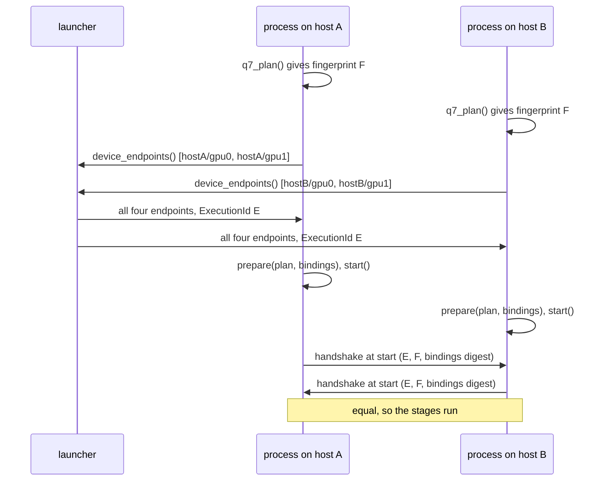
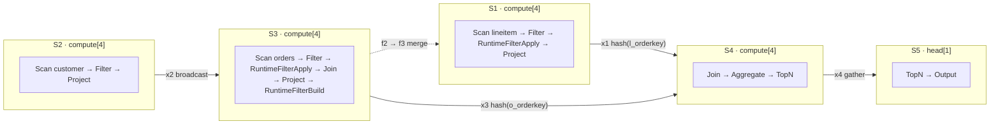
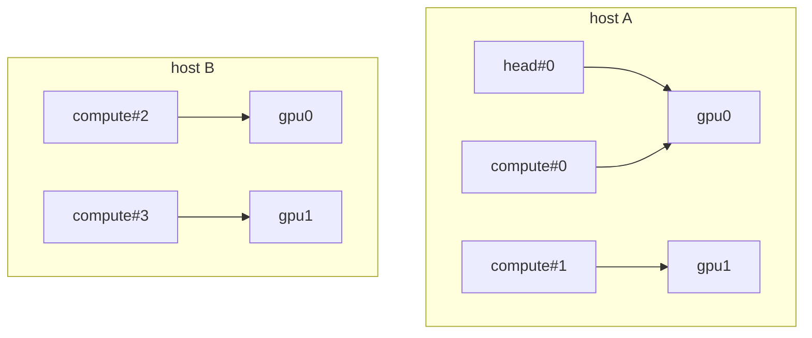

# Sirius on its own: Distributed Sirius

Upstream Distributed Sirius runs the same SQL in several DuckDB processes, one per GPU. The
planner inserts rank-to-rank exchanges, and rank 0 returns the result. This chapter asks how a
standalone application could run that query by building the exchanges itself. In the proposed API,
a worker belongs to a plan and can be bound to an endpoint in any participating process.
[Upstream distributed execution](https://github.com/sirius-db/sirius/blob/ef7eb2951a370f4293784549bc05fc46c7cc64f6/docs/super-sirius/distributed-sirius.md)

## The host's role

Here the "host" is a small program that embeds Sirius, plus a launcher that starts one copy of
it per machine:

- **Every process** runs identical builder code on identical inputs (SPMD: single program,
  multiple data), so every process builds the same plan, with the same fingerprint. The plan is
  **closed**: it contains both ends of every exchange and every value edge. StarRocks instead builds
  [open instance plans](../part-2/04-stages-and-bindings.md#open-plans-authoring-stages-and-instances-directly),
  whose far sides live in other plans.
- **The launcher** starts the processes, gathers each one's `device_endpoints()` so that every
  process can bind every worker, and hands out one `ExecutionId`. It does not plan, schedule or
  move data.
- **Sirius** executes the plan on every process: stages, exchanges, value edges and the final
  gather.



Each process must be able to reconstruct the same plan. If two processes enumerate files in a
different order, even the same round-robin rule can assign different work to their GPUs.
The fingerprint covers the ordered list. How much plan replication and collective admission
cost at larger worker counts is a scaling question. [Running at scale](../part-5/08-running-at-scale.md)

## What it builds

Nobody else makes distribution choices for Distributed Sirius, so its builder writes every one of
them:

- **Several worker sets in one plan:** `head[1]` for the result and `compute[4]` for the work.
- **Deterministic shards:** `files_round_robin` or `byte_ranges`. `Relation::scan` resolves each
  worker's share from the file list, its declared sizes and the set size, so every set is sized
  and the splits are in the plan.
- **Every exchange mode it needs:** hash for co-partitioned joins, broadcast for small builds,
  gather (including `by_worker` and `merge`) for results, range for global sorts.
- **Value edges:** `RuntimeFilterBuild` -> `ValueExchange` -> `RuntimeFilterApply` across workers,
  and `Observe key_sample` -> `ValueExchange` -> `ComputeBoundaries` for range exchanges.
- **Two-phase nodes:** `Aggregate partial` / `final` with state types, and a local `TopN`
  before the gather plus a final one after it.
- **Adaptivity:** an `Observe` / `Decide` pair when a join's build size is unknown, or a fixed
  choice when the builder knows enough.

## A worked plan: Q7 on two hosts

Q7 joins customers, orders and line items, groups by order, and returns the ten orders with
the most revenue under its date and market-segment predicates. The [worked plan](../part-3/07-a-multi-stage-query.md#the-joined-plan)
specifies every exchange. Here the same four compute workers are spread across two hosts.

Four of its five stages run on `compute[4]`, across both hosts. One runs on `head[1]`:



[The joined plan](../part-3/07-a-multi-stage-query.md#the-joined-plan) explains each choice. Three
facts matter across hosts:

- **Every link between hosts is a node.** Only the exchanges `x1` to `x4` and the value edge
  `f2 -> f3` cross a host boundary.
- **The Bloom merge is a node.** The `ValueExchange` that merges the `partial` `f2` into `f3` is
  the only value merge between workers, and it is in the `values:` block. `f1` is already
  `global` on every worker.
- **The wait is a parameter.** `wait=up_to(20ms)` says how long the lineitem scan may hold back
  for `f3`. The scan can continue after its budget expires even if a remote share is still in flight.

## SPMD: the same plan everywhere

Every process runs the function below, so no process sends its plan to another.

```cpp
#include <sirius/sirius.hpp>
using namespace sirius;

// Runs unchanged in the process on host A and in the process on host B.
Result<Collected> run_q7(const Context& context, Launcher& launcher) {
  SIRIUS_TRY(ex, running_example());                 // head[1], compute[4], table sources
  SIRIUS_TRY(plan, q7_plan(ex.customer, ex.orders, ex.lineitem, ex.head, ex.compute));
  // plan is identical on every process

  // Host code: every process contributes its endpoints and gets all of them, host A first.
  std::vector<Endpoint> gpus = launcher.gather_endpoints(context.device_endpoints());
  ExecutionId id = launcher.execution_id();          // made once, the same everywhere
```
```rust
use sirius::prelude::*;

// Runs unchanged in the process on host A and in the process on host B.
fn run_q7(context: &Context, launcher: &mut Launcher) -> sirius::Result<Collected> {
    let ex = running_example()?;                    // head[1], compute[4], table sources
    let plan = q7_plan(&ex.customer, &ex.orders, &ex.lineitem, &ex.head, &ex.compute)?;
    // plan is identical on every process

    // Host code: every process contributes its endpoints and gets all of them, host A first.
    let gpus = launcher.gather_endpoints(context.device_endpoints());
    let id = launcher.execution_id();               // made once, the same everywhere
```

`running_example()` supplies the worker sets and table sources of
[the running example](../part-3/00-running-example.md), and `q7_plan` is the Q7 builder from
Part III.

`Launcher` is not part of Sirius: it is whatever the deployment uses to start processes and pass
a few bytes between them. An `Endpoint` travels as bytes (`to_bytes()` and `from_bytes()`), and
so do the 16 bytes of the `ExecutionId`.

At start the peers handshake on the execution id, the plan fingerprint and a digest of the
bindings. If one process built a different plan (say, an older binary with a different filter
size), the execution fails with `binding_mismatch` before any row moves (V25).

`prepare` does not rewrite the plan. A program that wants a rewrite, such as
`rewrite::push_filters_into_scans`, calls it before preparing, and every process must call the
same ones.
[Every process prepares the same plan](../part-2/04-stages-and-bindings.md#every-process-prepares-the-same-plan)
has the details, and [open question 1](../reference/open-questions.md#1-how-plans-travel) covers
how plans might travel between processes instead.

## What prepare binds

The cluster from [Two deployments](../part-3/00-running-example.md#two-deployments) has two hosts
with two GPUs each, and one process per host that admits both GPUs. The launcher returns four
endpoints in host order: `hostA/gpu0`, `hostA/gpu1`, `hostB/gpu0`, `hostB/gpu1`.

```cpp
  SIRIUS_TRY(head_on, WorkerBinding::to({gpus[0]}));
  SIRIUS_TRY(compute_on, WorkerBinding::to(gpus));   // all four, in host order
  SIRIUS_TRY(bindings, Bindings::builder()
                           .execution(id)
                           .workers(ex.head, std::move(head_on))
                           .workers(ex.compute, std::move(compute_on))
                           .build());
  SIRIUS_TRY(prepared, context.prepare(plan, std::move(bindings)));
```
```rust
    let head_on = WorkerBinding::to(vec![gpus[0].clone()])?;
    let compute_on = WorkerBinding::to(gpus)?;     // all four, in host order
    let bindings = Bindings::builder()
        .execution(id)
        .workers(&ex.head, head_on)
        .workers(&ex.compute, compute_on)
        .build()?;
    let prepared = context.prepare(&plan, bindings)?;
```

Every process passes the same bindings and hosts the workers bound to its own
`device_endpoints()`. `prepared.local_workers()` is `[compute#0, compute#1, head#0]` on host A
and `[compute#2, compute#3]` on host B:

```text
Plan "q7_shipping_priority" (joined)
worker sets: head[1], compute[4]
...
binding:
  compute#0 -> hostA/gpu0
  compute#1 -> hostA/gpu1
  compute#2 -> hostB/gpu0
  compute#3 -> hostB/gpu1
  head#0    -> hostA/gpu0
```



`prepare` receives no splits, no routing, no filter topology and no stage list. Those follow from
the plan (the shards are `files_round_robin`, so worker k reads files k, k+4, k+8 and so on).
[Bindings say only where](../part-2/04-stages-and-bindings.md#bindings-where-never-what) each
logical worker lives.

## Starting, reading, finishing

```cpp
  SIRIUS_TRY(started, std::move(prepared).start());
  std::vector<RecordBatch> batches;
  for (OutputReader& output : started.outputs) {       // host A: one reader; host B: none
    while (true) {
      SIRIUS_TRY(batch, output.reader.next());
      if (!batch) break;
      batches.push_back(std::move(*batch));
    }
  }
  SIRIUS_TRY(report, std::move(started.execution).wait());
  return Collected{std::move(batches), std::move(report)};
}
```
```rust
    let StartedExecution { execution, outputs } = prepared.start()?;
    let mut batches = Vec::new();
    for output in outputs {                           // host A: one reader; host B: none
        for batch in output.reader {
            batches.push(batch?);
        }
    }
    let report = execution.wait()?;
    Ok(Collected { batches, report })
}
```

Only the process that hosts `head#0` gets a reader, because `Output "result"` sits on `head[1]`
([Readers go where the Output lives](../part-2/04-stages-and-bindings.md#readers-go-where-the-output-lives)).
The process on host B has an empty `outputs` list and only waits.

Each process's `wait()` returns a report for the stage instances it hosted. If the launcher
collects them, `ExecutionReport::combine` merges them into one report for the whole execution.
For `f3` it says whether the filter was published, its kind, its size and the lineitem rows it
pruned on each worker.

## Failure and cancellation

A failure on the required data path must reach the participating processes and their callers.
If only the optional filter merge fails and the rows are still available, the scan can proceed
without pruning. A timeout on first contact with a required peer fails the execution. After
output has reached the application, the launcher must account for those rows before retrying.
[Failure propagation](../part-5/07-failure-cancellation-and-recovery.md#fail-stop-along-the-edges)

Spooling can make a completed intermediate result available to another attempt. Retrying a
stage also requires surviving inputs, a way to select the winning attempt, and consumers that
can avoid duplicate effects or rows. The launcher would have to coordinate that retry on every
participating process. [Retrying a stage instance](../part-5/07-failure-cancellation-and-recovery.md#retrying-a-stage-instance)

The retry API is [open question 28](../reference/open-questions.md#28-retry-api-and-who-decides),
and liveness and the rest of coordination are
[open question 4](../reference/open-questions.md#4-coordination-and-failure).

## The same plan, other shapes

Bindings say only where, so the same plan runs on other machines unchanged
([Same plan, different machines](../part-2/04-stages-and-bindings.md#same-plan-different-machines)):

- **One process per GPU.** Run four processes, each admitting one GPU. The launcher returns four
  endpoints, one per process, and the bindings code is identical. Host A's two processes host
  `compute#0` and `compute#1`, and the first also hosts `head#0`.
- **One machine, the sirius-duckdb shape.** Bind both sets with `Bindings::local()` on a four-GPU
  host, and the exchanges move data between GPUs in one process instead of over the network.
  sirius-duckdb binds its plans the same way.

## Distributed execution on upstream main

Distributed SQL landed in [PR #2337](https://github.com/sirius-db/sirius/pull/2337).
At the revision reviewed here, each rank runs the same statements in the same order, with the
same peer list and its own rank index. Independent CPU fallback is disabled because one rank
executing the query alone would produce a different result.

| Upstream SQL path | Proposed builder path |
|---|---|
| Each rank lowers its local plan. `distribute_plan()` recognizes supported operator shapes and inserts hash, range, broadcast or gather exchanges. | The caller builds the exchanges. Plan validation checks the properties the downstream operators require. |
| Ranks compare a hash of the rewritten plan shape before running. The connection's query count contributes to stream IDs. | Processes compare a plan fingerprint and a bindings digest for the same execution ID. |
| Local Parquet files are laid end to end and divided by byte span. Each rank reads the row groups starting in its span. Remote files are assigned by file index. | The scan specifies its shard rule or split list. A host can reproduce a particular assignment with explicit splits. |
| A distributed sort shares samples to compute boundaries. A publishing join can merge compatible Bloom filters across ranks. | The samples, boundaries and filter merges become named values and dependencies in the plan. |
| Rank 0 returns the result. After transport failure, recovering the distributed session requires restarting the ranks. | The plan names the output worker. Retry, transport recovery and handling already delivered output need a separate protocol. |

The merged guide records single-host tests and lists multi-host qualification as outstanding.
A separate four-node study measured join-heavy queries on a development build with host-staged
TCP. Those results describe that configuration. Cross-host transport work has its own PR.
[Distributed guide and limits](https://github.com/sirius-db/sirius/blob/ef7eb2951a370f4293784549bc05fc46c7cc64f6/docs/super-sirius/distributed-sirius.md#limits) · [Four-node measurements](https://github.com/sirius-db/sirius/issues/2465) · [Multi-host transport](https://github.com/sirius-db/sirius/pull/2623)
