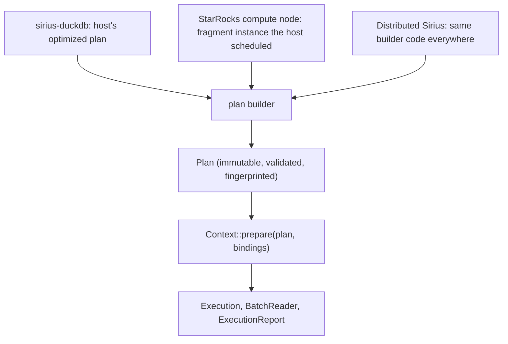

# One IR, three integrations

> [!TIP]
> **TL;DR**
>
> - The host owns catalog, client and where to cut. Sirius owns execution, data movement and values.
> - The plan is the only contract. Bindings say where, never what. Scan splits live in the plan.
> - Every IR feature but `Choose` is required by some host. Each integration is a subset of one
>   vocabulary.
> - Q4: one joined plan for sirius-duckdb and Distributed Sirius (only bindings differ), thirteen
>   open instance plans for StarRocks.
> - All three get the same objects back: readers, `ExecutionReport`, error codes,
>   `CancellationHandle`.
> - The gaps are shared missing nodes or rules, or lifecycle concerns. None needs a different kind
>   of plan.
> - Plans converted from Axiom run as a whole query, from Spark tasks as one plan per task.
>   Neither needs a new structural concept.

[sirius-duckdb](01-duckdb-extension.md), [StarRocks](02-starrocks.md) and
[Distributed Sirius](03-distributed-sirius.md) differ in who plans, who schedules, who owns the
catalog, and how results reach a client. Each one builds a plan with the plan builder, calls
`Context::prepare` with bindings, and calls `start()`. This chapter compares the three, then looks
at two more systems and the level at which each one meets Sirius.

## Who owns what

The last column, what Sirius does, is the same in all three integrations.

| Concern | sirius-duckdb | StarRocks | Distributed Sirius | Sirius, in all three |
|---|---|---|---|---|
| **Plan source** | The extension translates the host's optimized plan through the builder. | Each compute node builds one open instance plan per fragment instance the host scheduled. | Every process runs the same builder code. | Validates the plan and fingerprints it. |
| **Optimizer** | DuckDB's optimizer: join order, build side, join-filter edges. | The StarRocks frontend: fragments, distribution, filters. | Whoever writes the builder code. | Never rewrites at prepare. Offers rewrites that keep every `Exchange` and `ValueExchange`, which the host calls; resolves worker-local `auto` properties. |
| **Stage cut** | Derived from the plan's exchanges. | The frontend cuts fragments; each one is a stage. | Derived from the plan's exchanges. | Treats stages as the parts between exchanges. |
| **Scheduling** | One process; nothing to place. | The frontend places instances on compute nodes. | A launcher starts one process per host or GPU. | Schedules everything inside each worker. |
| **Worker identity** | `compute[N]`, `head[1]` | One set per fragment: sized where the plan depends on it (`frag3[4]`), unsized for a hosting set that only scans and sends (`frag1[?]`) | `compute[4]`, `head[1]` | Logical workers, bound at prepare |
| **Transport** | Between GPUs in one process | Between compute nodes | Between hosts | Chosen per endpoint pair; never changes what a worker receives |
| **Scan splits** | From the plan, including host-registered kinds | From the plan: the frontend's scan ranges for each instance, as `Shards::splits` | From the plan (`files_round_robin`, `byte_ranges`) | Fixes every worker's splits when the scan is built, or lets the set's workers claim them at run time under an explicit `shards=dynamic` |
| **Runtime filters** | Imported from the host's join-filter edges | Planned by the frontend, sent as shares | Written by the builder | Builds, merges and applies them as value edges |
| **Results** | One reader on `head#0`, copied into the host's result chunks | A reader on the compute node that hosts `frag0#0` | One reader on the process that hosts `head#0` | One `OutputReader` per `Output` worker, in the hosting process |
| **Failure and cancel** | Typed `unsupported` before start, or `runtime_unavailable`: either keeps DuckDB's plan; interrupt to `CancellationHandle` | The frontend's cancel to `CancellationHandle`; status reported per instance | Fail-stop; any process can cancel | Typed errors with worker and location; failure and cancellation travel along edges; [opt-in stage retry](../part-5/07-failure-cancellation-and-recovery.md#retrying-a-stage-instance); `runtime_unavailable` after a fatal GPU error |

In every row, the host owns the catalog, the client and the choice of where to cut. Sirius owns
execution, data movement and value delivery. The plan is the only contract between the two: it
records the distribution choices, whoever made them, and the engine runs what it says.

## The feature matrix

Each row is a feature from the [node catalog](../reference/node-catalog.md). **R** means the
integration's plans need it, **O** means it is useful or occasional, and **-** means it is not
needed.

| Plan IR feature | sirius-duckdb | StarRocks | Dist. Sirius |
|---|---|---|---|
| `Scan` with `files_round_robin` or `byte_ranges` shards | R | - | R |
| `Scan` with `Shards::splits` (one instance's splits, from the host) | - | R | - |
| `TableSource::registered` (a host scan kind with a handle) | R | - | - |
| `Filter`, `Project` | R | R | R |
| `Aggregate` single phase on `hashed` input | R | R | R |
| `Aggregate partial` / `final` with state types | R | R | R |
| `Aggregate` with grouping sets | R | O | O |
| `Window` on `hashed` or `single` input | R | O | O |
| `Join` co_partitioned and broadcast_build | R | R | R |
| `Join` decided (`Observe`, `Decide`, `Exchange::decided_by`) | R | O | O |
| `Choose` between subtrees | O | - | O |
| `HashScheme::v1` and `NullRouting::to_all` | R | R | R |
| Null-safe key pairs (`JoinKey::null_safe`) | R | O | O |
| `JoinOptions::with_build_rows` for co-partitioned `mark` joins (`IN`, `ANY` subqueries) | R | O | R |
| `Exchange` hash, broadcast, gather | R | R | R |
| `Exchange` gather `by_worker` or `merge` | R | O | R |
| `Exchange` range with `ComputeBoundaries` | R | O | R |
| `Exchange` forward (as a decided alternative) | R | - | O |
| `Sort`, local and final `TopN` | R | R | R |
| Per-key `TopN` | R | O | O |
| `Limit` with close | R | O | O |
| `Union` | R | O | O |
| `Repeat` (`INTERSECT ALL`, `EXCEPT ALL`) | R | O | O |
| `RuntimeFilterBuild` / `RuntimeFilterApply` | R | R | R |
| `ValueExchange` merge of Bloom filters | R | - | R |
| `ValueExchange` merge of `in_list` / `min_max` shares | O | R | - |
| `WaitPolicy::up_to` | O | R | O |
| Several worker sets in one plan | R | R | R |
| Authored instance plans (`Plan::create_instance`) | - | R | - |
| Unsized hosting sets (`WorkerSet::unsized`) | - | R | - |
| Open plans: `ExchangeSource` / `ExchangeSink`, `ValueSource` / `ValueSink` | - | R | - |
| Endpoints in other processes | - | R | R |

The matrix shows three things:

1. **Every row except `Choose` is R for at least one integration.** `Choose` is optional for two
   of them. No feature is there only for a hypothetical user.
2. **Every integration is a subset of the same vocabulary.** sirius-duckdb is the single-machine
   case: every exchange stays inside one process. StarRocks is the open case: each plan describes
   one worker, and the far sides of its edges live in plans that other compute nodes prepare.
   Distributed Sirius is the closed case: one plan holds both ends of every edge.
3. **What is specific to a host lives at the edges.** sirius-duckdb's one special row is a
   registered scan kind with an opaque handle, which is an extension point. StarRocks's special
   rows are open instance plans, unsized hosting sets and per-instance splits: the same nodes,
   written for one worker at a time.

## One query, three plans

Q4 (urgent March revenue) comes from
[Partitioned join and runtime filters](../part-3/04-partitioned-join-and-runtime-filters.md).

```text
Plan "q4_urgent_march_revenue" (joined)
worker sets: head[1], compute[4]
values:
  f2 = ValueExchange merge f1 -> compute[4]
Output "result" on head[1]
└─ Exchange x3 gather -> head[1]
   └─ Aggregate keys=[o_orderkey, o_orderdate] measures=[revenue = sum(rev)]
      └─ Project [o_orderkey, o_orderdate, rev = l_extendedprice * (1 - l_discount)]
         └─ Join inner keys=[l_orderkey == o_orderkey] build=right  mode=co_partitioned(x1, x2)
            ├─ Exchange x1 hash(l_orderkey) -> compute[4]
            │  └─ RuntimeFilterApply [l_orderkey] <~ f2  wait=never
            │     └─ Scan lineitem [l_orderkey, l_extendedprice, l_discount]  on compute[4]  shards=files_round_robin
            └─ Exchange x2 hash(o_orderkey) -> compute[4]
               └─ RuntimeFilterBuild keys=[o_orderkey] spec=bloom(fixed 8MiB)  scope=partial ~> f1
                  └─ Filter o_orderdate >= 1995-03-01 and o_orderdate < 1995-04-01 and o_orderpriority == "1-URGENT"
                     └─ Scan orders [o_orderkey, o_orderdate, o_orderpriority]  on compute[4]  shards=files_round_robin
```

- **sirius-duckdb** produces this plan if DuckDB's optimizer supplies a join-filter edge and the
  extension writes a partitioned join. The extension prepares it with `Bindings::local()` on a
  four-GPU machine, so `x1`, `x2`, `x3` and `f2` move data between GPUs in one process.
- **Distributed Sirius** produces the same plan. Two processes on two hosts build it with the
  same builder code and get the same fingerprint. Rows that change hosts, and the merge into
  `f2`, cross the network.
- **StarRocks** produces thirteen open instance plans, one per fragment instance (four each for
  `frag1`, `frag2` and `frag3`, one for `frag0`), as in
  [Under someone else's scheduler: StarRocks](02-starrocks.md). The frontend made some choices of
  its own, so `rewrite::join_stages` on the thirteen gives a joined plan that differs from this
  one in a few lines.

Between sirius-duckdb and Distributed Sirius, only the bindings differ. StarRocks also differs in
plan form and in the choices its optimizer made:

| | sirius-duckdb | Distributed Sirius | StarRocks |
|---|---|---|---|
| Plan form | joined, closed | joined, closed | thirteen instance plans, open |
| Worker sets | `head[1]`, `compute[4]` | `head[1]`, `compute[4]` | `frag0[1]`, `frag3[4]`; `frag1[?]`, `frag2[?]` where they host the plan |
| Exchange and value ids | `x1`-`x3`, `f1`/`f2`, from `Plan::create` | the same | `x11`-`x13`, `f21`/`f22`, from the frontend |
| Filter | Bloom, built below `x2`, `partial`, merged | the same | `in_list` or `min_max`, built above `x12`, `partition(x12)`, shares merged |
| Filter wait | `never` | `never` | `up_to(30s)` |
| Scan shards | `files_round_robin` | `files_round_robin` | `Shards::splits`, the frontend's ranges for each instance |
| Bindings | `Bindings::local()` | builder: 2 hosts, 4 GPUs | builder per instance plan: endpoints only |
| Readers | one, in the only process | one, on host A | one, on the compute node that hosts `frag0#0` |

All three hosts reach the same entry point:



## Prepare, side by side

sirius-duckdb and Distributed Sirius pass the same plan to `prepare` and differ only in the
bindings. A StarRocks compute node passes an instance plan, so its part also builds that plan, to
show where the frontend's scan ranges go. A real program contains one of the three.

```cpp
#include <sirius/sirius.hpp>
using namespace sirius;

// context: this process's Context. q4: Q4's joined plan.
// head, compute, head_on, compute_on, id: as in "Sirius on its own".
// frag1, frag3, lineitem, here, frag3_on, query, ranges, k: as in the StarRocks chapter.

// sirius-duckdb: one process hosts every worker.
SIRIUS_TRY(in_process, context.prepare(q4, Bindings::local()));

// Distributed Sirius: the same plan; the identical call runs on both hosts.
SIRIUS_TRY(cluster_bindings, Bindings::builder()
                                 .execution(id)
                                 .workers(head, std::move(head_on))
                                 .workers(compute, std::move(compute_on))
                                 .build());
SIRIUS_TRY(on_cluster, context.prepare(q4, std::move(cluster_bindings)));

// StarRocks compute node, instance k of frag1: the frontend's ranges go into the plan.
SIRIUS_TRY(splits, Shards::splits(std::move(ranges)));
ScanOptions scan_options = ScanOptions::on(frag1)
                               .with_columns({"l_orderkey", "l_extendedprice", "l_discount"})
                               .with_shards(std::move(splits));
SIRIUS_TRY(scan, Relation::scan(lineitem, std::move(scan_options)));
// ... the filter probe and the hash sink on x11, as in the StarRocks chapter, give frag1_sink.
SIRIUS_TRY(frag1_k, Plan::create_instance(frag1.at(k), {frag1_sink}));
SIRIUS_TRY(instance_bindings, Bindings::builder()
                                  .execution(query)
                                  .worker(frag1.at(k), here)
                                  .workers(frag3, std::move(frag3_on))
                                  .build());
SIRIUS_TRY(on_node, context.prepare(frag1_k, std::move(instance_bindings)));
```
```rust
use sirius::prelude::*;

// context: this process's Context. q4: Q4's joined plan.
// head, compute, head_on, compute_on, id: as in "Sirius on its own".
// frag1, frag3, lineitem, here, frag3_on, query, ranges, k: as in the StarRocks chapter.

// sirius-duckdb: one process hosts every worker.
let in_process = context.prepare(&q4, Bindings::local())?;

// Distributed Sirius: the same plan; the identical call runs on both hosts.
let cluster_bindings = Bindings::builder()
    .execution(id)
    .workers(&head, head_on)
    .workers(&compute, compute_on)
    .build()?;
let on_cluster = context.prepare(&q4, cluster_bindings)?;

// StarRocks compute node, instance k of frag1: the frontend's ranges go into the plan.
let scan_options = ScanOptions::on(&frag1)
    .with_columns(&["l_orderkey", "l_extendedprice", "l_discount"])
    .with_shards(Shards::splits(ranges)?);
let scan = Relation::scan(&lineitem, scan_options)?;
// ... the filter probe and the hash sink on x11, as in the StarRocks chapter, give frag1_sink.
let frag1_k = Plan::try_new_instance(&frag1.at(k), vec![frag1_sink], vec![])?;
let instance_bindings = Bindings::builder()
    .execution(query)
    .worker(frag1.at(k), here)
    .workers(&frag3, frag3_on)
    .build()?;
let on_node = context.prepare(&frag1_k, instance_bindings)?;
```

All three follow the rule that
[bindings say where, never what](../part-2/04-stages-and-bindings.md#bindings-where-never-what):

- sirius-duckdb binds nothing beyond "here". Its plan already holds the snapshot handle, the
  files, the filter edge and any adaptive threshold.
- Distributed Sirius binds an execution id and an endpoint for each worker. Its plan already holds
  the shards, the exchanges and the filter merge.
- StarRocks binds an execution id and endpoints: for the worker this instance plan runs as, and
  for the workers of the far-side sets it exchanges with. Its scan ranges are *what* the worker
  reads, so they are in the plan as `Shards::splits`, and the fingerprint covers them.

No binding changes a node, a routing or a partition count. The frontend's instance ids, the
launcher's process indexes and sirius-duckdb's local GPUs are all logical workers bound to
endpoints.

`prepare` rewrites none of the three plans, and Q4 has no `auto` property for it to resolve
([Preparing a plan](../part-1/06-prepare-and-execute.md#preparing-a-plan)).

## What Sirius gives back

Every integration gets the same objects back and maps them onto its own protocol:

- **Readers.** `start()` returns one `OutputReader` per `Output` worker hosted in this process.
  sirius-duckdb copies batches into DuckDB's result chunks. A StarRocks compute node turns them
  into the frontend's result batches. A Distributed Sirius program prints them or writes them out.
- **Reports.** `wait()` returns an `ExecutionReport`: rows, bytes and time per stage instance,
  bytes per exchange sender and receiver, the outcome of every value, every decision label,
  spills, and the `resolved_plan()`. A StarRocks compute node maps it onto its per-instance status
  report. Distributed Sirius merges the per-process reports with `ExecutionReport::combine`.
- **Errors.** Every host sees the same error codes, each with a message and, where they apply, a
  `PlanLocation` and a `WorkerRef`
  ([Errors, by phase](../part-1/06-prepare-and-execute.md#errors-by-phase)). After a fatal GPU
  error every call returns `runtime_unavailable` until the process restarts
  ([How long a context lives](../part-1/03-context-and-session.md#how-long-a-context-lives)):
  sirius-duckdb treats it like `unsupported` and DuckDB reruns from its own plan, and Distributed
  Sirius treats the process as lost.
- **Cancellation.** One `CancellationHandle` per execution. A DuckDB interrupt, a StarRocks
  frontend cancel and a Distributed Sirius launcher's abort all call `request_cancel()`.

## Honest gaps

The three integrations push on the design in the places below. None comes from a host needing a
different kind of plan: each is a missing node or rule that all three would share, or a lifecycle
concern that sits outside the plan by design. The numbers refer to
[Open questions](../reference/open-questions.md).

- **How plans travel (question 1).** None of the three ships a plan today: sirius-duckdb builds
  in-process, StarRocks compute nodes build their own instance plans, and Distributed Sirius
  rebuilds the same plan everywhere and compares fingerprints. A host that plans in one place and
  executes in another would need more, and all three need fingerprints that are stable across
  releases. Large file lists already travel by reference, as a
  [split manifest](../part-5/08-running-at-scale.md#split-manifests).
- **Open-plan composition (question 9).** The rules for `join_stages` and for edge signatures are
  not final. StarRocks's older prototype materializes every exchange; Distributed Sirius pipelines
  them ([Durability: pipelined or
  spooled](../part-5/07-failure-cancellation-and-recovery.md#durability-pipelined-or-spooled)).
- **Coordination and failure (questions 4 and 28).** The host hands out endpoints and execution
  ids in all three.
  [Failure, cancellation and recovery](../part-5/07-failure-cancellation-and-recovery.md)
  covers outcomes, failure along edges and opt-in stage retry. Still open: sirius-duckdb wants to
  know whether a failed execution left side effects, StarRocks would decide retries in its
  frontend, and Distributed Sirius cannot reconnect after a transport failure. Question 28 asks
  who decides a retry, and through which call.
- **Filter waits across hosts (question 6).** StarRocks's 30-second budget and Q7's 20 ms both fit
  `WaitPolicy::up_to`. The defaults and caps for waits that cross hosts are open.
- **Filter kinds and geometry (question 7).** Distributed Sirius merges fixed-size Bloom filters;
  StarRocks merges exact key lists that degrade to bounds. Both fit `RuntimeFilterSpec`, but
  `fixed` geometry can lose precision, and `sized_by` costs an extra round trip.
- **The hash contract (question 18).** `HashScheme::v1` is Sirius-defined, so every worker in a
  hash exchange must be a Sirius worker. That holds for all three hosts today, and it rules out
  mixing native StarRocks backends into a Sirius exchange.
- **Host-registered scans (question 14).** DuckDB's native tables need snapshot handles,
  visibility and leases that only the host can provide. The `ScanHandle` is opaque; how it is
  made and how a scan kind is registered are open.
- **Dynamic split assignment (question 22).** All three hosts fix splits when the plan is built.
  The answer is an explicit shard kind, `Shards::dynamic()`
  ([Dynamic splits](../part-5/08-running-at-scale.md#dynamic-splits)); no host uses it yet.
- **Hints and certified properties (question 13).** DuckDB's row estimates, min/max statistics and
  key constraints, and StarRocks's exact sender row counts, feed engine choices today. The IR has
  no place for them yet.
- **Shared subplans (question 10).** sirius-duckdb and Distributed Sirius both meet plans where
  one subtree feeds two consumers; decorrelated subqueries are one case. A shared node is
  evaluated once per worker, but sharing an `Input`, a `volatile` node or an `effectful` node is
  rejected until an explicit multicast node exists
  ([Shared subplans](../reference/extension-points.md#shared-subplans)).
- **Nested types on the wire (question 8).** List-typed state such as `distinct_state` cannot
  cross an exchange (V21), so the IR plans a distinct count as a two-level grouping (Q3d). The
  Distributed Sirius prototype hashes raw rows before the aggregate, and StarRocks's prototype
  refuses distinct in a partial aggregate.
- **Scale (questions 2 and 26).** sirius-duckdb targets one machine, Distributed Sirius tens up to
  the low hundreds of GPUs, and anything larger needs a coordinator such as StarRocks's frontend
  ([Three hosts, three scales](../part-5/08-running-at-scale.md#three-hosts-three-scales)). Worker
  granularity and skewed keys are open.
- **Windows over a global order (question 29).** `Window` covers only the forms sirius-duckdb runs
  on the GPU today. A window without keys needs all its rows on one worker, so it does not scale
  out. Window functions and frames outside those forms cannot be built: sirius-duckdb keeps the
  host's own plan for them, and the other two refuse them.

## Why one IR fits all three

One IR fits because of
[the ownership rule](../part-2/01-everything-in-the-plan.md#the-ownership-rule): every choice that
decides what a receiving worker ends up with is a node or an edge in the plan. The feature matrix
shows the IR can express every such choice the three make.

The three hosts pull in different directions: single machine against cluster, open plans against
closed, a foreign scheduler against none. The prediction is that a fourth host needs its own
translation and its own bindings, but the same kind of plan.
[Related designs](../appendix/related-designs.md#positioning-the-layer-under-a-planner) places
this layer next to other engines.

## Beyond three hosts

The [next chapter](05-plans-from-other-systems.md) tests that prediction on plans that arrive in another
system's description, with two producers of [Velox](https://github.com/facebookincubator/velox)
plan nodes as examples:

- **Axiom** is a planner without a public distributed scheduler. Its optimizer produces a complete
  plan of fragments of Velox plan nodes, with every exchange chosen, and leaves execution to a
  pluggable runner.
- **Bolt** is an execution library with no optimizer and no scheduler. Spark, through Apache
  Gluten, hands it one task at a time and keeps every shuffle for itself.

The five systems meet Sirius at different *levels*. A level says how much of the query Sirius
sees and who owns the edges between the parts it runs.

| Level | sirius-duckdb | StarRocks | Dist. Sirius | Axiom | Bolt |
|---|---|---|---|---|---|
| **Whole query, one closed plan** | Used | - | Used | Recommended, through a `SiriusRunner`; a pushed-down subtree is a hybrid second path | BoltML's stage graph on Ray |
| **Open instance plans under a foreign scheduler** | - | Used, once live streaming lands | - | Per fragment; blocked today | Presto on Bolt, itself an open RFC |
| **One single-worker plan per host task** | - | First step: one closed plan per fragment instance, with a local exchange onto its destinations; the host carries every edge | - | - | Recommended: one plan per Spark task |
| **Operator-level offload** | - | - | - | Not recommended; Velox's cuDF backend works here | A stepping stone only |
| **Data level: Arrow results, registered scans** | Registered scans; results into DuckDB's chunks | Results into the frontend's batches | Results to the launching program | Results as Velox `RowVector`s | Results into Bolt's shuffle writer or the JVM |

Each level down hands more of the query to the host.

- **Whole query.** Sirius sees every stage and owns every edge, in one closed plan. The host's
  optimizer plans (DuckDB, Axiom) or whoever writes the builder code does (Distributed Sirius).
  Axiom is the sirius-duckdb pattern at cluster scale: its plan arrives with every exchange
  chosen, and an adapter library, `sirius::velox`, turns Velox plan nodes into builder calls.
- **Open instance plans.** The host's scheduler places every fragment instance. Every edge is
  still a Sirius exchange, split across plans and checked by edge signatures at start. Every
  worker on such an edge must be a Sirius worker, which blocks Axiom's per-fragment level and
  Presto on Bolt today.
- **One plan per host task.** The host owns every edge between tasks. Rows leave one plan through
  an `Output`, the host moves them, and they enter another plan through an `Input`: a
  [host-carried edge](../part-2/04-stages-and-bindings.md#host-carried-edges). The ownership rule still holds, because
  the parties that must agree are the host's tasks. In the first delivery the host binds such an
  `Input` as a completed input, after the producing plan has finished
  ([Feeding completed inputs](../part-1/06-prepare-and-execute.md#feeding-completed-inputs)).
  StarRocks's [first step](02-starrocks.md#getting-there) is at this level too.
- **Operator-level offload.** Sirius would see a few operators of one pipeline at a time, pay a
  copy at every boundary, and keep nothing distributed or adaptive, so the book does not recommend
  it.
- **Data level.** Every integration uses it: results leave through a `BatchReader` as Arrow, and a
  host's own tables enter through a registered scan kind or as batches made with
  `RecordBatch::from_arrow`. On its own it is a building block, not an integration.

The level follows from what the host already owns. Axiom owns planning but has no public
distributed scheduler, so Sirius can take the whole query and fall back to Axiom's local runner as
a whole. Spark owns stages, the shuffle, adaptive re-planning, retries and speculation, so Sirius
fits inside one task, and fallback is per task.

Neither system needs a new structural concept in the IR. Axiom's fragments become stages and its
output and exchange node pairs become `Exchange` nodes
([A multi-fragment plan from Axiom](05-plans-from-other-systems.md#a-multi-fragment-plan-from-axiom)). A Bolt task is a closed
plan on `local[1]` with `Input` leaves and an `Output` root, which
[Part I](../part-1/05-relations-and-plans.md) already has; the host-carried edge is a pattern,
with no node of its own. The adapter is a library on top of the builders, so
[rule 5](../part-2/01-everything-in-the-plan.md#the-ownership-rule) (builders may help; plans may
not hide) holds.

The chapter finds [gaps](05-plans-from-other-systems.md#gaps) of the same kind as the
[honest gaps](#honest-gaps) above:

- **Coverage.** Missing types, table writes, generators, the window functions the IR does not
  define (question 29), and each host's dialect: functions, hashing, overflow and decimal rules,
  and aggregate state layouts (questions 16 and 31). A query or task that needs any of them falls
  back as a whole, before anything runs.
- **Host-fed split channels (question 30).** Presto, and the distributed runtime Axiom's design
  documents describe, feed splits into running tasks. Sirius fixes a scan's splits when the plan
  is built, or shares a fixed list among a set's workers under `shards=dynamic`.
- **Foreign hash schemes and wire formats (question 18).** A Sirius exchange with a Velox, Presto
  or Spark worker on it would need that system's partition function and its exchange protocol.

Two more items are open but sit outside the plan vocabulary: many short executions sharing one
GPU inside a Spark executor (question 15), and the scope and home of the Velox plan adapter
(question 32). None needs a different kind of plan, so on paper the prediction holds for all five
systems.
