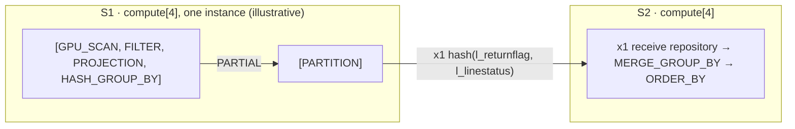

# From plan to pipelines

In Sirius, a **pipeline** runs a sequence of GPU operators on a batch. **Lowering** chooses
those operators and connects the pipelines. Today Sirius builds them from its internal operator
tree. The proposed API would also accept an explicit plan in which the host has already specified
which workers exchange rows. The Q2 example below shows where that saves a wait.

## What the engine runs today

The engine executes **pipelines**. A pipeline is an ordered list of operators: the first is its
source, the last its sink. A task runs one pipeline over one input: it calls `execute()` on every
operator in order, then the sink's `sink()`.

A sink pushes its output into a **repository** (a `cucascade::shared_data_repository`), and the
next pipeline's source pulls from it. Each repository sits behind a **port** on the consuming
operator: `default` for most inputs, `build` for a hash join's build side. A port's **barrier** determines when its consumer can run.
A `FULL` barrier waits for the producer to finish. `PARTIAL` allows the consumer to process
batches as they arrive. `PIPELINE` needs no synchronization between individual operators.
Operators declare this per input in `input_barrier_for`. [Operator implementation](https://github.com/sirius-db/sirius/blob/ef7eb2951a370f4293784549bc05fc46c7cc64f6/src/op/sirius_physical_operator.cpp)

Scheduling is pull-based. The task creator asks an operator for `get_next_task_hint()`, which
answers `READY` or `WAITING_FOR_INPUT_DATA` and, when waiting, names the producer to schedule
first. Tasks reserve GPU memory before they run, and the downgrade executor can move idle batches
from repositories to host memory or disk (see [Memory](06-memory.md)).

### How today's operator tree gets its shape

For a query on one machine, `insert_gpu_pipeline_operators` adds operators that distribute
work across the process's GPUs. It puts a partition and merge after a partial aggregate, and a
partition and concatenation below each hash-join input. Windows need all rows of a group on one
GPU. Sorts need samples, range partitions and a merge. Top-N needs a final merge of the local
candidates. With one process per GPU, a second pass inserts exchanges between ranks.
[Local planner](https://github.com/sirius-db/sirius/blob/ef7eb2951a370f4293784549bc05fc46c7cc64f6/src/planner/sirius_physical_plan_generator.cpp) · [Distributed planner](https://github.com/sirius-db/sirius/blob/ef7eb2951a370f4293784549bc05fc46c7cc64f6/src/planner/distributed_plan.cpp)

Then `mark_fusable_merge_pipelines` decides which merges fold into their downstream pipeline. The
pipeline construction pass in `src/pipeline/` cuts the tree into pipelines, wires the
repositories, hands every `PARTITION` consumer the admitted GPU ids, and orders the pipelines
leaf first.

In pipeline notation, `[A, B, C]` is one pipeline and an arrow is a repository labelled with its
barrier. A grouped aggregation today (illustrative):

```text
[GPU_SCAN, FILTER, PROJECTION, HASH_GROUP_BY] -FULL-> [PARTITION] -FULL-> [MERGE_GROUP_BY, RESULT_COLLECTOR]
```

`PARTITION` sits behind a `FULL` barrier because it measures its complete input before it picks a
partition count and a placement. The explicit plan makes that choice, so the barrier relaxes (see
the [worked example](#worked-example-q2-stage-s1)).

## What lowering receives

Under the proposal, `prepare` checks the plan and bindings and resolves worker-local
properties marked `auto`. Each process lowers the stage instances for its workers. This view
of Q2 shows the **two** stages that run on `compute#2`. The file list and the receive partition
belong to this worker. [Q2, plan A](../part-3/02-aggregation.md)

```text
Plan "q2_pricing_summary" (instance compute#2)
worker sets: head[1], compute[4]
Stage S1 instance compute#2
ExchangeSink x1 hash(l_returnflag, l_linestatus)  partitions->workers {0:#0, 1:#1, 2:#2, 3:#3}
└─ Aggregate partial keys=[l_returnflag, l_linestatus] ...
   └─ Project ...
      └─ Filter l_shipdate <= 1998-09-02
         └─ Scan lineitem ...  files=[2, 6, 10, ..., 254] (64 of 256)
Stage S2 instance compute#2
ExchangeSink x2 gather order=merge[l_returnflag asc, l_linestatus asc] -> [head#0]
└─ Sort [l_returnflag asc, l_linestatus asc]
   └─ Aggregate final keys=[l_returnflag, l_linestatus]
      └─ ExchangeSource x1 partition=2/4 <- senders=[compute#0..3]
```

## The lowering rules

1. **Barriers.** A blocking input across pipelines needs `FULL`. A streaming input can use
   `PARTIAL`. For example, a join must finish its build before it can probe the hash table. A hash
   exchange with a fixed partition count can route its first batch immediately. An ordered limit
   needs a way to identify the first rows in order. [Node input contracts](../reference/node-catalog.md)
2. **Pipeline ends.** A partial aggregate, local top-N, sort, window input, join build, ordered
   limit, exchange sink or output can end a pipeline. Each arm of a union supplies a distinct
   input. An in-process exchange can use a single-operator `PARTITION` pipeline.
3. **Pipeline starts.** A scan, named input, values node or exchange source can supply the first
   batch. A downstream pipeline can also start by reading a preceding pipeline's repository.
4. **Merge fusion.** A grouped final aggregate or final top-N can run in a downstream pipeline
   when the intervening operators stream through one input and its sink supports fusion. A sort
   is such a sink. This saves a task launch and a trip through a repository.
5. **Scheduling.** Schedule ready build pipelines early so that optional filters can reach scans
   while there is still work to prune. A required value gates its consumers. An optional filter
   follows the wait policy on its apply node.
6. **Values.** A typed channel carries a filter, statistic or decision. A consumer waiting for a
   required value yields its task-creator slot. When the value arrives, the channel schedules
   the consumer again. [Value delivery](03-runtime-values-in-the-engine.md)
7. **Queues.** Data crossing a pipeline boundary waits in a repository. Exchange queues must
   distinguish the destination streams, even when several logical workers share a device.
   Idle batches can spill.
8. **Tasks.** A task runs a pipeline on an input. If a partition has a resident hash table, its
   probe tasks must run on the GPU that holds it.

## Worked example: Q2 stage S1

Apply the rules to S1 on `compute#2`:

- `Scan` starts a pipeline (rule 3). `Filter` and `Project` stream, so they stay in it.
- `Aggregate partial` ends it (rule 2).
- `ExchangeSink x1` starts the next pipeline (rule 3) and ends it (rule 2). In a single-process
  binding that is a single-node `PARTITION` pipeline.
- The sink's input is streaming, so the edge between the two pipelines is `PARTIAL` (rule 1).



The barrier in front of `PARTITION` has relaxed from today's `FULL` to `PARTIAL`. The plan fixes
the partitions, so there is nothing to measure, and partial states move as soon as they exist. The
engine may still collect several small batches before sending them.

`HASH_GROUP_BY` aggregates each batch on its own, so one worker can emit several state rows for the
same group. The contract of `Aggregate partial` in the
[node catalog](../reference/node-catalog.md#aggregate) allows this, and the final aggregate merges
them. Accumulating states across batches inside the worker, so that fewer rows reach the sink, is
an engine optimization.

If the plan said `partitions=<~d2`, a partition count chosen at run time, the sink would need the
Decision `d2` before it could route anything. That is a required value, so by lowering rule 6 the
`PARTITION` task waits on the value channel. Its input waits in the router's spillable input
repository, because no destination is known yet. The barrier is still `PARTIAL`: waiting for a
value is not waiting for complete input.

On S2, `ExchangeSource x1` is the source and `Aggregate final` has a blocking input, so the edge
from x1's receive repository is `FULL`. The final aggregate's downstream path to the `Sort` is
unary, so by lowering rule 4 `MERGE_GROUP_BY` fuses into the sort's pipeline.

## Lowering a `Window`

For whole, ranking and running windows, Sirius places `PARTITION` and `CONCAT` below
`WINDOW`. With partition keys it hashes rows so that every group stays together. Without keys
the whole input is one group. `CONCAT` gathers a complete local partition for a window task.

```text
[GPU_SCAN, FILTER] -FULL-> [PARTITION] -PARTIAL-> [CONCAT] -FULL-> [WINDOW, ...]
```

Local partition sizing uses measured input bytes. If an explicit exchange already supplied complete
window groups, the engine could reuse those partitions. In either case, a window task must fit
its local table and results in GPU memory, within cuDF's row limit. Hashing again cannot divide
one oversized group. The planner checks supported functions and types, including floating-point
running minima and maxima. [Window planner](https://github.com/sirius-db/sirius/blob/ef7eb2951a370f4293784549bc05fc46c7cc64f6/src/planner/sirius_plan_window.cpp) · [Floating-point support](https://github.com/sirius-db/sirius/pull/2542)

## Many stage instances, one process

On a four-GPU machine, a process can host all four instances of Q2's first stage. It could use
one pipeline graph with device-pinned tasks, or a graph per stage instance. Two workers bound to
the same GPU still own distinct logical streams.

## What lowering never does

The host specifies the exchange mode, partitioning, ordering, runtime filters and any decision that
changes what another worker receives. Validation checks whether the resulting plan meets each
node's input requirements. An engine unable to implement a valid operation reports `unsupported`
during the capability check. A missing exchange that makes a join invalid is a plan error.

Within a worker the engine still chooses scheduling, batching and local subpartitioning. For a
worker-local property exposed in the API, such as the build side of a co-partitioned join,
`prepare` resolves `auto` and checks explicit choices. [Worker-local choices](../part-2/01-everything-in-the-plan.md#inside-one-worker)

