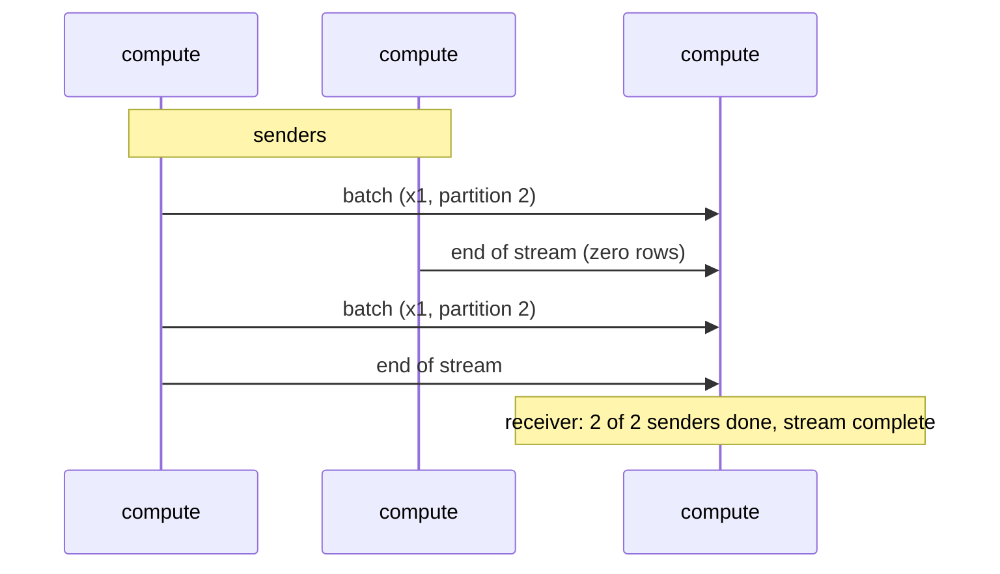

# Exchanges in the engine

For `Exchange x1 hash(l_orderkey) -> compute[4]`, each sender hashes the order key and
routes the batch fragments to their owners. Each receiver collects its fragments from every
sender. The same plan may use a repository for local delivery and the network for remote delivery.

## Transport follows the endpoint pair

A binding places one worker on a (process, GPU) endpoint. For each pair of workers, the
engine can pick a transport that serves their endpoints.

| Endpoints | Current mechanism |
|---|---|
| Same process and GPU | A repository passes batches between pipelines. |
| Same process, different GPUs | `PARTITION` routes batches. The consumer can copy a batch onto its own device. |
| Different processes | `EXCHANGE_SINK` and `EXCHANGE_SOURCE` send frames over NIXL with a UCX backend. The current distributed path runs one process per GPU and supports hash, range, broadcast and gather. |

Q7's `compute#0` can send to `compute#1` on the same host and to `compute#2` across the network. Its
gather to `head#0` can use a local repository if both workers share an endpoint. This combination of
logical bindings is proposed. The merged distributed SQL implementation derives its exchanges from
the single-GPU operator tree. [Distributed execution](https://github.com/sirius-db/sirius/pull/2337)
· [Q7 bindings](../part-3/07-a-multi-stage-query.md)

## The sender half: one router per mode

In-process routing uses `partition_spec`. The proposed exchange modes map to these mechanisms:

| Exchange mode | Sender-side lowering |
|---|---|
| `hash` | `partition_mode::hash`, with the key casts that `HashScheme::v1` canonicalization requires |
| `broadcast` | `partition_mode::broadcast`: output 0 keeps the original batch, the others get copies |
| `gather` | `partition_mode::single` to the one receiver |
| `forward` | Worker *i* hands batches to its own downstream instance. Device-local routing suffices only if it identifies that same logical worker. |
| `range` | `SORT_PARTITION`, reading its splitters from a `Boundaries` value |
| `round_robin` | An even split within a process. Routing it across processes would need an additional exchange mode. |
| `decided_by` | A router whose mode is set when the Decision arrives ([Adaptivity in the engine](04-adaptivity-in-the-engine.md)); new everywhere |

These operators supply routing primitives. The proposed hash scheme and logical worker identities would still need implementation.

A range router may sort its input first, route each sorted run by the splitters, and merge the runs
on the receiver. The plan fixes which interval each key falls in, ties included, so every receiver
gets the same rows either way.

The current distributed ordered gather buffers batches until all senders finish, then emits them by
rank and batch number. This suffices after a range sort when ranks own successive intervals. The
proposed `gather order=merge` must also support sorted streams with overlapping key ranges. It needs
a merge on the sort keys. [Exchange
source](https://github.com/sirius-db/sirius/blob/ef7eb2951a370f4293784549bc05fc46c7cc64f6/src/op/sirius_physical_exchange_source.cpp)

`HashScheme::v1` would define how each key is represented before hashing, along with the hash
function and seed. For example, two senders hashing a decimal must use the same width and scale.
Today's in-process `PARTITION` has key casts. Matching the proposed scheme would require agreement
on every supported key type. [Hash canonicalization](../reference/extension-points.md#hash-canonicalization-in-v1)

By default partition *p* belongs to worker *p mod |W|*. In Q4 with 16 partitions on four
workers, `compute#2` receives partitions 2, 6, 10 and 14 from both sides of the join.
It can run those partitions as separate tasks. A hash exchange using `assigned_by` instead
follows the recorded partition map. The two sides must agree on the mapping in either case.
[Partitioned join](../part-3/04-partitioned-join-and-runtime-filters.md)

## The seed rule

The engine often splits a worker's input further, for example to keep a join's hash table within
GPU memory. This **local sub-partitioning** is engine-owned, with one rule: its hash seed must
differ from the one `HashScheme::v1` uses.

Every row that reaches `compute#2` through x1 has `h(key) mod 4 = 2`. If the engine splits those
rows into eight local partitions with the same hash `h`, a row can only land in local partition
`h(key) mod 8`, which is 2 or 6. Six local partitions stay empty, leaving the other two to hold the
entire input. A different seed avoids reusing those same low bits. Repeated copies of a heavy key
will still land together.

The distributed SQL engine already uses different seeds for the cross-rank exchange and the rank's
local `PARTITION`. [Exchange
operators](https://github.com/sirius-db/sirius/blob/ef7eb2951a370f4293784549bc05fc46c7cc64f6/docs/super-sirius/distributed-sirius.md)

## The receiver half: repositories are the queues

In-process streaming provides one model for the proposed queues. A `STREAMING_SINK` can expose a
repository per destination. Its matching `batch_stream` tracks which senders have closed. When empty
it can distinguish a temporary wait from end of stream. Idle batches in repositories are eligible to
spill. [Streaming
sessions](https://github.com/sirius-db/sirius/blob/ef7eb2951a370f4293784549bc05fc46c7cc64f6/docs/super-sirius/streaming-sessions.md)

Between ranks the current transport uses fixed receive rings. Each peer owns a share of the frames.
A receiver returns a credit after copying data out of a frame, and a backlog can stop a sender. The
normal queued-send limit is 1 GiB. Batches waiting for an ordered gather or for a stream to attach
can occupy GPU memory outside the spillable repositories. [Distributed transport
limits](https://github.com/sirius-db/sirius/blob/ef7eb2951a370f4293784549bc05fc46c7cc64f6/docs/super-sirius/distributed-sirius.md#limits)

The proposal gives each logical stream credits and spillable queues. A batch waiting for network
credit would remain in a send repository. A batch waiting for a routing decision belongs earlier, in
the router's input repository, because its destination is still unknown. [Transport
buffers](06-memory.md#transport-buffers) · [Credit
waits](08-running-at-scale.md#credits-and-deadlock-freedom)

## The protocol

In the proposal, a stream is identified by the execution id, edge id, sender and receiver. Each
sender closes its stream with an end-of-stream message, including a sender with no rows for that
destination. A receiver can send a close upstream as soon as it no longer needs rows. Failures
propagate along both data and value edges. [Exchange
protocol](../part-2/03-exchanges.md#the-exchange-protocol) · [Message keys and
retries](07-failure-cancellation-and-recovery.md#every-message-has-a-key)

A receiver with two senders, one of which sends nothing:

The distributed SQL engine implements the cross-process half with credit-based one-sided writes.
A sender writes each packed batch straight into the receiver's receive ring, and the batch is
unpacked on arrival. Each sender numbers its batches, and its end of stream carries the batch
count, so a receiver can tell a complete stream from one with a gap. A query that fails sends an
abort to every process.

These are transport details below the plan.

## Agreement before the first byte

The current distributed engine all-gathers a hash of its internal plan shape before execution.
The proposed API adds two checks at `start`. For a closed plan, peers compare the execution id,
plan fingerprint and bindings digest. For an open plan, peers compare the signatures of the
exchange and value edges they share before using them. A mismatch reports `binding_mismatch`.
With only neighbor handshakes, success on one edge says nothing about a remote edge. A
query-wide start barrier for open plans would require participation by the host or another
agreement protocol. [Edge signatures](../reference/node-catalog.md#exchangesink-and-exchangesource-pairs)

## The logical edge and its physical shape

For an exchange, [the ownership rule](../part-2/01-everything-in-the-plan.md#the-ownership-rule)
splits as follows:

| The plan owns the logical edge | The engine owns the physical shape |
|---|---|
| Mode, keys, hash scheme and partition count | Transport, chunking and compression |
| Null routing and durability | Flow control, credits and connection pooling; where a spool lives |
| Target set, sender set and ordered destinations | Direct delivery or forwarding through an intermediate worker; multicast or relay broadcast; two-level shuffles, within a host over NVLink first and then over the network |
| For a value edge: kind, merge rule and wait policy | Tree, ring or via-host reduction of a value merge |

Every entry on the right leaves each receiver with the same rows, so none appears in the plan text.
A two-level shuffle still delivers partition *p* to its assigned worker, however many links the
bytes cross. A relay broadcast, forwarded through one GPU per host, still leaves every worker with
every row. A forwarded message keeps its original logical ids, so the receiver still counts end of
stream per sender from the plan's sender set.

Pre-aggregating partial states per host before they cross the network is not a physical shape,
because it changes the rows each receiver gets. The front-end writes it into the plan as an explicit
`Aggregate combine` ([Everything in the
plan](../part-2/01-everything-in-the-plan.md#the-logical-edge-and-its-physical-shape)).

Where the plan says `arbitrary`, the engine chooses, so results are deterministic only up to the
nondeterminism SQL already allows ([Where the plan says
`arbitrary`](../part-2/01-everything-in-the-plan.md#where-the-plan-says-arbitrary)).
