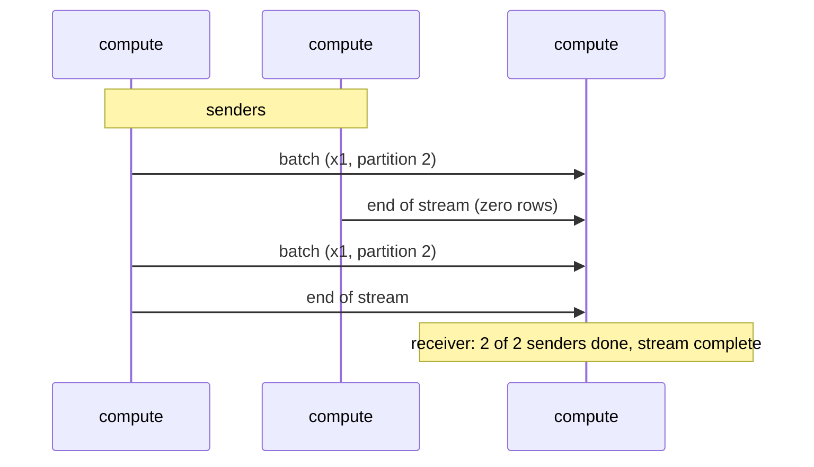

# Exchanges in the engine

For `Exchange x1 hash(l_orderkey) -> compute[4]`, each sender hashes the order key and
routes the batch fragments to their owners. Each receiver collects its fragments from every
sender. The same plan may use a repository for local delivery and the network for remote delivery.

## Transport follows the endpoint pair

A binding places one worker on a (process, GPU) endpoint. For each pair of workers, the
engine can pick a transport that serves their endpoints.

| Endpoints | Current mechanism |
|---|---|
| Same process and GPU | A repository passes batches between pipelines. |
| Same process, different GPUs | `PARTITION` routes batches. The consumer can copy a batch onto its own device. |
| Different processes | `EXCHANGE_SINK` and `EXCHANGE_SOURCE` send frames over NIXL with a UCX backend. The current distributed path runs one process per GPU and supports hash, range, broadcast and gather. |

Q7's `compute#0` can send to `compute#1` on the same host and to `compute#2` across the
network. Its gather to `head#0` can use a local repository if both workers share an endpoint.
This combination of logical bindings is proposed. The merged distributed SQL implementation
derives its exchanges from the single-GPU operator tree. [Distributed execution](https://github.com/sirius-db/sirius/pull/2337) · [Q7 bindings](../part-3/07-a-multi-stage-query.md)

## The sender half: one router per mode

In-process routing uses `partition_spec`. The proposed exchange modes map to these mechanisms:

| Exchange mode | Sender-side lowering |
|---|---|
| `hash` | `partition_mode::hash`, with the key casts that `HashScheme::v1` canonicalization requires |
| `broadcast` | `partition_mode::broadcast`: output 0 keeps the original batch, the others get copies |
| `gather` | `partition_mode::single` to the one receiver |
| `forward` | Worker *i* hands batches to its own downstream instance. Device-local routing suffices only if it identifies that same logical worker. |
| `range` | `SORT_PARTITION`, reading its splitters from a `Boundaries` value |
| `round_robin` | An even split within a process. Routing it across processes would need an additional exchange mode. |
| `decided_by` | A router whose mode is set when the Decision arrives ([Adaptivity in the engine](04-adaptivity-in-the-engine.md)); new everywhere |

These operators supply routing primitives. The proposed hash scheme and logical worker identities would still need implementation.

A range router may sort its input first, route each sorted run by the splitters, and merge the runs
on the receiver. The plan fixes which interval each key falls in, ties included, so every receiver
gets the same rows either way.

Inside one process, `gather order=by_worker` lowers onto the batch positions the engine already
carries from `MERGE_SORT` to the result collector. Streams that leave a process carry no positions
today, so across processes the receiver of an ordered gather restores the order itself: it reads
its senders in worker order or merges on the sort keys.

**Hash keys are canonical.** `HashScheme::v1` fixes the function, the seed and the canonical form
each key type hashes in: signed integers as `int64`, unsigned as `uint64`, decimals in their
scale-preserving 128-bit form ([Hash canonicalization in
v1](../reference/extension-points.md#hash-canonicalization-in-v1)). Today `key_cast_types` makes an
`int32` key and an `int64` key hash identically. In the plan both keys of a join pair have the same
type, so there are no two widths to reconcile.

The in-process `PARTITION` and streaming sink each
hashes with murmur3 and `cudf::DEFAULT_HASH_SEED`, through `cudf::hash_partition` or an
order-preserving equivalent (`src/op/partition/gpu_partition_impl.cpp`). The streaming sink's
default key casts are narrower than v1's: it widens integers to `int64`, casts decimal keys to
`float64`, and refuses date, timestamp and float keys.

**By default, partition p goes to worker p mod |W|.** An assigned hash exchange instead uses its explicit partition map. With `Partitions::fixed(16)` on `compute[4]`, worker 2
owns partitions 2, 6, 10 and 14. This is today's default placement,
`partition_placement::round_robin(P, gpu_ids)`, which puts partition *p* on
`active_gpu_ids[p % n]`. Today that list is the query's admitted GPU set. In the explicit plan it
is the worker set, and the bindings map workers to devices.

Take a variant of Q4's join with sixteen partitions on both sides. The count is part of the
signature, so co-partitioned sides must use the same one (V8):

```cpp
#include <sirius/sirius.hpp>
using namespace sirius;

Result<Relation> partitioned_inputs(const Relation& lineitem_side, const Relation& orders_side,
                                    const WorkerSet& compute) {
  SIRIUS_TRY(partitions, Partitions::fixed(16));
  SIRIUS_TRY(left, lineitem_side.exchange(
      Exchange::hash({"l_orderkey"}, compute, partitions, HashScheme::v1())));
  SIRIUS_TRY(right, orders_side.exchange(
      Exchange::hash({"o_orderkey"}, compute, partitions, HashScheme::v1())));
  SIRIUS_TRY(on, JoinOn::keys({{"l_orderkey", "o_orderkey"}}));
  return left.join(right, JoinType::inner, std::move(on), JoinOptions::defaults());
}
```

```rust
use sirius::prelude::*;

fn partitioned_inputs(lineitem_side: &Relation, orders_side: &Relation,
                      compute: &WorkerSet) -> Result<Relation, PlanError> {
    let partitions = Partitions::fixed(16)?;
    let left = lineitem_side.exchange(
        &Exchange::hash(&["l_orderkey"], compute, partitions.clone(), HashScheme::v1()))?;
    let right = orders_side.exchange(
        &Exchange::hash(&["o_orderkey"], compute, partitions, HashScheme::v1()))?;
    let on = JoinOn::keys(&[("l_orderkey", "o_orderkey")])?;
    left.join(&right, JoinType::Inner, on, JoinOptions::default())
}
```

The instance for `compute#2` then reads:

```text
Stage S3 instance compute#2
ExchangeSink x3 gather -> [head#0]
└─ Aggregate keys=[o_orderkey, o_orderdate] measures=[revenue = sum(rev)]
   └─ Project [o_orderkey, o_orderdate, rev = l_extendedprice * (1 - l_discount)]
      └─ Join inner keys=[l_orderkey == o_orderkey] build=right  mode=co_partitioned(x1, x2)
         ├─ ExchangeSource x1 partitions=[2, 6, 10, 14] (4 of 16) <- senders=[compute#0..3]
         └─ ExchangeSource x2 partitions=[2, 6, 10, 14] (4 of 16) <- senders=[compute#0..3]
```

Within the worker, the engine may run those four partitions as four tasks, one task, or anything in
between. Local scheduling stays out of the plan.

Today `PARTITION` asks its consumer for a layout at run time: how many partitions, broadcast or
hash, and on which GPUs. With explicit exchanges the plan and the bindings answer all three.

## The seed rule

The engine often splits a worker's input further, for example to keep a join's hash table within
GPU memory. This **local sub-partitioning** is engine-owned, with one rule: its hash seed must
differ from the one `HashScheme::v1` uses.

Every row that reaches `compute#2` through x1 has `h(key) mod 4 = 2`. If the engine splits those
rows into eight local partitions with the same hash `h`, a row can only land in local partition
`h(key) mod 8`, which is 2 or 6. Six local partitions stay empty, and the other two are each four
times as large as planned. A different seed avoids reusing those same low bits. Repeated copies of a heavy key will still land together.

The distributed SQL engine already uses different seeds for the cross-rank exchange and
the rank's local `PARTITION`. [Exchange operators](https://github.com/sirius-db/sirius/blob/ef7eb2951a370f4293784549bc05fc46c7cc64f6/docs/super-sirius/distributed-sirius.md)

## The receiver half: repositories are the queues

A receiver needs a queue per incoming stream and a way to know when the stream is over. The engine
has both. `STREAMING_SINK` can expose N output streams, one per destination, each backed by its own
repository. `STREAMING_SOURCE` wraps an `exec::batch_stream`, constructed with the set of senders
it expects:

```cpp
// src/exec/batch_stream.hpp (today, abridged)
class batch_stream {
 public:
  enum class availability { HAS_DATA, WAITING, END_OF_STREAM };
  // push(batch) stores in the repository, then fires on_data.
  // close(sender) records one sender's end of stream; a repeat is idempotent.
};
```

The design rule in `docs/super-sirius/streaming-sessions.md` is "the repository is the queue". A
repository is a thread-safe queue of batches, and the downgrade executor sweeps it for spill
candidates. A slow receiver's backlog accumulates in its own repository, where it can spill to host
memory or disk without blocking the other receivers. Batches cross the boundary in whatever tier
they sit in, so a queued batch stays spillable until it is consumed.

The explicit plan reuses this unchanged. Every exchange gets one send repository per destination
stream and one receive repository per incoming stream (rule 7 of
[the lowering rules](01-from-plan-to-pipelines.md#the-lowering-rules)). A router still waiting for
its Decision or Boundaries value keeps its rows in its own input repository.

Inside a process there is no channel-level backpressure: a backlog spills instead (see
[Memory](06-memory.md#no-backpressure-inside-a-process-by-design)).

Between processes, staging buffers are finite, so the transport uses receiver credits: a receiver
grants a sender room for a bounded amount of data, and the sender moves no more than that.

- **In the distributed SQL engine**, each receiver has a registered receive ring, and every peer holds a fixed
  share of its credits. A queued send cannot spill, and a sender blocks once it has 1 GiB queued.
- **In the design**, a batch that has no credit yet waits in its send repository, which can spill.
  The ring itself is registered memory and cannot spill
  ([Transport buffers](06-memory.md#transport-buffers)).

The proposal grants credits per logical stream. The engine must also make progress on control messages and spills while streams wait
([Credits and deadlock freedom](08-running-at-scale.md#credits-and-deadlock-freedom)).

## The protocol

The engine carries out [the exchange protocol](../part-2/03-exchanges.md#the-exchange-protocol):
streams addressed by logical ids, end of stream from every sender, close traveling upstream, and
any failure failing the whole execution. Three of these differ between today's engine and the
explicit plan:

- **Addressing.** A stream is addressed by four logical ids: execution id, exchange id, sender
  worker, receiver worker. Today output streams are paired with input streams by position, in the
  routing table of whoever embeds the engine. In the explicit plan the exchange id pairs them, and
  it is part of the plan. Each message adds the sender's attempt, a reserved epoch and a sequence
  number
  ([Every message has a key](07-failure-cancellation-and-recovery.md#every-message-has-a-key)).
  The wire never mentions endpoints; the transport looks them up in the bindings.
- **End of stream.** Every sender sends end of stream to every receiver, even after zero rows;
  duplicates are harmless. Today `batch_stream` reaches `END_OF_STREAM` only after every declared
  sender has closed, and a repeated close from one sender cannot end it early. In the explicit plan
  the set of declared senders is the plan's sender set.
- **Failure.** Today a failed stream is poisoned (`fail_output`), and a parked consumer is woken
  so it can rethrow. In the explicit plan the failure travels along the plan's edges in both
  directions
  ([Fail-stop, along the edges](07-failure-cancellation-and-recovery.md#fail-stop-along-the-edges)).
  A peer that never answers the handshake fails the edge with `transport` at the first-contact
  deadline.

A receiver with two senders, one of which sends nothing:



The distributed SQL engine implements the cross-process half with credit-based one-sided writes.
A sender writes each packed batch straight into the receiver's receive ring, and the batch is
unpacked on arrival. Each sender numbers its batches, and its end of stream carries the batch
count, so a receiver can tell a complete stream from one with a gap. A query that fails sends an
abort to every process.

These are transport details below the plan.

## Agreement before the first byte

The current distributed engine all-gathers a hash of its internal plan shape before execution.
The proposed API adds two checks at `start`. For a closed plan, peers compare the execution id,
plan fingerprint and bindings digest. For an open plan, peers compare the signatures of the
exchange and value edges they share before using them. A mismatch reports `binding_mismatch`.
With only neighbor handshakes, success on one edge says nothing about a remote edge. A
query-wide start barrier for open plans would require participation by the host or another
agreement protocol. [Edge signatures](../reference/node-catalog.md#exchangesink-and-exchangesource-pairs)

## The logical edge and its physical shape

For an exchange, [the ownership rule](../part-2/01-everything-in-the-plan.md#the-ownership-rule)
splits as follows:

| The plan owns the logical edge | The engine owns the physical shape |
|---|---|
| Mode, keys, hash scheme and partition count | Transport, chunking and compression |
| Null routing and durability | Flow control, credits and connection pooling; where a spool lives |
| Target set, sender set and ordered destinations | Direct delivery or forwarding through an intermediate worker; multicast or relay broadcast; two-level shuffles, within a host over NVLink first and then over the network |
| For a value edge: kind, merge rule and wait policy | Tree, ring or via-host reduction of a value merge |

Every entry on the right leaves each receiver with the same rows, so none appears in the plan text.
A two-level shuffle still delivers partition *p* to worker *p mod |W|*; it only changes which links
carry the bytes. A relay broadcast, forwarded through one GPU per host, still leaves every worker
with every row. A forwarded message keeps its original logical ids, so the receiver still counts
end of stream per sender from the plan's sender set.

Pre-aggregating partial states per host before they cross the network is not a physical shape,
because it changes the rows each receiver gets. The front-end writes it into the plan as an explicit
`Aggregate combine` ([Everything in the
plan](../part-2/01-everything-in-the-plan.md#the-logical-edge-and-its-physical-shape)).

Where the plan says `arbitrary`, the engine chooses, so results are deterministic only up to the
nondeterminism SQL already allows ([Where the plan says
`arbitrary`](../part-2/01-everything-in-the-plan.md#where-the-plan-says-arbitrary)).
