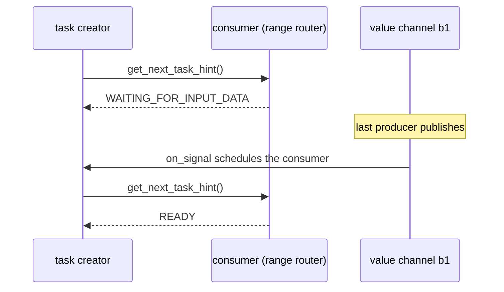

# Runtime values in the engine

A runtime filter can arrive after a scan has started. A hash router waiting for a partition count
has no such freedom. The proposed value channel serves both cases. Only a `Filter` is optional. A
consumer that depends on any other value kind must wait for it. [Value
kinds](../part-2/05-runtime-filters.md#data-edges-and-value-edges)

## Today's filter channel

A scan and a hash join can share a `sirius_dynamic_filter_set`. The planner follows a probe
key to a scan or inserts a filter operator. It registers the join's right to publish, then
freezes registration before execution. Each producer ends once, with `PUBLISHED`, `SKIPPED`,
`FAILED` or `CANCELLED`. The set becomes terminal after every producer ends.

At each checkpoint the scan takes a snapshot. A late filter can prune subsequent batches. A filter
built from an incomplete key set could discard a matching row, so an abandoned build must skip
publication. [Filter
implementation](https://github.com/sirius-db/sirius/blob/ef7eb2951a370f4293784549bc05fc46c7cc64f6/src/op/dynamic_filter/sirius_dynamic_filter.hpp)

## A typed channel per value

Under the proposal each execution creates a typed channel for each `ValueId`. The plan names
its producers and consumers. `prepare` can wire their dependencies, but the pending values,
snapshots and completion state belong to one execution. Otherwise a second run could read a
filter or decision left by the first.

## From one filter to its engine parts

In Q7, each orders worker builds `f2` before its hash exchange. The workers merge those
partial filters into `f3`, and the lineitem scans wait up to 20 ms for it. The abbreviated
plan shows the build and probe inputs of the join. [Q7 builder and full plan](../part-3/07-a-multi-stage-query.md)

```text
Plan "q7_shipping_priority" (joined)
worker sets: head[1], compute[4]
values:
  f3 = ValueExchange merge f2 -> compute[4]
...
└─ Join inner keys=[l_orderkey == o_orderkey] build=right  mode=co_partitioned(x1, x3)
   ├─ Exchange x1 hash(l_orderkey) -> compute[4]
   │  └─ Project [l_orderkey, rev = l_extendedprice * (1 - l_discount)]
   │     └─ RuntimeFilterApply [l_orderkey] <~ f3  wait=up_to(20ms)
   │        └─ Filter l_shipdate > 1995-03-15
   │           └─ Scan lineitem ...
   └─ Exchange x3 hash(o_orderkey) -> compute[4]
      └─ RuntimeFilterBuild keys=[o_orderkey] spec=bloom(fixed 8MiB)  scope=partial ~> f2
         └─ Project [o_orderkey, o_orderdate, o_shippriority]
            └─ ...
```

### RuntimeFilterBuild: the path follows the position

Today a hash join can publish its filter three ways, and conditions checked inside the join pick
one. In the explicit plan, the position of the `RuntimeFilterBuild` node picks the path:

| Input of the build node | Scope | Engine path | Today's mechanism |
|---|---|---|---|
| `replicated`, or on a size-1 set | `global` | Whole build: the complete input is on this worker | `observe_whole_build`, for a build that arrives as one delivery (single-partition and broadcast builds) |
| `hashed` on exactly the filter keys | `partition(xK)` | Accumulation over this worker's partitions | `hash_join_partition_observer` accumulates a Bloom filter inside the build-side `PARTITION` (`try_begin_accumulation`, `contribute`, `publish_if_final`) |
| Anything else (`arbitrary`) | `partial` | A pass-through accumulating stage | `BUILD_FILTER`, a separate stage for right semi and right anti joins that accumulates from the build input and passes every batch through unchanged |

In the full Q7 plan, `f1` sits above a broadcast exchange, so it is a whole-build filter: global,
with no merge. `f2` sits below x3 on arbitrary rows, so each `compute` worker runs a pass-through
stage. The stage adds every batch's keys to its partial Bloom filter and publishes when its local
input ends.

### ValueExchange: today's root-GPU merge, generalized

The engine already merges partial filters within one process. During multi-partition
accumulation, each GPU builds a partial Bloom array. The current task's GPU acts as the root: it
pulls the other partials in chunks, ORs them into its array, and copies the union to every replica
GPU.

The OR is valid because every partial shares one `accumulated_bloom_geometry` (in
`src/op/dynamic_filter/complete_build_inventory.hpp`). It is sized before any insert, from the
certified total build row count.

The distributed SQL engine already all-gathers partial Bloom arrays and combines them with bitwise
OR. A missing contribution can disable publication for the query. [Cross-rank filter
merge](https://github.com/sirius-db/sirius/blob/ef7eb2951a370f4293784549bc05fc46c7cc64f6/docs/super-sirius/distributed-sirius.md#dynamic-filters-across-ranks)

The root-GPU merge is a `ValueExchange merge` among the workers of one process. The explicit plan
makes two changes:

- **The geometry comes from the plan.** A certified row count is local to one process, so the plan
  states the geometry and V13 checks that every partial agrees
  ([Filter specs and geometry agreement](../part-2/05-runtime-filters.md#filter-specs-and-geometry-agreement)).
- **The merge is a small collective over the exchange transport**, using the merge rule of the
  filter's kind. The merged filter is published only if every partial was
  ([Merging to global](../part-2/05-runtime-filters.md#merging-to-global)).

Bloom OR gives the same bits in any merge order when the geometry and key hashing agree. The engine
chooses the shape: all-to-all, a tree, a ring, or one GPU per host as in today's root-GPU merge. See
[The logical edge and its physical
shape](../part-2/01-everything-in-the-plan.md#the-logical-edge-and-its-physical-shape) and [Value
merges at scale](08-running-at-scale.md#value-merges-all-to-all-in-the-plan-a-tree-on-the-wire).

The filter **kind** follows the same split. Today the publisher picks an in-list, a hashed in-list
or a Bloom filter at run time, from the build size and the probe GPU's L2 cache size. In the
explicit plan the spec fixes the kind of a filter that is merged across workers. The engine still
chooses among the allowed kinds for a filter that never leaves a worker
([Inside one worker](../part-2/01-everything-in-the-plan.md#inside-one-worker)).

### RuntimeFilterApply: a snapshot, or a short wait

Today the engine fuses a filter into the scan while it builds the operator tree.
`dynamic_filter_consumer` applies it at the reader's checkpoints, and a keep-ratio gate
(`dynamic_filter_gate`) turns it off when it removes too little. Where the scan cannot take the
filter, it becomes a `DYNAMIC_FILTER` operator.

In the explicit plan the fusion is the `push_filters_into_scans` rewrite from
[Plan-to-plan rewrites](05-plan-to-plan-rewrites.md), so it shows in the plan. Lowering maps a
fused apply to the scan's consumer and an unfused one to `DYNAMIC_FILTER`.

With `wait=never`, the consumer takes a snapshot at each checkpoint, as today. With
`wait=up_to(20ms)`, the scan's first task answers `WAITING_FOR_INPUT_DATA` until `f3` reaches a
terminal state or 20 milliseconds pass, then proceeds with the snapshot it has. A bounded wait
never fails the execution: if the filter never arrives, the scan runs unfiltered.

When no value arrives, a timer in the task creator must re-nominate the scan by firing the same
hook as an arriving value (next section). The task creator in `src/creator/` has no timer today,
so bounded waits are engine work.

## Waiting without blocking: the on_signal hook

Consumers of required values have to wait: a range exchange cannot route a row without its
Boundaries, and a decided exchange cannot pick a mode without its Decision. Blocking in the
consumer could deadlock: the task creator nominates work from a small, bounded thread pool, and
the value may come from a task that only that pool can create.

Value consumers use the pattern `STREAMING_SOURCE` uses for batches arriving from outside. When
its stream is empty, the source answers `WAITING_FOR_INPUT_DATA` and its request is dropped. A
persistent `on_data` hook on the stream calls `task_creator::schedule` on the next push. For
values the hook is `on_signal`:



The task creator must register the hook before testing readiness, or use an equivalent
synchronized check. Otherwise the consumer can miss its only wakeup. While the value is pending,
input batches wait in a spillable repository.

## Boundaries instead of a pointer

Today's distributed sort samples its input in `SORT_SAMPLE`, which overrides its task hint to wait
for enough samples, then computes splitters. `SORT_PARTITION` reads the splitters through a raw
pointer installed with `set_sample_op`. When several ranks participate, a hook pools their samples.
The current sample and Bloom collectives can occupy a GPU worker thread while waiting for other
ranks. [Issue #2375](https://github.com/sirius-db/sirius/issues/2375)

Q6b (full sort) from [Sort, top-N and limit](../part-3/06-sort-top-n-and-limit.md) makes that edge
explicit:

```text
Plan "q6b_orders_sorted" (joined)
worker sets: head[1], compute[4]
values:
  s2 = ValueExchange merge s1 -> compute[4]
  b1 = ComputeBoundaries s2 -> compute[4]
Output "result" on head[1]
└─ Exchange x2 gather order=by_worker -> head[1]
   └─ Sort [o_orderdate asc, o_totalprice desc]
      └─ Exchange x1 range([o_orderdate asc, o_totalprice desc]) <~ b1 -> compute[4]
         └─ Observe key_sample([o_orderdate asc, o_totalprice desc], 1024/worker) ~> s1
            └─ Filter o_orderdate >= 1996-01-01 and o_orderdate < 1997-01-01
               └─ Scan orders [o_orderkey, o_orderdate, o_totalprice]  on compute[4]  shards=files_round_robin
```

The lowering splits today's operator pair along the edges:

- `Observe` becomes a pass-through sampler, the sampling half of `SORT_SAMPLE`. It never blocks and
  publishes its sample at its input's end of stream.
- `ValueExchange` pools the four samples, ordered by sender index so that arrival order cannot
  matter, and delivers the pool to every worker.
- `ComputeBoundaries` is a pure function from the pooled sample to three splitters, evaluated on
  each worker. A digest on each delivered `Boundaries` value checks that all workers computed the
  same splitters. A mismatch fails the execution with an `execution` error instead of routing rows
  to the wrong range (see
  [Why every worker picks the same label](../part-2/06-adaptive-plans.md#why-every-worker-picks-the-same-label)).
- The range `Exchange` lowers to `SORT_PARTITION`, which reads `b1` from its channel and waits for
  it through `on_signal`.

The same value could feed two range exchanges, and the report shows when it arrived.

## What the report shows

Every value node leaves a record in `ExecutionReport::values()`
([How a filter ends](../part-2/05-runtime-filters.md#how-a-filter-ends)). For Q7, a filter's
pruned rows per worker and its arrival time relative to its consumers show whether
`wait=up_to(20ms)` paid off. Decisions also appear in `decisions()`; see
[Adaptivity in the engine](04-adaptivity-in-the-engine.md).
