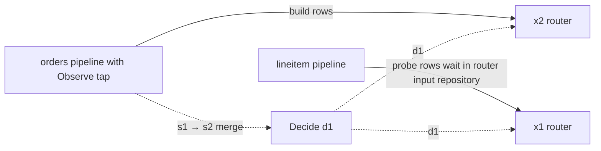

# Adaptivity in the engine

Today's in-process hash join measures its build input before choosing how to route rows
across GPUs. In the proposed Q5 plan, an `Observe` records build bytes and a `Decide` selects
broadcast or hash distribution. Workers can still choose how to execute their local joins.
[Adaptive join](../part-3/05-adaptive-join.md)

## How the engine adapts today

The `PARTITION` operators feeding a consumer share a `partition_exchange` that coordinates
their choice of layout. [Partition exchange implementation](https://github.com/sirius-db/sirius/blob/ef7eb2951a370f4293784549bc05fc46c7cc64f6/src/op/partition/partition_exchange.hpp)

One input is the **sizing input**, for a hash join its build side. A `FULL` barrier in front of
its `PARTITION` makes the input complete before the operator runs. The operator then calls
`choose_layouts` with the measured bytes and rows, which calls the consumer's
`get_partition_strategy`. For a hash join that is `compute_hash_join_partition_strategy` in
`src/op/sirius_physical_hash_join.hpp`, which decides four things at once:

- **Broadcast or hash.** The build is a broadcast candidate when it is below a small-table
  threshold, or when it is below `max_broadcast_join_size` and the probe side is estimated to be at
  least `num_gpus * 1.25` times larger. A candidate is replicated only if it also qualifies for
  `BUILD_PROBE`.
- **Partition count.** Otherwise the "natural" count is the measured bytes divided by a
  per-partition byte target, and at least the number of GPUs.
- **Join algorithm.** `BUILD_PROBE`, which builds one resident hash table per partition, when the
  table fits and the join type allows it; otherwise `STANDARD`.
- **Placement.** Which GPU each partition runs on.

The choice is applied atomically: the join changes its mode and resizes its port repositories.
Until then the non-sizing inputs wait, and `partition_exchange::hint` nominates the sizing input
first.

The problem is that a decision about where rows go lives inside an operator, where no other
process can see it.

## Where each decision goes

A decision that changes what each receiving worker gets belongs in the plan. Placement goes to the
bindings. The rest stays with the engine.

| Decided today by `compute_hash_join_partition_strategy` | Home in the explicit design |
|---|---|
| Broadcast or hash across GPUs | Exchange modes; adaptively, a `Decide` node and decided exchanges |
| Partition count across GPUs | Worker set size, `Partitions::fixed`, or `Partitions::decided_by` |
| `BUILD_PROBE` or `STANDARD` | Engine-owned: a local algorithm on one worker |
| Partition count inside one GPU, for memory | Engine-owned: local sub-partitioning |
| Placement on GPUs | Bindings, plus "partition p goes to worker p mod \|W\|" |

Partition count appears twice because today's count does two jobs. It **routes**: partition *p*
runs on one GPU, so the count decides which GPU sees which rows. It also **bounds partition size**:
a merge or join task processes one whole partition, which is why the count derives from a
per-partition byte target. `MERGE_GROUP_BY` raises it further so that an average partition holds at
most 2^30 rows; a cuDF column must hold fewer than 2^31.

The explicit design separates the two. Every sender must agree on how many pieces the *exchange*
produces, so that count is in the plan. How finely one worker slices its own share to fit in memory
concerns no other worker, so it stays with the engine.

The engine then no longer bounds a worker's share: it is whatever the plan routes there. Local
operators must handle a share larger than GPU memory
([Out-of-core local operators](06-memory.md#out-of-core-local-operators)).

## Lowering Observe and Decide

Q5 uses four workers. Each has orders and lineitem rows, but only the filtered orders count
toward the broadcast threshold. [Q5 builder and plan](../part-3/05-adaptive-join.md)

1. **`Observe bytes ~> s1`** is a tap on the orders pipeline. It counts the logical bytes that pass
   on this worker and publishes at the input's end of stream. It replaces the measurement in
   `partition_input_stats` at today's sizing `PARTITION`, but it never blocks: the build rows flow
   on to x2's router, which has no mode yet, and wait in its input repository.
2. **`s2 = ValueExchange merge s1`** sums the four per-worker counts and delivers the total to
   every worker of `compute[4]`. Inside one process this is a sum over local channels. Across
   processes it is the small value collective from
   [Runtime values in the engine](03-runtime-values-in-the-engine.md), which the engine may reduce
   as a tree.
3. **`d1 = Decide threshold(...)`** is a pure function from `s2` to a label. Each worker evaluates
   it where `choose_layouts` runs today: when a router of a decided exchange first needs a mode.
4. **The decided exchanges** lower to routers whose mode is unset until `d1` arrives. Both wait on
   the value channel through `on_signal`, so no thread blocks. Under `broadcast`, x2's router
   becomes `partition_mode::broadcast` and x1's router becomes a forward, which inside one process
   means each probe batch stays on its logical worker. Under `partitioned`, both
   routers become `partition_mode::hash`.

Inside one worker:



### The lineitem side waits, and that is fine

`d1` is unknown until the orders side finishes, but the lineitem scan does not wait for it. Its
batches queue in x1's router input repository, which can spill.

Today's non-sizing inputs wait behind the sizing input the same way. The reason for the wait is now
a dotted edge in the plan instead of a flag inside `partition_exchange`.

### Every worker computes the same label

Today each shared `partition_exchange` resolves its layout once, under a mutex, inside one process.
Across processes there is no shared object to lock. Each worker instead evaluates `Decide` locally,
from the same merged `s2`, with the same pure rule. There is no coordinator and no round trip
beyond the merge. This is why V15 requires the input of a `Decide` to be global on every set it
controls.

The merged `s2` must be identical bit for bit on every worker, whatever engine or encoding each
one uses. That is why `Observe` counts logical bytes, computed from Arrow type widths and never
from encoded, compressed or device bytes.
[Why every worker picks the same label](../part-2/06-adaptive-plans.md#why-every-worker-picks-the-same-label)
gives the full rules. Label digests on every decided exchange check the result at run time, and a
mismatch fails the execution with an `execution` error.

When a decision needs one place to happen, for example a timeout, the plan can
[decide on a leader](../part-2/06-adaptive-plans.md#deciding-on-a-leader) instead. The label digest
guards that decision too.

## What the report records

The report records the label in `ExecutionReport::decisions()` and in `resolved_plan()` (see
[After the run](../part-2/06-adaptive-plans.md#after-the-run-decisions-and-the-resolved-plan)):

```cpp
SIRIUS_TRY(prepared, context.prepare(plan, Bindings::local()));
SIRIUS_TRY(result, std::move(prepared).collect());
std::cout << result.report.resolved_plan().explain();
```

```rust
let prepared = context.prepare(&plan, Bindings::local())?;
let result = prepared.collect()?;
println!("{}", result.report.resolved_plan().explain(&ExplainOptions::default()));
```

On a day with few orders, the join and its inputs in the resolved plan read:

```text
Join inner keys=[l_orderkey == o_orderkey] build=right  mode=broadcast_build
├─ Exchange x1 forward -> compute[4]
│  └─ Scan lineitem [l_orderkey, l_extendedprice, l_discount]  on compute[4]  shards=files_round_robin
└─ Exchange x2 broadcast -> compute[4]
   └─ Observe bytes ~> s1
      └─ Filter o_orderdate == 1995-03-15
         └─ Scan orders [o_orderkey, o_orderdate]  on compute[4]  shards=files_round_robin
```

Today this information exists only in logs. Diff the resolved plans of two runs to see which
choice changed.

## Deciding the partition count

Q5's variant decides the partition count instead of the mode:
`d2 = Decide partition_count(s2.bytes, target=1GiB, min=4, max=64)`, used as `partitions=<~d2` on
both x1 and x2. The rule is ceil(bytes / target), clamped to the range. That is today's "natural"
count, with the per-partition byte target as `target` and the GPU count as `min`. It only routes
([Where each decision goes](#where-each-decision-goes)).

Both sides must use the same Decision (V20), or matching keys would land in different partitions.
Today the shared `partition_exchange` enforces that inside one process by binding the build and
probe routers to one decision. V20 checks it across processes.

## Lowering Choose

Today's engine has no counterpart to
[`Choose`](../part-2/06-adaptive-plans.md#choosing-between-subtrees): the pipeline graph is built
once, from one operator tree. Lowering a `Choose` reuses the pieces that decided exchanges need.
The linked section builds one for Q2 (pricing summary).

- **Every arm is built.** The pipelines, ports, exchange sinks and exchange sources of every arm
  exist from `prepare`, so handshakes and admission do not depend on the label.
- **A stage of the losing arms waits, then closes.** Its pipelines depend on the Decision's value
  channel, as a decided router does. When the label names another arm, the stage instance sends end
  of stream on every exchange it feeds and ends `closed`, without scheduling a task.
- **A shared stage drops the losing pipelines.** In a stage that holds nodes of several arms, the
  shared nodes run as usual and their output ports buffer, in spillable memory, until the label
  arrives. Then the engine connects the chosen arm's pipelines to those ports, and the other arms'
  sinks send end of stream with no rows.
- **Nothing runs on empty input.** A losing arm is never run on zero rows to make it finish,
  because an ungrouped aggregate would turn zero rows into one.
- **Every exchange inside an arm carries the label digest**, like a decided exchange, so a worker
  that ran the wrong arm fails the execution instead of mixing rows from two arms.

The `Decide` itself lowers as above, evaluated where its input is global. For Q2 that is `head#0`,
which delivers the label to `compute[4]` through a one-sender `ValueExchange`.

## What does not map one to one

Today's broadcast rule also looks at the probe-to-build ratio and the estimated hash table size.
`Decision::threshold` looks at one merged statistic. A richer pure policy, for example one that
compares two statistics, is a possible extension, related to open questions
[11 (`Choose` limits and richer policies)](../reference/open-questions.md#11-choose-limits-and-richer-policies) and
[12 (decision determinism)](../reference/open-questions.md#12-decision-determinism-and-replay).

`BUILD_PROBE` versus `STANDARD` stays an engine choice, made on each worker from what that worker
holds. Whether the report should also list engine-owned choices is part of
[open question 19](../reference/open-questions.md#19-the-implicit-boundary).

Adaptivity weakens the join's output distribution to the meet of the alternatives, `arbitrary`, so
Q5 needs a two-phase aggregation above the join
([The other cost: a weaker distribution](../part-2/06-adaptive-plans.md#the-other-cost-a-weaker-distribution)).
The hash-distributed arm alone can sometimes aggregate locally. Adding a broadcast alternative can therefore add a shuffle even on a run that ultimately chooses hash.
