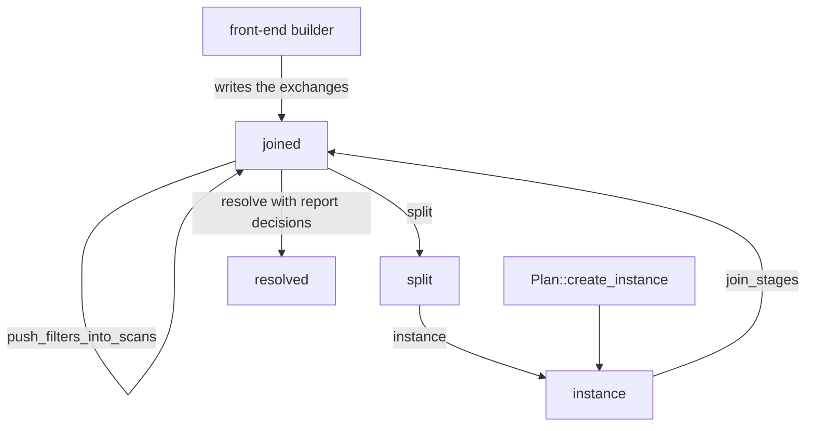

# Plan-to-plan rewrites

A plan rewrite takes an immutable plan and returns another plan that you can print or
validate. For example, a pushdown rewrite can add a pruning hint to a scan while leaving the
exact filter above it. The host chooses which rewrites run before `prepare`.

Sirius already rewrites its internal operator tree, both within a process and across ranks. The
proposed API would expose selected transformations on the public plan. A host could then inspect the
resulting exchanges and filters before executing them. [Current distributed
planner](https://github.com/sirius-db/sirius/blob/ef7eb2951a370f4293784549bc05fc46c7cc64f6/src/planner/distributed_plan.cpp)

## The rewrites at a glance

| Rewrite | From | To | Touches exchanges? | Today's counterpart |
|---|---|---|---|---|
| `split` | joined | split | Turns each `Exchange` into a sink/source pair, same id | None: stage boundaries are declared by hand |
| `instance` | split | instance | No | None |
| `join_stages` | stage or instance plans | joined | Turns sink/source pairs back into `Exchange` nodes | None |
| `resolve` | joined with decisions | resolved | Replaces each decided exchange with its chosen alternative | None: the choice is only logged |
| `push_filters_into_scans` | any form | same form | No | Filter pushdown into the scan, and the scan's shared filter consumer |
| `insert_runtime_filters` | any form | same form | Adds `ValueExchange` nodes where scope requires | `trace_probe_key` and `place_endpoint` during operator-tree construction |
| `collapse` | any form | same form | Elides `forward` exchanges on size-1 sets | None |

Every rewrite takes a plan by reference and returns `Result<Plan>`. Its output passes V1-V20, V24
and V26-V28, so a rewrite cannot produce a plan you could not have written by hand.

The public node view exposes node kinds and data edges. A host can add nodes above a relation
it finds this way, but it cannot yet read every parameter needed to rebuild a node with a new
input. That limits which custom rewrites the proposed interface can express.
[Node view](../reference/api-at-a-glance.md#node-view)

Call rewrites before `prepare`. Preparation resolves worker-local `auto` values in the submitted
plan. Peers with closed plans compare the fingerprints of the submitted plans at start. For open plans
the handshake checks shared edges. [Preparing a plan](../part-1/06-prepare-and-execute.md#preparing-a-plan)

## Today's multi-GPU wrapping moves to the front-end

Today the engine's `wrap_*` passes add the multi-GPU operators to [its operator
tree](01-from-plan-to-pipelines.md#how-todays-operator-tree-gets-its-shape) around grouped
aggregations, hash-join inputs, sorts, top-N and, with `wrap_ungrouped_aggregate`, ungrouped
aggregates. `build_window_exchange` does the same under each window. The passes are a small planner.
They place routing operators around the computation. On a single machine the partition consumer can
choose the partition count and broadcast policy at run time.

In the proposal the host chooses the distribution and writes the exchanges into the plan. The
library checks their compatibility with the operators that consume them. Whether to offer a helper
for single-machine placement remains open.

StarRocks, Axiom and Spark already plan distribution. The proposed DuckDB adapter would translate
its optimized plan into `Exchange` nodes for `compute[N]`, as in [the Q5 worked
plan](../part-4/01-duckdb-extension.md#a-worked-plan-q5-on-four-local-gpus).

A front-end's planner can read the node requirements to place exchanges, as DataFusion's physical
optimizer and the datafusion-distributed library do
([Related designs](../appendix/related-designs.md#datafusion-distributed)). Whether the property
model gains equivalence classes is
[open question 27](../reference/open-questions.md#27-requirements-as-data-and-equivalence-properties).

For Q2 on four GPUs, a host can place the two exchanges explicitly. First it moves
partial states to the worker for each group. After final aggregation it gathers sorted rows for
the result. [Q2 input, keys and measures](../part-3/02-aggregation.md)

```cpp
SIRIUS_TRY(partial, priced.aggregate_partial(keys, measures));
SIRIUS_TRY(moved, partial.exchange(Exchange::hash(keys, compute)));
SIRIUS_TRY(totals, moved.aggregate_final());
SIRIUS_TRY(sorted, totals.sort(order));
SIRIUS_TRY(gathered, sorted.exchange(Exchange::gather(head, GatherOrder::merge(order))));
SIRIUS_TRY(plan, Plan::from_root(gathered));
std::cout << plan.explain();
```

```rust
let partial = priced.aggregate_partial(&keys, measures)?;
let moved = partial.exchange(&Exchange::hash(&keys, &compute, Partitions::one_per_worker(),
                                             HashScheme::v1()))?;
let totals = moved.aggregate_final()?;
let sorted = totals.sort(order.clone())?;
let gathered = sorted.exchange(&Exchange::gather(&head, GatherOrder::merge(order)))?;
let plan = Plan::from_root(&gathered, "result")?;
println!("{}", plan.explain(&ExplainOptions::default()));
```

```text
Plan "q2_pricing_summary" (joined)
worker sets: head[1], compute[4]
Output "result" on head[1]
└─ Exchange x2 gather order=merge[l_returnflag asc, l_linestatus asc] -> head[1]
   └─ Sort [l_returnflag asc, l_linestatus asc]
      └─ Aggregate final keys=[l_returnflag, l_linestatus]
         └─ Exchange x1 hash(l_returnflag, l_linestatus) -> compute[4]
            └─ Aggregate partial keys=[l_returnflag, l_linestatus]
               │  measures=[sum_qty = sum(l_quantity), sum_revenue = sum(revenue),
               │            avg_price = avg(l_extendedprice), count_order = count_star()]
               │  -> (l_returnflag string, l_linestatus string, sum_qty sum_state<decimal(38,2)>,
               │      sum_revenue sum_state<decimal(38,4)>, avg_price avg_state<decimal(15,2)>,
               │      count_order count_state)
               └─ Project [l_returnflag, l_linestatus, l_quantity, l_extendedprice,
                  │        revenue = l_extendedprice * (1 - l_discount)]
                  └─ Filter l_shipdate <= 1998-09-02
                     └─ Scan lineitem [l_returnflag, l_linestatus, l_quantity, l_extendedprice,
                                       l_discount, l_shipdate]  on compute[4]  shards=files_round_robin
```

Q2's hash exchange names the keys and the destination set. The proposed partial-state schema
lets the builder check that the final aggregate can read those states. The ordered gather merges
the sorted streams into one result. In a single process, the engine instead collects batches using
their recorded positions. In the distributed SQL engine, a gather sends results to rank 0.

A host could also express the existing in-process broadcast heuristic with a decision and two
exchange alternatives. Validation rejects incompatible join inputs. It cannot infer the cheapest
legal distribution or always name a unique repair. [Adaptive joins](04-adaptivity-in-the-engine.md)

One case is open. On one machine with several GPUs, every front-end would carry the policy the
`wrap_*` passes hold today. A small Sirius helper could turn a single-worker plan into one on
`compute[N]` bound to one process. It would work only from node requirements, with every policy
choice supplied by the caller or left as a `Decide`, and would not grow into a planner for many
machines. The helper is
[open question 36](../reference/open-questions.md#36-a-distribution-helper-for-one-machine).

Pre-aggregation per host belongs to the plan too (see [The logical edge and its physical
shape](../part-2/01-everything-in-the-plan.md#the-logical-edge-and-its-physical-shape)).
Combining the partial states of one host's workers before they cross the network changes the rows
each receiving worker gets. The front-end therefore writes it as an `Aggregate combine` and an
extra exchange; the engine never does it on its own while carrying out x1.

## split, instance and join_stages: the forms

`split` cuts a joined plan at every `Exchange`, and `instance` fills in one worker's splits,
partitions and senders
([Split form and instance form](../part-2/04-stages-and-bindings.md#split-form-and-instance-form)).
A host can also author an instance plan with `Plan::create_instance`. It has the same form and
notation as the output of `rewrite::instance`, except that its hosting set may be unsized
([Instance plans](../part-2/04-stages-and-bindings.md#instance-plans)).

`join_stages` goes the other way. Given separately authored stage or instance plans, it groups
them by hosting set, matches sinks to sources by exchange id and value sinks to value sources by
value id, and returns the joined plan. A host that does its own scheduling uses it to print and
compare its instance plans as one program
([Under someone else's scheduler: StarRocks](../part-4/02-starrocks.md)).

Its contract:

- It needs one instance per worker of each set it recovers, with indices 0 to n-1. An unsized set
  takes its size from the number of instances supplied.
- Every sink must find its sources, and the edge signatures must agree.
- The result must pass V1-V20, V24 and V26-V28.

These three rewrites change the view, not what runs. Running `join_stages` over the instances of
a split plan gives back an equivalent joined plan.

## push_filters_into_scans: pushdown made visible

Today a table scan can take filters, and its reader uses them to skip row groups and rows. The
engine also fuses runtime filters into the scan
([RuntimeFilterApply](03-runtime-values-in-the-engine.md#runtimefilterapply-a-snapshot-or-a-short-wait)).
The proposed plan would show both the pruning hint and the filter consumer.

`push_filters_into_scans` does the same work as a rewrite. The lineitem side of Q7 before:

```text
Join inner keys=[l_orderkey == o_orderkey] build=right  mode=co_partitioned(x1, x3)
├─ Exchange x1 hash(l_orderkey) -> compute[4]
│  └─ Project [l_orderkey, rev = l_extendedprice * (1 - l_discount)]
│     └─ RuntimeFilterApply [l_orderkey] <~ f3  wait=up_to(20ms)
│        └─ Filter l_shipdate > 1995-03-15
│           └─ Scan lineitem [l_orderkey, l_extendedprice, l_discount, l_shipdate]
│                            on compute[4]  shards=files_round_robin
└─ Exchange x3 hash(o_orderkey) -> compute[4]
   └─ ...
```

and after:

```text
Join inner keys=[l_orderkey == o_orderkey] build=right  mode=co_partitioned(x1, x3)
├─ Exchange x1 hash(l_orderkey) -> compute[4]
│  └─ Project [l_orderkey, rev = l_extendedprice * (1 - l_discount)]
│     └─ Filter l_shipdate > 1995-03-15
│        └─ Scan lineitem [l_orderkey, l_extendedprice, l_discount, l_shipdate]
│                         on compute[4]  shards=files_round_robin
│                         pushed=l_shipdate > 1995-03-15
│                         fused=[RuntimeFilterApply [l_orderkey] <~ f3  wait=up_to(20ms)]
└─ Exchange x3 hash(o_orderkey) -> compute[4]
   └─ ...
```

Three details make the rewrite safe:

- The pushed predicate is a pruning hint. The `Filter` stays above the scan, so the plan is
  correct whether or not the reader skips anything.
- Moving the apply through this date comparison preserves its result. A rewrite over arbitrary predicates would also need to preserve observable errors and side effects.
- The fused apply keeps its value id and wait policy, so the value edge stays where it was. The
  scan prints it on a `fused=[...]` continuation line, next to `pushed=`.

Call it before you prepare:

```cpp
SIRIUS_TRY(pushed, rewrite::push_filters_into_scans(plan));
SIRIUS_TRY(prepared, context.prepare(pushed, Bindings::local()));
std::cout << prepared.plan().explain();   // the plan you built, with every auto resolved
```

```rust
let pushed = rewrite::push_filters_into_scans(&plan)?;
let prepared = context.prepare(&pushed, Bindings::local())?;
println!("{}", prepared.plan().explain(&ExplainOptions::default()));
```

## insert_runtime_filters: discovery as a rewrite

Today runtime filter discovery runs while the hash join operator is built. It checks whether the
build side filters anything, admits the join keys, and walks the probe side to a scan, or to an
endpoint it splices in when no scan can take the filter
([Today's filter channel](03-runtime-values-in-the-engine.md#todays-filter-channel)). The result
lives in the internal operator tree and publication state.

`rewrite::insert_runtime_filters(plan, policy)` does the same walk on the plan and writes the
result as nodes. The walk is narrower than today's: V18 lets a filter pass only key-preserving
nodes (`Filter`, a plain `Project`, and an `Exchange` of any mode, including a decided exchange).
The rewrite stops where today's walk would descend through a grouped aggregate, a join or a union.

Applied to Q4 (urgent March revenue) without filters, it produces the canonical Q4 from
[Partitioned join and runtime filters](../part-3/04-partitioned-join-and-runtime-filters.md):

```text
values:
  f2 = ValueExchange merge f1 -> compute[4]
...
└─ Join inner keys=[l_orderkey == o_orderkey] build=right  mode=co_partitioned(x1, x2)
   ├─ Exchange x1 hash(l_orderkey) -> compute[4]
   │  └─ RuntimeFilterApply [l_orderkey] <~ f2  wait=never
   │     └─ Scan lineitem [l_orderkey, l_extendedprice, l_discount]  on compute[4]  shards=files_round_robin
   └─ Exchange x2 hash(o_orderkey) -> compute[4]
      └─ RuntimeFilterBuild keys=[o_orderkey] spec=bloom(fixed 8MiB)  scope=partial ~> f1
         └─ Filter o_orderdate >= 1995-03-01 and o_orderdate < 1995-04-01 and o_orderpriority == "1-URGENT"
            └─ Scan orders [o_orderkey, o_orderdate, o_orderpriority]  on compute[4]  shards=files_round_robin
```

The rewrite places the build where its filter is useful, decides its scope, and adds a
`ValueExchange` when the scope is not global and the consumer is on another worker (V12, V16-V18).
For a key of a null-safe pair it builds the filter with `NullKeys::pass` (V18).

A host that already knows its filter edges can skip the rewrite and build the same nodes directly.

## resolve and collapse

`resolve` takes the decisions from a report and returns the resolved form, with every decided
exchange replaced by the alternative its Decision chose.

```cpp
SIRIUS_TRY(resolved, rewrite::resolve(q5, result.report.decisions()));
// equal to result.report.resolved_plan() for Q5, which has no assignments or dynamic scans
```

```rust
let resolved = rewrite::resolve(&q5, result.report.decisions())?;
// equal to result.report.resolved_plan() for Q5, which has no assignments or dynamic scans
```

A resolved plan is executable. Running it pins the choice, which helps to reproduce a run or to
compare the broadcast and partitioned alternatives on the same data.

`collapse` makes a single-worker plan print compactly. On size-1 worker sets it elides `forward`
exchanges and turns merges over a single producer into identities.

## Forms and rewrites together



Every box is the same IR. Lowering consumes the instance form. Nothing in the engine produces a
plan outside this diagram.
