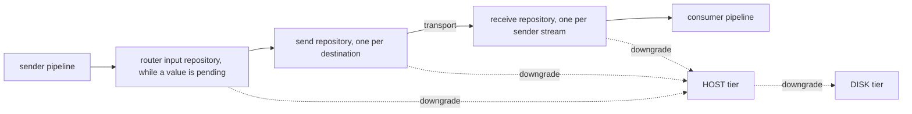

# Memory

A batch waiting for a slow receiver can leave GPU memory. A hash table that a running
join needs may have to stay. This distinction matters when a plan sends most of a table to
one worker. The engine can spill every queued batch and still fail to fit the join's working set.

The proposal keeps memory limits in engine configuration and execution options. An exchange
specifies what a worker receives. The engine decides where the batches wait.

## Tiers, spaces and configuration

The engine manages memory with cuCascade in three tiers:

| Tier | Backed by | Role |
|---|---|---|
| GPU | One asynchronous memory pool per device | Active data, used by pipeline tasks |
| HOST | NUMA-local pinned host memory, shared by the GPUs on that NUMA node | First downgrade target, and staging for transfers |
| DISK | Spill files under configured directories | Last resort under extreme pressure |

A `cucascade::memory::memory_space` represents one (tier, device) pair. Each space has a reservation
limit and two thresholds. When reserved memory crosses the *trigger* fraction, the engine moves
data down a tier until it reaches the *stop* fraction. The defaults are 0.8 and 0.6 for GPU memory
and 0.9 and 0.8 for host memory.

Host capacity defaults to a fraction of each backing NUMA node's RAM. Disk spilling requires a
configured spill directory. Here the explicit host limit is 25 GB per NUMA node. [Configuration
reference](https://github.com/sirius-db/sirius/blob/ef7eb2951a370f4293784549bc05fc46c7cc64f6/docs/super-sirius/configuration.md)

```yaml
sirius:
  memory:
    gpu:
      usage_limit_fraction: 0.95
      downgrade_trigger_fraction: 0.8
      downgrade_stop_fraction: 0.6
    host: { capacity_bytes: 25GB }
    disk: { downgrade_root_dirs: "/tmp/sirius_disk_memory" }
```

### Workers and memory spaces

A worker is bound to one endpoint. It uses that device's GPU memory space and the HOST space of the
device's NUMA node. Two things follow from the bindings, not from the plan:

- Within one engine, workers on GPUs of the same NUMA node can share a HOST space. On the cluster from the
  [running example](../part-3/00-running-example.md), if host A's two GPUs sit on one NUMA node,
  `compute#0` and `compute#1` spill into the same pinned host memory.
- Workers that share an endpoint share a GPU pool. `head#0` and `compute#0` both live on host A's
  GPU 0, so the final gather and a compute stage instance draw on the same reservations.

The same `compute[4]` plan can use four GPUs on one machine or two GPUs on each of two machines. The
binding changes both memory sharing and the cost of transfers.

A chunk loaded with `pin_table` already lives on a particular GPU. With fixed shards, the plan
assigns the chunk to a logical worker and the bindings later select that worker's GPU. The two
placements can disagree. How a scan should follow pinned data is [open question
34](../reference/open-questions.md#34-scans-over-gpu-resident-data).

## Reservations and retries

The executor estimates a task's peak GPU memory from earlier tasks in its pipeline. It weights
peak-to-estimate ratios more heavily for tasks of similar size and accounts for bringing the
inputs onto the device. A request is capped at the most the GPU space can grant.

After a recoverable allocation failure, the executor can save intermediate data and the operator
index, release its locks and requeue the task for a fresh reservation. Some allocation failures
raise the task's reservation floor. The normal limit is 100 retries with a 50 ms backoff. After
exhaustion the query fails. These retries stay within one stage attempt. [GPU
executor](https://github.com/sirius-db/sirius/blob/ef7eb2951a370f4293784549bc05fc46c7cc64f6/src/pipeline/gpu_pipeline_executor.cpp)

## The downgrade executor

A memory monitor requests reclamation when a space crosses its trigger threshold. The GPU
executor can also request space for a waiting task. Reclamation can release unused staging
buffers and move idle batches from data repositories, followed by inputs of queued tasks. A
batch locked by a running task stays put.

The downgrade executor considers candidates in the source memory space. On GPU pressure it can try
host memory and then disk when configured. A later task that needs the data on a GPU must reserve
room to materialize it again. The design calls for cancellation checks during long spills.
[Downgrade
executor](https://github.com/sirius-db/sirius/blob/ef7eb2951a370f4293784549bc05fc46c7cc64f6/src/downgrade/downgrade_executor.cpp)

## Every place data waits is a repository

[Rule 7 of the lowering](01-from-plan-to-pipelines.md#the-lowering-rules) gives every
cross-pipeline edge and every exchange destination stream its own repository, and the downgrade
executor looks in every repository. That covers every place an explicit plan makes data wait:

| Why data waits | Where it waits | Example |
|---|---|---|
| A blocking input is not complete yet | The repository in front of the blocking node | Q7's join build input |
| A required value has not arrived | The consumer's input repository; for a decided or range exchange, the router's input repository | Q5's lineitem rows waiting for `d1`; Q6b's rows waiting for `b1` |
| A receiver consumes more slowly than a sender produces | That receiver's own send and receive repositories | Any hash exchange with skew |
| A live input produces faster than the plan consumes | The input channel's repository | A live `Input` channel, which comes later |
| A spooled exchange keeps its output for a retry | The sender's send repository, which is not emptied when its batches are sent | Q4 with `durability=spooled` |

The second row is the one an explicit plan adds. Rows queue in the router's input repository
because no destination is known until the value arrives; see
[The lineitem side waits](04-adaptivity-in-the-engine.md#where-the-lineitem-rows-wait).
The spool in the last row is an ordinary repository that stays full and moves down to host memory
and disk like any other
([Durability](07-failure-cancellation-and-recovery.md#durability-pipelined-or-spooled)).

The path of one exchange's bytes, illustrative:



## No backpressure inside a process, by design

Current in-process streaming channels can queue idle batches in spillable repositories.
A slow consumer can therefore create host or disk traffic. Device reservations, lower-tier capacity
and available spill space still limit how much the producer can get ahead.

The distributed SQL transport uses credits and fixed receive rings. Queued sends normally block
around the 1 GiB limit. Unordered batches already in a receive repository can spill, while early
arrivals, ordered-gather batches and batches for unattached streams can remain outside repositories.
The proposal would put more of this backlog in spillable send and receive repositories. The limit on
a host writing to a future live input is a separate API decision. [Exchange buffering
limits](https://github.com/sirius-db/sirius/issues/2376) · [Repository
backpressure](https://github.com/sirius-db/sirius/issues/1276) · [Public API
scope](https://github.com/sirius-db/sirius/issues/2461)

V1 checks waits the plan describes. Progress also depends on the transport returning credits,
control messages getting through, and the spill path running or reporting that storage is full.
[Credits and deadlock freedom](08-running-at-scale.md#credits-and-deadlock-freedom)

### Transport buffers

The credits stand for real memory. A network transport needs registered memory for its send and
receive buffers, so that the network card can read and write it directly. In the design the engine
carves that memory out of the budget it manages; the current NIXL transport allocates its rings
outside that budget. Either way it does not spill, because a registered buffer must stay where the
transport registered it.

With today's fixed allocation per peer, registered memory grows with the rank count. Dynamic credit
allocation is one proposed way to cap it. [Transport credit
allocation](https://github.com/sirius-db/sirius/issues/2371)

## Out-of-core local operators

Spilling handles data that waits, not data that an operator needs all at once. A hash join builds
a hash table over its whole build input, a sort orders its whole input, and today's `MERGE_SORT`
and `MERGE_GROUP_BY` concatenate a whole partition before they work on it. None of that fits if
the input is larger than GPU memory, and a cuDF column must hold fewer than 2^31 rows in any case.

Today the engine sizes partitions from measured bytes. This routes rows to GPUs and targets an average partition size
([Where each decision goes](04-adaptivity-in-the-engine.md#where-each-decision-goes)). In the
explicit plan the exchange's partition count only routes. With `Partitions::fixed(16)` on
`compute[4]`, each worker owns four partitions of whatever size the data has, and a skewed key can
send most of a table to one worker.

So the engine needs operators that bound their own working set, however the plan routed the rows:

- **Receive-side repartition.** A worker splits what it receives into local partitions sized to
  fit, by hashing the keys with its own seed
  ([The seed rule](02-exchanges-in-the-engine.md#the-seed-rule)). A final aggregate then finalizes
  one local partition at a time. A `Window` is evaluated the same way, but a window group is never
  split ([Lowering a `Window`](01-from-plan-to-pipelines.md#lowering-a-window)).
- **Grace hash join.** Both join inputs are repartitioned locally with the same local hash. The
  join builds and probes one pair of local partitions at a time, while the others wait spilled.
- **External sort.** A sort produces sorted runs that each fit in GPU memory and spills them.
- **Streaming k-way merge.** Sorted runs, or the sorted streams of a `gather order=merge`, merge a
  batch at a time instead of being concatenated first, so the output never has to exist as one
  column.

Local partitioning, sorted runs and chunked join builds already exist in Sirius. They do not give
every operator a bounded working set on arbitrary input. A single hot key, for example, stays
together under any hash seed. A plan that sends too much data to one such task can still exhaust
memory. [Distributed execution and chunked builds](https://github.com/sirius-db/sirius/pull/2337)

All four are local sub-partitioning and algorithm variants, which the engine owns. None changes
what a worker ends up with, so the engine uses them without changing the plan. If a node offers a
worker-local variant (none does yet), a plan may also name it or mark it `auto`, which prepare
resolves ([What lowering never does](01-from-plan-to-pipelines.md#what-lowering-never-does)).

## What cannot move

A few kinds of state are pinned to their GPU, and the plan can create them:

- **Bloom filter arrays.** Runtime filter arrays are raw device storage and are not spillable. A
  plan that asks for `BloomGeometry::fixed(8 << 20)` asks for 8 MiB on every worker that holds the
  filter, for the filter's lifetime. `sized_by` takes a `max_bytes` cap for this reason. Today the
  engine also caps Bloom bytes per GPU and skips the optional filter when the cap is hit.
- **Resident hash tables.** A join running in `BUILD_PROBE` mode keeps a hash table that is valid
  only on the GPU that built it. Every task of that partition must run on that GPU, so the
  partition's device is a correctness constraint.
- **Batches in use.** A batch stays locked while a task reads it
  ([The downgrade executor](#the-downgrade-executor)).
- **Transport buffers.** Registered memory never spills ([Transport buffers](#transport-buffers)).

Optional state degrades: a filter that cannot get its memory is skipped, and the results do not
change. Required state has no such escape.

## Seeing memory in the report

`ExecutionReport::spills()` lists what moved between tiers, alongside the per-stage and
per-exchange records:

```cpp
SIRIUS_TRY(result, std::move(prepared).collect());
std::cout << result.report.spills().size() << " spill records\n";
```

```rust
let result = prepared.collect()?;
println!("{} spill records", result.report.spills().len());
```

If a run spills more than you expect, look at the exchange or value that made data wait. A resolved
plan from [Plan-to-plan rewrites](05-plan-to-plan-rewrites.md) lets you rerun with that fixed
choice. To compare alternatives, prepare plans that select different choices.
