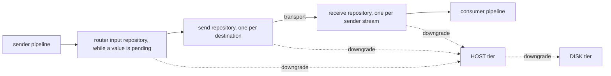

# Memory

Memory tiers and spilling belong to the engine
([Everything in the plan](../part-2/01-everything-in-the-plan.md)). A plan never names a memory
tier and never changes because a GPU is nearly full.

The plan's shape still decides *where data waits*: in front of a blocking input, behind a required
value, in an exchange queue whose receiver is slow. The engine has one rule for all of them:
**every place data waits is a repository, and every repository is spillable**. That is why
exchanges inside a process need no backpressure.

The plan also decides *how much* each worker must process, so the engine needs local operators
that work on more data than fits in GPU memory
([Out-of-core local operators](#out-of-core-local-operators)).

## Tiers, spaces and configuration

The engine manages memory with cuCascade in three tiers:

| Tier | Backed by | Role |
|---|---|---|
| GPU | One asynchronous memory pool per device | Active data, used by pipeline tasks |
| HOST | NUMA-local pinned host memory, shared by the GPUs on that NUMA node | First downgrade target, and staging for transfers |
| DISK | Spill files under configured directories | Last resort under extreme pressure |

A `cucascade::memory::memory_space` represents one (tier, device) pair. Each space has a reservation
limit and two thresholds. When reserved memory crosses the *trigger* fraction, the engine moves
data down a tier until it reaches the *stop* fraction. The defaults are 0.8 and 0.6 for GPU memory
and 0.9 and 0.8 for host memory.

The YAML file that `ContextConfigBuilder::from_yaml` reads sets all of this
([Configuration](../part-1/02-configuration.md)):

```yaml
sirius:
  memory:
    gpu:
      usage_limit_fraction: 0.95
      downgrade_trigger_fraction: 0.8
      downgrade_stop_fraction: 0.6
    host: { capacity_bytes: 25GB }
    disk: { disk_id: 0, capacity_bytes: 1000000000000, downgrade_root_dirs: "/tmp/sirius_disk_memory" }
```

```cpp
#include <sirius/sirius.hpp>
using namespace sirius;

Result<Context> create_context() {
  SIRIUS_TRY(builder, ContextConfigBuilder::from_yaml("sirius.yaml"));
  SIRIUS_TRY(config, builder.build());   // validates without touching hardware
  return Context::create(config);        // resolves devices and memory spaces
}
```

```rust
use sirius::prelude::*;

fn create_context() -> sirius::Result<Context> {
    let builder = ContextConfigBuilder::from_yaml("sirius.yaml")?;
    let config = builder.build()?;   // validates without touching hardware
    Ok(Context::try_new(&config)?)   // resolves devices and memory spaces
}
```

### Workers and memory spaces

A worker is bound to one endpoint. It uses that device's GPU memory space and the HOST space of the
device's NUMA node. Two things follow from the bindings, not from the plan:

- Workers on GPUs of the same NUMA node share one HOST space. On the cluster from the
  [running example](../part-3/00-running-example.md), if host A's two GPUs sit on one NUMA node,
  `compute#0` and `compute#1` spill into the same pinned host memory.
- Workers that share an endpoint share a GPU pool. `head#0` and `compute#0` both live on host A's
  GPU 0, so the final gather and a compute stage instance draw on the same reservations.

The plan text is the same whether `compute[4]` is bound to four GPUs of one machine or to two
hosts with two GPUs each. Only the memory each worker can use changes.

Data pinned in GPU memory with `pin_table` is the one place where memory and the plan can
disagree. A pinned chunk already lives on one GPU, but scan splits are assigned to workers when the
plan is built, and the bindings place those workers later. How a scan should follow pinned data is
[open question 34](../reference/open-questions.md#34-scans-over-gpu-resident-data).

## Reservations and retries

Before a GPU executor runs a task, its manager loop reserves memory for it. The size comes from
the pipeline's memory history, a small ring buffer of each past task's input size and observed
peak. The predicted peak is a weighted average of past tasks, with the most similar inputs
weighted highest. The request adds the bytes needed to bring the task's inputs onto its device,
such as a host-resident batch or a batch cloned from another GPU, and is clamped to the most the
space can ever grant.

Every allocation during execution is charged against that reservation. If it runs out, the
operator throws `oom_reschedule_exception`, which carries the partial results and the index of the
operator to resume from. The executor backs off for 50 milliseconds and reschedules the task, up
to 100 times. Each failure raises the recorded peak, so the next attempt reserves more. When the
retries are exhausted the query fails; the proposed API reports it as an `execution` error.

An explicit plan changes none of this. Reservations are per task, tasks are per pipeline, and
pipelines come from the lowering rules in [From plan to pipelines](01-from-plan-to-pipelines.md).

## The downgrade executor

Each memory space has a `downgrade_executor` in `src/downgrade/`. It frees memory by moving idle
batches to the next tier down. Two things drive it:

- A monitor thread watches each space. When usage crosses the trigger, it requests enough
  downgrades to reach the stop fraction.
- When a task's reservation comes up short, the GPU executor requests downgrades until that
  reservation can be made, so it spills only as much as the task needs.

Candidates are fetched in a fixed order:

1. **Data repositories first.** For each repository, idle GPU-resident batches are taken from the
   back of the queue, one at a time.
2. **Then the task queue.** Input batches of tasks that are queued but not yet running can move
   down too.

A batch that a task is reading is locked and never moves. A spilled batch moves back to the GPU when
a task needs it, and that task's reservation includes the cost. Spill copies are chunked, so a
large batch does not block in one transfer. Optional spill compression shrinks what lands on host
memory or disk.

In the design a spill is cancellable: the executor checks for cancellation between batches. Today
a query blocked on a spill is not cancelled promptly.

## Every place data waits is a repository

[Rule 7 of the lowering](01-from-plan-to-pipelines.md#the-lowering-rules) gives every
cross-pipeline edge and every exchange destination stream its own repository, and the downgrade
executor looks in every repository. That covers every place an explicit plan makes data wait:

| Why data waits | Where it waits | Example |
|---|---|---|
| A blocking input is not complete yet | The repository in front of the blocking node | Q7's join build input |
| A required value has not arrived | The consumer's input repository; for a decided or range exchange, the router's input repository | Q5's lineitem rows waiting for `d1`; Q6b's rows waiting for `b1` |
| A receiver consumes more slowly than a sender produces | That receiver's own send and receive repositories | Any hash exchange with skew |
| A live input produces faster than the plan consumes | The input channel's repository | A live `Input` channel, which comes later |
| A spooled exchange keeps its output for a retry | The sender's send repository, which is not emptied when its batches are sent | Q4 with `durability=spooled` |

The second row is the one an explicit plan adds. Rows queue in the router's input repository
because no destination is known until the value arrives; see
[The lineitem side waits](04-adaptivity-in-the-engine.md#the-lineitem-side-waits-and-that-is-fine).
The spool in the last row is an ordinary repository that stays full and moves down to host memory
and disk like any other
([Durability](07-failure-cancellation-and-recovery.md#durability-pipelined-or-spooled)).

The path of one exchange's bytes, illustrative:



## No backpressure inside a process, by design

Inside a process, the engine never slows a sender down when its receiver falls behind. It has no
"slow down" task hint and no channel-level backpressure: a backlog spills. The explicit plan keeps
that design for exchanges:

- **One slow receiver never holds up the others.** Each destination has its own send repository,
  so a sender keeps producing for every destination while one falls behind.
- **The limit is capacity, not speed.** If no lower tier can accept more data, tasks reschedule
  until memory frees up or their retries run out, and the execution fails with an `execution`
  error.

Between processes, staging buffers are finite, so transports use receiver credits
([The receiver half](02-exchanges-in-the-engine.md#the-receiver-half-repositories-are-the-queues)).
In the design, spilling is the buffer behind them. What a receiver accepts lands in a spillable
receive repository, and a batch that has no credit yet waits in its spillable send repository. A
slow link therefore throttles the transfer, and the pipeline that produced the batch keeps
running until the tiers below are full.

The prototype ([The protocol](02-exchanges-in-the-engine.md#the-protocol)) spills only what a
receiver has accepted: a queued send stays on the GPU, and a sender blocks once 1 GiB of sends is
queued.

This keeps flow-control vocabulary out of the plan. The trade-off is that a pathological skew
turns into disk traffic instead of a stall. Buffers are still bounded, so the waits a plan creates
could block each other. V1 checks that they cannot; see
[Credits and deadlock freedom](08-running-at-scale.md#credits-and-deadlock-freedom) and
[open question 5](../reference/open-questions.md#5-backpressure).

### Transport buffers

The credits stand for real memory. A network transport needs registered memory for its send and
receive buffers, so that the network card can read and write it directly. In the design the engine
carves that memory out of the budget it manages; the prototype allocates its rings outside that
budget. Either way it does not spill, because a registered buffer must stay where the transport
registered it.

Every peer needs its own share of credits, so the registered memory grows with the number of
peers. On a large cluster that is a significant share of the budget.

## Out-of-core local operators

Spilling handles data that waits, not data that an operator needs all at once. A hash join builds
a hash table over its whole build input, a sort orders its whole input, and today's `MERGE_SORT`
and `MERGE_GROUP_BY` concatenate a whole partition before they work on it. None of that fits if
the input is larger than GPU memory, and a cuDF column must hold fewer than 2^31 rows in any case.

Today the engine avoids the problem through its adaptive partition count, which both routes rows
to GPUs and bounds the average size of a partition
([Where each decision goes](04-adaptivity-in-the-engine.md#where-each-decision-goes)). In the
explicit plan the exchange's partition count only routes. With `Partitions::fixed(16)` on
`compute[4]`, each worker owns four partitions of whatever size the data has, and a skewed key can
send most of a table to one worker.

So the engine needs operators that bound their own working set, however the plan routed the rows:

- **Receive-side repartition.** A worker splits what it receives into local partitions sized to
  fit, by hashing the keys with its own seed
  ([The seed rule](02-exchanges-in-the-engine.md#the-seed-rule)). A final aggregate then finalizes
  one local partition at a time. A `Window` is evaluated the same way, but a window group is never
  split ([Lowering a `Window`](01-from-plan-to-pipelines.md#lowering-a-window)).
- **Grace hash join.** Both join inputs are repartitioned locally with the same local hash. The
  join builds and probes one pair of local partitions at a time, while the others wait spilled.
- **External sort.** A sort produces sorted runs that each fit in GPU memory and spills them.
- **Streaming k-way merge.** Sorted runs, or the sorted streams of a `gather order=merge`, merge a
  batch at a time instead of being concatenated first, so the output never has to exist as one
  column.

None of the four exists in the engine today. Without them, a correct plan can fail with an
out-of-memory `execution` error, because the plan chose how much data each worker holds.

All four are local sub-partitioning and algorithm variants, which the engine owns. None changes
what a worker ends up with, so the engine uses them without changing the plan. If a node offers a
worker-local variant (none does yet), a plan may also name it or mark it `auto`, which prepare
resolves ([What lowering never does](01-from-plan-to-pipelines.md#what-lowering-never-does)).

## What cannot move

A few kinds of state are pinned to their GPU, and the plan can create them:

- **Bloom filter arrays.** Runtime filter arrays are raw device storage and are not spillable. A
  plan that asks for `BloomGeometry::fixed(8 << 20)` asks for 8 MiB on every worker that holds the
  filter, for the filter's lifetime. `sized_by` takes a `max_bytes` cap for this reason. Today the
  engine also caps Bloom bytes per GPU and skips the optional filter when the cap is hit.
- **Resident hash tables.** A join running in `BUILD_PROBE` mode keeps a hash table that is valid
  only on the GPU that built it. Every task of that partition must run on that GPU, so the
  partition's device is a correctness constraint.
- **Batches in use.** A batch stays locked while a task reads it
  ([The downgrade executor](#the-downgrade-executor)).
- **Transport buffers.** Registered memory never spills ([Transport buffers](#transport-buffers)).

Optional state degrades: a filter that cannot get its memory is skipped, and the results do not
change. Required state has no such escape.

## Seeing memory in the report

`ExecutionReport::spills()` lists what moved between tiers, alongside the per-stage and
per-exchange records:

```cpp
SIRIUS_TRY(result, std::move(prepared).collect());
std::cout << result.report.spills().size() << " spill records\n";
```

```rust
let result = prepared.collect()?;
println!("{} spill records", result.report.spills().len());
```

If a run spills more than you expect, look at the exchange or value that made data wait. A
resolved plan from [Plan-to-plan rewrites](05-plan-to-plan-rewrites.md) lets you rerun with the
other alternative and compare.
