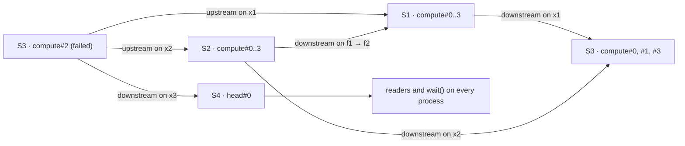

# Failure, cancellation and recovery

The distributed SQL engine generally aborts a failed query across ranks. When the transport loses a
peer, subsequent distributed queries can fail until all ranks restart. The proposed API would also
let a host retry an individual stage if its inputs remain available and the failed attempt has
exposed no irreversible output. [Current failure
handling](https://github.com/sirius-db/sirius/blob/ef7eb2951a370f4293784549bc05fc46c7cc64f6/docs/super-sirius/distributed-sirius.md#limits)
· [Lost-peer recovery](https://github.com/sirius-db/sirius/issues/2373)

## How an execution ends

An attempt has one outcome. A stage instance that succeeds on retry has two entries in the report, one for each attempt.

| Outcome | A stage instance | An execution | `wait()` returns |
|---|---|---|---|
| `succeeded` | Produced its full output, sent end of stream on every exchange it feeds, and ended every value edge it produces. | Every output was read to its end. | The report |
| `closed` | Stopped early because every receiver of its output closed, or never ran because it belongs only to arms of a `Choose` that were not chosen. It still sent end of stream and ended every value edge it produces. | The host closed every output before its end, by dropping its `BatchReader`. | The report |
| `failed` | Hit an error of its own. | Some instance failed and was not retried. | The originating error, such as `execution`, `source_mismatch`, `transport`, `binding_mismatch` or `runtime_unavailable` |
| `cancelled` | Stopped because the execution was cancelled, or because a failure elsewhere reached it. | `request_cancel()` was called, or the `Execution` was dropped. | A `cancelled` error |

The proposal defines the cases where all readers drain or all close early. The outcome for a mixture
of drained and early-closed readers still needs a rule.

In Q6c (any 100 orders), the final `Limit 100` on `head#0` closes `x1`
as soon as it has its rows. An S1 instance that was still scanning ends `closed`; one whose local
`Limit` had already produced its 100 rows ends `succeeded` (see
[How the plan stops work](../part-3/06-sort-top-n-and-limit.md#how-the-plan-stops-work)). A stage
of an arm that a [`Choose`](../part-2/06-adaptive-plans.md#choosing-between-subtrees) did not pick
waits for the label, then ends `closed` without reading anything.

Today's engine has the in-process half: an operator that has exhausted its limit lets its pipeline
finish early (`is_limit_exhausted()` in `src/op/sirius_physical_operator.hpp`).

If a single instance fails, the error names its worker and plan location. Instances stopped
by that failure end `cancelled`. If two ranks fail independently, each can observe a different
error first. The proposal still needs to say what a combined report or a reader returns in
that case. [Coordination and failure](../reference/open-questions.md#4-coordination-and-failure)

## Close is not end of stream

**Close** goes upstream, from a receiver to its senders: "I need nothing more from you." **End of
stream** goes downstream, from a sender to each receiver: "you have everything I will ever send
you."

A closed sender drops whatever it has not sent and still sends end of stream, because a receiver
is complete only after one end of stream from every sender in its sender set (see
[Exchanges](../part-2/03-exchanges.md#the-exchange-protocol)). A receiver that closed one input may
still be waiting on others.

Value consumers can outlive a stage's data consumers. A stage closing early must therefore
settle each value it promised.

| Value | What happens on early close |
|---|---|
| Filter | An incomplete build ends `skipped`. Its missing keys could otherwise cause the probe to discard matches. A missing share disables the merged filter. |
| Statistics | `Observe` publishes the prefix it saw, marked `truncated`. The merge retains that flag if any producer closed early. |
| Boundaries, Decision, Assignment | A consumer that still needs one of these values must receive a valid result or fail. |

A truncated count of zero cannot prove the build side of a mark join is empty. A consumer that
needs that fact must see a complete count or fail. [Mark join requirements](../part-2/03-exchanges.md#mark-joins-need-the-whole-build)

## Fail-stop, along the edges

Failure travels **along the plan's edges, in both directions**. It cannot go to a list of peers,
because an open plan has none: the StarRocks instance plan for `frag1#2` names `frag3[4]` as its
target, but has no list of every worker of the query (see
[Under someone else's scheduler: StarRocks](../part-4/02-starrocks.md)). The two directions:

- **Downstream**, on every exchange and value edge the failed instance sends on. A receiver that
  gets a failure message stops waiting for end of stream.
- **Upstream**, on every exchange and value edge the failed instance receives from, the way a
  close travels. A sender that gets a failure message stops producing.

When an unrecoverable failure reaches a worker, it cancels its local instances and forwards the
failure on their edges. In a connected plan with responsive peers this reaches the rest of the
execution.

Cancellation uses the same path: `request_cancel()` on any process starts the flood. A message
that arrives twice is ignored, so a host that also cancels every instance itself (the StarRocks
frontend does) does no harm. In the rare plan with parts that share no edge, a closed plan also
notifies every peer in its bindings; an open plan relies on its host.

Here is a failure of S3 on `compute#2` in Q4 (urgent March revenue) from
[Partitioned join and runtime filters](../part-3/04-partitioned-join-and-runtime-filters.md). Each
arrow is labelled with the edge that carries the failure:



A cancellation caused by this failure should preserve the original error, for example

```text
execution: stage S3 on compute#2 failed in Join inner keys=[l_orderkey == o_orderkey]:
out of memory after 100 reservation retries
```

A filter that fails degrades to absent and does not fail the execution. A required value that
fails or is skipped fails it with `execution` (see
[Optional and required values](../reference/node-catalog.md#optional-and-required-values)).

Today, inside one process, an error fails only the affected query: a failed stream is poisoned, and
the first failure wins (`exec::batch_stream::fail`, contracts P1-P4 in
`docs/super-sirius/streaming-sessions.md`). Cancellation is polled every 25 ms while a query runs,
but kernels already submitted are not preempted, and a query blocked on a memory reservation or a
spill is not cancelled promptly. The design makes spills cancellable
([Memory](06-memory.md#the-downgrade-executor)). In the distributed engine, a rank aborts a
numbered, attached query on its peers. Some failures before the query is attached can leave peers
waiting for a timeout.

### The first-contact deadline

A peer may never answer the handshake that every process runs at `start` (see
[Exchanges in the engine](02-exchanges-in-the-engine.md#agreement-before-the-first-byte)): its
process never started, it crashed before `start`, or the host declared more workers than it runs.
The receiver would then wait forever for an end of stream.

So every edge has a **first-contact deadline**. After `start`, each peer of the edge must answer the
handshake within it, or the edge fails with `transport`. It is a prepare option, because it
describes the deployment:

```cpp
auto options = PrepareOptions::defaults().with_first_contact_deadline(std::chrono::seconds(30));
SIRIUS_TRY(prepared, context.prepare_with(plan, std::move(bindings), std::move(options)));
```

```rust
let options = PrepareOptions::default().with_first_contact_deadline(std::time::Duration::from_secs(30));
let prepared = context.prepare_with(&plan, bindings, options)?;
```

The deadline is always finite; `PrepareOptions::defaults()` sets 60 seconds. It covers first
contact only. Whether a peer that answered is still alive later is the transport's business, and
whether that needs heartbeats is
[open question 4](../reference/open-questions.md#4-coordination-and-failure).

The typical case is a host whose plans disagree on a set size. Suppose the StarRocks frontend
builds the `frag3` instance plans for six lineitem senders (`frag1[6]`) but starts only five
`frag1` instances. Every edge signature that exists matches, so the handshake finds no
disagreement, and `frag3#2` never hears from `frag1#5`:

```text
transport: first-contact deadline (30s) expired on exchange x11: frag3#2 heard from 5 of 6
senders in frag1[6]; frag1#5 never answered
```

### When the device itself fails

A recoverable query error leaves the engine available. A fatal CUDA error or unconfirmed
cleanup of GPU work can latch the local engine until the process restarts. The proposed public
error is `runtime_unavailable`. Operations that require that engine fail. Building a plan can
still proceed without a context. [Context lifetime](../part-1/03-context-and-session.md#how-long-a-context-lives)

A host can fall back to its own engine for later queries. Replaying the **current** query needs a
separate check. The host may already have seen rows, or a write may already have taken effect. The
DuckDB extension checks these conditions before CPU replay. A peer reporting `runtime_unavailable`
should identify the affected worker, since the receiving process's own engine may still be healthy.
[Replay
admission](https://github.com/sirius-db/sirius/blob/ef7eb2951a370f4293784549bc05fc46c7cc64f6/src/transparent/replay_admission.hpp)

A retry after a fatal device error must account for the loss of that process and anything it held,
including spools. [Stage retry](#retrying-a-stage-instance)

## Every message has a key

[Exchanges](../part-2/03-exchanges.md#the-exchange-protocol) and
[Exchanges in the engine](02-exchanges-in-the-engine.md#the-protocol) address a **stream** by four
logical ids: the execution id, the edge id, the sender worker and the receiver worker. Recovery
has to name a message within a stream, so the full key adds an attempt, a reserved epoch and a
sequence number:

`(execution id, attempt, epoch, edge id, sender, receiver, sequence)`

| Field | Set by | What it is for |
|---|---|---|
| execution id | The host, once per execution | Keeps two executions apart, even of the same plan. |
| attempt | The engine; 0 unless the sending instance was retried | Tells a receiver which run of the sending instance produced the message. |
| epoch | Reserved, always 0 | Iteration and streaming later; see [Extension points](../reference/extension-points.md#reserved-now-epochs). |
| edge id | `Plan::create`, or the host in an open plan | Which exchange (`x1`) or value edge (`f2`). |
| sender, receiver | The plan | Which pair of workers, such as `compute#0` to `compute#2`. |
| sequence | The sender, counting from 0 per stream and attempt | Makes duplicates and gaps detectable. |

On a hash exchange, the batch from `compute#0` carrying partition 2 of `x1` might be keyed
`(E, 0, 0, x1, compute#0, compute#2, 17)`. End of stream carries a sequence number too, so a
receiver can tell a complete stream from one with a gap. When a transport redelivers a message
after a reconnect, the receiver already has that sequence number and drops the copy.

The proposal requires a fresh `ExecutionId` for each new execution on a hosted worker. A duplicate
start must be detected across context handles that share that worker, or a delayed message could
arrive in an unrelated execution with the same keys.

```text
binding_mismatch: execution id 3f9c0a1e... was already used by compute#2 in this context; every
execution needs a fresh ExecutionId
```

The rule is per worker because one query can put several instance plans on one compute node, as
StarRocks does. They host different workers, so they share the query's id, and they are admitted
as one unit (see [Admission across processes](08-running-at-scale.md#admission-across-processes)).

Re-running a whole execution takes a new `ExecutionId`. Re-running one stage instance stays inside
the same execution, under the same id, with a new attempt.

## Durability: pipelined or spooled

A stage instance can be re-run only if its receivers have not consumed part of its output.
Otherwise a rerun would hand them some rows twice, or a mixture of two answers if the rerun is not
deterministic. So every exchange has a **durability**:

- **`Durability::pipelined()`**, the default. Rows flow to receivers as they are produced. A
  receiver may be consuming a sender's batches while the sender is still running.
- **`Durability::spooled()`**. The sender's output is **retained until the execution ends**, and a
  receiver consumes a sender attempt's output **only after that sender attempt completed**, like a
  shuffle file. A receiver never sees part of an attempt that failed.

Both sides must agree on durability: it is part of the edge signature that open plans compare at
the handshake, and the fingerprint covers it.

Where the spool lives is the engine's business. It is an ordinary send repository that is not
emptied when its batches are sent, so it spills to host memory and disk like every other
repository (see [Memory](06-memory.md)). Today nothing in the engine retains an exchange's output
after it is consumed.

For example, Q4's join could read spooled copies of the hash exchanges and write a spooled
gather. If the join fails before completing its attempt, the host can retry just that instance
while its input spools remain available.

```text
Output "result" on head[1]
└─ Exchange x3 gather -> head[1]  durability=spooled
   └─ Aggregate keys=[o_orderkey, o_orderdate] ...
      └─ Project ...
         └─ Join inner keys=[l_orderkey == o_orderkey] build=right  mode=co_partitioned(x1, x2)
            ├─ Exchange x1 hash(l_orderkey) -> compute[4]  durability=spooled
            │  └─ ...
            └─ Exchange x2 hash(o_orderkey) -> compute[4]  durability=spooled
               └─ ...
```

Use `with_durability(Durability::spooled())` on the exchange. On a decided exchange the setting
applies to all alternatives. [Full Q4 plan](../part-3/04-partitioned-join-and-runtime-filters.md)

In split and instance form both halves of the edge carry it, at the end of the line:
`ExchangeSink x3 gather -> [head#0]  durability=spooled` and
`ExchangeSource x1 partition=2/4 <- senders=[compute#0..3]  durability=spooled`.

A receiver can consume output from a completed sender while another sender is still running. The
spool retains completed output until the execution ends. The costs are storage and the wait for each
sender to complete.

The cost varies by edge. In Q4, `x3` follows an aggregate, which emits nothing until its input is
complete, so the extra wait on `x3` starts only when that sender begins emitting aggregate rows.
Spooling `x1` prevents S3 from probing rows from a sender while that same scan attempt is still
running.

Value edges have no durability property. Values are small and bounded, so the engine keeps every
value share until the execution ends, and a re-run instance receives the values it consumes again.

## Retrying a stage instance

Stage retry re-runs a whole stage instance under a new attempt, and every peer of that instance
takes part. It is unrelated to the engine's task retry after a failed memory reservation (see
[Memory](06-memory.md#reservations-and-retries)), which happens within one attempt and which no
receiver notices.

A failed stage instance is **retryable** when all of these hold:

1. Every data input can be reopened at the same snapshot or replayed in full from a surviving spool. A list of filenames alone cannot guarantee that the files still hold the same rows.
2. Every exchange it sends on is spooled, so no receiver has consumed any of the failed attempt's
   output.
3. Every value it produces is either not yet published, or its producing subtree is
   `deterministic` or `per_execution` (see
   [Extension points](../reference/extension-points.md#determinism-classes)), so a rerun publishes
   the same share. A re-published share carries a digest, and a share that differs from one already
   merged fails the execution with `execution`, like the decision digests in
   [Protocol facts](../reference/node-catalog.md#protocol-facts).
4. Every node it runs is `none` or `idempotent` in its side-effect class.
5. It has not closed a spooled input. A receiver that closed an input gave up the rest of it, so it
   cannot read that input in full again.

A retried instance runs the same plan under attempt n+1. Its receivers discard buffered output from
the failed attempt and reject late messages from that attempt. Because a spooled receiver consumes
only a completed attempt, the rerun **need not be deterministic**. A re-run lineitem scan in Q4 may
prune more rows than the original, because by then the merged filter `f2` has arrived; the receivers
get attempt 1's rows and never see attempt 0.

The `Output` stage is never retried once its first batch has reached the host's reader: the host
has seen those rows. The stages feeding it can still be retried, if the exchange into `Output` is
spooled.

### A worked retry: Q4 on two hosts

In Q4 the join stage S3 on `compute#2` reads partition 2 from spooled exchanges `x1` and
`x2` and sends results to `head#0` on spooled `x3`. Suppose its first attempt runs out of GPU
memory. Its process is still healthy and the input spools are intact.

1. `head#0` discards batches buffered from the failed attempt. It may already have delivered
   rows from other senders that completed successfully.
2. Once memory becomes available on the same GPU, the host requests attempt 1 of S3 on
   `compute#2`. The upstream senders replay partition 2 from their completed spools.
3. `head#0` ignores late messages from attempt 0 of S3 and releases attempt 1's rows once that
   attempt completes. The report records the failed and successful attempts separately.

The upstream senders themselves never restarted. Their replayed batches still have the original
sender attempt and sequence numbers. The restarted **receiver** needs fresh read positions for
those streams, or it will discard its replay as duplicate data. The retry protocol must distinguish
these legitimate replays from messages left over from the earlier receiver attempt.
[Message identity](#every-message-has-a-key)

A lost process is a different case. Its completed spools may be gone, and a downstream
consumer may already have exposed their rows to the host. Re-running the producer under a new
attempt can give different rows or a different order. An unchanged filter digest says nothing
about the data in that spool. Recovery here would need a surviving copy or a way to prove that
every affected consumer can restart from a consistent point. If output already reached a host
that cannot roll it back, recovery may be impossible. The proposed stage retry alone does not
cover this case. [Retry protocol](../reference/open-questions.md#28-retry-api-and-who-decides)

### Who decides

The host knows whether another attempt is worth its cost. An overflow will recur with the
same input, while memory pressure might ease on a different GPU. The proposed engine would
identify an eligible failed instance and report its error and attempt number. In a closed plan
every participant must agree on the retry and any replacement endpoint. In an open plan the
scheduler can notify the affected peers.

A tentative API uses `Execution::next_event` and `Execution::retry_stage`. How long to wait for
the host, how to fence old attempts and how a replacement process joins a running execution are
open questions. [Retry API and ownership](../reference/open-questions.md#28-retry-api-and-who-decides)

## Binding epochs

A **binding epoch** identifies a version of the worker-to-endpoint map. The initial map has
epoch 0. The proposed counter advances for every retry. Moving a worker requires all affected peers to agree on its new endpoint
before routing data there. Closed-plan peers can compare binding digests. Open instances need
their scheduler to supply the changed endpoints.

```text
binding epoch=1:
  compute#0 -> hostA/gpu0
  compute#1 -> hostA/gpu1
  compute#2 -> hostC/gpu0
  compute#3 -> hostB/gpu1
  head#0    -> hostA/gpu0
```

Here `compute#2` moves to host C. A problem remains if only its join stage restarts. Spools
from **other** stages of `compute#2` may still live on host B. Looking up those spools solely
through the new worker binding would send a replay request to the wrong process. The retry API
needs a way to locate retained output and fence earlier attempts. The separate epoch reserved
in the message key is for future iteration or streaming. [Retry API](../reference/open-questions.md#28-retry-api-and-who-decides)

## Side effects decide what may rerun

Re-running a stage instance re-runs every node in it. Retry condition 4 reads each node's
[side-effect class](../reference/extension-points.md#side-effect-classes):

| Node | Side-effect class | May a retry re-run it? |
|---|---|---|
| Read-only relational nodes and Parquet scans | `none` | If their inputs still meet the replay conditions |
| A registered scan kind that holds a lease, keyed by the `ExecutionId`, on host state such as a snapshot | `idempotent`, while the lease holds | Yes, if the lease is still valid |
| `Input` | `effectful`: a channel is read once | No |
| `Output`, once its first batch has reached the host | `effectful` | No |

The current DuckDB extension supports Parquet export through `COPY TO`. A write in the proposed
public plan would need to specify when output becomes visible and which effects can survive a failed
attempt. [Parquet export](https://github.com/sirius-db/sirius/pull/2575)

The DuckDB extension checks whole-query CPU replay separately. A cancelled query, a changed
transaction, non-rollbackable effects or a result already emitted can each veto a replay. [CPU
replay
admission](https://github.com/sirius-db/sirius/blob/ef7eb2951a370f4293784549bc05fc46c7cc64f6/src/transparent/replay_admission.hpp)

## How other systems recover

| System | Recovery unit and owner |
|---|---|
| Spark | The driver's scheduler can retry a failed task and recompute missing shuffle output from its inputs. |
| Trino | The coordinator can retry a query or, with task-level fault tolerance and an exchange manager, a failed task. |
| Ballista | The scheduler can retry failed tasks and regenerate missing shuffle output. |
| Proposed Sirius API | The host can request a stage-instance retry across eligible spooled edges. |

[Related designs](../appendix/related-designs.md) compares how these systems schedule stages and
transfer intermediate results.
