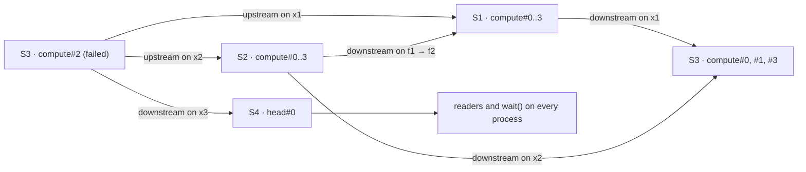
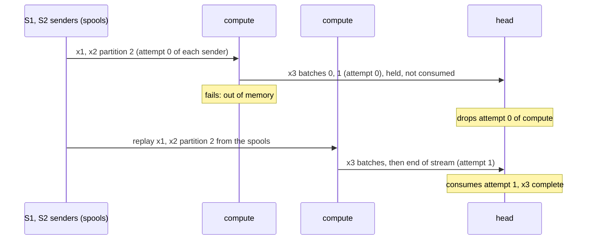

# Failure, cancellation and recovery

By default Sirius is **fail-stop**: any failure fails the whole execution, as in today's engine.

Recovery is opt-in per exchange, through its **durability**. With it, a host can re-run one failed
stage instance under a new attempt, on the same endpoint or a new one, and every receiver still
gets exactly one complete copy of that instance's output.

## How an execution ends

Every stage instance ends exactly once, with one of four outcomes. An execution ends the same way.

| Outcome | A stage instance | An execution | `wait()` returns |
|---|---|---|---|
| `succeeded` | Produced its full output, sent end of stream on every exchange it feeds, and ended every value edge it produces. | Every output was read to its end. | The report |
| `closed` | Stopped early because every receiver of its output closed, or never ran because it belongs only to arms of a `Choose` that were not chosen. It still sent end of stream and ended every value edge it produces. | The host closed every output before its end, by dropping its `BatchReader`. | The report |
| `failed` | Hit an error of its own. | Some instance failed and was not retried. | The first error: `execution`, `source_mismatch`, `transport`, `binding_mismatch` or `runtime_unavailable` |
| `cancelled` | Stopped because the execution was cancelled, or because a failure elsewhere reached it. | `request_cancel()` was called, or the `Execution` was dropped. | A `cancelled` error |

**Closed is not a failure.** In Q6c (any 100 orders), the final `Limit 100` on `head#0` closes `x1`
as soon as it has its rows. An S1 instance that was still scanning ends `closed`; one whose local
`Limit` had already produced its 100 rows ends `succeeded` (see
[How the plan stops work](../part-3/06-sort-top-n-and-limit.md#how-the-plan-stops-work)). A stage
of an arm that a [`Choose`](../part-2/06-adaptive-plans.md#choosing-between-subtrees) did not pick
waits for the label, then ends `closed` without reading anything.

Today's engine has the in-process half: an operator that has exhausted its limit lets its pipeline
finish early (`is_limit_exhausted()` in `src/op/sirius_physical_operator.hpp`).

A failure has one origin. That instance ends `failed`; every instance the failure reached ends
`cancelled`. The error that every reader and `wait()` receives names the origin's worker and plan
location.

The report shows each instance's outcome, and each attempt if the instance was retried:

```cpp
#include <sirius/sirius.hpp>
using namespace sirius;

Result<std::size_t> count_closed(PreparedPlan prepared) {
  SIRIUS_TRY(result, std::move(prepared).collect());       // failed or cancelled: an Error
  std::size_t closed = 0;
  for (const StageReport& stage : result.report.stages()) {
    if (stage.outcome() == Outcome::closed) ++closed;       // stopped early, not a failure
  }
  return closed;
}
```

```rust
use sirius::prelude::*;
use std::time::Duration;

fn count_closed(prepared: PreparedPlan) -> Result<usize, ExecutionError> {
    let result = prepared.collect()?;                         // failed or cancelled: an Err
    let closed = result.report.stages().iter()
        .filter(|stage| stage.outcome() == Outcome::Closed)   // stopped early, not a failure
        .count();
    Ok(closed)
}
```

## Close is not end of stream

**Close** goes upstream, from a receiver to its senders: "I need nothing more from you." **End of
stream** goes downstream, from a sender to each receiver: "you have everything I will ever send
you."

A closed sender drops whatever it has not sent and still sends end of stream, because a receiver
is complete only after one end of stream from every sender in its sender set (see
[Exchanges](../part-2/03-exchanges.md#the-exchange-protocol)). A receiver that closed one input may
still be waiting on others.

A value's consumers may sit in a part of the plan that did not close. So a stage that stops early
still ends every value edge it produces, according to its kind:

| Value kind | What a closed producer does | Why that is safe |
|---|---|---|
| `Filter` (`RuntimeFilterBuild`) | Ends `skipped`. It never publishes a filter built from part of its input. | A partial filter could drop rows that match. Filters are optional, so a skipped share makes the merged filter absent and every row passes. |
| `Statistics` (`Observe`) | Publishes what it saw, with a `truncated` flag. A merged value is truncated if any share is. | `Observe` never blocks and is required, so skipping it would fail the execution. The flag is recorded in the report, next to the value. |
| `Boundaries`, `Decision`, `Assignment` | Always published, or the execution fails. | These are required. They are computed from a merged statistic, not from the closed stage's rows, so a close upstream never stops them; at worst their input is flagged `truncated`. |

The filter row is today's default: a producer right that is dropped without finishing ends `SKIPPED`
(`sirius_dynamic_filter_set::producer` in `src/op/dynamic_filter/sirius_dynamic_filter.hpp`).

## Fail-stop, along the edges

Failure travels **along the plan's edges, in both directions**. It cannot go to a list of peers,
because an open plan has none: the StarRocks instance plan for `frag1#2` names `frag3[4]` as its
target, but has no list of every worker of the query (see
[Under someone else's scheduler: StarRocks](../part-4/02-starrocks.md)). The two directions:

- **Downstream**, on every exchange and value edge the failed instance sends on. A receiver that
  gets a failure message stops waiting for end of stream.
- **Upstream**, on every exchange and value edge the failed instance receives from, the way a
  close travels. A sender that gets a failure message stops producing.

Each worker that learns of the failure cancels its own stage instances and forwards the failure on
all of their edges. In a connected plan every stage instance reaches every other through edges, so
the failure floods the whole execution without anyone knowing its membership.

Cancellation uses the same path: `request_cancel()` on any process starts the flood. A message
that arrives twice is ignored, so a host that also cancels every instance itself (the StarRocks
frontend does) does no harm. In the rare plan with parts that share no edge, a closed plan also
notifies every peer in its bindings; an open plan relies on its host.

Here is a failure of S3 on `compute#2` in Q4 (urgent March revenue) from
[Partitioned join and runtime filters](../part-3/04-partitioned-join-and-runtime-filters.md). Each
arrow is labelled with the edge that carries the failure:



The first failure wins; a later failure caused by the cancellation never replaces it:

```text
execution: stage S3 on compute#2 failed in Join inner keys=[l_orderkey == o_orderkey]:
out of memory after 100 reservation retries
```

A filter that fails degrades to absent and does not fail the execution. A required value that
fails or is skipped fails it with `execution` (see
[Optional and required values](../reference/node-catalog.md#optional-and-required-values)).

Today, inside one process, an error fails only the affected query: a failed stream is poisoned,
and the first failure wins (`exec::batch_stream::fail`, contracts P1-P4 in
`docs/super-sirius/streaming-sessions.md`). Cancellation is polled every 25 ms while a query runs,
but kernels already submitted are not preempted, and a query blocked on a memory reservation or a
spill is not cancelled promptly. The design makes spills cancellable
([Memory](06-memory.md#the-downgrade-executor)). In the multi-process prototype a failed query
sends an abort to every process.

### The first-contact deadline

A peer may never answer the handshake that every process runs at `start` (see
[Exchanges in the engine](02-exchanges-in-the-engine.md#agreement-before-the-first-byte)): its
process never started, it crashed before `start`, or the host declared more workers than it runs.
The receiver would then wait forever for an end of stream.

So every edge has a **first-contact deadline**. After `start`, each peer of the edge must answer the
handshake within it, or the edge fails with `transport`. It is a prepare option, because it
describes the deployment:

```cpp
auto options = PrepareOptions::defaults().with_first_contact_deadline(std::chrono::seconds(30));
SIRIUS_TRY(prepared, context.prepare_with(plan, std::move(bindings), std::move(options)));
```

```rust
let options = PrepareOptions::default().with_first_contact_deadline(Duration::from_secs(30));
let prepared = context.prepare_with(&plan, bindings, options)?;
```

The deadline is always finite; `PrepareOptions::defaults()` sets 60 seconds. It covers first
contact only. Whether a peer that answered is still alive later is the transport's business, and
whether that needs heartbeats is
[open question 4](../reference/open-questions.md#4-coordination-and-failure).

The typical case is a host whose plans disagree on a set size. Suppose the StarRocks frontend
builds the `frag3` instance plans for six lineitem senders (`frag1[6]`) but starts only five
`frag1` instances. Every edge signature that exists matches, so the handshake finds no
disagreement, and `frag3#2` never hears from `frag1#5`:

```text
transport: first-contact deadline (30s) expired on exchange x11: frag3#2 heard from 5 of 6
senders in frag1[6]; frag1#5 never answered
```

### When the device itself fails

Every failure so far ends one execution and leaves the engine ready for the next query. Two things
**latch** the engine as unavailable for the whole process: a fatal device error, such as a sticky
CUDA error, and GPU work whose completion the engine cannot confirm. The execution that hit the
fault fails with `runtime_unavailable`, and so does every later call on any handle of that
process.
[How long a context lives](../part-1/03-context-and-session.md#how-long-a-context-lives) has the
full rules, including what `Context::create` returns afterwards.

The two codes mean different things:

| Code | What failed | What still works |
|---|---|---|
| `execution` | This query: an I/O error, out of memory after reservation retries, a required value that failed, a device error the engine recovered from | The engine. The next query runs normally. |
| `runtime_unavailable` | The engine of this process | Nothing on the GPU until the process restarts. Building plans needs no context and keeps working. |

Today the latch is per engine and has no public code. Inside sirius-duckdb, a fatal CUDA error or
a failed mandatory cleanup makes the engine refuse GPU queries until the process restarts, and
DuckDB runs later queries on the CPU where it can.

A transport's named shared memory or listening ports can outlive a crashed process. A restarted
process cleans up or ignores the stale ones; that is engine work and needs no API.

Sirius never replays failed work, on the GPU or on the CPU. A host with its own CPU engine, such as
DuckDB, Axiom or Bolt, treats `runtime_unavailable` like `unsupported` for every later query until
the process restarts. A running query is not switched over mid-flight; the host reruns it from the
start, if it can:

```cpp
auto report = std::move(started.execution).wait();
if (!report && report.error().code == ErrorCode::runtime_unavailable) {
  host.gpu_available = false;                           // host code: later queries keep their plan
  return host_query.rerun_from_start(report.error());   // host code, if the host can
}
```

```rust
match started.execution.wait() {
    Err(e @ ExecutionError::RuntimeUnavailable { .. }) => {
        host.gpu_available = false;                  // host code: later queries keep their own plan
        return host_query.rerun_from_start(e);       // host code, if the host can
    }
    other => { other?; }
}
```

The engines of other processes are unaffected. Their readers and `wait()` still receive the
origin's `runtime_unavailable`, with the origin's worker, so a host checks that worker before it
treats its own engine as down. Whether peers should see a different code is part of
[open question 4](../reference/open-questions.md#4-coordination-and-failure).

For retry, a process whose engine is unavailable counts as a **lost process**, like one that
crashed (see [A worked retry](#a-worked-retry-q4-on-two-hosts)). Its stage instances are retried on
another process, or on the same machine after a restart, never in place on the same GPU.

## Every message has a key

[Exchanges](../part-2/03-exchanges.md#the-exchange-protocol) and
[Exchanges in the engine](02-exchanges-in-the-engine.md#the-protocol) address a **stream** by four
logical ids: the execution id, the edge id, the sender worker and the receiver worker. Recovery
has to name a message within a stream, so the full key adds an attempt, a reserved epoch and a
sequence number:

`(execution id, attempt, epoch, edge id, sender, receiver, sequence)`

| Field | Set by | What it is for |
|---|---|---|
| execution id | The host, once per execution | Keeps two executions apart, even of the same plan. |
| attempt | The engine; 0 unless the sending instance was retried | Tells a receiver which run of the sending instance produced the message. |
| epoch | Reserved, always 0 | Iteration and streaming later; see [Extension points](../reference/extension-points.md#reserved-now-epochs). |
| edge id | `Plan::create`, or the host in an open plan | Which exchange (`x1`) or value edge (`f2`). |
| sender, receiver | The plan | Which pair of workers, such as `compute#0` to `compute#2`. |
| sequence | The sender, counting from 0 per stream and attempt | Makes duplicates and gaps detectable. |

On a hash exchange, the batch from `compute#0` carrying partition 2 of `x1` might be keyed
`(E, 0, 0, x1, compute#0, compute#2, 17)`. End of stream carries a sequence number too, so a
receiver can tell a complete stream from one with a gap. When a transport redelivers a message
after a reconnect, the receiver already has that sequence number and drops the copy.

**An `ExecutionId` is single use per hosted worker, and Sirius enforces it.** A `Context`
remembers each id that every worker it hosts has run under, and refuses to start a worker again
under the same id. A peer refuses a handshake for an id it has already finished. Otherwise a late
message from a finished execution could land in a new one with the same keys:

```text
binding_mismatch: execution id 3f9c0a1e... was already used by compute#2 in this context; every
execution needs a fresh ExecutionId
```

The rule is per worker because one query can put several instance plans on one compute node, as
StarRocks does. They host different workers, so they share the query's id, and they are admitted
as one unit (see [Admission across processes](08-running-at-scale.md#admission-across-processes)).

Re-running a whole execution takes a new `ExecutionId`. Re-running one stage instance stays inside
the same execution, under the same id, with a new attempt.

## Durability: pipelined or spooled

A stage instance can be re-run only if its receivers have not consumed part of its output.
Otherwise a rerun would hand them some rows twice, or a mixture of two answers if the rerun is not
deterministic. So every exchange has a **durability**:

- **`Durability::pipelined()`**, the default. Rows flow to receivers as they are produced. A
  receiver may be consuming a sender's batches while the sender is still running.
- **`Durability::spooled()`**. The sender's output is **retained until the execution ends**, and a
  receiver consumes a sender attempt's output **only after that sender attempt completed**, like a
  shuffle file. A receiver never sees part of an attempt that failed.

Both sides must agree on durability: it is part of the edge signature that open plans compare at
the handshake, and the fingerprint covers it.

Where the spool lives is the engine's business. It is an ordinary send repository that is not
emptied when its batches are sent, so it spills to host memory and disk like every other
repository (see [Memory](06-memory.md)). Today nothing in the engine retains an exchange's output
after it is consumed.

You set durability on the exchange description. Here are Q4's three exchanges from
[Partitioned join and runtime filters](../part-3/04-partitioned-join-and-runtime-filters.md), all
spooled:

```cpp
SIRIUS_TRY(probe, pruned.exchange(
    Exchange::hash({"l_orderkey"}, compute).with_durability(Durability::spooled())));
SIRIUS_TRY(build_side, build.relation.exchange(
    Exchange::hash({"o_orderkey"}, compute).with_durability(Durability::spooled())));
// join, project and aggregate exactly as in Q4, giving per_order
SIRIUS_TRY(gathered, per_order.exchange(
    Exchange::gather(head).with_durability(Durability::spooled())));
```

```rust
let probe = pruned.exchange(&Exchange::hash(&["l_orderkey"], &compute,
        Partitions::one_per_worker(), HashScheme::v1()).with_durability(Durability::spooled()))?;
let build_side = build.relation.exchange(&Exchange::hash(&["o_orderkey"], &compute,
        Partitions::one_per_worker(), HashScheme::v1()).with_durability(Durability::spooled()))?;
// join, project and aggregate exactly as in Q4, giving per_order
let gathered = per_order.exchange(&Exchange::gather(&head, GatherOrder::any())
        .with_durability(Durability::spooled()))?;
```

On a decided exchange you set it once, on the result of `decided_by`, and it applies to every
alternative; an alternative that sets its own is rejected with `invalid_plan`. The plan prints
`durability=spooled` at the end of the Exchange line; pipelined is not printed:

```text
Plan "q4_urgent_march_revenue" (joined)
worker sets: head[1], compute[4]
values:
  f2 = ValueExchange merge f1 -> compute[4]
Output "result" on head[1]
└─ Exchange x3 gather -> head[1]  durability=spooled
   └─ Aggregate keys=[o_orderkey, o_orderdate] measures=[revenue = sum(rev)]
      └─ Project [o_orderkey, o_orderdate, rev = l_extendedprice * (1 - l_discount)]
         └─ Join inner keys=[l_orderkey == o_orderkey] build=right  mode=co_partitioned(x1, x2)
            ├─ Exchange x1 hash(l_orderkey) -> compute[4]  durability=spooled
            │  └─ RuntimeFilterApply [l_orderkey] <~ f2  wait=never
            │     └─ Scan lineitem [l_orderkey, l_extendedprice, l_discount]  on compute[4]  shards=files_round_robin
            └─ Exchange x2 hash(o_orderkey) -> compute[4]  durability=spooled
               └─ RuntimeFilterBuild keys=[o_orderkey] spec=bloom(fixed 8MiB)  scope=partial ~> f1
                  └─ Filter o_orderdate >= 1995-03-01 and o_orderdate < 1995-04-01 and o_orderpriority == "1-URGENT"
                     └─ Scan orders [o_orderkey, o_orderdate, o_orderpriority]  on compute[4]  shards=files_round_robin
```

In split and instance form both halves of the edge carry it, at the end of the line:
`ExchangeSink x3 gather -> [head#0]  durability=spooled` and
`ExchangeSource x1 partition=2/4 <- senders=[compute#0..3]  durability=spooled`.

Spooling is opt-in because it costs latency and memory: nothing streams through a spooled edge,
and the whole output is kept until the execution ends.

The cost varies by edge. In Q4, `x3` follows an aggregate, which emits nothing until its input is
complete, so spooling `x3` costs almost no latency. Spooling `x1` means the probe in S3 cannot
overlap the scan that produces its rows.

Value edges have no durability property. Values are small and bounded, so the engine keeps every
value share until the execution ends, and a re-run instance receives the values it consumes again.

## Retrying a stage instance

Stage retry re-runs a whole stage instance under a new attempt, and every peer of that instance
takes part. It is unrelated to the engine's task retry after a failed memory reservation (see
[Memory](06-memory.md#reservations-and-retries)), which happens within one attempt and which no
receiver notices.

A failed stage instance is **retryable** when all of these hold:

1. Every data input of the instance is a scan or a spooled exchange, so its input can be read
   again in full.
2. Every exchange it sends on is spooled, so no receiver has consumed any of the failed attempt's
   output.
3. Every value it produces is either not yet published, or its producing subtree is
   `deterministic` or `per_execution` (see
   [Extension points](../reference/extension-points.md#determinism-classes)), so a rerun publishes
   the same share. A re-published share carries a digest, and a share that differs from one already
   merged fails the execution with `execution`, like the decision digests in
   [Protocol facts](../reference/node-catalog.md#protocol-facts).
4. Every node it runs is `none` or `idempotent` in its side-effect class.
5. It has not closed a spooled input. A receiver that closed an input gave up the rest of it, so it
   cannot read that input in full again.

A retried instance runs the same plan under attempt n+1. Receivers ignore every message from any
other attempt of that sender. Because a spooled receiver consumes only a completed attempt, the
rerun **need not be deterministic**. A re-run lineitem scan in Q4 may prune more rows than the
original, because by then the merged filter `f2` has arrived; the receivers get attempt 1's rows
and never see attempt 0.

The `Output` stage is never retried once its first batch has reached the host's reader: the host
has seen those rows. The stages feeding it can still be retried, if the exchange into `Output` is
spooled.

### A worked retry: Q4 on two hosts

Take Q4 with all three exchanges spooled, as printed above, bound to the two-host cluster from the
[running example](../part-3/00-running-example.md): `compute#0` and `compute#1` on host A,
`compute#2` and `compute#3` on host B, and `head#0` sharing host A's GPU 0. Partition 2 of the order
key is heavily skewed this time.

1. **Before the failure.** Every S1 and S2 instance has finished under attempt 0. Their outputs sit
   in their spools, and the merged filter `f2` has been published. The S3 instances on
   `compute#0`, `#1` and `#3` have finished and sent their aggregated rows on `x3`. Those three
   attempts completed, so `head#0` has already handed their rows to the host's reader.
2. **The failure.** S3 on `compute#2` has built its hash table from partition 2 of `x2`, probed it
   with partition 2 of `x1`, and sent two batches on `x3`, keyed
   `(E, 0, 0, x3, compute#2, head#0, 0)` and `(..., 1)`. Then it runs out of memory after its
   reservation retries, because another execution on host B's GPU 0 holds most of it. The instance
   ends `failed`.
3. **Is it retryable?** Yes, conditions 1-5 hold: inputs `x1` and `x2` and output `x3` are spooled,
   it produces no values, every node in it is `none`, and it closed nothing. The S4 `Output`
   instance on `head#0` has delivered rows, but it did not fail, so that does not matter.
4. **The host decides.** The engine on host B reports the failure as retryable. The launcher picks a
   spare GPU on host C and tells every process to retry S3 on `compute#2` there. Each process moves
   to binding epoch 1. How a process on host C joins the running execution to host the new attempt
   is part of [open question 28](../reference/open-questions.md#28-retry-api-and-who-decides).
5. **What reruns.** Only S3 on `compute#2`, now attempt 1, on host C. Every S1 and S2 sender replays
   partition 2 of its spool to the new endpoint. A replay reuses the original keys, such as
   `(E, 0, 0, x1, compute#0, compute#2, 0)`, because it is the same output of the same attempt.
6. **What receivers discard.** `head#0` drops the two attempt-0 batches it was holding from
   `compute#2`; it never handed them to `Output`, because attempt 0 never completed. Any attempt-0
   message still in flight is dropped on arrival. `head#0` consumes attempt 1 once it completes.



The report records two entries for S3 on `compute#2`: attempt 0 `failed` and attempt 1
`succeeded`. The execution itself `succeeded`, with the same result as a run without the failure.

Losing a whole process applies the same rule to more instances. If host B's process dies, every
instance it hosted dies with it: S3 on `compute#2` and `compute#3`, and the spools of S1 and S2 on
those workers. The S1 and S2 instances read only scans, so they are retryable, and they re-run
first. Their filter shares `f1` re-publish under the new attempt; the subtree that builds them
(`Scan`, `Filter`, `RuntimeFilterBuild`) is deterministic, so the shares match the ones already
merged into `f2`. A receiver that was part-way through reading a lost spool has consumed part of an
attempt that no longer exists, so it is retried too.

### Who decides

Sirius never retries on its own. Whether a retry is worth it, and where it should run, depends on
the cluster, the budget and the error, which only the host knows. A sum that overflows its result
type will overflow again on any GPU. So the engine reports each failure as an event, says whether
retry is allowed, and leaves the choice to the host:

```cpp
// A sketch: the exact names are open question 28.
SIRIUS_TRY(event, started.execution.next_event());   // blocks until an instance fails or the run ends
if (const auto* failed = std::get_if<InstanceFailed>(&event)) {
  if (!failed->retryable) return std::unexpected(failed->error);   // fail-stop
  SIRIUS_TRY(epoch, started.execution.retry_stage(failed->instance, spare_gpu));
}
```

```rust
// A sketch: the exact names are open question 28.
if let ExecutionEvent::InstanceFailed(failed) = started.execution.next_event()? {
    if !failed.retryable { return Err(failed.error.into()); }  // fail-stop
    let epoch = started.execution.retry_stage(&failed.instance, Some(spare_gpu))?;
}
```

In a closed plan, every process must apply the same retry, as every process uses the same
bindings. In Distributed Sirius the launcher hears about the failure from the process that hosted
the instance and passes the same retry to every process, the way it handed out the `ExecutionId`.
In StarRocks the frontend already tracks every fragment instance, and it would send the retry to
the compute nodes that host the instance's peers.

How a host opts in to hear failures before they become fatal, and how long a failed instance waits
for the host's answer, are part of
[open question 28](../reference/open-questions.md#28-retry-api-and-who-decides).

## Binding epochs

A retry may move a worker. In the worked retry, `compute#2` moves from host B's GPU 0 to host C.
That is a change of *where*, never of *what*
([rule 4](../part-2/01-everything-in-the-plan.md#the-ownership-rule)): the plan, its fingerprint
and every edge signature stay as they were. Only the bindings change.

So bindings carry a **binding epoch**: 0 when the execution starts, and one more for every retry
the execution applies. The bindings digest that closed plans compare at the handshake covers the
epoch. When a moved instance starts, its edges handshake again, comparing the execution id, the
unchanged fingerprint and the new digest. A process that has not applied the same rebinding has a
different digest, and the handshake fails with `binding_mismatch` before a single row moves.

Open plans compare edge signatures, which do not include endpoints. The moved instance handshakes
again with its edge peers, and the host's retry message tells those peers its new endpoint.

The book prints the epoch on the binding block of a bound plan. A block without one is epoch 0:

```text
binding epoch=1:
  compute#0 -> hostA/gpu0
  compute#1 -> hostA/gpu1
  compute#2 -> hostC/gpu0
  compute#3 -> hostB/gpu1
  head#0    -> hostA/gpu0
```

The binding epoch is unrelated to the reserved epoch in the message key, and never appears in a
key.

## Side effects decide what may rerun

Re-running a stage instance re-runs every node in it. Retry condition 4 reads each node's
[side-effect class](../reference/extension-points.md#side-effect-classes):

| Node | Side-effect class | May a retry re-run it? |
|---|---|---|
| Relational, distribution and runtime-value nodes; `Scan` of Parquet | `none` | Yes |
| A registered scan kind that holds a lease, keyed by the `ExecutionId`, on host state such as a snapshot | `idempotent`, while the lease holds | Yes, if the lease is still valid |
| `Input` | `effectful`: a channel is read once | No |
| `Output`, once its first batch has reached the host | `effectful` | No |

A future write with a commit step would declare its own class in the same way.

Today's engine applies the same logic to a whole query. When a GPU execution fails inside
sirius-duckdb, the extension may replay the query on DuckDB's CPU executor. It refuses when a
result was already emitted, when the query was cancelled, when the captured transaction is no
longer valid, or when non-rollbackable state was touched (`src/transparent/replay_admission.hpp`).
It also refuses when the query's own cleanup could not be confirmed; then only later queries keep
DuckDB's plan.

## How other systems recover

| System | Default between stages | Durable exchange | What reruns | Who decides |
|---|---|---|---|---|
| Spark | Shuffle output written to local files at every stage boundary | Always | Failed tasks; lost map output is recomputed from lineage | The driver's scheduler |
| Trino | Pipelined; a failure fails the query | Opt-in fault-tolerant execution (`retry-policy` QUERY or TASK); task retries spool exchange data through an exchange manager | The whole query, or failed tasks | The coordinator |
| Ballista | Each stage's shuffle output written to files on its executor | Always | Failed tasks; map tasks whose output was lost with an executor | The scheduler |
| Sirius | Pipelined; fail-stop | Opt-in per exchange: `Durability::spooled()` | One stage instance, under a new attempt | The host |

Trino is the closest relative, but it turns spooling on for a whole query; Sirius turns it on per
exchange, in the plan. Each of the others is its own coordinator and decides retries itself.
Related designs has more on [Ballista](../appendix/related-designs.md#ballista) and on
[Spark and Trino](../appendix/related-designs.md#spark-trino-and-snowflake).
