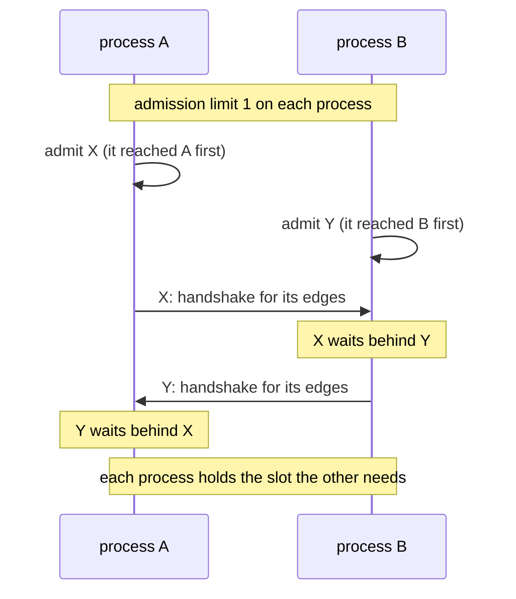
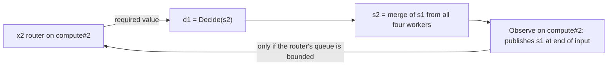

# Running at scale

At 1,000 workers, one all-to-all hash exchange has a million logical streams. Does it
need a million network connections? Could an idle GPU help a worker with a large partition?
Those questions have different answers. The engine can pool streams without changing the plan.
Moving a partition to another worker changes the assignment that both sides of a join must use.

## Three hosts, three scales

| Proposed integration | Who places work | Where the costs fall |
|---|---|---|
| Embedded DuckDB | The extension builds a closed plan for one machine. | The process shares memory and I/O resources across its GPUs. |
| Distributed Sirius | Every process builds the same closed plan. | Each process pays for planning and checks its agreement with peers. |
| StarRocks or another coordinator | The scheduler gives each worker an open instance plan. | The coordinator handles placement and tracks failures. Workers check the edges they share. |

The book explores tens to low hundreds of GPUs for a closed plan and larger installations with a
coordinator. Where that trade-off pays off is a measurement question. The merged distributed SQL
engine runs one process per GPU. Its upstream guide documents single-host testing. A separate
four-host experiment on a development branch used 16 GPUs. Doubling from 8 to 16 helped scan-heavy
TPC-H Q1 and Q6, while warm Q3, Q5 and Q9 slowed. Those results describe the tested software and
network. [Merged execution path](https://github.com/sirius-db/sirius/pull/2337) · [Four-host
measurements](https://github.com/sirius-db/sirius/issues/2465)

## What grows with the worker count

Consider 1,000 workers on 125 hosts, eight GPUs and one hypothetical engine process per
host. These are cost estimates for the proposed model. Today's distributed SQL engine runs one
process per GPU.

| Item | Count in this example | Possible reduction |
|---|---|---|
| Streams of one all-to-all exchange | 1,000 × 1,000 sender-receiver pairs including self-delivery | Pool the 64 logical streams between a pair of hosts. |
| One broadcast batch | 1,000 logical recipients | Send one copy to each receiving host, then fan out locally. |
| One 8 MiB Bloom merge | About 7.6 TiB of logical shares across all recipients | A tree reduction and broadcast transfer about 15.6 GiB in total. |
| Five shared edge signatures | Up to 77,500 comparisons if all five span every ordered cross-host process pair | Batch signatures for each pair. A closed plan can compare one fingerprint. |
| One million inline splits | About 100 MB per process at an assumed 100 bytes per split | Fingerprint a manifest digest and cache the manifest by digest. |

### Exchanges: N squared streams

In this model, a hash exchange from `compute[1000]` to `compute[1000]` has a stream from every sender to every
receiver. The [protocol](02-exchanges-in-the-engine.md#the-protocol) ends each with its own end of
stream, even when it carried zero rows. The plan cannot remove those streams, because every sender
may hold rows for every partition.

Several transport choices could reduce the cost per stream.

- It pools streams per process pair and reuses connections across executions: 7,750 connections if
  each carries both directions.
- One message on a pooled connection may carry many end-of-stream markers for its process pair,
  under their original logical ids, so the receiver still counts one per sender.
- A two-level shuffle moves rows between the GPUs of a host over NVLink first, then across the
  network.

All of these are
[physical shapes](02-exchanges-in-the-engine.md#the-logical-edge-and-its-physical-shape); none
changes what a receiver ends up with.

### Value merges: all to all in the plan, a tree on the wire

A `ValueExchange` that merges a partial runtime filter into a global one on every worker is all to
all *logically*. Every receiver needs the merge of every sender's share. For an 8 MiB Bloom filter
with identical geometry and key hashing, bitwise OR gives the same result in any merge order.

- **Literally all to all:** 1,000 x 1,000 shares of 8 MiB, which is about 7.6 TiB.
- **Tree reduction:** the shares are ORed up a binary tree to one root (999 transfers), and the
  result is sent back down a tree (999 transfers). That is 1,998 x 8 MiB, about 15.6 GiB, over
  about 20 hops.
- **Via the host first:** each host ORs its 8 shares over NVLink, the 125 host results are reduced
  and redistributed as a tree over the network (2 x 124 transfers), and each host fans the result
  out to its GPUs. That is 248 x 8 MiB, about 1.9 GiB, on the network.

The engine chooses the shape per value and per binding.

The [leader pattern](../part-2/06-adaptive-plans.md#deciding-on-a-leader) is a plan choice instead:
merging to `head[1]` and delivering the result through a one-sender `ValueExchange` costs 2N
messages. [What it costs](#what-it-costs) uses it for a partition assignment.

### Handshakes

For a closed plan the proposed handshake compares the execution id, plan fingerprint and
bindings digest. For open plans each peer pair compares signatures of its shared edges.
Batching those records can save round trips. Success on one pair proves agreement only for that
pair. [Agreement before the first byte](02-exchanges-in-the-engine.md#agreement-before-the-first-byte)

### Plan size and build cost

If 125 processes each expand the same file glob, the storage service has to return the listing
125 times. If a file appears between two listings, the processes can build different plans.
A host can enumerate once and give every process the same manifest.

## Split manifests

A **split manifest** identifies a list of file or byte-range splits by its content digest.
The host lists the table once, then distributes the serialized manifest. The proposed
`SplitManifest::from_bytes` reads the manifest and checks its digest. Each process can
cache the verified list by digest.

With `files_round_robin`, entry *i* belongs to worker *i mod n*. A manifest of byte ranges
already specifies the cuts. Changing the number of workers changes the assignment without
requiring another listing.

In joined and split form the scan prints its rule, then the manifest's short digest and size:

```text
Scan lineitem [l_orderkey, l_extendedprice, l_discount]
              on compute[1000]  shards=files_round_robin  manifest=3f9a1c2e (1000000 splits)
```

The instance form shows only that worker's slice, as indices into the manifest. This is
`compute#2`:

```text
Scan lineitem [l_orderkey, l_extendedprice, l_discount]
              manifest=3f9a1c2e  splits=[2, 1002, 2002, ..., 999002] (1000 of 1000000)
```

The digest keeps the plan text small. Creating or verifying a new manifest still requires
reading every entry. An instance plan built by a coordinator can also carry just its worker's
splits. A split list identifies which inputs to open. Replaying exactly the same bytes also
requires a stable version of each underlying object. [How plans travel](../reference/open-questions.md#1-how-plans-travel)

## Dynamic splits

With fixed split lists, a worker that finishes early cannot help a peer with more work.

With `Shards::dynamic()`, the scan's splits, from the file list or the manifest, are **assigned to
workers of the set at run time, with one logical owner per split**. Today's engine balances scans only inside
one process ([Worker granularity](#worker-granularity)).

```cpp
SIRIUS_TRY(claimed, Relation::scan(lineitem, ScanOptions::on(compute)
                                                 .with_columns({"l_orderkey", "l_extendedprice",
                                                                "l_discount"})
                                                 .with_shards(Shards::dynamic())));
```

```rust
let claimed = Relation::scan(&lineitem, ScanOptions::on(&compute)
                                            .with_columns(&["l_orderkey", "l_extendedprice",
                                                            "l_discount"])
                                            .with_shards(Shards::dynamic()))?;
```

The plan prints the shard kind. The instance form prints the same continuation line without a
slice, because no worker's splits are known until it runs:

```text
Scan lineitem [l_orderkey, l_extendedprice, l_discount]
              on compute[1000]  shards=dynamic  manifest=3f9a1c2e (1000000 splits)
```

### Why it is legal

A dynamic scan on multiple workers produces `arbitrary(W)`. No downstream operator may assume that
particular keys are on particular workers. So the plan may leave open which worker reads which
split, as it leaves open which rows a `round_robin` exchange sends where.

What the workers must agree on is in the plan and compared at `start`: the split list (by digest),
the set, and the rule that every split contributes once to a complete successful scan. How claims are served (which worker
serves them, how many splits a claim takes, how far a worker prefetches) is physical shape.

`report.split_claims()` identifies the splits each worker claimed. The resolved plan replaces
`shards=dynamic` with explicit worker lists so a later execution can reuse the assignment. A claim
records ownership. A failed attempt might read a split again. Exactly-once delivery requires
accepting output only from a successful attempt. [Stage
retry](07-failure-cancellation-and-recovery.md#retrying-a-stage-instance)

### Where it does not apply

Dynamic claiming fits only where no per-worker property is relied on:

- `replicated` scans have nothing to claim.
- A future source-declared partitioning, where split *i* must land on a given worker for the rows
  to count as `hashed`, needs a fixed assignment. On a multi-worker set, a dynamic scan offers only `arbitrary(W)`.
- The set must be sized (V24). An instance plan with an unsized hosting set reads exactly what its
  coordinator gave it with `Shards::splits`.

Claims are recorded per attempt, so a retried stage instance first re-reads the splits its failed
attempt claimed. Unclaimed splits stay open to every worker of the set, the retried one included.

The dynamic shard kind gives a host an explicit choice between balancing scan work and fixing the
assignment in advance. [Dynamic split
assignment](../reference/open-questions.md#22-dynamic-split-assignment)

## Skew: more partitions than workers

Hash partitioning sends equal keys to the same partition. Even a uniform hash of distinct keys can
give one worker most of the rows when a single key is frequent.

The first answer is **over-partitioning**: `Partitions::fixed(P)` with P greater than |T|, so that
each worker holds several partitions. With the default rule, partition *p* still goes to worker
*p mod |T|* wherever the heavy partitions fall. `Partitions::assigned_by` chooses the
partition-to-worker map at run time instead, from the observed partition sizes.

An **assignment** is a runtime value, like `Boundaries`. An `AssignPartitions` node computes it
from a global histogram of bytes per partition. The assignment is required, and global on the set
it controls. Value ids for assignments use the letter `a`.

Take a join of orders and customers on the customer key, where a few customers have far more
orders than the rest:

```cpp
// orders_scan and customer_scan are scans of orders and customer on compute
SIRIUS_TRY(spec, StatisticsSpec::partition_bytes({"o_custkey"}, 16));   // HashScheme::v1()
SIRIUS_TRY(observed, orders_scan.observe(spec));
SIRIUS_TRY(s2, observed.statistics.merge_to(compute));
SIRIUS_TRY(a1, Assignment::balanced(s2, compute));
SIRIUS_TRY(left, observed.relation.exchange(
    Exchange::hash({"o_custkey"}, compute, Partitions::assigned_by(a1))));
SIRIUS_TRY(right, customer_scan.exchange(
    Exchange::hash({"c_custkey"}, compute, Partitions::assigned_by(a1))));
SIRIUS_TRY(on, JoinOn::keys({{"o_custkey", "c_custkey"}}));
SIRIUS_TRY(joined, left.join(right, JoinType::inner, std::move(on), JoinOptions::defaults()));
```

```rust
// orders_scan and customer_scan are scans of orders and customer on compute
let spec = StatisticsSpec::partition_bytes(&["o_custkey"], 16, HashScheme::v1())?;
let observed = orders_scan.observe(spec)?;
let s2 = observed.statistics.merge_to(&compute)?;
let a1 = Assignment::balanced(&s2, &compute)?;
let left = observed.relation.exchange(&Exchange::hash(&["o_custkey"], &compute,
                                                      Partitions::assigned_by(&a1),
                                                      HashScheme::v1()))?;
let right = customer_scan.exchange(&Exchange::hash(&["c_custkey"], &compute,
                                                   Partitions::assigned_by(&a1),
                                                   HashScheme::v1()))?;
let on = JoinOn::keys(&[("o_custkey", "c_custkey")])?;
let joined = left.join(&right, JoinType::Inner, on, JoinOptions::default())?;
```

`partition_bytes` counts logical bytes per partition, hashing the keys with the same scheme and
partition count the exchange will use. The merge sums the histograms element by element. An
exchange built with `assigned_by(a1)` takes its partition count from the histogram behind `a1`;
building it fails with `invalid_plan` if its key types or hash scheme differ from the histogram's.
Adding a group aggregate and a gather gives this plan:

```text
Plan "orders_per_customer" (joined)
worker sets: head[1], compute[4]
values:
  s2 = ValueExchange merge s1 -> compute[4]
  a1 = AssignPartitions balanced(s2) -> compute[4]
Output "result" on head[1]
└─ Exchange x3 gather -> head[1]
   └─ Aggregate keys=[c_custkey, c_name] measures=[order_count = count_star()]
      └─ Join inner keys=[o_custkey == c_custkey] build=right  mode=co_partitioned(x1, x2)
         ├─ Exchange x1 hash(o_custkey) partitions=16 assign=<~a1 -> compute[4]
         │  └─ Observe partition_bytes(o_custkey, 16) ~> s1
         │     └─ Scan orders [o_orderkey, o_custkey]  on compute[4]  shards=files_round_robin
         └─ Exchange x2 hash(c_custkey) partitions=16 assign=<~a1 -> compute[4]
            └─ Scan customer [c_custkey, c_name]  on compute[4]  shards=files_round_robin
```

The join is still co-partitioned, because both exchanges have the same
[partitioning signature](../part-2/03-exchanges.md#the-partitioning-signature-and-co-partitioning),
which includes the assignment `a1`. Exchanges with different assignments are not co-partitioned,
and V20 rejects a join over them. The inner join's output is hashed on either key, so the
single-phase aggregate on `c_custkey` needs no further exchange (V6).

### The policy

`balanced` takes the largest partition first, breaking ties by partition index, and assigns
it to the least-loaded worker so far, breaking ties by worker index. Integer weights and explicit
tie rules make the map reproducible from the same histogram. A digest on each assigned exchange
checks that its sender and receiver use the same map.

Suppose partition 0 holds 40 GiB and each of the other 15 holds 4 GiB: 100 GiB in total, 25 GiB
per worker on average.

| Worker | `p mod 4` | `balanced` |
|---|---|---|
| `compute#0` | partitions 0, 4, 8, 12: 52 GiB | partition 0: 40 GiB |
| `compute#1` | partitions 1, 5, 9, 13: 16 GiB | partitions 1, 4, 7, 10, 13: 20 GiB |
| `compute#2` | partitions 2, 6, 10, 14: 16 GiB | partitions 2, 5, 8, 11, 14: 20 GiB |
| `compute#3` | partitions 3, 7, 11, 15: 16 GiB | partitions 3, 6, 9, 12, 15: 20 GiB |

The most loaded worker drops from 52 GiB to 40 GiB. It cannot drop further, because partition 0 is
one unit.

If those 40 GiB belong to a single customer key, no choice of P helps: a hash exchange puts every
row of one key on one worker. Splitting a heavy key across workers, and replicating the matching
rows of the other side, changes which rows each worker ends up with in a way no partition map can
express. Such skew-aware exchanges are
[open question 26](../reference/open-questions.md#26-skew-aware-exchanges).

### What it costs

An assignment is a required value, so x1's rows wait for `a1` in the router's input repository, as
a range exchange waits for its boundaries. The whole observed side waits until every worker has
published its histogram, and the waiting rows can spill
([Memory](06-memory.md#every-place-data-waits-is-a-repository)).

The histogram has P buckets. With 16 partitions per worker on 1,000 workers, P is 16,000, and with
an 8-byte counter per partition one share is about 125 KiB. Merged to every worker, that is about
119 GiB logically, before the engine's tree reduction.

An alternative is to send the histograms to `head#0`, compute the map there and distribute
the map. With a 4-byte worker index per partition the map is 62.5 KiB. Both inputs of the join
must receive the same final assignment. The worker set being assigned partitions and the
worker that evaluates the assignment play different roles. [Leader decisions](../part-2/06-adaptive-plans.md#deciding-on-a-leader)

The resolved plan prints the map, for example
`partitions=16 assign={0:#0, 1:#1, ..., 15:#3}`. It can replay this choice without measuring
the histogram again.

## Worker granularity

Each worker binds to one GPU. The plan names the worker that owns a partition, and the bindings identify its GPU. This has two costs.

With one worker per GPU, the 1,000-GPU example needs a million logical streams for an all-to-all
exchange. A worker per eight-GPU process would need 125², or 15,625. Connection pooling reduces
network state, but logical streams still need identities and completion tracking.

A coarser worker would give the engine more freedom to move work between local GPUs. A worker
bound to one GPU makes the placement of a large hash table explicit. Dynamic splits can help
balance the scan, and partition assignments can spread distinct partitions. Neither can divide
the join state for a single heavy key. The current proposal keeps one GPU per worker while
allowing workers to share a GPU. [Worker granularity](../reference/open-questions.md#2-worker-granularity)

### One machine: one process or one per GPU

On a single machine, one process can drive every GPU, as sirius-duckdb does, or each GPU can have
its own process, as a Distributed Sirius launcher may start. The plan is identical, with the same
text, fingerprint and results; only the bindings differ.

| | One process, every GPU | One process per GPU |
|---|---|---|
| Engines | One engine shares the memory tiers, the pinned host memory of each NUMA node, the table cache and the I/O reactors. | One engine per GPU. Each process gets its own share of host memory and its own cache. |
| Exchanges between GPUs | A peer copy or host staging inside the process. | The transport between processes, which may still copy over NVLink. Each pair needs a handshake. |
| Admission | One engine admits queries across its GPUs. | Gang admission across the processes ([Admission across processes](#admission-across-processes)). |
| A fatal device error | The shared engine stops accepting GPU work until restart. | Other processes can still serve local work. Distributed queries using the current failed transport require a restart of all ranks. |
| Hosts | Hosts that live in one process, such as sirius-duckdb. | Hosts that already launch processes, such as Distributed Sirius. |

Neither shape changes what any worker ends up with, so the choice can be made per deployment and
changed without touching a plan.

## Admission across processes

Today each engine admits queries on its own, first come, first served, up to
`max_concurrent_queries` (1 by default). Inside one process that is safe while no execution waits
on another (see below). Across processes it can deadlock. Two processes, A and B, both run two
queries, X and Y, with an admission limit of one each:



Neither query can start, and neither slot is released. A deadline may eventually abort a waiting
execution, but both otherwise lack a way to make progress.

The proposal uses **gang admission** for a closed plan. Each process tentatively reserves a slot
and uses the same ordering for competing executions, by priority and then `ExecutionId`. In the
example, if X precedes Y, B can give up Y's tentative slot so X can start on both processes.

A common ordering addresses that cycle. A complete protocol still has to say when tentative
reservations become irrevocable, how a peer withdraws an offer, and how a timeout or lost peer
releases it. Otherwise one process could start Y while another gives Y's slot to X. An open instance
plan may lack a complete participant list, so its host must arrange admission across instances. A
first-contact deadline detects silence from a peer. A peer that has answered but is still queued
presents a different timeout question. [Coordination and
failure](../reference/open-questions.md#4-coordination-and-failure) · [Admission
ownership](../reference/open-questions.md#15-one-context-per-process)

Today Sirius admits bounded concurrent SQL queries inside a process. With distributed SQL, one
connection per process issues the matching sequence of distributed statements. Other connections can
run local work if admission permits. In the proposed API, a live producer and consumer that need the
same single slot can block one another. Chaining through a completed input avoids that dependency.
[Distributed admission
limits](https://github.com/sirius-db/sirius/blob/ef7eb2951a370f4293784549bc05fc46c7cc64f6/docs/super-sirius/distributed-sirius.md#limits)
· [Completed inputs](../part-1/06-prepare-and-execute.md#feeding-completed-inputs)

### Quotas and priority

Quotas and priority change neither what any worker ends up with nor what two workers must agree on
about an edge, so they are prepare options, never plan facts:

```cpp
auto options = PrepareOptions::defaults()
                   .with_priority(10)
                   .with_memory_quota(48ull << 30)    // per worker, on its GPU
                   .with_spill_quota(512ull << 30);   // on this process, host and disk
SIRIUS_TRY(prepared, context.prepare_with(plan, std::move(bindings), std::move(options)));
```

```rust
let options = PrepareOptions::default()
    .with_priority(10)
    .with_memory_quota(48 << 30)    // per worker, on its GPU
    .with_spill_quota(512 << 30);   // on this process, host and disk
let prepared = context.prepare_with(&plan, bindings, options)?;
```

A memory quota caps this execution's reservations on each of its workers' GPUs. A spill quota caps
what it may move to host memory and disk on this process. When an execution hits a quota, its tasks
reschedule and spill as they do under memory pressure; if that does not help, the execution fails
with `execution`.

Quotas may differ between processes. Priority is part of the admission key, so it must be the same
on every process; a mismatch is a `binding_mismatch` at admission. None of these options enters the
fingerprint.

## Credits and deadlock freedom

Between processes, transports use receiver credits: a receiver grants a sender room for a bounded
amount of data, and the sender moves no more than it was granted. Spilling is the buffer behind the
credits ([Memory](06-memory.md#no-backpressure-inside-a-process-by-design)). Both are physical
shape, and neither appears in the plan.

Credits are granted per logical stream: one exchange, one sender, one receiver. On a pooled
connection, one stream's missing credit must never hold up another's bytes. Otherwise a receiver
that is not yet reading one exchange could stall a second exchange on the same connection, and the
two would wait for each other through the wire.

Credits also add waits. Once buffers are bounded, a sender can wait for its receiver, *against* the
direction of the data. That can close a cycle that the plan's data and value edges do not show.
Here is Q5 from [Adaptive plans](../part-2/06-adaptive-plans.md), seen from one worker, with every
arrow meaning "waits for":



If the router's input queue on `compute#2` were bounded, `Observe` would wait for room, `s1` would
never be published, and every worker would wait forever.

So the engine distinguishes two kinds of queues, derived from the plan:

- A **streaming queue** is drained by a consumer that waits for nothing else. Credits may bound it.
- A **barrier queue** is one whose consumer may wait for something else first. It accepts
  everything it is sent and spills. Its receiver still grants credits, but only to pace the
  transfer; it never withholds them while it can spill.

The barrier queues are the router of an exchange that needs a required value, the build input of a
join, the probe input of a join while its build is incomplete, and each per-sender queue of an
ordered gather. A by-worker gather waits for earlier workers. A merge gather may need the next key,
or end of stream, from each sender before emitting the smallest head row.

V1 would check for cycles among declared dependencies, including the required
value, build-before-probe and per-stream credit waits. In an open instance plan a local check
can only inspect the visible part of the graph. Composing all the instances makes cross-stage
cycles visible.

Acyclic dependencies alone cannot guarantee progress. For the Q5 example to finish, an
`Observe` task must be scheduled, its output must be able to spill, and the control message
carrying its statistic must still travel when data credits run out. Exhausted storage must lead
to a reported error while the control path can still run. These are obligations of the scheduler
and transport that a plan validator cannot test. [Backpressure discussion](../reference/open-questions.md#5-backpressure)

## Observability at scale

Across all 1,000 workers, full reporting for one all-to-all exchange can produce a million
sender-receiver records. A process-local report covers its own workers.
`report.exchange_summaries()` returns one record per exchange instead, with totals, quantiles of the
bytes per receiver and per sender-receiver pair, and the heaviest receivers. The ratio of the
largest receiver to the mean is the skew from the table in [The policy](#the-policy), as one number:

```cpp
for (const ExchangeSummary& summary : report.exchange_summaries()) {
  const Quantiles& per_receiver = summary.bytes_per_receiver;
  std::cout << "p50 " << per_receiver.p50 << ", p99 " << per_receiver.p99 << ", max "
            << per_receiver.max << " bytes per receiver\n";
}
```

```rust
for summary in report.exchange_summaries() {
    let per_receiver = &summary.bytes_per_receiver;
    println!("p50 {}, p99 {}, max {} bytes per receiver", per_receiver.p50, per_receiver.p99,
             per_receiver.max);
}
```

A prepare option chooses the detail: `with_report_detail(ReportDetail::full())`, the default,
keeps per-pair records and summaries; `ReportDetail::summary()` keeps only the summaries.

Stragglers must be seen while the execution runs. `Execution::progress()` returns a snapshot for
the workers this process hosts: per stage instance, rows and bytes consumed and produced, splits
claimed and finished, and what it waits for right now (a value, credits on an exchange, or
nothing). Polled every second, it gives a live view.

A launcher could combine process snapshots to find a lagging worker and distinguish slow scans,
credit waits and missing required values. Slow progress alone does not make a running stage
eligible for the proposed failure-retry protocol.

## How other systems do it

Spark can start a speculative copy of a task and replan from materialized shuffle output. Trino
schedules splits as workers have room. Snowflake describes scan workers stealing files and an
adaptive exchange that can redistribute work under skew. In this proposal a dynamic scan allows late
split assignment, while a co-partitioned join needs a placement rule shared by both inputs.
Splitting a single heavy key across workers would need an additional exchange rule. [Related
designs](../appendix/related-designs.md#spark-trino-and-snowflake) · [Skew-aware
exchanges](../reference/open-questions.md#26-skew-aware-exchanges)
