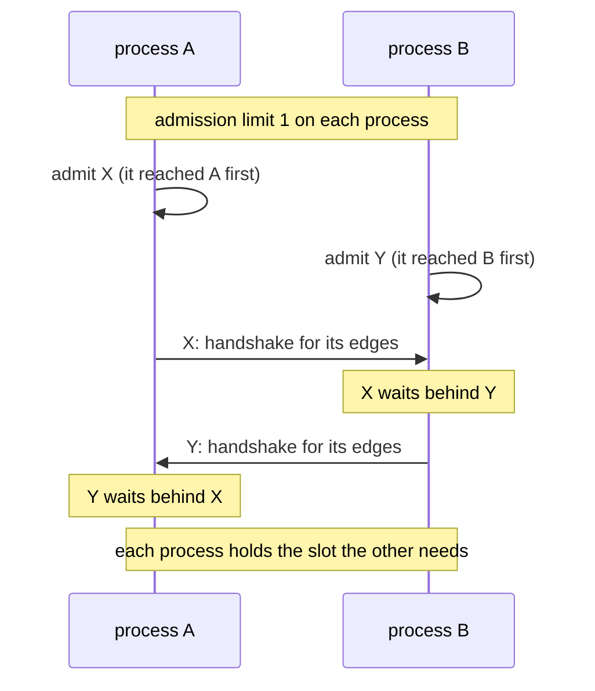
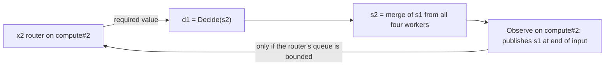

# Running at scale

Every plan so far ran on `compute[4]`. On a thousand workers the plan holds the same facts. What
changes is cost, which grows with the number of workers, with its square, or with the number of
files.

The engine absorbs most of that cost by choosing the physical shape of each edge
([Everything in the plan](../part-2/01-everything-in-the-plan.md)). Where a fix changes what a
worker ends up with, it is a plan node that you can print.

## Three hosts, three scales

The three hosts in [Part IV](../part-4/04-one-ir-three-integrations.md) use the same Plan IR at
different scales. The ranges are design targets, not measurements: the Distributed Sirius prototype
has run on up to 16 GPUs across four machines.

| Host | Plan it builds | Target scale | What limits it |
|---|---|---|---|
| [sirius-duckdb](../part-4/01-duckdb-extension.md) | One closed plan in one process | One machine, a handful of GPUs | One machine; interactive queries |
| [Distributed Sirius](../part-4/03-distributed-sirius.md) | The same closed plan, built by every process (SPMD); no coordinator | Tens of GPUs, up to the low hundreds; batch-style queries | Every process builds and checks the whole plan; admission spans every process; fail-stop unless exchanges are [spooled](07-failure-cancellation-and-recovery.md#durability-pipelined-or-spooled) |
| A coordinator: [StarRocks](../part-4/02-starrocks.md) today, a future Sirius coordinator | One open instance plan per worker, built by whoever schedules it | Hundreds of GPUs and beyond | The coordinator owns scheduling, admission and retry |

Distributed Sirius has a ceiling because it has no coordinator. Up to the low hundreds of GPUs,
with batch queries that run for seconds to minutes, the costs in its row are small next to the
work. Beyond that, something has to schedule. A coordinator changes the plan form and keeps the
Plan IR, so a query means the same thing under every host.

## What grows with the worker count

The numbers in this section use one cluster: **1,000 workers on 125 hosts with 8 GPUs each**, one
process per host. N is the number of workers. The counts follow from the plan. None of the
techniques in the last column is in the engine today; its only cross-process transport is the
prototype's.

| Cost | Grows as | At 1,000 workers | What keeps it in check |
|---|---|---|---|
| Streams of one all-to-all exchange | senders x receivers | 1,000,000 logical streams, each ending with its own end of stream | The engine pools streams per process pair: 125 x 125 ordered pairs (15,500 of them across hosts), 64 logical streams each |
| A broadcast | senders x receivers | Every batch reaches 1,000 workers | The engine multicasts or forwards through intermediate workers (relay broadcast): each batch crosses each host link once |
| A value merge to every worker, logically | N^2 shares | An 8 MiB Bloom filter: 1,000,000 shares, about 7.6 TiB | The engine reduces it as a tree: 1,998 transfers, about 15.6 GiB; about 1.9 GiB on the network if each host merges first |
| A value merge through a leader | 2N messages | 2,000 messages | A plan choice: [Deciding on a leader](../part-2/06-adaptive-plans.md#deciding-on-a-leader) |
| The handshake at `start` | edges x peer process pairs | 5 edges x 15,500 ordered cross-host pairs: 77,500 comparisons | The engine sends one message per process pair, carrying everything that pair compares |
| Plan size with inline split lists | files, on every process | 1,000,000 splits, about 100 MB per process; 125 separate listings | A [split manifest](#split-manifests): the plan holds a digest, constant in size; the 100 MB manifest is fetched once per process and cached |

### Exchanges: N squared streams

A hash exchange from `compute[1000]` to `compute[1000]` has a stream from every sender to every
receiver. The [protocol](02-exchanges-in-the-engine.md#the-protocol) ends each with its own end of
stream, even when it carried zero rows. The plan cannot remove those streams, because every sender
may hold rows for every partition.

The engine reduces the cost per stream instead:

- It pools streams per process pair and reuses connections across executions: 7,750 connections if
  each carries both directions.
- One message on a pooled connection may carry many end-of-stream markers for its process pair,
  under their original logical ids, so the receiver still counts one per sender.
- A two-level shuffle moves rows between the GPUs of a host over NVLink first, then across the
  network.

All of these are
[physical shapes](02-exchanges-in-the-engine.md#the-logical-edge-and-its-physical-shape); none
changes what a receiver ends up with.

### Value merges: all to all in the plan, a tree on the wire

A `ValueExchange` that merges a partial runtime filter into a global one on every worker is all to
all *logically*: every receiver ends up with the merge of every sender's share. Merge rules are
associative and commutative, so the engine may reduce the shares in any shape. For an 8 MiB Bloom
filter:

- **Literally all to all:** 1,000 x 1,000 shares of 8 MiB, which is about 7.6 TiB.
- **Tree reduction:** the shares are ORed up a binary tree to one root (999 transfers), and the
  result is sent back down a tree (999 transfers). That is 1,998 x 8 MiB, about 15.6 GiB, over
  about 20 hops.
- **Via the host first:** each host ORs its 8 shares over NVLink, the 125 host results are reduced
  and redistributed as a tree over the network (2 x 124 transfers), and each host fans the result
  out to its GPUs. That is 248 x 8 MiB, about 1.9 GiB, on the network.

The engine chooses the shape per value and per binding.

The [leader pattern](../part-2/06-adaptive-plans.md#deciding-on-a-leader) is a plan choice instead:
merging to `head[1]` and delivering the result through a one-sender `ValueExchange` costs 2N
messages. [What it costs](#what-it-costs) uses it for a partition assignment.

### Handshakes

At `start`, every process compares each of its edges with its peers
([Agreement before the first byte](02-exchanges-in-the-engine.md#agreement-before-the-first-byte)).
The engine batches the comparisons into one message per process pair, so the handshake costs one
round trip:

- For a closed plan the message carries one record (the execution id, the fingerprint and the
  bindings digest), because the fingerprint already covers every edge.
- For open plans it carries the signature of every edge the pair shares.

A peer that never answers fails the edge with `transport` after the first-contact deadline
([Failure, cancellation and recovery](07-failure-cancellation-and-recovery.md)).

### Plan size and build cost

A scan stores, per worker, the exact list of splits that worker reads
([Shard kinds](../part-2/02-workers-and-distribution.md#shard-kinds)). Take a table with
**1,000,000 files** on 1,000 workers:

- Every process that builds the closed plan lists the table itself, so the object store answers
  125 listings of a million entries.
- Each process holds the full split lists, about 100 bytes per split, and the fingerprint hashes
  all of it.
- Two listings taken a moment apart can differ if a file appeared in between. The fingerprints then
  differ and `start` fails with `binding_mismatch`.

The splits must stay in the plan: by
[rule 4](../part-2/01-everything-in-the-plan.md#the-ownership-rule), bindings say where, never
what. What can change is *how* the plan holds them.

## Split manifests

A **split manifest** is an immutable list of splits, identified by a digest of its contents. A
`TableSource` built from a manifest carries the manifest instead of a file list. A scan over it
stores its shard rule and the manifest's digest, and the plan's fingerprint covers the digest.

The per-worker lists are still fixed when the plan is built: they follow from the rule, the
manifest and the set size, so every process that holds the same manifest derives the same lists.

The host lists the table once, wherever it plans, and ships the manifest's bytes to every process
the same way it ships endpoints:

```cpp
#include <sirius/sirius.hpp>
using namespace sirius;

// On the one process that lists the table.
Result<std::vector<std::byte>> list_lineitem_once(std::vector<Split> splits) {
  SIRIUS_TRY(manifest, SplitManifest::create(std::move(splits)));   // 1,000,000 splits
  return manifest.to_bytes();
}
```

```rust
use sirius::prelude::*;

// On the one process that lists the table.
fn list_lineitem_once(splits: Vec<Split>) -> Result<Vec<u8>, PlanError> {
    let manifest = SplitManifest::try_new(splits)?;  // 1,000,000 splits
    Ok(manifest.to_bytes())
}
```

Every process builds its table source from those bytes. `from_bytes` recomputes the digest, so a
damaged manifest never reaches a plan:

```cpp
SIRIUS_TRY(manifest, SplitManifest::from_bytes(shipped));
SIRIUS_TRY(lineitem, TableSource::from_manifest("lineitem", manifest, lineitem_schema));
SIRIUS_TRY(rows, Relation::scan(lineitem, ScanOptions::on(compute)
                                              .with_columns({"l_orderkey", "l_extendedprice",
                                                             "l_discount"})
                                              .with_shards(Shards::files_round_robin())));
```

```rust
let manifest = SplitManifest::from_bytes(&shipped)?;
let lineitem = TableSource::from_manifest("lineitem", &manifest, &lineitem_schema)?;
let rows = Relation::scan(&lineitem, ScanOptions::on(&compute)
                                         .with_columns(&["l_orderkey", "l_extendedprice",
                                                         "l_discount"])
                                         .with_shards(Shards::files_round_robin()))?;
```

Over a manifest, `files_round_robin` deals manifest entries: entry *i* goes to worker *i mod n*.
An entry may be a whole file or a byte range. `byte_ranges` is not offered over a manifest,
because the manifest already fixes the splits; cut ranges when you create it.

In joined and split form the scan prints its rule, then the manifest's short digest and size:

```text
Scan lineitem [l_orderkey, l_extendedprice, l_discount]
              on compute[1000]  shards=files_round_robin  manifest=3f9a1c2e (1000000 splits)
```

The instance form shows only that worker's slice, as indices into the manifest. This is
`compute#2`:

```text
Scan lineitem [l_orderkey, l_extendedprice, l_discount]
              manifest=3f9a1c2e  splits=[2, 1002, 2002, ..., 999002] (1000 of 1000000)
```

The plan holds only a digest, so building, printing, diffing and fingerprinting it is cheap at any
table size, and two processes cannot disagree by listing at different moments. Also:

- Each process fetches the manifest once and caches it by digest, so later queries over the same
  snapshot fetch nothing.
- How a manifest reaches a process is the host's business
  ([open question 1](../reference/open-questions.md#1-how-plans-travel)).
- An instance plan built by a coordinator rarely needs a manifest, because `Shards::splits` lists
  only its own worker's splits.

## Dynamic splits

With fixed split lists, a worker that finishes early cannot help a slow one. On a thousand workers
some worker is always slow, and the whole stage waits for it.

With `Shards::dynamic()`, the scan's splits, from the file list or the manifest, are **claimed by
the workers of the set at run time, exactly once each**. Today's engine balances scans only inside
one process ([Worker granularity](#worker-granularity)).

```cpp
SIRIUS_TRY(claimed, Relation::scan(lineitem, ScanOptions::on(compute)
                                                 .with_columns({"l_orderkey", "l_extendedprice",
                                                                "l_discount"})
                                                 .with_shards(Shards::dynamic())));
```

```rust
let claimed = Relation::scan(&lineitem, ScanOptions::on(&compute)
                                            .with_columns(&["l_orderkey", "l_extendedprice",
                                                            "l_discount"])
                                            .with_shards(Shards::dynamic()))?;
```

The plan prints the shard kind. The instance form prints the same continuation line without a
slice, because no worker's splits are known until it runs:

```text
Scan lineitem [l_orderkey, l_extendedprice, l_discount]
              on compute[1000]  shards=dynamic  manifest=3f9a1c2e (1000000 splits)
```

### Why it is legal

A scan's output is `arbitrary(W)`: the plan says nothing about which worker holds which row, and no
later node may rely on it. So the plan may leave open which worker reads which split, as it leaves
open which rows a `round_robin` exchange sends where.

What the workers must agree on is in the plan and compared at `start`: the split list (by digest),
the set, and the rule that every split is read exactly once. How claims are served (which worker
serves them, how many splits a claim takes, how far a worker prefetches) is physical shape.

The outcome is recorded. `report.split_claims()` lists, for every dynamic scan and every worker,
the splits it claimed:

```cpp
// a started execution, as in Prepare and execute
SIRIUS_TRY(report, std::move(started.execution).wait());
for (const SplitClaim& claim : report.split_claims()) {
  std::cout << claim.worker.set << "#" << claim.worker.index << " read "
            << claim.splits.size() << " splits\n";
}
```

```rust
// a started execution, as in Prepare and execute
let report = started.execution.wait()?;
for claim in report.split_claims() {
    println!("{}#{} read {} splits", claim.worker.set, claim.worker.index, claim.splits.len());
}
```

`report.resolved_plan()` also turns each dynamic scan into an explicit one,
`shards=explicit_splits (resolved from dynamic)`, whose per-worker lists are the claims. Its
instance form prints each worker's claimed splits as indices into the manifest. Running the
resolved plan reads every split on the same worker as before, which helps when you chase a wrong
answer.

### Where it does not apply

Dynamic claiming fits only where no per-worker property is relied on:

- `replicated` scans have nothing to claim.
- A future source-declared partitioning, where split *i* must land on a given worker for the rows
  to count as `hashed`, needs a fixed assignment. A dynamic scan always produces `arbitrary(W)`.
- The set must be sized (V24). An instance plan with an unsized hosting set reads exactly what its
  coordinator gave it with `Shards::splits`.

Claims are recorded per attempt, so a retried stage instance first re-reads the splits its failed
attempt claimed. Unclaimed splits stay open to every worker of the set, the retried one included.

This answers [open question 22](../reference/open-questions.md#22-dynamic-split-assignment): split
assignment moves at run time only through an explicit shard kind. There is no implicit stealing.

## Skew: more partitions than workers

Hash partitioning spreads distinct keys evenly, not rows. When some keys have far more rows than
others, one worker gets more than its share.

The first answer is **over-partitioning**: `Partitions::fixed(P)` with P greater than |T|, so that
each worker holds several partitions. With the default rule, partition *p* still goes to worker
*p mod |T|* wherever the heavy partitions fall. `Partitions::assigned_by` chooses the
partition-to-worker map at run time instead, from the observed partition sizes.

An **assignment** is a runtime value, like `Boundaries`. An `AssignPartitions` node computes it
from a global histogram of bytes per partition. The assignment is required, and global on the set
it controls. Value ids for assignments use the letter `a`.

Take a join of orders and customers on the customer key, where a few customers have far more
orders than the rest:

```cpp
// orders_scan and customer_scan are scans of orders and customer on compute
SIRIUS_TRY(spec, StatisticsSpec::partition_bytes({"o_custkey"}, 16));   // HashScheme::v1()
SIRIUS_TRY(observed, orders_scan.observe(spec));
SIRIUS_TRY(s2, observed.statistics.merge_to(compute));
SIRIUS_TRY(a1, Assignment::balanced(s2, compute));
SIRIUS_TRY(left, observed.relation.exchange(
    Exchange::hash({"o_custkey"}, compute, Partitions::assigned_by(a1))));
SIRIUS_TRY(right, customer_scan.exchange(
    Exchange::hash({"c_custkey"}, compute, Partitions::assigned_by(a1))));
SIRIUS_TRY(on, JoinOn::keys({{"o_custkey", "c_custkey"}}));
SIRIUS_TRY(joined, left.join(right, JoinType::inner, std::move(on), JoinOptions::defaults()));
```

```rust
// orders_scan and customer_scan are scans of orders and customer on compute
let spec = StatisticsSpec::partition_bytes(&["o_custkey"], 16, HashScheme::v1())?;
let observed = orders_scan.observe(spec)?;
let s2 = observed.statistics.merge_to(&compute)?;
let a1 = Assignment::balanced(&s2, &compute)?;
let left = observed.relation.exchange(&Exchange::hash(&["o_custkey"], &compute,
                                                      Partitions::assigned_by(&a1),
                                                      HashScheme::v1()))?;
let right = customer_scan.exchange(&Exchange::hash(&["c_custkey"], &compute,
                                                   Partitions::assigned_by(&a1),
                                                   HashScheme::v1()))?;
let on = JoinOn::keys(&[("o_custkey", "c_custkey")])?;
let joined = left.join(&right, JoinType::Inner, on, JoinOptions::default())?;
```

`partition_bytes` counts logical bytes per partition, hashing the keys with the same scheme and
partition count the exchange will use. The merge sums the histograms element by element. An
exchange built with `assigned_by(a1)` takes its partition count from the histogram behind `a1`;
building it fails with `invalid_plan` if its key types or hash scheme differ from the histogram's.
Adding a group aggregate and a gather gives this plan:

```text
Plan "orders_per_customer" (joined)
worker sets: head[1], compute[4]
values:
  s2 = ValueExchange merge s1 -> compute[4]
  a1 = AssignPartitions balanced(s2) -> compute[4]
Output "result" on head[1]
└─ Exchange x3 gather -> head[1]
   └─ Aggregate keys=[c_custkey, c_name] measures=[order_count = count_star()]
      └─ Join inner keys=[o_custkey == c_custkey] build=right  mode=co_partitioned(x1, x2)
         ├─ Exchange x1 hash(o_custkey) partitions=16 assign=<~a1 -> compute[4]
         │  └─ Observe partition_bytes(o_custkey, 16) ~> s1
         │     └─ Scan orders [o_orderkey, o_custkey]  on compute[4]  shards=files_round_robin
         └─ Exchange x2 hash(c_custkey) partitions=16 assign=<~a1 -> compute[4]
            └─ Scan customer [c_custkey, c_name]  on compute[4]  shards=files_round_robin
```

The join is still co-partitioned, because both exchanges have the same
[partitioning signature](../part-2/03-exchanges.md#the-partitioning-signature-and-co-partitioning),
which includes the assignment `a1`. Exchanges with different assignments are not co-partitioned,
and V20 rejects a join over them. The inner join's output is hashed on either key, so the
single-phase aggregate on `c_custkey` needs no further exchange (V6).

### The policy

`balanced` is a pure function with integer inputs, so every worker computes the same map from the
same histogram, as V15 requires of `AssignPartitions`. It takes partitions largest first, ties by
partition index, and gives each to the worker with the smallest load so far, ties by worker index.

Like a `Boundaries` value, every delivered assignment carries a digest, and so does every batch on
an assigned exchange. A receiver that sees a different digest fails the execution with `execution`.

Suppose partition 0 holds 40 GiB and each of the other 15 holds 4 GiB: 100 GiB in total, 25 GiB
per worker on average.

| Worker | `p mod 4` | `balanced` |
|---|---|---|
| `compute#0` | partitions 0, 4, 8, 12: 52 GiB | partition 0: 40 GiB |
| `compute#1` | partitions 1, 5, 9, 13: 16 GiB | partitions 1, 4, 7, 10, 13: 20 GiB |
| `compute#2` | partitions 2, 6, 10, 14: 16 GiB | partitions 2, 5, 8, 11, 14: 20 GiB |
| `compute#3` | partitions 3, 7, 11, 15: 16 GiB | partitions 3, 6, 9, 12, 15: 20 GiB |

The most loaded worker drops from 52 GiB to 40 GiB. It cannot drop further, because partition 0 is
one unit.

If those 40 GiB belong to a single customer key, no choice of P helps: a hash exchange puts every
row of one key on one worker. Splitting a heavy key across workers, and replicating the matching
rows of the other side, changes which rows each worker ends up with in a way no partition map can
express. Such skew-aware exchanges are
[open question 26](../reference/open-questions.md#26-skew-aware-exchanges).

### What it costs

An assignment is a required value, so x1's rows wait for `a1` in the router's input repository, as
a range exchange waits for its boundaries. The whole observed side waits until every worker has
published its histogram, and the waiting rows can spill
([Memory](06-memory.md#every-place-data-waits-is-a-repository)).

The histogram has P buckets. With 16 partitions per worker on 1,000 workers, P is 16,000, and with
an 8-byte counter per partition one share is about 125 KiB. Merged to every worker, that is about
119 GiB logically, before the engine's tree reduction.

The leader pattern fits better: merge the histogram to `head[1]`, assign there, and deliver the
assignment through a one-sender `ValueExchange`. With a 4-byte worker index per partition, the
assignment is about 62 KiB:

```text
values:
  s2 = ValueExchange merge s1 -> head[1]
  a1 = AssignPartitions balanced(s2) -> compute[1000]
  a2 = ValueExchange merge a1 -> compute[1000]
```

Both exchanges then read `a2`, which holds the same map as `a1`.

The resolved plan substitutes the map that was used. For the 16-partition plan above, the values
block abbreviates it like a file list, as
`a1 = {0:#0, 1:#1, 2:#2, 3:#3, 4:#1, ..., 15:#3} (resolved)`, and each exchange prints it as
`partitions=16 assign={0:#0, 1:#1, ..., 15:#3}`. With the leader pattern, `a1` and the delivered
`a2` both print that map.

## Worker granularity

Each worker is bound to exactly one GPU. Moving rows between two GPUs is always an exchange, so the
plan says which GPU holds which partition. At scale this has two costs.

The first is streams. With G GPUs, an all-to-all exchange has G^2 logical streams
([Exchanges: N squared streams](#exchanges-n-squared-streams)). If a worker were a process with
8 GPUs, 1,000 GPUs would need 125 x 125, or 15,625. Pooling and two-level shuffles close most of
that gap on the wire, but the logical count still drives the handshake, the end-of-stream count and
the report.

The second is load balancing inside one machine. Today the engine places a query's work on the
GPUs of its process at run time: splits round robin by default, other tasks by data locality
([Inside one machine](../part-4/01-duckdb-extension.md#inside-one-machine)). With one worker per
GPU, the plan fixes which GPU reads which split and owns which partition, so a GPU that falls
behind cannot hand work to its neighbor. Dynamic splits and assigned partitions recover much of
this, explicitly, but not all.

The alternative is a worker that is a process with a set of devices: exchanges between processes
stay in the plan, and the engine places work on the GPUs inside each process. That would cut the
logical streams and keep today's balancing inside each process. It would also move a fact out of
the plan: which GPU holds which rows, and so which GPU's memory a hash table or a Bloom filter
occupies.

The model stays one worker per GPU for now. The trade-off, the engine evidence for both sides and
the first measurements are in
[open question 2](../reference/open-questions.md#2-worker-granularity). The measurements compare
setups that differ in more than placement, so they support the leaning without proving it.

### One machine: one process or one per GPU

On a single machine, one process can drive every GPU, as sirius-duckdb does, or each GPU can have
its own process, as a Distributed Sirius launcher may start. The plan is identical, with the same
text, fingerprint and results; only the bindings differ.

| | One process, every GPU | One process per GPU |
|---|---|---|
| Engines | One engine shares the memory tiers, the pinned host memory of each NUMA node, the table cache and the I/O reactors. | One engine per GPU. Each process gets its own share of host memory and its own cache. |
| Exchanges between GPUs | A peer copy or host staging inside the process. | The transport between processes, which may still copy over NVLink. Each pair needs a handshake. |
| Admission | One admitter for every GPU. | Gang admission across the processes ([Admission across processes](#admission-across-processes)). |
| A fatal device error | Makes the one engine unavailable, so every GPU of the machine stops taking Sirius work until the process restarts. | Takes down only that GPU's process. A query that ran on it still fails, but the others keep serving. |
| Hosts | Hosts that live in one process, such as sirius-duckdb. | Hosts that already launch processes, such as Distributed Sirius. |

Neither shape changes what any worker ends up with, so the choice can be made per deployment and
changed without touching a plan.

## Admission across processes

Today each engine admits queries on its own, first come, first served, up to
`max_concurrent_queries` (1 by default). Inside one process that is safe while no execution waits
on another (see below). Across processes it can deadlock. Two processes, A and B, both run two
queries, X and Y, with an admission limit of one each:



Neither query can start, and neither slot is released. The first-contact deadline turns the hang
into two `transport` failures.

The fix is **gang admission**: an execution is admitted everywhere or nowhere, and every process
admits in the same order.

- Every execution has an **admission key**: its priority, then its `ExecutionId`. Keys are
  ordered by priority, highest first, then by execution id. Every process computes the same key,
  because the execution id is shared and peers compare the priority when they admit.
- A process admits an execution tentatively, then tells its peers. The execution starts only when
  every process that hosts one of its workers has admitted it.
- A tentative admission yields to a waiting execution whose key comes earlier. Nothing has run
  yet, so yielding costs nothing.

No cycle can form, because the waiting execution whose key comes first is eventually admitted
everywhere. In the example, if X's key comes first, B's tentative admission of Y yields to X, X
runs on both processes, then Y does.

`ExecutionId::random()` orders executions arbitrarily. A host that wants first come, first served
puts a timestamp or a sequence number in the leading bytes and builds the id with
`ExecutionId::from_bytes`.

Admission happens in `start`, which returns once every peer has admitted the execution and the
handshake has passed, or fails with `transport` when the first-contact deadline expires. A
coordinator admits queries centrally, and each Sirius process only needs enough room for what the
coordinator sends it.

Gang admission needs one admitter per process, so admission is engine-level:
`max_concurrent_queries` and the admission order belong to the engine, not to a `Context` handle or
a prepared plan. Instance plans of one query that a process hosts under one `ExecutionId` are
admitted as one unit, so they all wait or all run. How the process starts them as one unit, and how
independent contexts in one process (which come later) would share admission, are part of
[open question 15](../reference/open-questions.md#15-one-context-per-process).

Gang admission cannot help when one execution waits on another in the same process. Until
concurrent executions exist, an engine may run its executions one at a time. So do not feed an
`Input` from another live Sirius execution in the same process: the second may wait for the slot
the first holds. Run the producer to completion and bind its batches to the consumer as a
[completed input](../part-1/06-prepare-and-execute.md#feeding-completed-inputs).

### Quotas and priority

Quotas and priority change neither what any worker ends up with nor what two workers must agree on
about an edge, so they are prepare options, never plan facts:

```cpp
auto options = PrepareOptions::defaults()
                   .with_priority(10)
                   .with_memory_quota(48ull << 30)    // per worker, on its GPU
                   .with_spill_quota(512ull << 30);   // on this process, host and disk
SIRIUS_TRY(prepared, context.prepare_with(plan, std::move(bindings), std::move(options)));
```

```rust
let options = PrepareOptions::default()
    .with_priority(10)
    .with_memory_quota(48 << 30)    // per worker, on its GPU
    .with_spill_quota(512 << 30);   // on this process, host and disk
let prepared = context.prepare_with(&plan, bindings, options)?;
```

A memory quota caps this execution's reservations on each of its workers' GPUs. A spill quota caps
what it may move to host memory and disk on this process. When an execution hits a quota, its tasks
reschedule and spill as they do under memory pressure; if that does not help, the execution fails
with `execution`.

Quotas may differ between processes. Priority is part of the admission key, so it must be the same
on every process; a mismatch is a `binding_mismatch` at admission. None of these options enters the
fingerprint.

## Credits and deadlock freedom

Between processes, transports use receiver credits: a receiver grants a sender room for a bounded
amount of data, and the sender moves no more than it was granted. Spilling is the buffer behind the
credits ([Memory](06-memory.md#no-backpressure-inside-a-process-by-design)). Both are physical
shape, and neither appears in the plan.

Credits are granted per logical stream: one exchange, one sender, one receiver. On a pooled
connection, one stream's missing credit must never hold up another's bytes. Otherwise a receiver
that is not yet reading one exchange could stall a second exchange on the same connection, and the
two would wait for each other through the wire.

Credits also add waits. Once buffers are bounded, a sender can wait for its receiver, *against* the
direction of the data. That can close a cycle that the plan's data and value edges do not show.
Here is Q5 from [Adaptive plans](../part-2/06-adaptive-plans.md), seen from one worker, with every
arrow meaning "waits for":



If the router's input queue on `compute#2` were bounded, `Observe` would wait for room, `s1` would
never be published, and every worker would wait forever.

So the engine distinguishes two kinds of queues, derived from the plan:

- A **streaming queue** is drained by a consumer that waits for nothing else. Credits may bound it.
- A **barrier queue** is one whose consumer may wait for something else first. It accepts
  everything it is sent and spills. Its receiver still grants credits, but only to pace the
  transfer; it never withholds them while it can spill.

The barrier queues are the router of an exchange that needs a required value, the build input of a
join, the probe input of a join while its build is incomplete, and each per-sender queue of a
receiver that reads its senders in a fixed order (`GatherOrder::merge` or
`GatherOrder::by_worker`).

With that rule, deadlock freedom within one execution is a property of the plan, and the validator
checks it. V1 requires the **wait-for graph** to be acyclic. The graph holds:

- the data and value edges;
- the ordered waits: a required value before rows, a join's build before its probe, every sender
  before a merge step;
- a credit wait from each producer to each streaming queue it feeds.

Every cycle a builder can make passes through a barrier queue, so most plans pass by construction.
The check matters for plans composed from instance plans with `rewrite::join_stages`, where ids are
matched by hand. Waits between two executions are outside any one plan; the rule for those is in
[Admission across processes](#admission-across-processes).

Barrier queues are still bounded by the capacity of the memory tiers. When those fill, the
execution fails with `execution` instead of hanging
([Memory](06-memory.md#no-backpressure-inside-a-process-by-design)).

This is the leaning of [open question 5](../reference/open-questions.md#5-backpressure).

## Observability at scale

On 1,000 workers, `report.exchanges()` holds a million per-pair records per exchange.
`report.exchange_summaries()` returns one record per exchange instead, with totals, quantiles of
the bytes per receiver and per sender-receiver pair, and the heaviest receivers. The ratio of the
largest receiver to the mean is the skew from the table in [The policy](#the-policy), as one
number:

```cpp
for (const ExchangeSummary& summary : report.exchange_summaries()) {
  const Quantiles& per_receiver = summary.bytes_per_receiver;
  std::cout << "p50 " << per_receiver.p50 << ", p99 " << per_receiver.p99 << ", max "
            << per_receiver.max << " bytes per receiver\n";
}
```

```rust
for summary in report.exchange_summaries() {
    let per_receiver = &summary.bytes_per_receiver;
    println!("p50 {}, p99 {}, max {} bytes per receiver", per_receiver.p50, per_receiver.p99,
             per_receiver.max);
}
```

A prepare option chooses the detail: `with_report_detail(ReportDetail::full())`, the default,
keeps per-pair records and summaries; `ReportDetail::summary()` keeps only the summaries.

Stragglers must be seen while the execution runs. `Execution::progress()` returns a snapshot for
the workers this process hosts: per stage instance, rows and bytes consumed and produced, splits
claimed and finished, and what it waits for right now (a value, credits on an exchange, or
nothing). Polled every second, it gives a live view.

A coordinator or launcher gathers every process's snapshots with `ExecutionProgress::combine`, as
it gathers reports with `ExecutionReport::combine`, and spots the worker that lags. What it does
then (wait, cancel, or with
[spooled exchanges](07-failure-cancellation-and-recovery.md#durability-pipelined-or-spooled) retry
that stage instance) is the host's decision.

## How other systems do it

The comparison follows each system's public documentation.
[Spark, Trino and Snowflake](../appendix/related-designs.md#spark-trino-and-snowflake) goes
deeper.

**Spark** schedules more tasks than it has slots, so a slow task delays only its own slice of a
stage. Adaptive query execution re-plans at stage boundaries from the sizes of materialized shuffle
outputs. Optional speculative execution starts a second copy of a slow task and keeps whichever
finishes first. The driver decides all of this at run time, without a plan you could print in
advance. In Sirius the alternatives are in the plan: decided exchanges and partition counts,
assigned partitions, and dynamic splits.

**Trino**'s coordinator enumerates splits as the query runs and hands each to a worker with room
in its queue, so a fast worker ends up with more splits. A dynamic scan in Sirius gives the same
balancing without a coordinator in the data path. A coordinator such as StarRocks remains free to
deliver work its own way.

**Snowflake**, as described in its published design, lets an idle worker steal scan files from a
slower peer. That is close to `Shards::dynamic`, except that in Sirius the scan says it may be
claimed dynamically, and the report says who read what.
[Generalized skew handling](https://www.snowflake.com/en/blog/engineering/generalized-skew-handling/)
watches the edges between operators while a query runs and moves rows from busy workers to idle
ones. In Sirius, moving rows is legal only where the plan says `arbitrary`; on a hashed edge it
changes what a worker ends up with, which is why skew-aware exchanges are
[open question 26](../reference/open-questions.md#26-skew-aware-exchanges).
