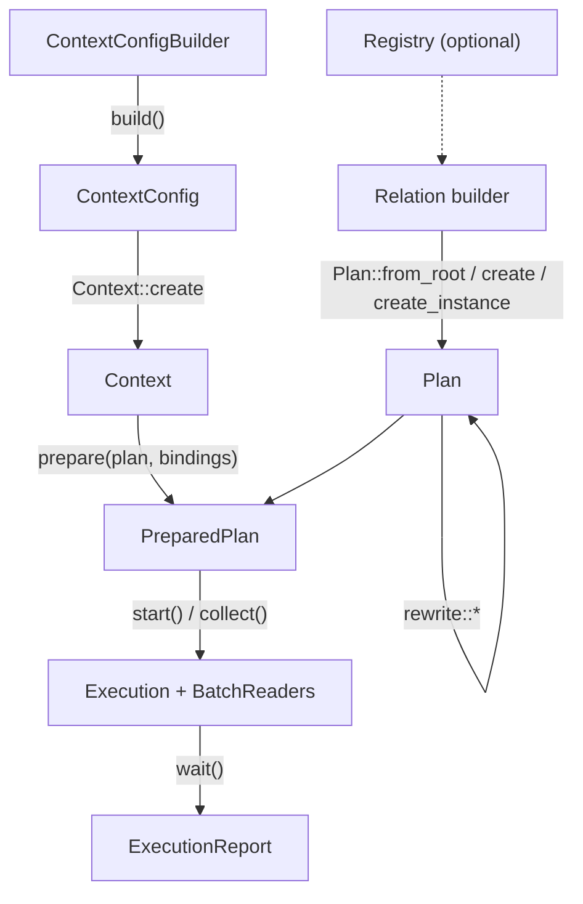

# API at a glance

This page lists the whole public surface of Sirius, C++ and Rust side by side. The namespace and the
crate are both `sirius` (`use sirius::prelude::*;`). Signatures are sketches: they omit move, copy
and destructor boilerplate and Rust's `pub`.

Every program follows one path, and the plan is the only entry point:



## Shared conventions

Both languages follow the [shared API conventions](../conventions.md#shared-api-conventions):
fallible calls return a [`Result`](../conventions.md#results-and-errors),
[keys are names, values are expressions](../conventions.md#keys-are-names-values-are-expressions),
and both wrap a thin [C ABI](../conventions.md#the-c-abi-underneath). A Rust name differs from the
C++ name only by the rules in
[Where Rust names differ](../conventions.md#where-rust-names-differ). The Rust prelude exports
every type on this page, the five error enums and the `rewrite` module; `sirius::Error` and
`sirius::Result` are written with their path. This page adds:

- **Immutable values:** `ContextConfig`, `DataType`, `Field`, `Schema`, `DataFile`, `TableSource`,
  `Expression`, `Relation`, `WorkerSet`, `SplitManifest`, `Exchange`, `RuntimeFilter`,
  `Statistics`, `Boundaries`, `Decision`, `Assignment`, `Registry`, `Plan`, `ExecutionReport`,
  `RecordBatch`.
- **Move-only capabilities:** `Context`, `PreparedPlan`, `Execution`, `BatchReader`, `InputWriter`,
  `InputSource`.
- **Retained, not borrowed.** `Context`, `PreparedPlan`, `Execution`, its readers and every
  `RecordBatch` handed to you each keep the engine alive. Handles never borrow from each other:
  there is no required drop order, Rust handles carry no lifetime parameters, and in C every
  `*_destroy` releases one handle. Dropping a handle never throws or terminates the process.
- **Enums are non-exhaustive**, so a new member never breaks callers
  ([Versioning](extension-points.md#versioning)).

**Threads.** These contracts are targets, pending an audit of the engine:

| Types | Contract |
|---|---|
| `Plan`, `Schema`, `ExecutionReport` | Immutable and shareable (`Send + Sync`) |
| `Context` | Shared between threads; executions may still run one at a time |
| `PreparedPlan`, `Execution` | Movable to another thread (`Send`), one caller at a time |
| Each `InputWriter` or `BatchReader` | One caller each; different writers and readers run concurrently |
| `CancellationHandle` | Concurrent requests |
| `RecordBatch` | Immutable once built; cheap to copy (`Clone`), movable and shareable (`Send + Sync`) |

**Rust traits.** Beyond the signatures in the tables:

| Types | Traits |
|---|---|
| Every public type | `Debug` |
| Every type except the move-only capabilities and the types that hold one (`Bindings`, `BindingsBuilder`, `StartedExecution`, `OutputReader`, `InputChannel`, `WriteError`, `TryWriteError`) | `Clone` |
| `Endpoint`, `WorkerRef`, `Split`, `DataFile`, `Field`, `DataType`, `Schema`, `PlanLocation`, `ExecutionId`, `ExchangeId`, `ValueId`, `ValueScope`, `Fingerprint`, `ManifestDigest`, enums without fields | `PartialEq`, `Eq`, `Hash` |
| `ExchangeId`, `ValueId`, `ValueScope`, `Fingerprint`, `ManifestDigest`, `Durability`, `ProducerCount`, enums without fields | `Copy` |
| `ScanOptions`, `JoinOptions`, `ExplainOptions`, `PrepareOptions` | `Default`, where C++ has `defaults()` |
| `WorkerSet`, `WorkerRef`, `DataType`, `ExchangeId` | `Display`, as in [Plan notation](plan-notation.md): `compute[4]`, `compute#2`, `decimal(15,2)`, `x1` |
| `BatchReader` | `Iterator<Item = Result<RecordBatch, ExecutionError>>` |
| The error enums | `Display`, `std::error::Error`, `Clone`, `PartialEq`, `Eq` |
| `sirius::Error` | `From` each of the five layer enums, which is what `?` uses |

`Expression` and `Relation` do not implement `PartialEq`: `eq` builds a comparison. No `TryFrom`
repeats a named factory such as `from_bytes` or `from_arrow`.

```cpp
template <class T> using Result = std::expected<T, Error>;
```

```rust
pub type Result<T> = std::result::Result<T, Error>;
```

## Errors

C++ reports every failure as one `Error`. Rust has one error enum per layer: a call returns the
enum of its layer, and `sirius::Error` wraps all five
([Results and errors](../conventions.md#results-and-errors)).

| C++ | Rust | Notes |
|---|---|---|
| `enum class ErrorCode` | The variants of the error enums | See the code list below. |
| `ErrorCode code` | The variant | |
| `std::string message` | `Display`, and the `message` field of the variant (the one field of `Io`, `MalformedYaml` and `InvalidConfiguration`) | For people; never parse it. |
| `std::optional<PlanLocation> location` | `fn location(&self) -> Option<&PlanLocation>`, and the `location` field of the variant | Set on errors about a plan. In Rust on `PlanError`, `PrepareError`, `ExecutionError` and `sirius::Error`. |
| `std::optional<WorkerRef> worker` | `fn worker(&self) -> Option<&WorkerRef>`, and the `worker` field of the variant | The worker that failed. In Rust on `ExecutionError` and `sirius::Error`. |
| `struct PlanLocation { NodeId node; std::optional<StageId> stage; }` | `struct PlanLocation { node: NodeId, stage: Option<StageId> }` | |

| C++ code | Rust variant | Meaning |
|---|---|---|
| `configuration_io` | `ConfigError::Io` | A configuration file could not be read. |
| `malformed_yaml` | `ConfigError::MalformedYaml` | The YAML did not parse. |
| `invalid_configuration` | `ConfigError::InvalidConfiguration` | The configuration is not valid. |
| `allocation_failure` | `AllocationFailure`, in every enum | |
| `invalid_argument` | `ConfigError::InvalidPath` from `from_yaml`; `Unexpected` everywhere else | |
| `internal_error` | `Unexpected`, in every enum | |
| `context_initialization` | `ContextError::Initialization` | `Context::create` failed: hardware resolution or engine initialization. Also returned while an engine is alive in this process, including one kept alive only by prepared plans, executions or batches, one still shutting down, and an unavailable engine that a handle still holds ([How long a context lives](../part-1/03-context-and-session.md#how-long-a-context-lives)). |
| `invalid_plan` | `PlanError::Invalid` | Construction or validation failed: structure, scope, type, distribution, or a name the registry does not know. |
| `unsupported` | `PrepareError::Unsupported` | A valid plan this engine build cannot run (`check`, `prepare`), or that the bound devices cannot run (`prepare`), including an explicit property the engine cannot honor. Never replanned and never run elsewhere. |
| `binding_mismatch` | `PrepareError::BindingMismatch` from `prepare` and the bindings builders; `ExecutionError::BindingMismatch` from `start` on | Bindings incomplete or inconsistent, or peers disagree at the handshake, which runs eagerly at `start`. Also an `ExecutionId` started again for a worker that already ran under it, a bindings digest (with its binding epoch) that differs after a retry, and a priority that differs between peers at admission. |
| `transport` | `ExecutionError::Transport` | Peer unreachable, timeout, protocol mismatch, a first-contact deadline that expired. |
| `execution` | `ExecutionError::Failed` | This query failed and the engine is fine: I/O, a recoverable device error, out of memory after retry, a quota that retries and spilling cannot meet, a failed required value, a sum that overflows its result type, a null or negative count in a `Repeat`, a decision, boundaries or assignment digest that differs between sender and receiver, a re-published value share whose digest differs from the merged one. |
| `source_mismatch` | `PrepareError::SourceMismatch` from `prepare`; `ExecutionError::SourceMismatch` from readers and `wait` | C `SIRIUS_SOURCE_MISMATCH`. A scanned file does not match the plan: a scanned column is absent or has another type, a `required` column holds a null, or the file's size differs from its declared size. Returned by the execution when a worker opens or reads the file, and by `prepare` under `SourceCheck::at_prepare`, where an unreadable file also counts. Carries the scan as its location. A file that is missing or unreadable at run time is `execution`. See [The source check](../part-1/05-relations-and-plans.md#the-source-check). |
| `cancelled` | `ExecutionError::Cancelled` | The execution was cancelled. |
| `runtime_unavailable` | `RuntimeUnavailable`, in `ContextError`, `PrepareError` and `ExecutionError`, by the call that returns it | C `SIRIUS_RUNTIME_UNAVAILABLE`. The engine is down for this process after a fatal device error or GPU work whose completion could not be confirmed. Returned by the execution that hit the fault and by every later call on any handle. `Context::create` returns it only after the engine was abandoned. Permanent until the process restarts; nothing is replayed on the CPU. See [How long a context lives](../part-1/03-context-and-session.md#how-long-a-context-lives). |

### Rust error enums

```rust
#[non_exhaustive]
enum ConfigError {
    Io(String),
    MalformedYaml(String),
    InvalidConfiguration(String),
    InvalidPath,
    AllocationFailure,
    Unexpected { status: u32, message: String },
}

#[non_exhaustive]
enum ContextError {
    Initialization { message: String },
    RuntimeUnavailable { message: String },
    AllocationFailure,
    Unexpected { status: u32, message: String },
}
```

```rust
#[non_exhaustive]
enum PlanError {
    Invalid { message: String, location: Option<PlanLocation> },
    AllocationFailure,
    Unexpected { status: u32, message: String },
}

#[non_exhaustive]
enum PrepareError {
    Unsupported { message: String, location: Option<PlanLocation> },
    BindingMismatch { message: String, location: Option<PlanLocation> },
    SourceMismatch { message: String, location: Option<PlanLocation>, uri: String },
    RuntimeUnavailable { message: String },
    AllocationFailure,
    Unexpected { status: u32, message: String },
}
```

```rust
#[non_exhaustive]
enum ExecutionError {
    Failed { message: String, location: Option<PlanLocation>, worker: Option<WorkerRef> },
    Transport { message: String, location: Option<PlanLocation>, worker: Option<WorkerRef> },
    BindingMismatch { message: String, location: Option<PlanLocation>, worker: Option<WorkerRef> },
    SourceMismatch {
        message: String,
        location: Option<PlanLocation>,
        worker: Option<WorkerRef>,
        uri: String,
    },
    RuntimeUnavailable {
        message: String,
        location: Option<PlanLocation>,
        worker: Option<WorkerRef>,
    },
    Cancelled,
    AllocationFailure,
    Unexpected { status: u32, message: String },
}
```

```rust
#[derive(Debug, Clone, PartialEq, Eq, thiserror::Error)]
#[non_exhaustive]
enum Error {
    #[error(transparent)] Config(#[from] ConfigError),
    #[error(transparent)] Context(#[from] ContextError),
    #[error(transparent)] Plan(#[from] PlanError),
    #[error(transparent)] Prepare(#[from] PrepareError),
    #[error(transparent)] Execution(#[from] ExecutionError),
}

impl PlanError { fn location(&self) -> Option<&PlanLocation>; }
impl PrepareError { fn location(&self) -> Option<&PlanLocation>; }
impl ExecutionError {
    fn location(&self) -> Option<&PlanLocation>;
    fn worker(&self) -> Option<&WorkerRef>;
}
impl Error {
    fn location(&self) -> Option<&PlanLocation>;
    fn worker(&self) -> Option<&WorkerRef>;
}
```

`Display` prints the text C++ has in `Error::message`. A `location` or `worker` field is `None`
where C++ leaves the field empty, and `location()` and `worker()` read the field of whichever
variant the error is. `Unexpected` holds a C status the layer has no variant for, with its
diagnostic; `internal_error` arrives there. `InvalidPath` is a configuration path that cannot be
passed to the engine, such as one with a NUL byte.

| Enum | Returned by |
|---|---|
| `ConfigError` | `ContextConfigBuilder::try_new`, `from_yaml`, `build`; `DeviceSelection::ids`; `TransportConfig::network` |
| `ContextError` | `Context::try_new` |
| `PlanError` | Every call that builds something without an engine: types, schemas, values, `RecordBatch::from_arrow`, the registry, expressions, measures, grouping sets, worker sets, sources, relations, exchanges, runtime values, plans and rewrites |
| `PrepareError` | `Context::check`, `prepare`, `prepare_with`; the values that bindings are made of: `Endpoint::from_bytes`, `ExecutionId::from_bytes`, `WorkerBinding::to`, `BindingsBuilder::build`, `InputSource::completed`, `InputChannel::try_new`, `ProducerCount::from_size` |
| `ExecutionError` | `start`, `collect`; a `BatchReader`'s items and `poll`; `wait`, `next_event`, `retry_stage`; `InputWriter::finish`; `RecordBatch::to_arrow`; `ExecutionProgress::combine`; `ExecutionReport::combine` |

## Configuration

| C++ | Rust | Notes |
|---|---|---|
| `ContextConfigBuilder()` | `ContextConfigBuilder::try_new() -> Result<Self, ConfigError>` | Starts from defaults. Rust returns a failed allocation as `ConfigError::AllocationFailure`. |
| `static Result<ContextConfigBuilder> from_yaml(const std::filesystem::path&)` | `fn from_yaml(path: impl AsRef<Path>) -> Result<Self, ConfigError>` | YAML layered over defaults. |
| `ContextConfigBuilder with_devices(DeviceSelection devices) &&` | `fn with_devices(self, devices: DeviceSelection) -> Self` | |
| `ContextConfigBuilder with_memory(MemoryLimits limits) &&` | `fn with_memory(self, limits: MemoryLimits) -> Self` | |
| `ContextConfigBuilder with_transport(TransportConfig transport) &&` | `fn with_transport(self, transport: TransportConfig) -> Self` | |
| `Result<ContextConfig> build() const` | `fn build(&self) -> Result<ContextConfig, ConfigError>` | No hardware access. |
| `class ContextConfig` | `struct ContextConfig` | Opaque immutable snapshot with no getters. |
| `static DeviceSelection all()` | `DeviceSelection::all() -> Self` | |
| `static Result<DeviceSelection> ids(std::vector<int> device_ids)` | `DeviceSelection::ids(device_ids: impl IntoIterator<Item = i32>) -> Result<Self, ConfigError>` | |
| `static TransportConfig in_process()` | `TransportConfig::in_process() -> Self` | |
| `static Result<TransportConfig> network(NetworkOptions options)` | `TransportConfig::network(options: NetworkOptions) -> Result<Self, ConfigError>` | |

## Context and Endpoint

Plans are checked and prepared on the `Context`. Preparation never rewrites a plan: it checks
support, resolves `auto` properties and binds, in that order
([Preparing a plan](../part-1/06-prepare-and-execute.md#preparing-a-plan)).

| C++ | Rust | Notes |
|---|---|---|
| `static Result<Context> Context::create(const ContextConfig& config)` | `Context::try_new(config: &ContextConfig) -> Result<Context, ContextError>` | Resolves hardware and returns a move-only handle to the process's one engine. Fails with `context_initialization` or `runtime_unavailable`; [Errors](#errors) says when. |
| `std::span<const Device> devices() const` | `fn devices(&self) -> &[Device]` | |
| `std::span<const Endpoint> device_endpoints() const` | `fn device_endpoints(&self) -> &[Endpoint]` | One per admitted GPU. |
| `Result<SupportReport> check(const Plan& plan) const` | `fn check(&self, plan: &Plan) -> Result<SupportReport, PrepareError>` | Build-level engine support only, without bindings (V21, V22). |
| `Result<PreparedPlan> prepare(const Plan& plan, Bindings bindings) const` | `fn prepare(&self, plan: &Plan, bindings: Bindings) -> Result<PreparedPlan, PrepareError>` | Consumes the bindings; binds workers, inputs and output readers (V23). Equal to `prepare_with(plan, bindings, PrepareOptions::defaults())`. |
| `Result<PreparedPlan> prepare_with(const Plan& plan, Bindings bindings, PrepareOptions options) const` | `fn prepare_with(&self, plan: &Plan, bindings: Bindings, options: PrepareOptions) -> Result<PreparedPlan, PrepareError>` | Options that are never plan facts and never enter the fingerprint. |
| `static Result<Endpoint> Endpoint::from_bytes(std::span<const std::byte> bytes)` | `Endpoint::from_bytes(bytes: &[u8]) -> Result<Endpoint, PrepareError>` | An endpoint is (process, device), opaque and comparable. |
| `std::vector<std::byte> to_bytes() const` | `fn to_bytes(&self) -> Vec<u8>` | Shareable between processes. |
| `bool operator==(const Endpoint&) const` | `impl Clone + Eq + Hash for Endpoint` | Cheap to copy (C++) / `Clone` (Rust). |
| `static PrepareOptions PrepareOptions::defaults()` | `impl Default for PrepareOptions` | |
| `PrepareOptions with_first_contact_deadline(std::chrono::milliseconds limit) &&` | `fn with_first_contact_deadline(self, limit: Duration) -> Self` | Every peer of an edge must answer the handshake within `limit` after `start`, or the edge fails with `transport`. Always finite; default 60 s. See [Failure, cancellation and recovery](../part-5/07-failure-cancellation-and-recovery.md#the-first-contact-deadline). |
| `PrepareOptions with_priority(std::uint32_t priority) &&` | `fn with_priority(self, priority: u32) -> Self` | Part of the admission key (priority, `ExecutionId`): higher priority is admitted first, and execution id breaks ties. Must be equal on every peer; a mismatch is `binding_mismatch` at admission. |
| `PrepareOptions with_memory_quota(std::uint64_t bytes_per_worker) &&` | `fn with_memory_quota(self, bytes_per_worker: u64) -> Self` | Caps this execution's reservations on each of its workers' GPUs. May differ between processes. |
| `PrepareOptions with_spill_quota(std::uint64_t bytes) &&` | `fn with_spill_quota(self, bytes: u64) -> Self` | Caps what this execution may spill to host memory and disk on this process. |
| `PrepareOptions with_report_detail(ReportDetail detail) &&` | `fn with_report_detail(self, detail: ReportDetail) -> Self` | |
| `ReportDetail::full()`, `summary()` | `ReportDetail::full()`, `summary()` | `full()`, the default, keeps per-pair exchange records and summaries; `summary()` keeps only the summaries. |
| `PrepareOptions with_source_check(SourceCheck check) &&` | `fn with_source_check(self, check: SourceCheck) -> Self` | When this process checks the Parquet files its workers read against the plan. Default `at_open`. May differ between processes. See [Checking sources early](../part-1/06-prepare-and-execute.md#checking-sources-early). |
| `enum class SourceCheck { at_open, at_prepare }` | `#[non_exhaustive] enum SourceCheck { AtOpen, AtPrepare }` | `at_open`: a worker checks each file when it opens it; this always happens. `at_prepare`: `prepare` also checks, from file metadata, the files in the splits fixed for the workers this process hosts, and fails with `source_mismatch`. |

## Types, schemas and values

| C++ | Rust | Notes |
|---|---|---|
| `DataType::boolean()`, `int8()`, `int16()`, `int32()`, `int64()`, `uint8()`, `uint16()`, `uint32()`, `uint64()`, `float32()`, `float64()`, `string()`, `date32()` | same names, `-> Self` | Names follow Arrow. |
| `static DataType timestamp(TimeUnit unit)` | `fn timestamp(unit: TimeUnit) -> Self` | A date and time of day without a time zone: an int64 count of `unit` since 1970-01-01 00:00:00. Different units are different types. Prints `timestamp(us)`. |
| `enum class TimeUnit { second, millisecond, microsecond, nanosecond }` | `#[non_exhaustive] enum TimeUnit { Second, Millisecond, Microsecond, Nanosecond }` | Printed `s`, `ms`, `us`, `ns`. `Copy` in Rust. |
| `static Result<DataType> decimal(std::uint8_t precision, std::int8_t scale)` | `fn decimal(precision: u8, scale: i8) -> Result<Self, PlanError>` | |
| `static DataType list(DataType element)` | `fn list(element: DataType) -> Self` | |
| `static Result<DataType> struct_of(std::vector<Field> fields)` | `fn struct_of(fields: impl IntoIterator<Item = Field>) -> Result<Self, PlanError>` | |
| `const std::optional<StateType>& state() const` | `fn state(&self) -> Option<&StateType>` | Set only on aggregate state columns. |
| `Field::required(std::string name, DataType type)` | `Field::required(name: &str, ty: DataType) -> Self` | |
| `Field::nullable(std::string name, DataType type)` | `Field::nullable(name: &str, ty: DataType) -> Self` | |
| `static Result<Schema> Schema::create(std::vector<Field> fields)` | `Schema::try_new(fields: impl IntoIterator<Item = Field>) -> Result<Schema, PlanError>` | Rejects empty and duplicate names. |
| `static Result<Schema> from_arrow(const ArrowSchema& schema)` | `Schema::from_arrow(schema: &ArrowSchema) -> Result<Schema, PlanError>` | Each `DataType` maps to the Arrow type of the same name. An Arrow type without a `DataType`, such as a timestamp with a time zone, fails with `invalid_plan`. |
| `std::span<const Field> fields() const` | `fn fields(&self) -> &[Field]` | |
| `Value::boolean(bool)`, `int8`, `int16`, `int32`, `int64`, `uint8`, `uint16`, `uint32`, `uint64`, `float32`, `float64`, `string` | `Value::boolean(v: bool)`, `int8(v: i8)`, `int16`, `int32`, `int64`, `uint8(v: u8)`, `uint16`, `uint32`, `uint64`, `float32(v: f32)`, `float64`, `string` | Infallible. One factory per scalar type; a literal has exactly that type. |
| `static Value timestamp(std::int64_t ticks, TimeUnit unit)` | `Value::timestamp(ticks: i64, unit: TimeUnit) -> Self` | Infallible. |
| `static Result<Value> date32(int year, unsigned month, unsigned day)` | `Value::date32(y: i32, m: u32, d: u32) -> Result<Self, PlanError>` | |
| `static Result<Value> decimal(std::string_view digits, std::uint8_t precision, std::int8_t scale)` | `Value::decimal(digits: &str, precision: u8, scale: i8) -> Result<Self, PlanError>` | |
| `static Value null(DataType type)` | `Value::null(ty: DataType) -> Self` | |

## Record batches and Arrow

A `RecordBatch` is the unit of data you pass in (`Relation::values`, `InputSource::completed`,
`InputWriter::write`) and read out (`BatchReader::next`, `collect`). It crosses the API through
the Arrow C Data Interface.

| C++ | Rust | Notes |
|---|---|---|
| `static Result<RecordBatch> RecordBatch::from_arrow(ArrowSchema* schema, ArrowArray* array)` | `RecordBatch::from_arrow(schema: ArrowSchema, array: ArrowArray) -> Result<RecordBatch, PlanError>` | Arrow C Data Interface, CPU memory. Takes ownership of the arrays. |
| `static Result<RecordBatch> RecordBatch::from_arrow_device(ArrowSchema* schema, ArrowDeviceArray* array)` | `RecordBatch::from_arrow_device(schema: ArrowSchema, array: ArrowDeviceArray) -> Result<RecordBatch, PlanError>` | Arrow C Device Data Interface, GPU memory. Still being evaluated, because that interface is experimental. |
| `Result<void> to_arrow(ArrowSchema* out_schema, ArrowArray* out_array) const` | `fn to_arrow(&self) -> Result<(ArrowSchema, ArrowArray), ExecutionError>` | Exports the batch, copying device memory to the host where it has to. |
| `const Schema& schema() const` | `fn schema(&self) -> &Schema` | |
| `std::int64_t num_rows() const` | `fn num_rows(&self) -> i64` | |
| copy constructor and copy assignment | `impl Clone for RecordBatch` | Cheap to copy (C++) / `Clone` (Rust): a copy shares the batch's immutable columns. |

Four rules hold for every batch:

- **Import needs no engine.** `from_arrow` and `from_arrow_device` need no `Context` and do not
  copy the data into engine memory pools.
- **Release runs on any thread.** The Arrow release callback of an imported batch may run on any
  thread, including an engine thread, so it must not depend on the importing thread.
- **Execution synchronizes.** Before an execution reads a batch, it establishes that the memory is
  usable on the worker's device and synchronizes.
- **Exports outlive the run.** A batch handed to you, and what you export from it, outlive the
  reader and the execution it came from. The batch retains what it needs.

## Registry

Plan construction resolves functions, aggregate state types, `Decide` and `AssignPartitions`
policies, hash schemes, scan kinds, value kinds and registered nodes by name in a `Registry`; an
unknown name is `invalid_plan`. A registry is immutable and needs no `Context`. See
[Closed and open lists](extension-points.md#closed-and-open-lists).

| C++ | Rust | Notes |
|---|---|---|
| `static Registry Registry::builtin()` | `Registry::builtin() -> Registry` | Every built-in member. The default wherever a registry is optional. |
| `static RegistryBuilder Registry::builder()` | `Registry::builder() -> RegistryBuilder` | Starts from `builtin()` and extends it. How members are added is [open question 25](open-questions.md#25-open-registries-and-versioning). |
| `Result<Registry> build() &&` | `fn build(self) -> Result<Registry, PlanError>` | On `RegistryBuilder`. |

## Expressions

Neither language overloads operators: every combinator is a named method that checks scope and
types and returns a `Result`. Columns come from `Relation::column`, listed under [Facts](#facts).

| C++ | Rust | Notes |
|---|---|---|
| `static Expression literal(Value value)` | `Expression::literal(value: Value) -> Expression` | Has the type of its `Value`; never converted. |
| `const DataType& type() const` | `fn data_type(&self) -> &DataType` | |
| `Result<Expression> eq(const Expression& rhs) const` | `fn eq(&self, rhs: &Expression) -> Result<Expression, PlanError>` | Also `ne`, `lt`, `le`, `gt`, `ge`. Operands of the same type. Returns a boolean. |
| `Result<Expression> and_(const Expression& rhs) const` | `fn and(&self, rhs: &Expression) -> Result<Expression, PlanError>` | Also `or_` / `or`. C++ spells `and_`, `or_` and `not_` because `and`, `or` and `not` are alternative tokens. |
| `Result<Expression> not_() const` | `fn not(&self) -> Result<Expression, PlanError>` | |
| `Result<Expression> add(const Expression& rhs) const` | `fn add(&self, rhs: &Expression) -> Result<Expression, PlanError>` | Also `sub`, `mul`, `div`. Numeric operands of the same type. |
| `Result<Expression> cast(const DataType& to) const` | `fn cast(&self, to: &DataType) -> Result<Expression, PlanError>` | The only conversion. Never inserted for you. |
| `Result<Expression> is_null() const` | `fn is_null(&self) -> Result<Expression, PlanError>` | |
| `static Result<Expression> call(std::string_view function, std::vector<Expression> args)` | `Expression::call(function: &str, args: &[Expression]) -> Result<Expression, PlanError>` | Resolves `function` in `Registry::builtin()`. The registry entry carries the function's determinism class. |
| `static Result<Expression> call_in(const Registry& registry, std::string_view function, std::vector<Expression> args)` | `Expression::call_in(registry: &Registry, function: &str, args: &[Expression]) -> Result<Expression, PlanError>` | Resolves `function` in a host registry, such as `spark.hash`. |
| `Determinism determinism() const` | `fn determinism(&self) -> Determinism` | The most volatile class among its calls; the classes are under [Facts](#facts). |
| `NamedExpression named(std::string name) const` | `fn named(&self, name: &str) -> NamedExpression` | `NamedExpression{name, expression}`. |
| `SortKey::asc(std::string column)`, `desc(...)` | `SortKey::asc(column: &str)`, `desc(...)` | Default: nulls last, whatever the direction. |
| `SortKey nulls_first() &&`, `nulls_last() &&` | `fn nulls_first(self) -> Self`, `nulls_last(self)` | |

**No implicit conversion.** The operands of `add`, `sub`, `mul`, `div` and of the six comparisons
have the same type, for decimals the same precision and scale; anything else is `invalid_plan` at
the call. Function and measure arguments match the registry signature exactly. Both keys of a join
pair have the same type, `Union` inputs have identical types, and no key is ever cast (V4). See
[No implicit conversion](../part-1/04-schemas-and-expressions.md#no-implicit-conversion).

**Nulls and NaN.** A comparison is null when either operand is null, and nullable if either
operand is. `Filter` keeps only the rows whose predicate is true. Floating-point values compare in
one total order: -0.0 equals +0.0, and NaN equals NaN and is greater than every other value. See
[Nulls and NaN](../part-1/04-schemas-and-expressions.md#nulls-and-nan).

## Measures

Measure arguments are expressions scoped to the input of the aggregate or window they are passed
to.

| C++ | Rust | Notes |
|---|---|---|
| `static Measure count_star(std::string name)` | `Measure::count_star(name: &str) -> Measure` | Infallible. |
| `static Result<Measure> count(std::string name, const Expression& arg)` | `Measure::count(name: &str, arg: &Expression) -> Result<Measure, PlanError>` | Counts the rows whose argument is not null. |
| `static Result<Measure> sum(std::string name, const Expression& arg)` | `Measure::sum(name: &str, arg: &Expression) -> Result<Measure, PlanError>` | |
| `avg`, `min`, `max`, `count_distinct`, `stddev_samp` | same names and shape | State types: [Node catalog](node-catalog.md). |
| `static Ranking rank(std::string name)`, `dense_rank(...)`, `row_number(...)` | `Ranking::rank(name: &str) -> Ranking`, `dense_rank(...)`, `row_number(...)` | The functions of `window_ranking`. Infallible. Each adds a required `int64` column. See [Window](node-catalog.md#window). |

## Grouping sets

A `GroupingSets` value is the keys and the explicit list of sets of an aggregate with subtotals.
Semantics: [Aggregate](node-catalog.md#aggregate).

| C++ | Rust | Notes |
|---|---|---|
| `static Result<GroupingSets> GroupingSets::create(std::vector<std::string> keys, std::vector<std::vector<std::string>> sets)` | `GroupingSets::try_new(keys: &[&str], sets: &[&[&str]]) -> Result<GroupingSets, PlanError>` | Each set is a subset of `keys`; every key is in some set. The position of a set in the list is its grouping id. |
| `static Result<GroupingSets> rollup(std::vector<std::string> keys)` | `GroupingSets::rollup(keys: &[&str]) -> Result<GroupingSets, PlanError>` | Expands to the n+1 prefixes of `keys`, longest first, ending with `()`. |
| `static Result<GroupingSets> cube(std::vector<std::string> keys)` | `GroupingSets::cube(keys: &[&str]) -> Result<GroupingSets, PlanError>` | Expands to all 2^n subsets; `cube(a, b)` is `[(a, b), (a), (b), ()]`. At most 16 keys. |
| `GroupingSets with_id_name(std::string name) &&` | `fn with_id_name(self, name: &str) -> Self` | Names the grouping-id column. Default `grouping_id`. |
| `std::span<const std::string> keys() const`, `std::span<const std::vector<std::string>> sets() const`, `const std::string& id_name() const` | `fn keys(&self) -> &[String]`, `fn sets(&self) -> &[Vec<String>]`, `fn id_name(&self) -> &str` | `sets()[i]` has grouping id i. |

## Worker sets and sources

| C++ | Rust | Notes |
|---|---|---|
| `struct WorkerRef { std::string set; std::uint32_t index; }` | `struct WorkerRef { set: String, index: u32 }` | Printed `compute#2`. |
| `static Result<WorkerSet> WorkerSet::create(std::string name, std::uint32_t size)` | `WorkerSet::try_new(name: &str, size: u32) -> Result<WorkerSet, PlanError>` | A sized set, printed `compute[4]`. `size >= 1`. |
| `static Result<WorkerSet> WorkerSet::unsized(std::string name)` | `WorkerSet::try_new_unsized(name: &str) -> Result<WorkerSet, PlanError>` | An unsized set, printed `frag1[?]`. Only the hosting set of an instance plan may be unsized (V24). `unsized` is a reserved word in Rust. |
| `static WorkerSet local()` | `WorkerSet::local() -> WorkerSet` | `local[1]`, the default. |
| `const std::string& name() const`, `std::optional<std::uint32_t> size() const`, `WorkerRef at(std::uint32_t i) const` | `fn name(&self) -> &str`, `fn size(&self) -> Option<u32>`, `fn at(&self, i: u32) -> WorkerRef` | `size()` is empty on an unsized set. `at(k)` works on both kinds. |
| `struct Split { std::string uri; std::optional<std::pair<std::uint64_t, std::uint64_t>> byte_range; }` | `struct Split { uri: String, byte_range: Option<(u64, u64)> }` | The unit of scan work. |
| `DataFile(std::string uri)`, `DataFile(const char* uri)` | `impl From<&str> for DataFile`, `impl From<String> for DataFile` | One file of a table source, without a declared size. Implicit in C++, so a URI string is accepted wherever a `DataFile` is. |
| `static DataFile sized(std::string uri, std::uint64_t bytes)` | `DataFile::sized(uri: &str, bytes: u64) -> Self` | The caller declares the file's size in bytes. The size is a plan fact, covered by the fingerprint. See [Sized files](../part-2/02-workers-and-distribution.md#sized-files). |
| `const std::string& uri() const`, `std::optional<std::uint64_t> size() const` | `fn uri(&self) -> &str`, `fn size(&self) -> Option<u64>` | On `DataFile`. `size()` is empty for a file without a size. |
| `static Result<TableSource> parquet(std::string name, std::vector<DataFile> files, const Schema& schema)` | `TableSource::parquet(name: &str, files: impl IntoIterator<Item = impl Into<DataFile>>, schema: &Schema) -> Result<TableSource, PlanError>` | The schema is explicit. Each URI is literal: no glob is expanded. Opens no file. An empty URI or a declared size of 0 is `invalid_plan`. |
| `static Result<TableSource> registered(std::string scan_kind, std::string name, const Schema& schema, ScanHandle handle)` | `TableSource::registered(kind: &str, name: &str, schema: &Schema, handle: ScanHandle) -> Result<TableSource, PlanError>` | A host-registered scan kind (V22). |
| `static Result<SplitManifest> SplitManifest::create(std::vector<Split> splits)` | `SplitManifest::try_new(splits: impl IntoIterator<Item = Split>) -> Result<SplitManifest, PlanError>` | An immutable, content-addressed list of splits, identified by its digest. |
| `static Result<SplitManifest> from_bytes(std::span<const std::byte> bytes)` | `SplitManifest::from_bytes(bytes: &[u8]) -> Result<SplitManifest, PlanError>` | Recomputes the digest, so a damaged manifest never reaches a plan. |
| `std::vector<std::byte> to_bytes() const` | `fn to_bytes(&self) -> Vec<u8>` | Shareable between processes. |
| `ManifestDigest digest() const`, `std::size_t size() const` | `fn digest(&self) -> ManifestDigest`, `fn len(&self) -> usize`, `fn is_empty(&self) -> bool` | |
| `static Result<TableSource> from_manifest(std::string name, const SplitManifest& manifest, const Schema& schema)` | `TableSource::from_manifest(name: &str, manifest: &SplitManifest, schema: &Schema) -> Result<TableSource, PlanError>` | A scan over it stores its shard rule and the manifest digest. See [Split manifests](node-catalog.md#split-manifests). |
| `Shards::files_round_robin()` | `Shards::files_round_robin() -> Self` | File i, or manifest entry i, to worker i mod n. Resolved by `Relation::scan`; see [Scan](node-catalog.md#scan). |
| `Shards::byte_ranges(std::uint64_t target_bytes)` | `Shards::byte_ranges(target: u64) -> Self` | Resolved by `Relation::scan` from the declared file sizes; opens no file. `invalid_plan` if a file of the source has no declared size, over a manifest, or if `target_bytes` is 0. |
| `Shards::replicated()` | `Shards::replicated() -> Self` | Every worker reads everything. |
| `static Result<Shards> explicit_splits(std::vector<std::vector<Split>> per_worker)` | `Shards::explicit_splits(per_worker: impl IntoIterator<Item = Vec<Split>>) -> Result<Self, PlanError>` | Worker k reads `per_worker[k]`. Sized sets only. |
| `static Result<Shards> splits(std::vector<Split> splits)` | `Shards::splits(splits: impl IntoIterator<Item = Split>) -> Result<Self, PlanError>` | The hosting worker reads exactly these splits. Instance plans only. |
| `static Shards dynamic()` | `Shards::dynamic() -> Self` | The set's workers claim the splits at run time, exactly once each. Sized sets only (V24). See [Scan](node-catalog.md#scan). |
| `ScanOptions::defaults()` | `impl Default for ScanOptions` | `local[1]`, `files_round_robin`, all columns. |
| `ScanOptions::on(const WorkerSet& workers)` | `ScanOptions::on(workers: &WorkerSet) -> Self` | |
| `ScanOptions with_columns(std::vector<std::string> columns) &&` | `fn with_columns(self, columns: &[&str]) -> Self` | |
| `ScanOptions with_shards(Shards shards) &&` | `fn with_shards(self, s: Shards) -> Self` | |

## Relations

Unless the row says otherwise, every method in these tables returns `Result<Relation>` in C++ and
`Result<Relation, PlanError>` in Rust. A `Relation` is immutable; each method returns a new one.

### Leaves

| C++ | Rust | Node |
|---|---|---|
| `static scan(const TableSource& source, ScanOptions options)` | `Relation::scan(source: &TableSource, options: ScanOptions)` | `Scan` |
| `static input(std::string name, const Schema& schema, const WorkerSet& on = WorkerSet::local())` | `Relation::input(name: &str, schema: &Schema, on: &WorkerSet)` | `Input` |
| `static values(const Schema& schema, std::vector<RecordBatch> batches, const WorkerSet& on)` | `Relation::values(schema: &Schema, batches: impl IntoIterator<Item = RecordBatch>, on: &WorkerSet)` | `Values` |
| `static exchange_source(ExchangeId id, const Schema& schema, const Exchange& exchange, const WorkerSet& senders)` | `Relation::exchange_source(id: ExchangeId, schema: &Schema, exchange: &Exchange, senders: &WorkerSet)` | `ExchangeSource` (open plans) |

### Facts

| C++ | Rust | Notes |
|---|---|---|
| `const Schema& schema() const` | `fn schema(&self) -> &Schema` | |
| `const Distribution& distribution() const` | `fn distribution(&self) -> &Distribution` | Derived by the builder. |
| `const WorkerSet& workers() const` | `fn workers(&self) -> &WorkerSet` | |
| `Result<Expression> column(std::string_view name) const` | `fn column(&self, name: &str) -> Result<Expression, PlanError>` | The only way to name a column; scoped to this relation. An unknown name fails here. |
| `Result<std::vector<NamedExpression>> pass_through(std::vector<std::string> columns) const` | `fn pass_through(&self, columns: &[&str]) -> Result<Vec<NamedExpression>, PlanError>` | Plain columns for `project`. |
| `Determinism determinism() const` | `fn determinism(&self) -> Determinism` | The most volatile class in the subtree. |
| `SideEffects side_effects() const` | `fn side_effects(&self) -> SideEffects` | The strongest class in the subtree. |
| `enum class Determinism { deterministic, per_execution, volatile_ }` | `#[non_exhaustive] enum Determinism { Deterministic, PerExecution, Volatile }` | Least to most volatile. C++ spells `volatile_` because `volatile` is a keyword. See [Extension points](extension-points.md#determinism-classes). |
| `enum class SideEffects { none, idempotent, effectful }` | `#[non_exhaustive] enum SideEffects { None, Idempotent, Effectful }` | Weakest to strongest. Retry re-runs only `none` and `idempotent` nodes. See [Extension points](extension-points.md#side-effect-classes). |

### Relational

| C++ | Rust | Node |
|---|---|---|
| `filter(const Expression& predicate) const` | `fn filter(&self, predicate: &Expression)` | `Filter` |
| `project(std::vector<NamedExpression> columns) const` | `fn project(&self, columns: impl IntoIterator<Item = NamedExpression>)` | `Project` |
| `aggregate(std::vector<std::string> keys, std::vector<Measure> measures) const` | `fn aggregate(&self, keys: &[&str], measures: impl IntoIterator<Item = Measure>)` | `Aggregate` (single) |
| `aggregate_partial(std::vector<std::string> keys, std::vector<Measure> measures) const` | `fn aggregate_partial(&self, keys: &[&str], measures: impl IntoIterator<Item = Measure>)` | `Aggregate partial` |
| `aggregate_sets(const GroupingSets& sets, std::vector<Measure> measures) const` | `fn aggregate_sets(&self, sets: &GroupingSets, measures: impl IntoIterator<Item = Measure>)` | `Aggregate` (single) with grouping sets |
| `aggregate_partial_sets(const GroupingSets& sets, std::vector<Measure> measures) const` | `fn aggregate_partial_sets(&self, sets: &GroupingSets, measures: impl IntoIterator<Item = Measure>)` | `Aggregate partial` with grouping sets; `aggregate_combine` and `aggregate_final` follow as usual |
| `aggregate_combine() const` | `fn aggregate_combine(&self)` | `Aggregate combine` |
| `aggregate_final() const` | `fn aggregate_final(&self)` | `Aggregate final` |
| `join(const Relation& right, JoinType type, JoinOn on, JoinOptions options) const` | `fn join(&self, right: &Relation, ty: JoinType, on: JoinOn, options: JoinOptions)` | `Join` |
| `sort(std::vector<SortKey> keys) const` | `fn sort(&self, keys: impl IntoIterator<Item = SortKey>)` | `Sort` |
| `top_n(std::uint64_t n, std::vector<SortKey> keys) const` | `fn top_n(&self, n: u64, keys: impl IntoIterator<Item = SortKey>)` | `TopN` |
| `top_n_per_key(std::vector<std::string> keys, std::uint64_t n, std::vector<SortKey> order) const` | `fn top_n_per_key(&self, keys: &[&str], n: u64, order: impl IntoIterator<Item = SortKey>)` | `TopN` per key. `order` may be empty. |
| `limit(std::uint64_t n, std::uint64_t offset = 0) const` | `fn limit(&self, n: u64, offset: u64)` | `Limit` |
| `window_whole(std::vector<std::string> keys, std::vector<Measure> measures) const` | `fn window_whole(&self, keys: &[&str], measures: impl IntoIterator<Item = Measure>)` | `Window whole`. Measures: `count_star`, `count`, `sum`, `avg`, `min`, `max`. |
| `window_ranking(std::vector<std::string> keys, std::vector<SortKey> order, std::vector<Ranking> rankings) const` | `fn window_ranking(&self, keys: &[&str], order: impl IntoIterator<Item = SortKey>, rankings: impl IntoIterator<Item = Ranking>)` | `Window ranking`. At least one order key. |
| `window_running(std::vector<std::string> keys, std::vector<SortKey> order, std::vector<Measure> measures) const` | `fn window_running(&self, keys: &[&str], order: impl IntoIterator<Item = SortKey>, measures: impl IntoIterator<Item = Measure>)` | `Window running`. Measures: `count_star`, `count`, `sum`, `min`, `max`. At least one order key. Any other measure is `invalid_plan` at the call. |
| `static union_all(std::vector<Relation> inputs)` | `Relation::union_all(inputs: impl IntoIterator<Item = Relation>)` | `Union` |
| `repeat(std::string count) const` | `fn repeat(&self, count: &str)` | `Repeat`. `count` names an integer column; each row is emitted that many times and the column is dropped. |
| `static Result<Relation> choose(std::vector<Decision> handles, std::vector<std::pair<std::string, Relation>> arms)` | `Relation::choose(handles: &[&Decision], arms: impl IntoIterator<Item = (&str, Relation)>) -> Result<Relation, PlanError>` | `Choose`. The first handle is the Decision, the rest one-sender deliveries of it; one arm per label, same schema (V26). |

### Distribution, terminals and runtime values

| C++ | Rust | Node |
|---|---|---|
| `exchange(const Exchange& exchange) const` | `fn exchange(&self, exchange: &Exchange)` | `Exchange` |
| `exchange_sink(ExchangeId id, const Exchange& exchange) const` | `fn exchange_sink(&self, id: ExchangeId, exchange: &Exchange)` | `ExchangeSink` (terminal, open plans) |
| `output(std::string name) const` | `fn output(&self, name: &str)` | `Output` (terminal) |
| `Result<FilterBuild> build_runtime_filter(std::vector<std::string> keys, RuntimeFilterSpec spec) const` | `fn build_runtime_filter(&self, keys: &[&str], spec: RuntimeFilterSpec) -> Result<FilterBuild, PlanError>` | `RuntimeFilterBuild` |
| `apply_runtime_filter(const RuntimeFilter& filter, std::vector<std::string> keys, WaitPolicy wait = WaitPolicy::never()) const` | `fn apply_runtime_filter(&self, filter: &RuntimeFilter, keys: &[&str], wait: WaitPolicy)` | `RuntimeFilterApply` |
| `Result<Observed> observe(StatisticsSpec spec) const` | `fn observe(&self, spec: StatisticsSpec) -> Result<Observed, PlanError>` | `Observe` |
| `struct FilterBuild { Relation relation; RuntimeFilter filter; }` | `struct FilterBuild { relation: Relation, filter: RuntimeFilter }` | The relation passes data through. |
| `struct Observed { Relation relation; Statistics statistics; }` | `struct Observed { relation: Relation, statistics: Statistics }` | |

### Joins

| C++ | Rust | Notes |
|---|---|---|
| `enum class JoinType { inner, left, right, full, left_semi, left_anti, right_semi, right_anti, mark }` | `#[non_exhaustive] enum JoinType { Inner, Left, Right, Full, LeftSemi, LeftAnti, RightSemi, RightAnti, Mark }` | Output schemas: [Node catalog](node-catalog.md). |
| `enum class BuildSide { left, right, auto_ }` | `#[non_exhaustive] enum BuildSide { Left, Right, Auto }` | C++ spells `auto_` because `auto` is a keyword. `auto` is allowed only on a `co_partitioned` or `single` join (`invalid_plan` elsewhere) and is resolved by `prepare`. A `mark` join builds on its right input: `left` and `auto` on it are `invalid_plan` at `join`. See [Join](node-catalog.md#join). |
| `static Result<JoinOn> JoinOn::keys(std::vector<JoinKey> keys)` | `JoinOn::keys<K: Into<JoinKey>>(keys: impl IntoIterator<Item = K>) -> Result<JoinOn, PlanError>` | Key pairs. A (left, right) pair of names converts to a plain pair, so `keys({{"l_orderkey", "o_orderkey"}})` and `keys(&[("l_orderkey", "o_orderkey")])` work as written. |
| `JoinKey(std::string left, std::string right)`, `static JoinKey equal(std::string left, std::string right)` | `JoinKey::equal(left: &str, right: &str) -> JoinKey`, `impl From<(&str, &str)> for JoinKey`, `impl From<&(&str, &str)> for JoinKey` | A plain pair, printed `==`: a null key matches nothing. |
| `static JoinKey null_safe(std::string left, std::string right)` | `JoinKey::null_safe(left: &str, right: &str) -> JoinKey` | A null-safe pair, printed `<=>`: two nulls are equal. See [Join](node-catalog.md#join). |
| `JoinOn with_residual(Expression residual) &&` | `fn with_residual(self, residual: Expression) -> Self` | Built from a `JoinScope`. |
| `static JoinScope JoinScope::create(const Relation& left, const Relation& right)` | `JoinScope::new(left: &Relation, right: &Relation) -> JoinScope` | Cannot fail. |
| `Result<Expression> left(std::string_view column) const`, `right(...)` | `fn left(&self, column: &str) -> Result<Expression, PlanError>`, `right(...)` | |
| `static JoinOptions JoinOptions::defaults()` | `impl Default for JoinOptions` | Build side `right`. |
| `JoinOptions with_build(BuildSide side) &&` | `fn with_build(self, side: BuildSide) -> Self` | An explicit side the engine cannot honor fails `prepare` with `unsupported`. Limits on `auto` and on `mark` joins are in the `BuildSide` row. |
| `JoinOptions with_build_rows(Statistics global_rows) &&` | `fn with_build_rows(self, rows: &Statistics) -> Self` | A global `rows` Statistics of the build input, a required value. A co-partitioned `mark` join with a plain key pair needs it: V10 in [Validator invariants](node-catalog.md#validator-invariants). |
| `JoinOptions with_adaptive_broadcast(std::uint64_t max_build_bytes) &&` | `fn with_adaptive_broadcast(self, max_build_bytes: u64) -> Self` | Sugar; expands visibly into Observe, merge, Decide and two decided exchanges. |

## Exchanges

| C++ | Rust | Notes |
|---|---|---|
| `static Exchange gather(const WorkerSet& to, GatherOrder order = GatherOrder::any())` | `Exchange::gather(to: &WorkerSet, order: GatherOrder) -> Exchange` | \|to\| == 1 (V19). |
| `static Exchange hash(std::vector<std::string> keys, const WorkerSet& to, Partitions partitions = Partitions::one_per_worker(), HashScheme scheme = HashScheme::v1())` | `Exchange::hash(keys: &[&str], to: &WorkerSet, partitions: Partitions, scheme: HashScheme) -> Exchange` | |
| `static Exchange broadcast(const WorkerSet& to)` | `Exchange::broadcast(to: &WorkerSet) -> Exchange` | |
| `static Exchange range(std::vector<SortKey> keys, const Boundaries& boundaries, const WorkerSet& to)` | `Exchange::range(keys: impl IntoIterator<Item = SortKey>, boundaries: &Boundaries, to: &WorkerSet) -> Exchange` | Half-open intervals in sort order; a key equal to a splitter goes to the higher partition. |
| `static Exchange round_robin(const WorkerSet& to)` | `Exchange::round_robin(to: &WorkerSet) -> Exchange` | |
| `static Exchange forward()` | `Exchange::forward() -> Exchange` | Same set; worker i to i. |
| `static Result<Exchange> decided_by(const Decision& decision, std::vector<std::pair<std::string, Exchange>> alternatives)` | `Exchange::decided_by(d: &Decision, alternatives: impl IntoIterator<Item = (&str, Exchange)>) -> Result<Exchange, PlanError>` | One alternative per label. |
| `GatherOrder::any()`, `by_worker()`, `merge(std::vector<SortKey> keys)` | `GatherOrder::any()`, `by_worker()`, `merge(keys: impl IntoIterator<Item = SortKey>)` | |
| `Partitions::one_per_worker()` | `Partitions::one_per_worker() -> Self` | The default. |
| `static Result<Partitions> fixed(std::uint32_t count)` | `Partitions::fixed(count: u32) -> Result<Self, PlanError>` | Partition p to worker p mod \|T\|. |
| `static Partitions decided_by(const Decision& decision)` | `Partitions::decided_by(d: &Decision) -> Self` | V20. |
| `static Partitions assigned_by(const Assignment& assignment)` | `Partitions::assigned_by(a: &Assignment) -> Self` | The count comes from the histogram behind the assignment, the map from the assignment. `Relation::exchange` fails with `invalid_plan` if the key types or the scheme differ from the histogram's. V20. |
| `static HashScheme HashScheme::v1()` | `HashScheme::v1() -> Self` | Fixed function, seed and key canonicalization. |
| `HashScheme with_nulls(NullRouting routing) &&` | `fn with_nulls(self, r: NullRouting) -> Self` | |
| `enum class NullRouting { hashed, to_all }` | `#[non_exhaustive] enum NullRouting { Hashed, ToAll }` | Default `hashed`. Only the build input of a `mark` join may read a `to_all` exchange (V28). |
| `static Durability Durability::pipelined()`, `spooled()` | `Durability::pipelined() -> Durability`, `Durability::spooled() -> Durability` | `pipelined` is the default. `Copy` in Rust. See [Exchange](node-catalog.md#exchange). |
| `Exchange with_durability(Durability d) &&` | `fn with_durability(self, d: Durability) -> Self` | On any exchange description. On a decided exchange, set once on the result of `decided_by`; an alternative that sets its own is `invalid_plan`. |

## Runtime values

| C++ | Rust | Notes |
|---|---|---|
| `struct ValueScope { Kind kind; std::optional<ExchangeId> exchange; }` | `#[non_exhaustive] enum ValueScope { Partial, Partition(ExchangeId), Global }` | `Kind` is `partial`, `partition` or `global`; `exchange` is set for `partition`. |
| `static Result<BloomGeometry> BloomGeometry::fixed(std::uint64_t bytes)` | `BloomGeometry::fixed(bytes: u64) -> Result<Self, PlanError>` | |
| `static Result<BloomGeometry> sized_by(const Statistics& global_rows, std::uint32_t bits_per_key, std::uint64_t max_bytes)` | `BloomGeometry::sized_by(rows: &Statistics, bits_per_key: u32, max_bytes: u64) -> Result<Self, PlanError>` | Integer inputs, so every worker derives the same geometry. |
| `static RuntimeFilterSpec bloom(BloomGeometry geometry)` | `RuntimeFilterSpec::bloom(g: BloomGeometry) -> Self` | |
| `static Result<RuntimeFilterSpec> in_list(std::uint64_t max_values)` | `RuntimeFilterSpec::in_list(max: u64) -> Result<Self, PlanError>` | |
| `static RuntimeFilterSpec min_max()` | `RuntimeFilterSpec::min_max() -> Self` | |
| `RuntimeFilterSpec or_else(RuntimeFilterSpec next) &&` | `fn or_else(self, next: RuntimeFilterSpec) -> Self` | Degrades on overflow, deterministically. |
| `RuntimeFilterSpec with_null_keys(NullKeys rule) &&` | `fn with_null_keys(self, rule: NullKeys) -> Self` | What an apply does with a row that has a null filter key. Applies to the whole `or_else` chain. `pass` is required for a key of a null-safe join pair (V18). |
| `enum class NullKeys { discard, pass }` | `#[non_exhaustive] enum NullKeys { Discard, Pass }` | Default `discard`. |
| `WaitPolicy::never()` | `WaitPolicy::never() -> Self` | The default. |
| `WaitPolicy::up_to(std::chrono::milliseconds limit)` | `WaitPolicy::up_to(limit: Duration) -> Self` | A bounded wait on an optional filter: after `limit`, rows pass unfiltered. Never fails the execution. |
| `ValueId id() const`, `ValueScope scope() const`, `const WorkerSet& workers() const` | `fn id(&self) -> ValueId`, `fn scope(&self) -> ValueScope`, `fn workers(&self) -> &WorkerSet` | On `RuntimeFilter`. |
| `Result<RuntimeFilter> merge_to(const WorkerSet& to) const` | `fn merge_to(&self, to: &WorkerSet) -> Result<RuntimeFilter, PlanError>` | Inserts a `ValueExchange`: every receiver ends up with the merge of every share. |
| `Result<ValueSink> value_sink(ValueId id, const WorkerSet& to) const` | `fn value_sink(&self, id: ValueId, to: &WorkerSet) -> Result<ValueSink, PlanError>` | Open plans. |
| `static Result<RuntimeFilter> value_source(ValueId id, RuntimeFilterSpec spec, std::vector<DataType> key_types, const WorkerSet& senders, const WorkerSet& on)` | `RuntimeFilter::value_source(id: ValueId, spec: RuntimeFilterSpec, key_types: impl IntoIterator<Item = DataType>, senders: &WorkerSet, on: &WorkerSet) -> Result<RuntimeFilter, PlanError>` | Open plans. |
| `StatisticsSpec::rows()`, `bytes()` | `StatisticsSpec::rows()`, `bytes()` | `bytes()` counts logical bytes; see `Metric` below. |
| `static Result<StatisticsSpec> key_sample(std::vector<SortKey> keys, std::uint32_t rows_per_worker)` | `StatisticsSpec::key_sample(keys: impl IntoIterator<Item = SortKey>, rows_per_worker: u32) -> Result<Self, PlanError>` | Each worker's share also carries the number of rows it saw. |
| `static Result<StatisticsSpec> partition_bytes(std::vector<std::string> keys, std::uint32_t partitions, HashScheme scheme = HashScheme::v1())` | `StatisticsSpec::partition_bytes(keys: &[&str], partitions: u32, scheme: HashScheme) -> Result<Self, PlanError>` | Logical bytes per partition, hashed as the exchange will hash. Merges by element-wise sum. |
| `Result<Statistics> merge_to(const WorkerSet& to) const` | `fn merge_to(&self, to: &WorkerSet) -> Result<Statistics, PlanError>` | Also `id()` and `scope()`. Pooled samples are ordered by sender index. |
| `static Result<Boundaries> from_sample(const Statistics& global_key_sample, const WorkerSet& target)` | `Boundaries::from_sample(sample: &Statistics, target: &WorkerSet) -> Result<Boundaries, PlanError>` | `ComputeBoundaries`. Weights each worker's sample by the rows that worker saw. |
| `enum class Metric { rows, bytes }` | `#[non_exhaustive] enum Metric { Rows, Bytes }` | Engine-independent units; `bytes` means logical bytes, from Arrow type widths, never encoded or device bytes. See [Observe](node-catalog.md#observe). |
| `struct PartitionCountPolicy { std::uint64_t target_bytes; std::uint32_t min; std::uint32_t max; }` | `struct PartitionCountPolicy { target_bytes: u64, min: u32, max: u32 }` | |
| `static Result<Decision> threshold(const Statistics& global, Metric metric, std::uint64_t at_most, std::string label_at_most, std::string label_above)` | `Decision::threshold(global: &Statistics, metric: Metric, at_most: u64, label_at_most: &str, label_above: &str) -> Result<Decision, PlanError>` | `Decide`. Integer inputs only. |
| `static Result<Decision> partition_count(const Statistics& global, PartitionCountPolicy policy)` | `Decision::partition_count(global: &Statistics, policy: PartitionCountPolicy) -> Result<Decision, PlanError>` | `Decide`. Integer inputs only. |
| `std::span<const std::string> labels() const` | `fn labels(&self) -> &[String]` | |
| `Result<Decision> merge_to(const WorkerSet& to) const` | `fn merge_to(&self, to: &WorkerSet) -> Result<Decision, PlanError>` | On a `Decision` evaluated on one worker, such as `head[1]`: inserts a one-sender `ValueExchange` that delivers the label to every worker of `to`. |
| `static Result<Assignment> Assignment::balanced(const Statistics& global_partition_bytes, const WorkerSet& target)` | `Assignment::balanced(histogram: &Statistics, target: &WorkerSet) -> Result<Assignment, PlanError>` | `AssignPartitions`: a required, global partition-to-worker map. Integer inputs only. See [Running at scale](../part-5/08-running-at-scale.md#skew-more-partitions-than-workers). |
| `Result<Assignment> merge_to(const WorkerSet& to) const` | `fn merge_to(&self, to: &WorkerSet) -> Result<Assignment, PlanError>` | As for `Decision`: a one-sender `ValueExchange` that delivers the map. |

## Plan

| C++ | Rust | Notes |
|---|---|---|
| `static Result<Plan> from_root(const Relation& root, std::string output = "result")` | `Plan::from_root(root: &Relation, output: &str) -> Result<Plan, PlanError>` | Adds `Output` unless the root is terminal, then assigns ids and validates as `create` does. |
| `static Result<Plan> create(std::vector<Relation> terminals, std::vector<ValueSink> value_sinks = {})` | `Plan::try_new(terminals: impl IntoIterator<Item = Relation>, value_sinks: impl IntoIterator<Item = ValueSink>) -> Result<Plan, PlanError>` | Assigns canonical ids; runs V1-V20, V24 and V26-V28. |
| `static Result<Plan> create_instance(const WorkerRef& worker, std::vector<Relation> terminals, std::vector<ValueSink> value_sinks = {})` | `Plan::try_new_instance(worker: &WorkerRef, terminals: impl IntoIterator<Item = Relation>, value_sinks: impl IntoIterator<Item = ValueSink>) -> Result<Plan, PlanError>` | An instance plan that runs as `worker`, form `instance frag1#2`. Prints like `rewrite::instance` output. Its hosting set may be unsized. |
| `PlanForm form() const` | `fn form(&self) -> PlanForm` | An instance plan comes from `rewrite::instance` or `create_instance`. |
| `enum class PlanForm { joined, split, instance, resolved }` | `#[non_exhaustive] enum PlanForm { Joined, Split, Instance, Resolved }` | |
| `Fingerprint fingerprint() const` | `fn fingerprint(&self) -> Fingerprint` | Hash of the canonical form, as built: an `auto` property counts as `auto`, so processes may resolve it differently. |
| `std::span<const WorkerSet> worker_sets() const` | `fn worker_sets(&self) -> &[WorkerSet]` | |
| `std::span<const InputRequirement> inputs() const` | `fn inputs(&self) -> &[InputRequirement]` | |
| `std::vector<StageInfo> stages() const` | `fn stages(&self) -> Vec<StageInfo>` | Derived, never declared. |
| `std::string explain(const ExplainOptions& options = ExplainOptions::defaults()) const` | `fn explain(&self, options: &ExplainOptions) -> String` | [Plan notation](plan-notation.md). For people: not a stable or parseable interface. |
| `std::string to_mermaid() const` | `fn to_mermaid(&self) -> String` | For people, like `explain()`. |
| `ExplainOptions::defaults()`, `instance(WorkerRef worker)` | `impl Default for ExplainOptions`, `ExplainOptions::instance(worker: WorkerRef)` | |
| `ExplainOptions with_form(PlanForm form) &&`, `with_schemas(bool show) &&`, `with_expression_types(bool show) &&`, `with_title(std::string title) &&` | `fn with_form(self, form: PlanForm) -> Self`, `fn with_schemas(self, show: bool) -> Self`, `fn with_expression_types(self, show: bool) -> Self`, `fn with_title(self, title: &str) -> Self` | `with_schemas` adds each node's schema and `with_expression_types` the type of every expression; both are off by default. `with_title` sets the `Plan "<name>"` header; without a title the header is `Plan (<form>)`. |
| `static Result<ExchangeId> ExchangeId::create(std::uint32_t n)`, `static Result<ValueId> ValueId::create(std::uint32_t n)` | `ExchangeId::try_new(n: u32) -> Result<ExchangeId, PlanError>`, `ValueId::try_new(n: u32) -> Result<ValueId, PlanError>` | Open plans only; joined plans get builder ids. `Copy` in Rust. |

### Node view

A plan can be read back node by node. The view is read-only and structural: it shows the plan's
nodes and how data edges connect them.

| C++ | Rust | Notes |
|---|---|---|
| `std::span<const Relation> terminals() const` | `fn terminals(&self) -> &[Relation]` | On `Plan`. Every `Output` and, in split, instance and open plans, every `ExchangeSink`, in node-id order. |
| `NodeKind kind() const` | `fn kind(&self) -> NodeKind` | On `Relation`. |
| `std::span<const Relation> children() const` | `fn children(&self) -> &[Relation]` | On `Relation`. Its data inputs, in order: a join's left then right, a union's inputs, a `Choose`'s arms in label order. Empty on a leaf. Value edges are not children. |
| `enum class NodeKind { scan, input, values, exchange_source, output, exchange_sink, value_sink, value_source, filter, project, aggregate, join, sort, top_n, limit, window, union_, repeat, choose, exchange, runtime_filter_build, runtime_filter_apply, value_exchange, observe, compute_boundaries, decide, assign_partitions }` | `#[non_exhaustive] enum NodeKind { Scan, Input, Values, ExchangeSource, Output, ExchangeSink, ValueSink, ValueSource, Filter, Project, Aggregate, Join, Sort, TopN, Limit, Window, Union, Repeat, Choose, Exchange, RuntimeFilterBuild, RuntimeFilterApply, ValueExchange, Observe, ComputeBoundaries, Decide, AssignPartitions }` | One member per node of the [node catalog](node-catalog.md#node-index), in its order. C++ spells `union_` because `union` is a keyword. |

A relation reached this way is an ordinary `Relation`: `schema()`, `distribution()` and the other
[facts](#facts) work on it, and you can build on it. `kind()` and `children()` also work on a
relation that is not in a plan yet. An `Aggregate` of any phase has the kind `aggregate`. The six
value nodes are not relations, so `kind()` never returns `value_sink`, `value_source`,
`value_exchange`, `compute_boundaries`, `decide` or `assign_partitions`.

Reading a node's parameters back, such as a filter's predicate or an exchange's description, is
not designed yet, and neither is reading its `NodeId`. So code that walks a plan cannot rebuild a
node over a different input.

## Rewrites

Rewrites are free functions in `sirius::rewrite`. Each takes a plan (`join_stages` takes
several) and returns another plan in the same IR.

| C++ | Rust | Notes |
|---|---|---|
| `split(const Plan& plan)` | `rewrite::split(plan: &Plan)` | Joined to split. |
| `instance(const Plan& plan, const WorkerRef& worker)` | `rewrite::instance(plan: &Plan, worker: &WorkerRef)` | Split to one worker's view. |
| `join_stages(std::vector<Plan> stage_plans)` | `rewrite::join_stages(stage_plans: impl IntoIterator<Item = Plan>)` | Stage or instance plans to joined. Needs one instance per worker of each set it recovers. |
| `resolve(const Plan& plan, std::span<const DecisionRecord> decisions)` | `rewrite::resolve(plan: &Plan, decisions: &[DecisionRecord])` | Decisions substituted. Assignments and dynamic split claims are substituted by `resolved_plan()`. |
| `push_filters_into_scans(const Plan& plan)` | `rewrite::push_filters_into_scans(plan: &Plan)` | Fuses filters into scans. Never applied for you. |
| `insert_runtime_filters(const Plan& plan, const FilterPolicy& policy)` | `rewrite::insert_runtime_filters(plan: &Plan, policy: &FilterPolicy)` | |
| `collapse(const Plan& plan)` | `rewrite::collapse(plan: &Plan)` | Size-1 sets: forward exchanges elided, merges become identity. |

All return `Result<Plan>`, in Rust `Result<Plan, PlanError>`. A host that wants one calls it before
preparing. Rewrites are pure functions of the plan, so every process that builds and rewrites the
same way gets the same fingerprint. See
[Plan-to-plan rewrites](../part-5/05-plan-to-plan-rewrites.md#the-rewrites-at-a-glance).

No rewrite places `Exchange` nodes: the front-end that builds the plan writes them, and validation
checks them. Whether one machine needs a helper for that is
[open question 36](open-questions.md#36-a-distribution-helper-for-one-machine).

The list is open: a host's own rewrite is any function from `Plan` to `Plan`. It reads the plan
through the [node view](#node-view), within that view's limits, and builds its result with the
builder, so the result is validated like any other plan.

## Bindings, preparation and execution

| C++ | Rust | Notes |
|---|---|---|
| `ExecutionId::random()` | `ExecutionId::random() -> Self` | Single use per hosted worker: starting an id again for a worker that already ran under it is `binding_mismatch`. Several instance plans of one query in one process share the id and are admitted as one unit. How a process starts them is not designed yet ([open question 15](open-questions.md#15-one-context-per-process)). |
| `static Result<ExecutionId> from_bytes(std::span<const std::byte> bytes)` | `ExecutionId::from_bytes(bytes: &[u8]) -> Result<Self, PrepareError>` | |
| `std::array<std::byte, 16> to_bytes() const` | `fn to_bytes(&self) -> [u8; 16]` | |
| `static Result<WorkerBinding> WorkerBinding::to(std::vector<Endpoint> endpoints)` | `WorkerBinding::to(endpoints: impl IntoIterator<Item = Endpoint>) -> Result<WorkerBinding, PrepareError>` | One endpoint per worker index. |
| `Bindings::local()` | `Bindings::local() -> Bindings` | Every set round-robin over this context's endpoints. |
| `Bindings::builder()` | `Bindings::builder() -> BindingsBuilder` | Maps workers to endpoints and inputs to input sources, nothing else. |
| `execution(ExecutionId id) &&` | `fn execution(self, id: ExecutionId) -> Self` | |
| `workers(const WorkerSet& set, WorkerBinding binding) &&` | `fn workers(self, set: &WorkerSet, binding: WorkerBinding) -> Self` | |
| `worker(WorkerRef worker, Endpoint endpoint) &&` | `fn worker(self, worker: WorkerRef, endpoint: Endpoint) -> Self` | Binds one worker. How the hosting worker of an unsized set is bound (V23). |
| `all_workers_local() &&` | `fn all_workers_local(self) -> Self` | |
| `input(std::string name, WorkerRef worker, InputSource source) &&` | `fn input(self, name: &str, worker: WorkerRef, source: InputSource) -> Self` | A [completed input](#completed-inputs) or, later, a [live channel](#live-inputs). |
| `Result<Bindings> build() &&` | `fn build(self) -> Result<Bindings, PrepareError>` | |
| `const Plan& PreparedPlan::plan() const` | `fn plan(&self) -> &Plan` | The plan you built, with every `auto` property resolved. |
| `std::span<const WorkerRef> local_workers() const` | `fn local_workers(&self) -> &[WorkerRef]` | Workers hosted by this process. |
| `const ExecutionId& execution_id() const` | `fn execution_id(&self) -> &ExecutionId` | |
| `Result<StartedExecution> start() &&` | `fn start(self) -> Result<StartedExecution, ExecutionError>` | Consumes the prepared plan. Returns once every peer has admitted the execution (gang admission) and agreed in the handshake (V25), before any batch moves; fails with `transport` at the first-contact deadline. |
| `Result<Collected> collect() &&` | `fn collect(self) -> Result<Collected, ExecutionError>` | Start, read every output, wait. |
| `struct StartedExecution { Execution execution; std::vector<OutputReader> outputs; }` | `struct StartedExecution { execution: Execution, outputs: Vec<OutputReader> }` | |
| `struct OutputReader { std::string output; WorkerRef worker; BatchReader reader; }` | `struct OutputReader { output: String, worker: WorkerRef, reader: BatchReader }` | One per hosted worker of each `Output`. Result routing is an `Exchange` before `Output`; preparation only binds readers ([Where did output routing go?](../part-1/06-prepare-and-execute.md#where-did-output-routing-go)). Dropping a reader before its end closes that output; if every output is closed, the execution ends `closed`. |
| `const Schema& BatchReader::schema() const` | `fn schema(&self) -> &Schema` | |
| `Result<std::optional<RecordBatch>> next()` | `impl Iterator for BatchReader`, `type Item = Result<RecordBatch, ExecutionError>` | Empty optional: clean end of stream. The Rust iterator ends there, and after it has yielded an `Err`. |
| `ReadPoll poll()` | `fn poll(&mut self) -> Result<ReadPoll, ExecutionError>` | `RecordBatch`, `Pending`, `End` or `Error`; in Rust the failure is the `Err`. Comes later, with live streaming. |
| `using ReadPoll = std::variant<RecordBatch, Pending, End, Error>;` | `#[non_exhaustive] enum ReadPoll { Batch(RecordBatch), Pending, End }` | Non-blocking read outcome. |
| `ExecutionProgress progress() const` | `fn progress(&self) -> ExecutionProgress` | A snapshot per hosted stage instance: rows and bytes in and out, splits claimed and done, and what it waits for now. |
| `static Result<ExecutionProgress> ExecutionProgress::combine(std::span<const ExecutionProgress> per_process)` | `ExecutionProgress::combine(per_process: &[ExecutionProgress]) -> Result<ExecutionProgress, ExecutionError>` | Merges the snapshots of every process. |
| `CancellationHandle cancellation() const` | `fn cancellation(&self) -> CancellationHandle` | Cancels the whole execution, on every peer. |
| `Result<ExecutionReport> wait() &&` | `fn wait(self) -> Result<ExecutionReport, ExecutionError>` | Reader EOF is not execution success; `wait()` is. |
| `void request_cancel() const noexcept` | `fn request_cancel(&self)` | On `CancellationHandle`. Idempotent. |
| `struct Collected { std::vector<RecordBatch> batches; ExecutionReport report; }` | `struct Collected { batches: Vec<RecordBatch>, report: ExecutionReport }` | |

### Failure events and retry (sketch)

The shape of the retry API is
[open question 28](open-questions.md#28-retry-api-and-who-decides); these rows are a sketch. See
[Failure, cancellation and recovery](../part-5/07-failure-cancellation-and-recovery.md#who-decides).

| C++ | Rust | Notes |
|---|---|---|
| `Result<ExecutionEvent> next_event()` | `fn next_event(&mut self) -> Result<ExecutionEvent, ExecutionError>` | On `Execution`. Blocks until an instance fails or the run ends. |
| `using ExecutionEvent = std::variant<InstanceFailed, Finished>;` | `#[non_exhaustive] enum ExecutionEvent { InstanceFailed(InstanceFailed), Finished }` | |
| `struct InstanceFailed { StageInstance instance; std::uint32_t attempt; Error error; bool retryable; }` | `struct InstanceFailed { instance: StageInstance, attempt: u32, error: ExecutionError, retryable: bool }` | |
| `struct StageInstance { StageId stage; WorkerRef worker; }` | `struct StageInstance { stage: StageId, worker: WorkerRef }` | A stage on one worker. |
| `Result<BindingEpoch> retry_stage(const StageInstance& instance, std::optional<Endpoint> endpoint = std::nullopt)` | `fn retry_stage(&mut self, instance: &StageInstance, endpoint: Option<Endpoint>) -> Result<BindingEpoch, ExecutionError>` | Re-runs the instance under a new attempt, optionally on a new endpoint. Every process of a closed plan applies the same retry. |
| `std::uint32_t BindingEpoch::value() const` | `fn value(&self) -> u32` | 0 at start, one more per applied retry; covered by the bindings digest. |

### Completed inputs

In the first delivery every input is *completed*: all its batches are supplied before the
execution starts, and the producer side is sealed.

| C++ | Rust | Notes |
|---|---|---|
| `static Result<InputSource> InputSource::completed(const Schema& schema, std::vector<RecordBatch> batches)` | `InputSource::completed(schema: &Schema, batches: impl IntoIterator<Item = RecordBatch>) -> Result<InputSource, PrepareError>` | Every batch has `schema`. Bound with `Bindings::builder().input(name, worker, source)`. |

Do not feed an `Input` from another live Sirius execution in the same process; run the producer to
completion, then bind its batches as a completed input. See
[Feeding completed inputs](../part-1/06-prepare-and-execute.md#feeding-completed-inputs).

### Live inputs

Live channels, `write`, `try_write` and `finish`, `BatchReader::poll`, bounded backpressure and
cancellation of blocked readers and writers come later, after completed inputs.

How a `BufferLimits` is constructed is [open question 21](open-questions.md#21-input-buffer-limits).
It is a small value, reusable for several channels: copyable in C++, `Clone` in Rust.

| C++ | Rust | Notes |
|---|---|---|
| `static Result<InputChannel> InputChannel::create(const Schema& schema, ProducerCount producers, BufferLimits limits)` | `InputChannel::try_new(schema: &Schema, producers: ProducerCount, limits: BufferLimits) -> Result<InputChannel, PrepareError>` | |
| `struct InputChannel { InputSource source; std::vector<InputWriter> writers; }` | `struct InputChannel { source: InputSource, writers: Vec<InputWriter> }` | Returned by `create`. |
| `static Result<ProducerCount> ProducerCount::from_size(std::size_t count)` | `ProducerCount::from_size(count: usize) -> Result<Self, PrepareError>` | Nonzero. A small value: copyable in C++, `Copy` in Rust. |
| `std::expected<void, WriteFailure> write(RecordBatch batch)` | `fn write(&mut self, batch: RecordBatch) -> Result<(), WriteError>` | Blocking; a failure returns the batch. Rust: `struct WriteError { error: ExecutionError, batch: RecordBatch }`. |
| `TryWriteResult try_write(RecordBatch batch)` | `fn try_write(&mut self, batch: RecordBatch) -> Result<(), TryWriteError>` | `Accepted`, `WouldBlock` or `WriteFailure`. Rust: `Ok(())`, or `#[non_exhaustive] enum TryWriteError { WouldBlock(RecordBatch), Failed(WriteError) }`. |
| `Result<void> finish() &&` | `fn finish(self) -> Result<(), ExecutionError>` | One producer done. |

### Reports

| C++ | Rust | Notes |
|---|---|---|
| `Outcome outcome() const` | `fn outcome(&self) -> Outcome` | On `ExecutionReport`: `succeeded` or `closed`; a failed or cancelled execution returns an error instead. |
| `enum class Outcome { succeeded, failed, cancelled, closed }` | `#[non_exhaustive] enum Outcome { Succeeded, Failed, Cancelled, Closed }` | `closed` means every consumer was done early; it is not a failure. See [Failure, cancellation and recovery](../part-5/07-failure-cancellation-and-recovery.md#how-an-execution-ends). |
| `std::span<const StageReport> stages() const` | `fn stages(&self) -> &[StageReport]` | Per stage instance and attempt: rows, bytes, time. |
| `const StageId& stage() const`, `const WorkerRef& worker() const` | `fn stage(&self) -> &StageId`, `fn worker(&self) -> &WorkerRef` | On `StageReport`. |
| `std::uint32_t attempt() const`, `Outcome outcome() const` | `fn attempt(&self) -> u32`, `fn outcome(&self) -> Outcome` | On `StageReport`. A retried instance has one entry per attempt, and an attempt's outcome is any of the four. |
| `std::span<const ExchangeReport> exchanges() const` | `fn exchanges(&self) -> &[ExchangeReport]` | Per sender to receiver. Empty under `ReportDetail::summary()`. |
| `std::span<const ExchangeSummary> exchange_summaries() const` | `fn exchange_summaries(&self) -> &[ExchangeSummary]` | One record per exchange. |
| `struct ExchangeSummary { ExchangeId exchange; std::uint64_t rows; std::uint64_t bytes; Quantiles bytes_per_receiver; Quantiles bytes_per_pair; std::vector<WorkerRef> heaviest_receivers; }` | `struct ExchangeSummary { exchange: ExchangeId, rows: u64, bytes: u64, bytes_per_receiver: Quantiles, bytes_per_pair: Quantiles, heaviest_receivers: Vec<WorkerRef> }` | |
| `struct Quantiles { std::uint64_t p50, p90, p99, max; }` | `struct Quantiles { p50: u64, p90: u64, p99: u64, max: u64 }` | |
| `std::span<const ValueReport> values() const` | `fn values(&self) -> &[ValueReport]` | Outcome, kind used, bytes, rows pruned, arrival. |
| `bool truncated() const` | `fn is_truncated(&self) -> bool` | On `ValueReport`: statistics published by a stage that closed early. |
| `std::span<const DecisionRecord> decisions() const` | `fn decisions(&self) -> &[DecisionRecord]` | Label, inputs, resolved counts. |
| `std::span<const SplitClaim> split_claims() const` | `fn split_claims(&self) -> &[SplitClaim]` | Per dynamic scan and worker, the splits it claimed. |
| `struct SplitClaim { PlanLocation scan; WorkerRef worker; std::vector<Split> splits; }` | `struct SplitClaim { scan: PlanLocation, worker: WorkerRef, splits: Vec<Split> }` | |
| `std::span<const SpillReport> spills() const` | `fn spills(&self) -> &[SpillReport]` | |
| `const Plan& resolved_plan() const` | `fn resolved_plan(&self) -> &Plan` | The plan with decisions, assignments and split claims substituted. |
| `static Result<ExecutionReport> combine(std::span<const ExecutionReport> per_process)` | `ExecutionReport::combine(per_process: &[ExecutionReport]) -> Result<ExecutionReport, ExecutionError>` | Merges the reports of every process. |

## Velox adapter (`sirius::velox`)

This adapter is a library on top of the builder API, not part of the core Sirius API. It is C++
only, as Velox is, so this section has no Rust column. Its scope and home are
[open question 32](open-questions.md#32-a-velox-plan-adapter).

The adapter turns Velox plan nodes into builder calls and returns an ordinary `Plan`, so
`explain()` shows what it built. [Plans from other systems](../part-4/05-plans-from-other-systems.md#the-velox-plan-adapter) uses it.

| C++ | Notes |
|---|---|
| `static AdapterOptions AdapterOptions::on(const WorkerSet& compute, const WorkerSet& head)` | The worker sets the translated plan runs on: wide fragments on `compute`, single ones on `head`. |
| `AdapterOptions with_connector(std::string name, ConnectorTranslator translator) &&` | Registers how one Velox connector's table handles and splits become a `TableSource` and `Split`s. |
| `AdapterOptions with_splits(ScanSplits splits) &&` | `ScanSplits` maps a `TableScanNode` id to every split its connector enumerated. By default each list is dealt over the scan's set with `Shards::explicit_splits`. |
| `AdapterOptions with_dynamic_splits() &&` | Uses `Shards::dynamic()` for every scan instead. |
| `ConnectorTranslator hive_parquet()` | Hive tables over Parquet files: a Hive table handle becomes `TableSource::parquet`, a Hive split a `Split` with a byte range. |
| `Result<Plan> translate(const facebook::velox::core::PlanNode& root, AdapterOptions options)` | One Velox plan fragment with no remote exchanges. |
| `Result<Plan> translate(const facebook::axiom::optimizer::MultiFragmentPlan& plan, AdapterOptions options)` | Axiom's fragments and their exchange links, as one closed joined plan. |

A node the adapter cannot translate fails with `unsupported`, and the message names the first such
node by its Velox plan node id.

## The canonical program

The same program in both languages, from [Your first plan](../part-1/01-hello-plan.md). `SIRIUS_TRY`
is a book-only helper defined in [Conventions](../conventions.md).

```cpp
#include <sirius/sirius.hpp>
using namespace sirius;

Result<void> hello() {
  SIRIUS_TRY(config, ContextConfigBuilder{}.build());
  SIRIUS_TRY(context, Context::create(config));

  SIRIUS_TRY(schema, Schema::create({Field::required("n_nationkey", DataType::int32()),
                                     Field::required("n_name", DataType::string())}));
  SIRIUS_TRY(nation, TableSource::parquet("nation", {"data/nation.parquet"}, schema));

  SIRIUS_TRY(scan, Relation::scan(nation, ScanOptions::defaults()));
  SIRIUS_TRY(key, scan.column("n_nationkey"));
  SIRIUS_TRY(small, key.lt(Expression::literal(Value::int32(5))));
  SIRIUS_TRY(filtered, scan.filter(small));
  SIRIUS_TRY(plan, Plan::from_root(filtered));
  std::cout << plan.explain();

  SIRIUS_TRY(prepared, context.prepare(plan, Bindings::local()));
  SIRIUS_TRY(result, std::move(prepared).collect());
  std::cout << result.batches.size() << " batches\n";
  return {};
}
```

```rust
use sirius::prelude::*;

fn hello() -> sirius::Result<()> {
    let config = ContextConfigBuilder::try_new()?.build()?;
    let context = Context::try_new(&config)?;

    let schema = Schema::try_new(vec![Field::required("n_nationkey", DataType::int32()),
                                      Field::required("n_name", DataType::string())])?;
    let nation = TableSource::parquet("nation", ["data/nation.parquet"], &schema)?;

    let scan = Relation::scan(&nation, ScanOptions::default())?;
    let key = scan.column("n_nationkey")?;
    let small = key.lt(&Expression::literal(Value::int32(5)))?;
    let filtered = scan.filter(&small)?;
    let plan = Plan::from_root(&filtered, "result")?;
    println!("{}", plan.explain(&ExplainOptions::default()));

    let prepared = context.prepare(&plan, Bindings::local())?;
    let result = prepared.collect()?;
    println!("{} batches", result.batches.len());
    Ok(())
}
```
