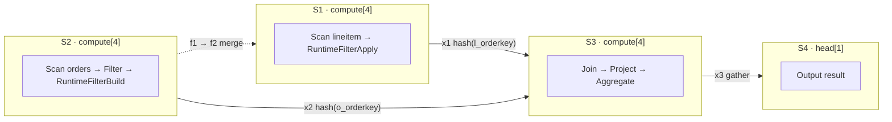
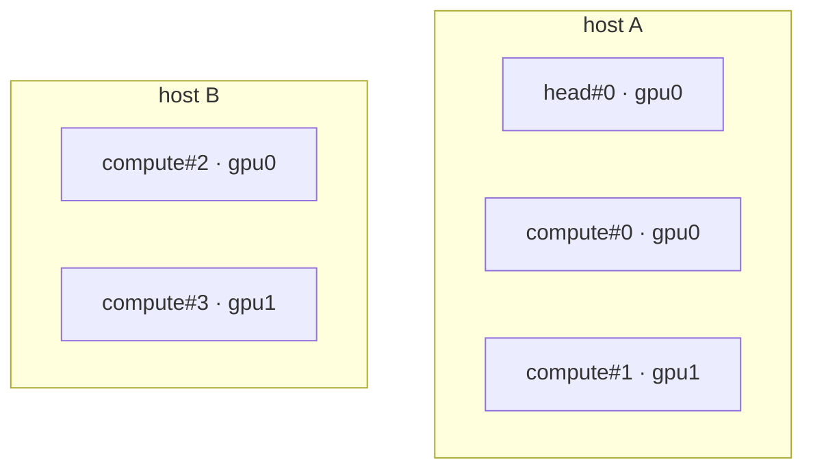
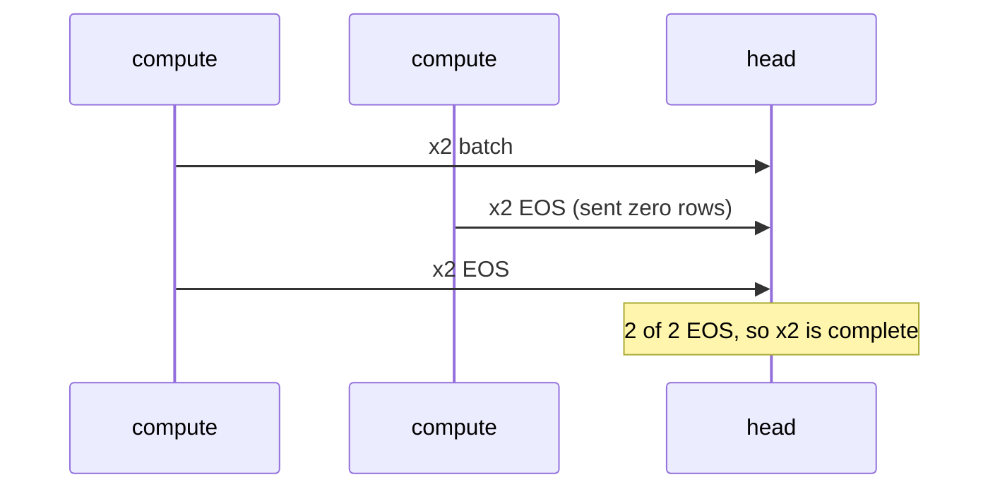

# Plan notation

Sirius gives you two views of the same plan:

- **text trees** (` ```text ` blocks, `explain()`) show every node with its parameters and
  value edges, for detail;
- **Mermaid diagrams** (` ```mermaid ` blocks, `to_mermaid()`) show stages, exchanges and value
  edges, for topology.

Both views are for people. The book's trees use the notation of `explain()`, and two printouts
from one build can be diffed. Neither output is a stable or parseable interface: spacing,
abbreviation and parameter order may change between releases, so do not parse the text, store it
as a key or compare it across releases. A program reads a plan through its accessors
(`fingerprint()`, `stages()`, `inputs()`, `worker_sets()` and the
[node view](api-at-a-glance.md#node-view)) and an error through its code and location.

The node vocabulary is in the [Node catalog](node-catalog.md).

## Text trees

### Header

Every tree starts with a header:

1. `Plan "<name>" (<form>)`, where the form is `joined`, `split`, `instance compute#2` or
   `resolved`. The name is the title set with
   `ExplainOptions::defaults().with_title("q2_pricing_summary")`. Without a title the header is
   `Plan (<form>)`.
2. `worker sets: head[1], compute[4]`, in declaration order. A sized set prints its size; an
   unsized set prints `[?]`, as in `worker sets: frag1[?], frag3[4]`. Only the hosting set of an
   instance plan can be unsized (see [Authored instance plans](#authored-instance-plans)).
3. Optionally `values:`, followed by one indented line per derived value (merged values, boundaries,
   decisions and assignments):

```text
values:
  f3 = ValueExchange merge f2 -> compute[4]
  d1 = Decide threshold(s2.bytes, at_most=64MiB) -> [broadcast, partitioned]
  b1 = ComputeBoundaries s2 -> compute[4]
  a1 = AssignPartitions balanced(s2) -> compute[4]
```

Value ids take a letter per kind: `f` for filters, `s` for statistics, `b` for boundaries, `d` for
decisions and `a` for assignments.

### Body

The body runs from the root down to the leaves.

- **Rails.** The glyphs are `├─ `, `│  ` and `└─ `, three columns per level. A join prints its
  left child first.
- **Node lines.** `NodeName [positional]  key=value  key=value`, with two spaces between groups.
- **Continuation lines.** A long line continues two columns past the node name, with the rails to
  its left.
- **Schemas** appear only when they matter, as a continuation line `-> (name type, ...)`. A
  nullable field prints `?` after its type, as in `-> (total_revenue sum_state<decimal(38,4)>?)`;
  a required field prints none. Types print as their factory is written, such as `int64`,
  `float32`, `decimal(15,2)` and `timestamp(us)`. `with_schemas(true)` prints the line under every
  node.
- **Expression types** print only under `with_expression_types(true)`. Every column reference,
  literal and operator or call result is followed by `:type`, with `?` when it is nullable. An
  operator result is parenthesized first, as in `(l_quantity:int64 < 24:int64):boolean`.
- **Shared subtrees.** `#A` marks the first occurrence of a shared node; later occurrences print
  `Ref #A` (rules: [Shared subplans](extension-points.md#shared-subplans)).

### Node lines by kind

| Node | Example line |
|---|---|
| Scan | `Scan lineitem [l_orderkey, l_shipdate]  on compute[4]  shards=files_round_robin` |
| Scan | `Scan lineitem [...]  on compute[1000]  shards=dynamic  manifest=3f9a1c2e (1000000 splits)` |
| Output | `Output "result" on head[1]` |
| Filter | `Filter l_shipdate <= 1998-09-02` |
| Project | `Project [l_orderkey, revenue = l_extendedprice * (1 - l_discount)]` |
| Aggregate | `Aggregate keys=[o_orderkey] measures=[revenue = sum(rev)]` (single phase) |
| Aggregate | `Aggregate partial keys=[...]`, `Aggregate combine`, `Aggregate final keys=[...]` |
| Aggregate | `Aggregate partial measures=[total_revenue = sum(revenue)]` (ungrouped: no `keys=`) |
| Aggregate | `Aggregate keys=[l_returnflag, l_linestatus] sets=[(l_returnflag, l_linestatus), (l_returnflag), ()] measures=[count_order = count_star()]` (grouping sets) |
| Join | `Join inner keys=[l_orderkey == o_orderkey] build=right  mode=co_partitioned(x1, x2)` |
| Join | `Join inner keys=[l_orderkey == o_orderkey] residual=(l_shipdate > o_orderdate) build=right  mode=single` |
| Join | `Join inner keys=[l_orderkey == o_orderkey] build=auto->right  mode=co_partitioned(x1, x2)` (prepared) |
| Join | `Join mark keys=[c_custkey == o_custkey] build=right  build_rows<~s2  mode=co_partitioned(x1, x2)` |
| Join | `Join left_anti keys=[c_custkey <=> o_custkey] build=right  mode=single` (null-safe pair) |
| Sort | `Sort [o_orderdate asc, o_totalprice desc]` |
| TopN | `TopN 10 [revenue desc, o_orderdate asc]` |
| TopN | `TopN 1 [o_orderdate desc, o_orderkey asc]  per=[o_custkey]` (per key) |
| Limit | `Limit 100` |
| Window | `Window whole keys=[o_custkey] measures=[customer_total = sum(o_totalprice)]` |
| Window | `Window ranking keys=[o_custkey] order=[o_totalprice desc] rankings=[price_rank = rank(), price_position = row_number()]` |
| Window | `Window running order=[o_orderdate asc, o_orderkey asc] measures=[orders_so_far = count_star()]` (no keys: no `keys=`) |
| Repeat | `Repeat count=copies` |
| Exchange | `Exchange x1 hash(l_orderkey) -> compute[4]` |
| Exchange | `Exchange x2 gather order=merge[l_returnflag asc, l_linestatus asc] -> head[1]` |
| Exchange | `Exchange x2 <~ d1 {broadcast: broadcast, partitioned: hash(o_orderkey)} -> compute[4]` |
| Exchange | `Exchange x1 range([o_orderdate asc, o_totalprice desc]) <~ b1 -> compute[4]` |
| Exchange | `Exchange x1 hash(o_custkey) partitions=16 assign=<~a1 -> compute[4]` |
| Exchange | `Exchange x3 gather -> head[1]  durability=spooled` |
| RuntimeFilterBuild | `RuntimeFilterBuild keys=[o_orderkey] spec=bloom(fixed 8MiB)  scope=partial ~> f1` |
| RuntimeFilterBuild | `RuntimeFilterBuild keys=[o_custkey] spec=bloom(fixed 8MiB) nulls=pass  scope=partial ~> f1` |
| RuntimeFilterApply | `RuntimeFilterApply [l_orderkey] <~ f2  wait=never` |
| Observe | `Observe bytes ~> s1`, `Observe partition_bytes(o_custkey, 16) ~> s1` |

The rules behind those lines:

- `on <set>[n]` appears only on leaves and on `Output`. Every other node runs on the set of its
  input, and an `Exchange` names its target with `-> compute[4]`. In split and instance form the
  stage header names the set, so `Output` prints without `on`. A scan keeps `on` in split form. In
  instance form it prints its files or splits in place of `on` and `shards=` (a `dynamic` scan
  keeps its joined line).
- Scans print the shard kind by its factory name: `shards=files_round_robin`,
  `shards=replicated`, `shards=dynamic`. In joined and split form the name stands for the
  per-worker split lists, which the plan stores when the scan is built; the
  [instance form](#instance-form) prints them. A `dynamic` scan has no lists until it runs. A scan
  over a split manifest adds the manifest's short digest and size, as in
  `shards=files_round_robin  manifest=3f9a1c2e (1000000 splits)`. A source's declared file sizes
  are not printed; the byte-range splits cut from them are, in the instance form.
- A scan can carry three more continuation lines: `pushed=l_shipdate <= 1998-09-02`, the predicate
  pushed by `rewrite::push_filters_into_scans`;
  `fused=[RuntimeFilterApply [l_orderkey] <~ f3  wait=up_to(20ms)]`, the applies the same rewrite
  fused into the scan; and `kind=duckdb.native`, the scan kind of a registered source.
- A join line shows `build=right` (or `build=left`) and the derived mode:
  `mode=co_partitioned(x1, x3)`, `mode=broadcast_build`, `mode=single` or `mode=decided(d1)`. A
  residual prints after the keys as `residual=(<expr>)`. A build row count
  (`JoinOptions::with_build_rows`) prints as `build_rows<~sN` between `build=` and `mode=`.
- A join key pair prints `==` when it is plain and `<=>` when it is null-safe.
- Grouping sets print after the keys of a single or partial aggregate, as
  `sets=[(l_returnflag, l_linestatus), (l_returnflag), ()]`, in grouping-id order: the first set
  has id 0. A renamed id column follows as `id=<name>`. A final lists the id column among its
  keys. A long list moves to a continuation line, before the measures.
- A per-key `TopN` prints its keys last, as `per=[o_custkey]`. With an empty order nothing stands
  between the count and `per=`: `TopN 1  per=[o_custkey]`.
- `NullKeys::pass` prints as `nulls=pass` after the spec of a `RuntimeFilterBuild`. The default,
  `discard`, is not printed.
- An `auto` property prints as `auto` in the plan you built and, in `prepared.plan()`, with the
  value prepare chose: a join built with `BuildSide::auto_` prints `build=auto`, then
  `build=auto->right` (rules: [Join](node-catalog.md#join)).
- A `Window` line names its form (`whole`, `ranking` or `running`), then `keys=[...]` if the node
  has keys, then `order=[...]` for the ranking and running forms, then `measures=[...]` or
  `rankings=[...]`. A long function list moves to a continuation line, as for `Aggregate`.
- A `Repeat` line names its count column, `count=copies`. The column is not in the node's output.
- A hash exchange prints its optional parameters before the target, where a gather prints its
  `order=`: non-default partitions as `partitions=64` or `partitions=<~d2`, assigned partitions as
  `partitions=16 assign=<~a1`, and `NullRouting::to_all` as `nulls=to_all`. Inside a decided
  exchange the parameter follows its alternative's mode:
  `{broadcast: broadcast, partitioned: hash(o_orderkey) partitions=<~d2}`.
- `durability=spooled` ends the line, after two spaces, in every form and on both the sink and
  the source: `Exchange x1 hash(l_orderkey) -> compute[4]  durability=spooled`,
  `ExchangeSource x1 partition=2/4 <- senders=[compute#0..3]  durability=spooled`. On a decided
  exchange it follows the target. Pipelined is the default and is not printed.
- A `Choose` prints its Decision and deliveries, `Choose <~ d1, d2`, and one child per arm in label
  order, each headed by its label: `├─ [on_head] Sort ...`. A subtree shared by the arms prints
  once, marked `#A`, in the first arm.
- **Value edges.** A producer line ends with `~> f1`; a consumer line contains `<~ f3`.
  `RuntimeFilterBuild` lines also show `scope=partial`, `scope=partition(x2)` or `scope=global`.
- **Expressions** are infix: equality is `==`, boolean operators are `and`, `or` and `not`, and a
  cast prints as `cast(l_quantity as float64)`. A call to a registered function prints its
  namespace, as in `spark.pmod(spark.hash(l_orderkey), 200)`.
- **Names and sort keys.** Named expressions are `name = expr` and measures are `name = sum(x)`.
  Sort keys are `[col asc, col desc]`. A key with `nulls_first()` prints `col asc nulls_first`;
  nulls last is the default and is not printed.
- **Literals** are bare (`1998-09-02`, `"BUILDING"`, `0.05`) and print their value, not their
  type: `5` may be any integer type, and the `1` in `1 - l_discount` is a `decimal(15,2)`, printed
  without trailing zeros. Nothing is converted implicitly, so the other operand, or the function's
  signature, gives the type. A boolean prints `true` or `false`, a null prints `null` whatever its
  type, and a timestamp prints as `1995-03-15T12:30:00`. A literal too long to print abbreviates
  to its type and logical size in angle brackets, as in `<binary 2MiB>` for a Bloom filter's bytes
  (the binary type is still a gap; see [Plans from other systems](../part-4/05-plans-from-other-systems.md#gaps)).

### Joined form

This is Q2 (pricing summary) from [Aggregation](../part-3/02-aggregation.md). The continuation
lines under `Aggregate partial` hold the measures, then the schema with its state types.

```text
Plan "q2_pricing_summary" (joined)
worker sets: head[1], compute[4]
Output "result" on head[1]
└─ Exchange x2 gather order=merge[l_returnflag asc, l_linestatus asc] -> head[1]
   └─ Sort [l_returnflag asc, l_linestatus asc]
      └─ Aggregate final keys=[l_returnflag, l_linestatus]
         └─ Exchange x1 hash(l_returnflag, l_linestatus) -> compute[4]
            └─ Aggregate partial keys=[l_returnflag, l_linestatus]
               │  measures=[sum_qty = sum(l_quantity), sum_revenue = sum(revenue),
               │            avg_price = avg(l_extendedprice), count_order = count_star()]
               │  -> (l_returnflag string, l_linestatus string, sum_qty sum_state<decimal(38,2)>,
               │      sum_revenue sum_state<decimal(38,4)>, avg_price avg_state<decimal(15,2)>,
               │      count_order count_state)
               └─ Project [l_returnflag, l_linestatus, l_quantity, l_extendedprice,
                  │        revenue = l_extendedprice * (1 - l_discount)]
                  └─ Filter l_shipdate <= 1998-09-02
                     └─ Scan lineitem [l_returnflag, l_linestatus, l_quantity, l_extendedprice,
                                       l_discount, l_shipdate]  on compute[4]  shards=files_round_robin
```

Q4 (urgent March revenue) from
[Partitioned join and runtime filters](../part-3/04-partitioned-join-and-runtime-filters.md) has
value edges, so its header has a `values:` block. It builds `f1` on the orders side, merges it
into `f2`, and applies `f2` to the lineitem scan:

```text
Plan "q4_urgent_march_revenue" (joined)
worker sets: head[1], compute[4]
values:
  f2 = ValueExchange merge f1 -> compute[4]
Output "result" on head[1]
└─ Exchange x3 gather -> head[1]
   └─ Aggregate keys=[o_orderkey, o_orderdate] measures=[revenue = sum(rev)]
      └─ Project [o_orderkey, o_orderdate, rev = l_extendedprice * (1 - l_discount)]
         └─ Join inner keys=[l_orderkey == o_orderkey] build=right  mode=co_partitioned(x1, x2)
            ├─ Exchange x1 hash(l_orderkey) -> compute[4]
            │  └─ RuntimeFilterApply [l_orderkey] <~ f2  wait=never
            │     └─ Scan lineitem [l_orderkey, l_extendedprice, l_discount]  on compute[4]  shards=files_round_robin
            └─ Exchange x2 hash(o_orderkey) -> compute[4]
               └─ RuntimeFilterBuild keys=[o_orderkey] spec=bloom(fixed 8MiB)  scope=partial ~> f1
                  └─ Filter o_orderdate >= 1995-03-01 and o_orderdate < 1995-04-01 and o_orderpriority == "1-URGENT"
                     └─ Scan orders [o_orderkey, o_orderdate, o_orderpriority]  on compute[4]  shards=files_round_robin
```

In this excerpt, one shared scan feeds both arms of a union:

```text
Union
├─ Filter o_orderstatus == "F"
│  └─ Scan orders [o_orderkey, o_orderstatus]  on compute[4]  shards=files_round_robin  #A
└─ Filter o_orderstatus == "O"
   └─ Ref #A
```

### Split form

`rewrite::split` cuts the plan at every exchange. The split form prints one block per stage:

- Each block is headed `Stage S<k> on <set>[n]`. Stages print in id order, the root stage last.
- The block's root is its sink, which names the receiving stage and its workers:
  `ExchangeSink x1 hash(l_orderkey) -> S3 [compute#0..3]`.
- Sources print `ExchangeSource x1 <- S1 senders=[compute#0..3]`.
- A block may open with a `values:` sub-block listing `ValueSink f2 merge -> S1` and
  `ValueSource f3 = merge f2 <- S3 senders=[compute#0..3]`.
- In an open stage plan the far side is not a stage of this plan, so it prints as its worker set:
  `ExchangeSource x11 <- frag1[4] senders=[frag1#0..3]`,
  `ExchangeSink x13 gather -> frag0[1] [frag0#0]` and `ValueSink f21 merge -> frag1[4]`.
  [Stages and bindings](../part-2/04-stages-and-bindings.md#open-plans-authoring-stages-and-instances-directly)
  authors one.

Q2 in split form (`...` abbreviates lines shown in full above):

```text
Plan "q2_pricing_summary" (split)
worker sets: head[1], compute[4]
Stage S1 on compute[4]
ExchangeSink x1 hash(l_returnflag, l_linestatus) -> S2 [compute#0..3]
└─ Aggregate partial keys=[l_returnflag, l_linestatus] ...
   └─ Project ...
      └─ Filter l_shipdate <= 1998-09-02
         └─ Scan lineitem ...  on compute[4]  shards=files_round_robin
Stage S2 on compute[4]
ExchangeSink x2 gather order=merge[l_returnflag asc, l_linestatus asc] -> S3 [head#0]
└─ Sort [l_returnflag asc, l_linestatus asc]
   └─ Aggregate final keys=[l_returnflag, l_linestatus]
      └─ ExchangeSource x1 <- S1 senders=[compute#0..3]
Stage S3 on head[1]
Output "result"
└─ ExchangeSource x2 <- S2 senders=[compute#0..3]
```

The first two stages of Q4 show the `values:` sub-blocks. S2 sends its filter shares to S1, which
merges them and applies the result:

```text
Stage S1 on compute[4]
values:
  ValueSource f2 = merge f1 <- S2 senders=[compute#0..3]
ExchangeSink x1 hash(l_orderkey) -> S3 [compute#0..3]
└─ RuntimeFilterApply [l_orderkey] <~ f2  wait=never
   └─ Scan lineitem [l_orderkey, l_extendedprice, l_discount]  on compute[4]  shards=files_round_robin
Stage S2 on compute[4]
values:
  ValueSink f1 merge -> S1
ExchangeSink x2 hash(o_orderkey) -> S3 [compute#0..3]
└─ RuntimeFilterBuild keys=[o_orderkey] spec=bloom(fixed 8MiB)  scope=partial ~> f1
   └─ Filter o_orderdate >= 1995-03-01 and o_orderdate < 1995-04-01 and o_orderpriority == "1-URGENT"
      └─ Scan orders [o_orderkey, o_orderdate, o_orderpriority]  on compute[4]  shards=files_round_robin
```

### Instance form

`rewrite::instance` (or `ExplainOptions::instance(worker)`) shows the stages one worker hosts.

- Blocks are headed `Stage S<k> instance compute#2`.
- Sinks print their concrete destinations: `-> [head#0]`, or
  `partitions->workers {0:#0, 1:#1, 2:#2, 3:#3}` for a hash exchange.
- Sources print the partitions this worker receives, `partition=2/4` (or
  `partitions=[2, 6, ..., 62] (16 of 64)`), and `<- senders=[...]`.
- Scans print their concrete files, the first few and the last:
  `files=[2, 6, 10, ..., 254] (64 of 256)`.
- A scan that reads byte ranges, or one built with `Shards::splits`, prints its splits instead. A
  split is a file, or a file and a byte range `[start, end)`:
  `splits=[lineitem/07.parquet[0, 256MiB), lineitem/07.parquet[256MiB, 512MiB), lineitem/19.parquet] (3 splits)`.
  Long lists abbreviate like file lists and end with `(N splits)`.
- A scan over a split manifest prints that worker's slice as indices into the manifest:
  `manifest=3f9a1c2e  splits=[2, 1002, 2002, ..., 999002] (1000 of 1000000)`. A `dynamic` scan
  prints the same line as in joined form, because no worker's splits are known until it runs.

Q2 on `compute#2`:

```text
Plan "q2_pricing_summary" (instance compute#2)
worker sets: head[1], compute[4]
Stage S1 instance compute#2
ExchangeSink x1 hash(l_returnflag, l_linestatus)  partitions->workers {0:#0, 1:#1, 2:#2, 3:#3}
└─ Aggregate partial keys=[l_returnflag, l_linestatus] ...
   └─ Project ...
      └─ Filter l_shipdate <= 1998-09-02
         └─ Scan lineitem ...  files=[2, 6, 10, ..., 254] (64 of 256)
Stage S2 instance compute#2
ExchangeSink x2 gather order=merge[l_returnflag asc, l_linestatus asc] -> [head#0]
└─ Sort [l_returnflag asc, l_linestatus asc]
   └─ Aggregate final keys=[l_returnflag, l_linestatus]
      └─ ExchangeSource x1 partition=2/4 <- senders=[compute#0..3]
```

### Authored instance plans

An instance plan authored with `Plan::create_instance`
([Instance plans](../part-2/04-stages-and-bindings.md#instance-plans)) prints like
`rewrite::instance` output, with the form `instance frag1#2`. Two things appear only here:

- The hosting set may be unsized, `frag1[?]`, when nothing in the plan depends on its size.
- In an open instance plan, a sink names its far-side set before its destinations:
  `ExchangeSink x11 hash(l_orderkey) -> frag3[4]  partitions->workers {0:#0, 1:#1, 2:#2, 3:#3}`.

This is instance 2 of the lineitem fragment of Q4 under StarRocks, from
[Under someone else's scheduler: StarRocks](../part-4/02-starrocks.md). It only scans and sends,
so its hosting set is unsized, and its scan reads the splits the host assigned with
`Shards::splits`:

```text
Plan "q4_frag1" (instance frag1#2)
worker sets: frag1[?], frag3[4]
Stage S11 instance frag1#2
values:
  ValueSource f22 = merge f21 <- senders=[frag3#0..3]
ExchangeSink x11 hash(l_orderkey) -> frag3[4]  partitions->workers {0:#0, 1:#1, 2:#2, 3:#3}
└─ RuntimeFilterApply [l_orderkey] <~ f22  wait=up_to(30s)
   └─ Scan lineitem [l_orderkey, l_extendedprice, l_discount]
                    splits=[lineitem/07.parquet[0, 256MiB), lineitem/07.parquet[256MiB, 512MiB), lineitem/19.parquet] (3 splits)
```

The join fragment receives two hash exchanges, so its plan depends on the size of its own set and
every set is sized. Instance 2 of it has `worker sets: frag0[1], frag1[4], frag2[4], frag3[4]` and
reads `ExchangeSource x11 partition=2/4 <- senders=[frag1#0..3]`.

### Resolved form

`report.resolved_plan()` prints with the form `resolved`: each decided exchange is replaced by the
alternative its Decision chose, each `Choose` by the arm it chose, and decided partition counts
print as numbers. The `values:` block lists each decision with the label it chose, as
`d1 = broadcast (resolved)`. The rest reads as in the joined form. Q5 (one day's revenue) from
[Adaptive plans](../part-2/06-adaptive-plans.md), after `d1` chose `broadcast`:

```text
Plan "q5_day_revenue" (resolved)
worker sets: head[1], compute[4]
values:
  s2 = ValueExchange merge s1 -> compute[4]
  d1 = broadcast (resolved)
Output "result" on head[1]
└─ Aggregate final keys=[o_orderkey, o_orderdate]
   └─ Exchange x3 gather -> head[1]
      └─ Aggregate partial keys=[o_orderkey, o_orderdate] measures=[revenue = sum(rev)]
         └─ Project [o_orderkey, o_orderdate, rev = l_extendedprice * (1 - l_discount)]
            └─ Join inner keys=[l_orderkey == o_orderkey] build=right  mode=broadcast_build
               ├─ Exchange x1 forward -> compute[4]
               │  └─ Scan lineitem [l_orderkey, l_extendedprice, l_discount]  on compute[4]  shards=files_round_robin
               └─ Exchange x2 broadcast -> compute[4]
                  └─ Observe bytes ~> s1
                     └─ Filter o_orderdate == 1995-03-15
                        └─ Scan orders [o_orderkey, o_orderdate]  on compute[4]  shards=files_round_robin
```

`x1` became `forward` and `x2` became `broadcast`, so the join mode is `broadcast_build`.

The resolved form substitutes two more run-time choices:

- An assignment prints its map, abbreviated like a file list, in the `values:` block,
  `a1 = {0:#0, 1:#1, 2:#2, 3:#3, 4:#1, ..., 15:#3} (resolved)`, and on each exchange that uses it,
  `partitions=16 assign={0:#0, 1:#1, ..., 15:#3}`. A delivered assignment, such as
  `a2 = ValueExchange merge a1`, prints the same map.
- A `dynamic` scan becomes `shards=explicit_splits (resolved from dynamic)`, whose instance form
  lists the splits that worker claimed.

### Bound plans

A plan never contains endpoints (rule 4,
[Bindings: where, never what](../part-2/04-stages-and-bindings.md#bindings-where-never-what)). When
the book shows a plan with its bindings, it lists them in a `binding:` block under the plan, one
`worker -> endpoint` line per worker, with endpoints written `<host>/<device>`. Q7 (shipping
priority) on two hosts with two GPUs each, from
[Sirius on its own: Distributed Sirius](../part-4/03-distributed-sirius.md) (`...` stands for the
plan body):

```text
Plan "q7_shipping_priority" (joined)
worker sets: head[1], compute[4]
...
binding:
  compute#0 -> hostA/gpu0
  compute#1 -> hostA/gpu1
  compute#2 -> hostB/gpu0
  compute#3 -> hostB/gpu1
  head#0    -> hostA/gpu0
```

After a retry moves a worker, the block header carries the binding epoch, as in
`binding epoch=1:`. A block without an epoch is epoch 0 (see
[Failure, cancellation and recovery](../part-5/07-failure-cancellation-and-recovery.md#binding-epochs)).

### Engine pipelines

Part V also shows the engine pipelines a stage lowers to, always labelled *illustrative* because
pipelines belong to the engine, not to the plan. A pipeline is a bracketed list of `UPPER_CASE`
engine operators; an edge between pipelines carries its barrier kind:

```text
[GPU_SCAN, FILTER, PROJECTION, HASH_GROUP_BY] -PARTIAL-> [PARTITION]
```

This is stage S1 of Q2 as the explicit plan lowers it. Today's engine puts a `FULL` barrier in
front of `PARTITION` instead (see
[From plan to pipelines](../part-5/01-from-plan-to-pipelines.md)).

## Mermaid diagrams

Diagrams show topology, never node detail.

- `flowchart LR` for stage graphs; `flowchart TB` for API object flows and worker-to-endpoint maps;
  `sequenceDiagram` only for protocol timelines.
- One `subgraph` per stage, with id `S1` and label `"S1 · compute[4]"`. Inside it, one node
  summarizes the chain with `→`: `S1n["Scan lineitem → Filter → Aggregate partial"]`.
- Data edges are solid and labelled with the exchange: `S1 -->|"x1 hash(l_returnflag, l_linestatus)"| S2`.
- Value edges are dotted and labelled with ids: `S2 -.->|"f1 → f2 merge"| S1`.
- Worker maps use nodes `c0..c3` and `h0` inside host subgraphs `"host A"` and `"host B"`.
- No colors, no `classDef`, every label quoted, and at most about 12 nodes.

The Q4 stage graph:



A worker map for the cluster deployment of the running example, where `head#0` shares a GPU with
`compute#0`:



A protocol timeline: two senders gather to `head#0`. The receiver is complete after one end of
stream from each sender, including a sender that had no rows:



## Naming

[Conventions](../conventions.md#naming) has the naming rules for IR nodes, public types, engine
operators and internals, workers, worker sets and queries. The notation adds three:

- A range of workers is written `compute#0..3`.
- Registered items print as `namespace.name` (`kind=duckdb.native`); built-in ones print without a
  namespace. Versions are never printed; they live in the fingerprint and edge signatures.
- Message keys appear in prose only, never in a tree, written in field order:
  `(E, 0, 0, x1, compute#0, compute#2, 17)` is execution E, attempt 0, epoch 0, exchange `x1`,
  sender `compute#0`, receiver `compute#2`, sequence 17.

## Code pairs

Every key example appears in both languages: a ` ```cpp ` block followed directly by a
` ```rust ` block. The only block longer than 25 lines is the Q7 builder in
[A multi-stage query](../part-3/07-a-multi-stage-query.md). The other rules are in
[Code comes in pairs](../conventions.md#code-comes-in-pairs).

```cpp
SIRIUS_TRY(scan, Relation::scan(nation, ScanOptions::defaults()));
SIRIUS_TRY(key, scan.column("n_nationkey"));
SIRIUS_TRY(small, key.lt(Expression::literal(Value::int32(5))));
SIRIUS_TRY(filtered, scan.filter(small));
```

```rust
let scan = Relation::scan(&nation, ScanOptions::default())?;
let key = scan.column("n_nationkey")?;
let small = key.lt(&Expression::literal(Value::int32(5)))?;
let filtered = scan.filter(&small)?;
```
